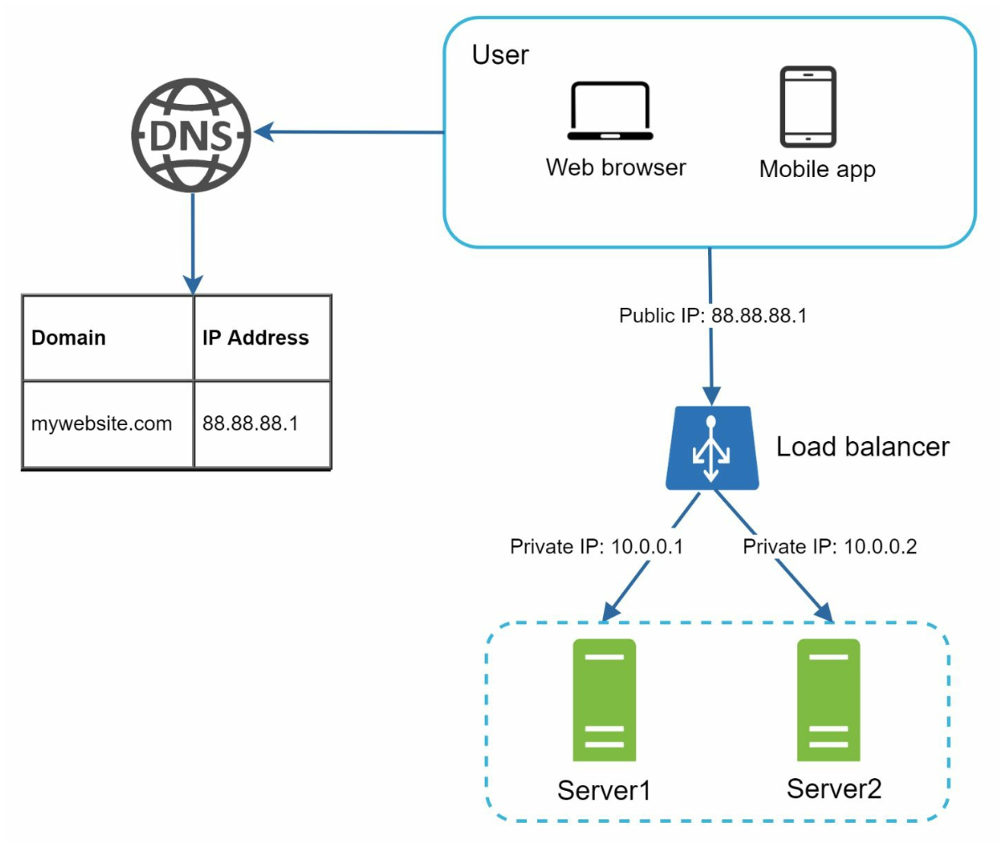
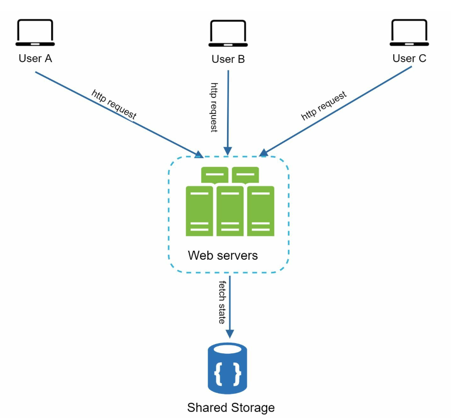
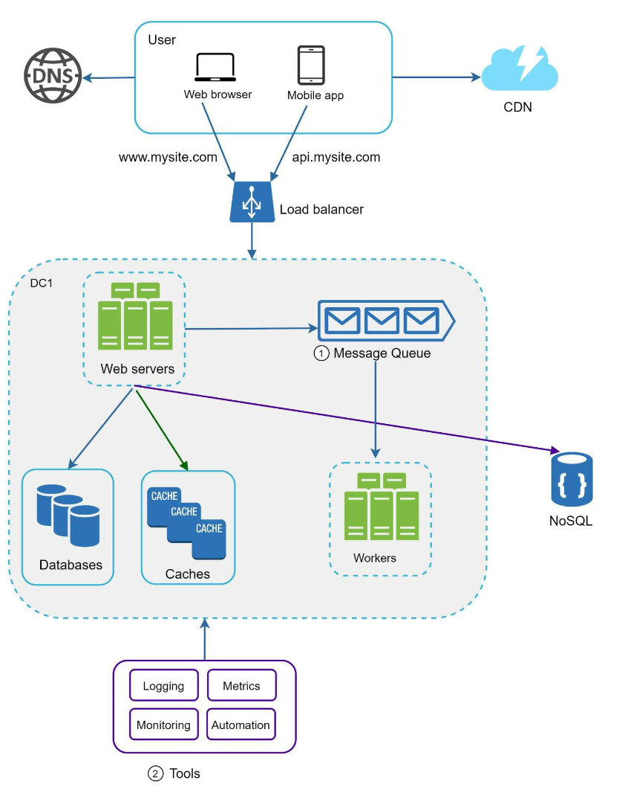
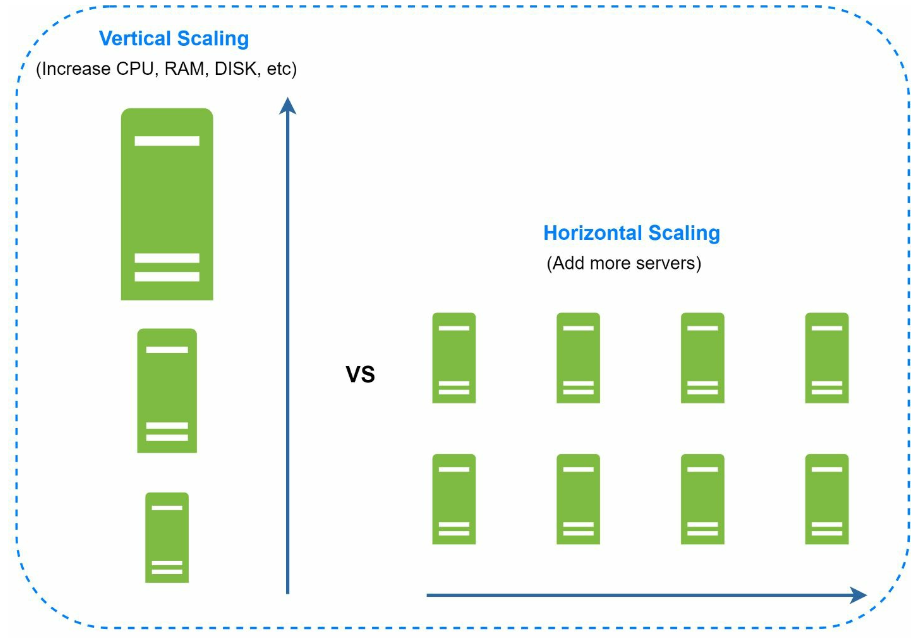

# 1장: 사용자 수에 따른 규모 확장성

## 소개
수백만 사용자를 지원하도록 시스템 규모를 확장하는 일은 끊임없는 개선과 최적화가 필요한, 복잡하고 반복적인 여정이다. 이 장에서는 단일 서버 구성에서 출발해 수백만 사용자를 감당할 수 있도록 아키텍처를 단계적으로 확장하는 방법을 살펴본다.

---

## 1절: 단일 서버
처음에는 모든 구성 요소(웹 앱, 데이터베이스, 캐시)가 서버 한 대에서 실행된다.

   

### 요청 흐름
1. 사용자는 도메인 이름(예: `api.mysite.com`)으로 애플리케이션에 접속하며, 도메인 이름은 DNS를 통해 IP 주소로 변환된다.
2. 웹 서버의 IP 주소가 브라우저나 모바일 앱에 반환된다.
3. HTTP 요청이 웹 서버로 전달되고, 웹 서버는 HTML 또는 JSON 응답을 반환한다.

### 트래픽 출처
1. **웹 애플리케이션:** 비즈니스 로직에는 서버 측 언어(예: Python, Java)를, 화면 표시에는 클라이언트 측 언어(예: JavaScript, HTML)를 사용한다.
2. **모바일 애플리케이션:** 가벼운 데이터 교환을 위해 HTTP와 JSON으로 웹 서버와 통신한다.

---

## 2절: 데이터베이스 분리
사용자가 늘어나면 데이터베이스를 전용 서버로 옮겨 웹 계층과 데이터베이스 계층을 독립적으로 확장할 수 있게 한다.

   

### 데이터베이스 선택

1. **관계형 데이터베이스(SQL):** 구조화된 데이터를 테이블에 저장한다. 예: MySQL, PostgreSQL.
2. **비관계형 데이터베이스(NoSQL):** 비정형 데이터나 낮은 지연 시간이 필요한 경우에 적합하다. 다음과 같은 종류가 있다.
   - 키-값 저장소(key-value store)
   - 그래프 데이터베이스(graph database)
   - 칼럼 저장소(column store)
   - 문서 저장소(document store)

- 다음과 같은 경우라면 비관계형 데이터베이스가 바람직한 선택일 수 있다.
   - 애플리케이션이 아주 낮은 지연 시간을 요구하는 경우
   - 데이터가 비정형이거나 관계형 데이터가 아닌 경우
   - 데이터를 직렬화·역직렬화(JSON, XML, YAML 등)하기만 하면 되는 경우
   - 아주 많은 양의 데이터를 저장해야 하는 경우

---

## 3절: 수직적 규모 확장 vs 수평적 규모 확장
### 수직적 규모 확장(vertical scaling)
- 기존 서버에 자원(CPU, RAM)을 더 추가한다.
- 하드웨어의 한계에 묶이며 다중화(redundancy)를 제공하지 못한다.

### 수평적 규모 확장(horizontal scaling)
- 서버 풀에 서버를 더 추가하므로 대규모 시스템에 더 적합하다.
- 서버 간 요청 분배는 로드밸런서가 맡는다.
---

## 4절: 로드밸런서

   

**로드밸런서(load balancer)** 는 여러 서버에 트래픽을 고르게 분산한다. 장점은 다음과 같다.
1. 다중화: 서버 하나가 다운되면 트래픽을 다른 서버로 우회시킨다.
   -  서버 1이 다운되면 모든 트래픽은 서버 2로 전달된다.
2. 규모 확장성: 트래픽 급증에 대응해 서버를 쉽게 추가할 수 있다.
   -  웹사이트 트래픽이 빠르게 늘면 서버를 더 추가해 늘어난 트래픽을 처리하면 된다.

---

## 5절: 데이터베이스 다중화

   

### 주-부(master-slave) 모델
- **주 데이터베이스(master):** 쓰기 연산을 처리한다.
   - insert, delete, update처럼 데이터를 변경하는 명령은 모두 주 데이터베이스로 보내야 한다.
- **부 데이터베이스(slave):** 읽기 연산을 처리해 성능과 안정성을 높인다.
   - 대부분의 애플리케이션은 쓰기보다 읽기 비율이 훨씬 높으므로, 보통 부 데이터베이스 수가 주 데이터베이스 수보다 많다.

### 장점
1. 읽기 연산을 병렬로 처리하므로 성능이 좋아진다.
2. 다중화를 통해 높은 가용성과 데이터 안정성을 확보한다.

### 장애 처리
- 부 데이터베이스가 한 대뿐인데 그 서버가 다운되면, 읽기 연산은 일시적으로 주 데이터베이스로 전달된다.
- 부 데이터베이스가 여러 대라면 읽기 연산은 정상 동작하는 다른 부 데이터베이스로 분산되고, 장애가 난 서버는 새 서버로 교체된다.
-  주 데이터베이스가 다운되면 부 데이터베이스 하나가 새 주 데이터베이스로 승격된다.
- 실제 운영 환경에서는 승격된 부 데이터베이스의 데이터가 최신 상태가 아닐 수 있으므로, 데이터 복구 스크립트를 돌려 누락된 데이터를 반영해야 한다(다중 마스터(multi-master)나 원형 다중화(circular replication) 같은 방식이 도움이 될 수 있다).

---

## 6절: 캐시
**캐시(cache)** 는 자주 접근하는 데이터를 메모리에 저장해 데이터베이스 부하를 줄인다. 캐시 계층은 데이터베이스보다 훨씬 빠른 임시 데이터 저장 계층이다.

   

### 캐시 사용 시 고려 사항
1. **사용 시점**: 데이터를 자주 읽지만 수정은 드물게 일어날 때 캐시 사용을 고려한다.
2. **만료 정책(expiration policy):** 만료된 데이터는 캐시에서 삭제된다. 만료 정책이 없으면 캐시된 데이터가 메모리에 영원히 남는다.
3. **일관성(consistency):** 저장소의 원본과 캐시 사본을 동기화된 상태로 유지하는 것을 뜻한다. 저장소와 캐시를 변경하는 연산이 하나의 트랜잭션으로 처리되지 않으면 불일치가 생길 수 있다.
4. **장애 대처**: 캐시 서버를 한 대만 두면 단일 장애 지점(SPOF)이 될 수 있으므로, 여러 데이터 센터에 캐시 서버를 분산하는 것이 좋다.
5. **방출 정책(eviction policy):** 캐시가 가득 차면 항목을 내보내 메모리를 확보해야 한다. 가장 널리 쓰이는 방출 정책은 LRU다.

---

## 7절: 콘텐츠 전송 네트워크(CDN)
**CDN** 은 정적 콘텐츠(이미지, CSS, JavaScript)를 지리적으로 분산된 서버에 캐시해 로딩 시간을 줄인다.

   

### 동작 흐름
1. 사용자는 가장 가까운 CDN 서버에 콘텐츠를 요청한다.
2. CDN 서버에 콘텐츠가 없으면 원본(origin) 서버에서 가져와 캐시한다.

### CDN 사용 시 고려 사항
1. **비용:** CDN은 제3자 사업자가 운영하며, CDN으로 들어오고 나가는 데이터 전송량에 따라 요금을 부과한다.
2. **캐시 만료 시간:** 만료 시간은 너무 길지도 너무 짧지도 않게 정해야 한다.
3. **CDN 장애 대처:** CDN에 일시적으로 장애가 나면, 클라이언트가 이를 감지해 원본 서버에서 자원을 가져올 수 있어야 한다.
4. **콘텐츠 무효화:** 파일이 갱신되면 캐시를 무효화해 갱신된 파일을 가리키게 해야 한다.

---

## 8절: 무상태(stateless) 웹 계층
세션 데이터를 공유 저장소로 옮기면 웹 서버가 무상태가 된다. 그러면 다음이 가능해진다.
1. 수평적 규모 확장이 쉬워진다.
2. 트래픽에 따라 자동으로 규모를 확장(auto-scaling)할 수 있다.

   

---

## 9절: 다중 데이터 센터
여러 데이터 센터에 배포하면 가용성이 높아지고 지연 시간이 줄어든다. 다음과 같은 전략을 쓴다.

   

1. **지리적 라우팅(GeoDNS):** 사용자를 가장 가까운 데이터 센터로 안내한다.
2. **데이터 다중화:** 데이터 센터 간 데이터를 동기화해 불일치를 막는다.

### 핵심 고려 사항
- **트래픽 우회:** 트래픽을 올바른 데이터 센터로 보낼 효과적인 방법이 필요하다.
- **데이터 동기화:** 흔히 쓰는 전략은 데이터를 여러 데이터 센터에 다중화하는 것이다.
- **테스트와 배포:** 모든 데이터 센터에서 서비스를 일관되게 유지하려면 자동화된 배포 도구가 꼭 필요하다.

---

## 10절: 메시지 큐
**메시지 큐(message queue)** 는 메모리에 저장되는 내구성 있는 컴포넌트로, 비동기 통신을 지원한다. 메시지 버퍼 역할을 하며 비동기 요청을 분배한다.

   

- 생산자(producer) 또는 발행자(publisher)라고 부르는 입력 서비스가 메시지를 만들어 메시지 큐에 발행한다.
- 소비자(consumer) 또는 구독자(subscriber)라고 부르는 서비스가 큐에 연결해 메시지에 정의된 작업을 수행한다.

---

## 11절: 로그, 지표, 자동화

   

### 중요성
1. **로그:** 오류와 시스템 상태를 추적한다.
2. **지표(metrics):** 성능과 사용자 활동에 대한 통찰을 제공한다.
3. **자동화:** 테스트, 배포, 규모 확장을 효율적으로 만든다.

---

## 12절: 데이터베이스 규모 확장
### 수직적 확장
- 하드웨어 자원을 추가하지만 물리적 한계와 비용 한계가 있다.
- 여러 단점이 있다.
   -  단일 장애 지점(SPOF)으로 인한 위험이 크다.
   -  전체 비용이 많이 든다.

### 수평적 확장(샤딩)

   

- 키(예: `user_id`)를 기준으로 데이터를 여러 샤드에 나눈다.
   - 샤딩(sharding)은 큰 데이터베이스를 관리하기 쉬운 작은 단위인 샤드(shard)로 분할하는 기술이다.
   - 모든 샤드는 같은 스키마를 쓰지만, 각 샤드에 저장되는 데이터는 서로 겹치지 않는다.
-  샤딩 전략을 구현할 때는 샤드 키(sharding key) 선정이 매우 중요하다. 데이터를 고르게 분산할 수 있는 키를 골라야 한다.

#### 해결해야 할 문제
1. **데이터 재샤딩(resharding):** 다음과 같은 경우 재샤딩이 필요하다.
   - 데이터가 너무 빨리 늘어나 샤드 하나로는 더 이상 감당할 수 없을 때
   - 데이터 분포가 고르지 않아 일부 샤드가 다른 샤드보다 빨리 소진될 때
   - 이런 문제는 안정 해시(consistent hashing)로 해결한다.

2. **유명인(celebrity) 문제:** 특정 샤드에 질의가 집중되면 서버에 과부하가 걸릴 수 있다.
   - 이 문제를 풀려면 유명인마다 샤드를 하나씩 할당해야 할 수도 있다.

3. **조인과 비정규화:** 데이터베이스를 여러 서버로 샤딩하고 나면 샤드를 넘나드는 조인 연산이 어려워진다.
   -  흔한 해결책은 데이터베이스를 비정규화해 하나의 테이블에서 질의할 수 있게 하는 것이다.

---

## 마무리
### 핵심 정리
1. 웹 계층은 무상태로 유지한다.
2. 모든 계층에 다중화를 도입한다.
3. 캐시와 CDN으로 성능을 최적화한다.
4. 데이터 계층은 샤딩으로 확장한다.
5. 컴포넌트를 분리해 유연성을 높인다.

이 장의 내용은 수백만 사용자를 감당할 수 있는 확장 가능한 시스템을 만드는 탄탄한 기반이 된다.

