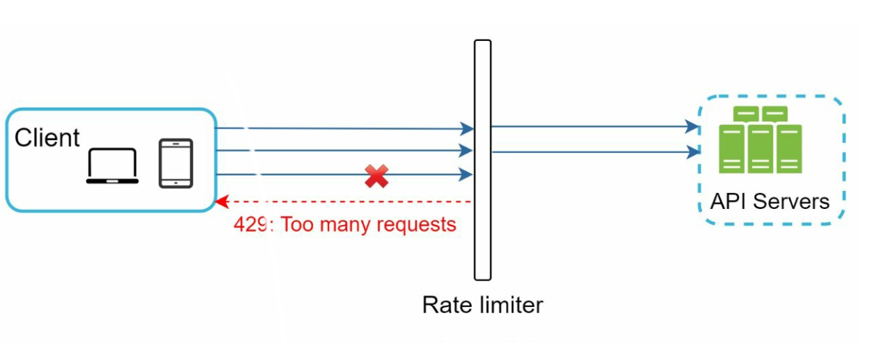
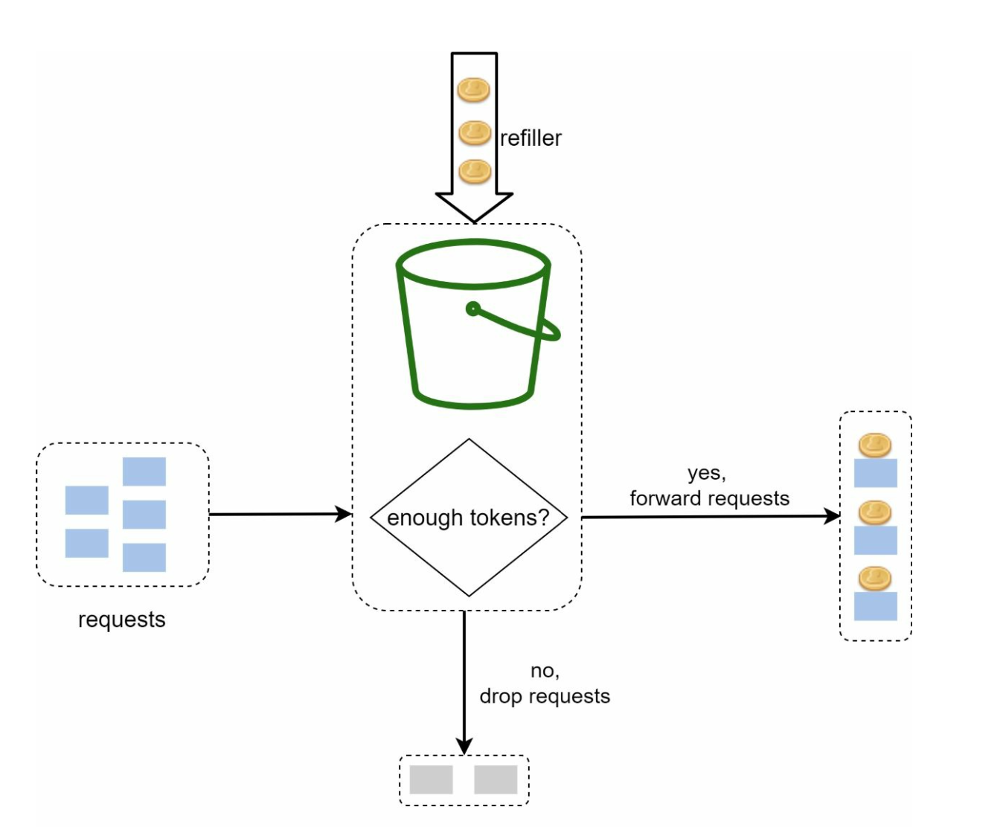
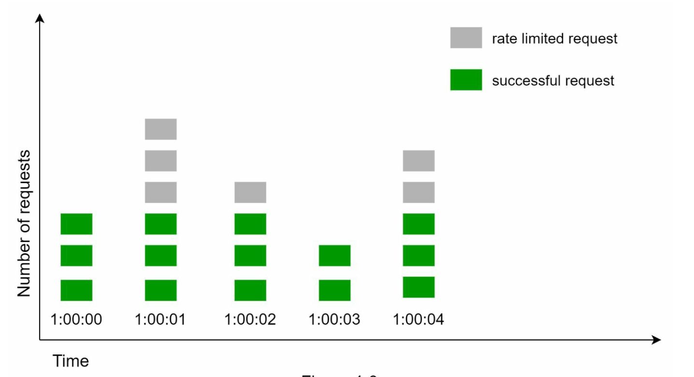
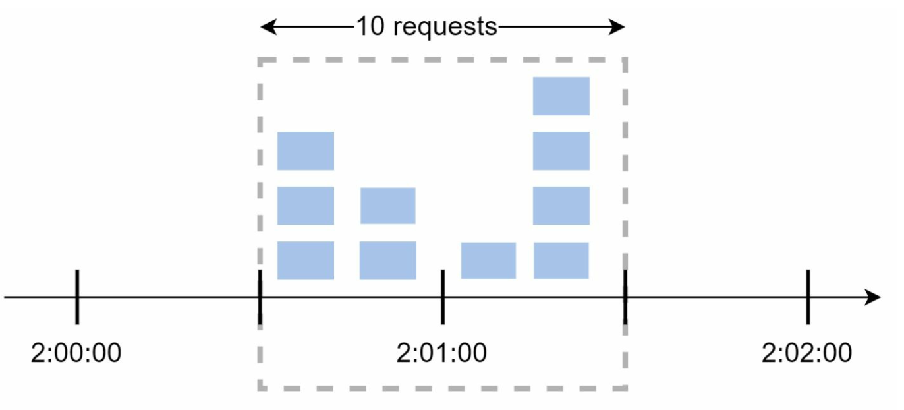
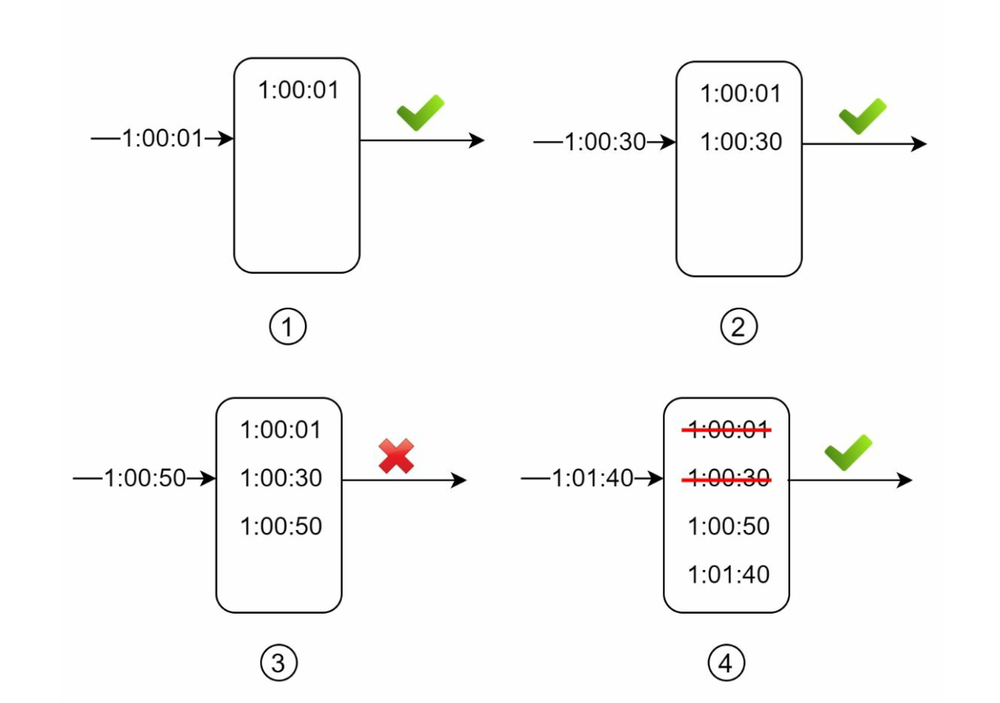

# 4장: 처리율 제한 장치 설계

## 소개
이 장에서는 처리율 제한 장치(rate limiter)의 설계와 구현을 살펴본다. 처리율 제한 장치는 클라이언트나 서비스가 보내는 트래픽의 처리율을 제어하는 시스템 컴포넌트다. 악용 방지, 비용 절감, 서버 자원의 안정성 확보에 꼭 필요하다. 게시물 작성, 계정 생성, 보상 수령 횟수를 제한하는 것이 대표적인 사용 예다.

## 처리율 제한의 이점
- **DoS 공격 방지:** 과도한 호출을 차단해 자원 고갈을 막는다.
- **비용 절감:** 불필요한 요청을 제한해 서버 비용을 줄인다.
- **과부하 방지:** 과도한 요청을 걸러 내 서버 성능을 안정적으로 유지한다.

## 1단계: 문제 이해
### 핵심 기능
- 서버 측 API 처리율 제한 장치
- 다양한 제어 규칙(throttle rule) 지원
- 분산 환경의 대규모 시스템 처리
- 독립 서비스로 둘지, 애플리케이션 코드에 포함할지 선택 가능
- 요청이 제한되면 사용자에게 알림

### 요구 사항
- 요청을 정확하게 제한
- 짧은 지연 시간
- 적은 메모리 사용
- 분산 환경 지원
- 명확한 예외 처리
- 높은 결함 감내성(fault tolerance)

## 2단계: 개략적인 설계
### 배치 위치

    

1. **클라이언트 측 구현:** 악용될 수 있어 신뢰하기 어렵다.
2. **서버 측 구현:** 통제와 신뢰성 측면에서 선호된다.
3. **미들웨어(API 게이트웨이):** 처리율 제한을 통합할 수 있는 유연한 선택지다.

### 배치 지침
- 현재 기술 스택을 점검하고 효율적인 방법을 고른다.
- 비즈니스 요구에 맞는 알고리즘을 선택한다.
- 마이크로서비스를 쓰고 있다면 API 게이트웨이를 활용한다.
- 자원이 부족하다면 상용 솔루션을 고려한다.

## 3단계: 처리율 제한 알고리즘
### 1. 토큰 버킷(token bucket)

  

- **설명:** 정해진 속도로 버킷에 토큰을 채우고, 요청마다 토큰을 하나씩 소비한다.
- **인자:** 버킷 크기, 토큰 공급률(refill rate)
- **장점:** 구현이 쉽고 메모리 효율이 좋으며, 짧은 시간에 몰리는 트래픽(burst)도 처리할 수 있다.
- **단점:** 인자 값을 세심하게 조정해야 한다.

### 2. 누출 버킷(leaking bucket)

  

- **설명:** FIFO 큐를 사용해 요청을 고정된 속도로 처리한다.
- **장점:** 메모리 효율이 좋고 처리율이 안정적이다.
- **단점:** 트래픽이 몰리면 최신 요청이 지연될 수 있다.
  

  예시: https://github.com/uber-go/ratelimit

### 3. 고정 윈도 카운터(fixed window counter)

  

- **설명:** 시간을 고정된 간격(윈도)으로 나누고 카운터로 요청 수를 제한한다.
- **장점:** 단순하고, 특정 사용 사례에 효율적이다.
- **단점:** 윈도 경계에 트래픽이 몰리면 한도를 넘을 수 있다.

- 윈도 경계 부근에 트래픽이 갑자기 몰리면 할당량보다 많은 요청이 처리될 수 있다.

  

### 4. 이동 윈도 로그(sliding window log)

  

- **설명:** 요청 타임스탬프를 추적해 시간 윈도를 계속 이동시킨다.
- **장점:** 처리율을 정확하게 제한한다.
- **단점:** 메모리를 많이 쓴다.
  

### 5. 이동 윈도 카운터(sliding window counter)

  

- **설명:** 고정 윈도 카운터와 이동 윈도 로그를 결합해 트래픽 급증을 완화한다.
- **장점:** 메모리 효율이 좋고 짧은 트래픽 급증에도 대응한다.
- **단점:** 근삿값을 쓰므로 제한이 완벽하게 엄격하지는 않다.
  

## 개략적인 아키텍처

  

- **데이터 저장:** 카운터 연산을 빠르게 처리하기 위해 메모리 기반 캐시(예: Redis)를 사용한다.
- **처리 단계:**
  1. 클라이언트가 미들웨어로 요청을 보낸다.
  2. 미들웨어가 Redis에서 카운터를 확인한다.
  3. 한도에 따라 요청을 처리하거나 거부한다.

## 심화 고려 사항
### 분산 환경
- **문제:** 경쟁 조건(race condition), 동기화 문제
- **해결:** 락, Lua 스크립트, Redis의 정렬 집합(sorted set)을 사용한다. 동기화에는 중앙 집중형 데이터 저장소를 활용한다.

### 성능 최적화
- 다중 데이터 센터 구성으로 지연 시간을 줄인다.
- 동기화에는 결과적 일관성(eventual consistency) 모델을 적용한다.

### 모니터링
- 알고리즘이 효과적인지 정기적으로 분석하고, 필요하면 규칙을 조정한다.

