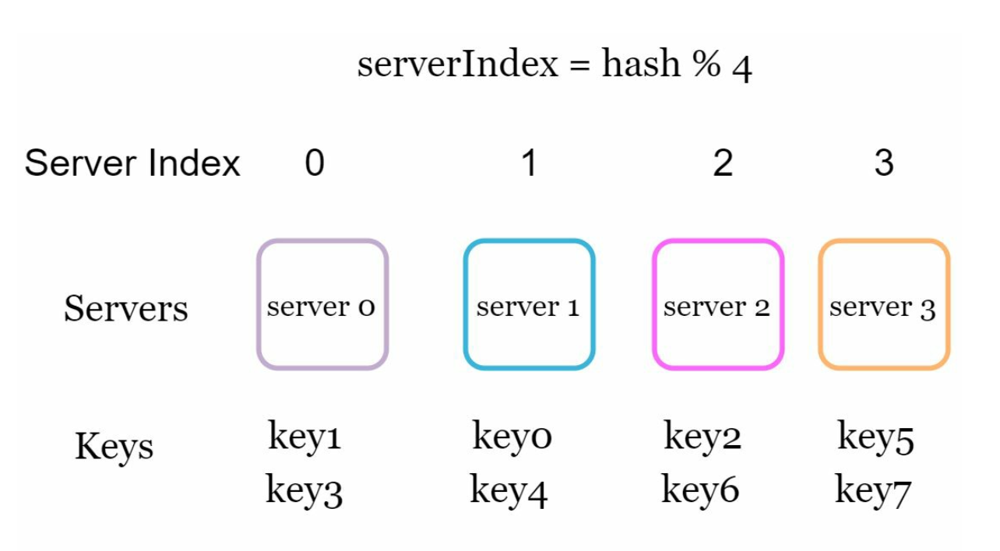
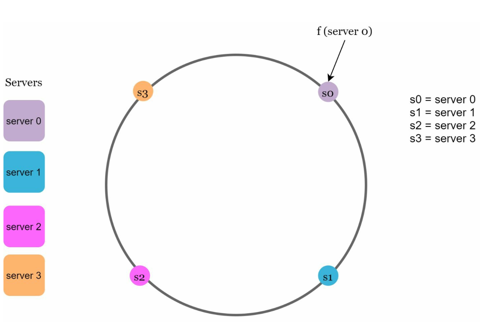
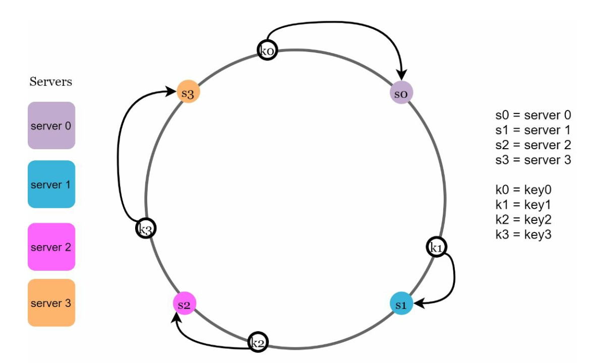
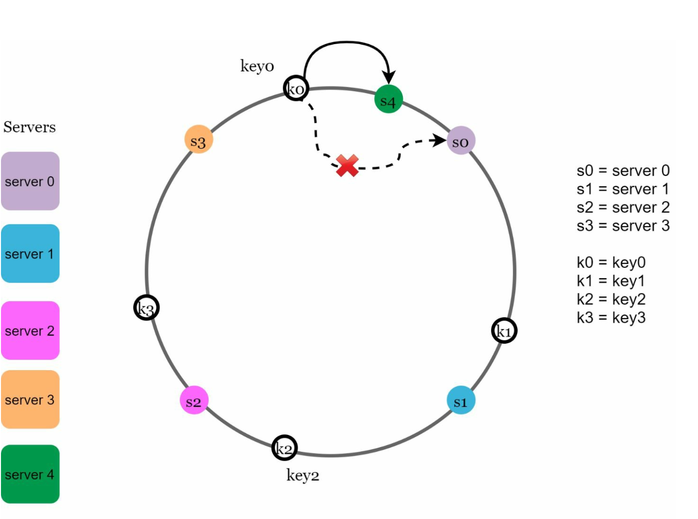
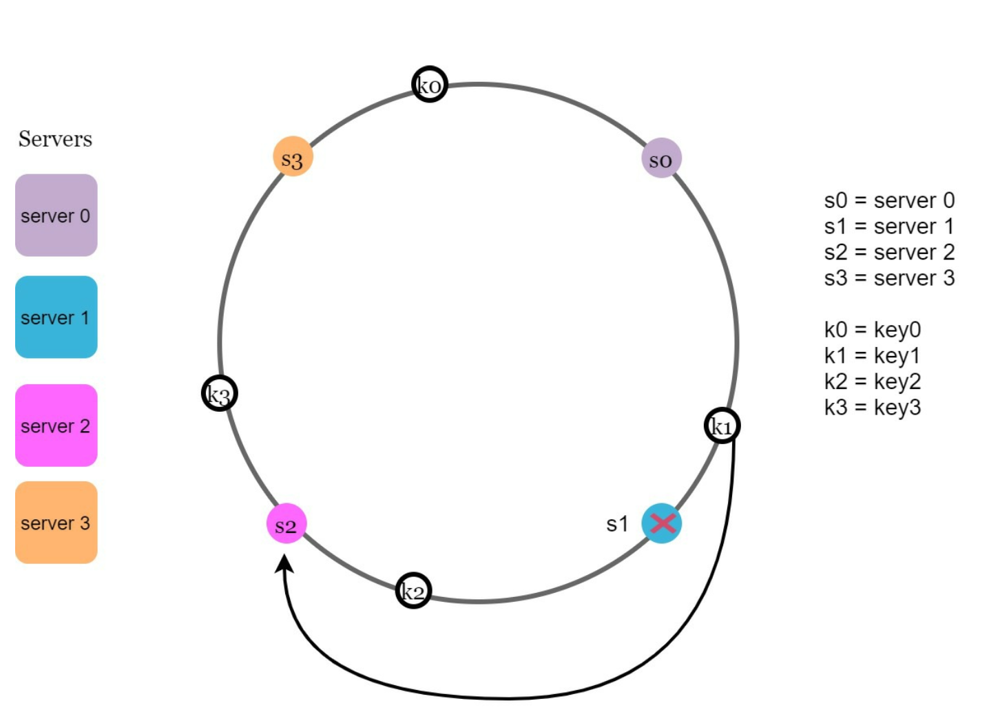

# 5장: 안정 해시 설계

## 소개
이 장에서는 안정 해시(consistent hashing)를 살펴본다. 안정 해시는 요청과 데이터를 서버들에 효율적으로 분산해 수평적 규모 확장을 가능하게 하는 핵심 기술이다. 서버를 추가하거나 제거할 때 재배치되는 데이터를 최소화하고, 데이터를 고르게 분산해 서버 핫스팟 같은 문제를 완화한다.

## 해시 키 재배치(rehash) 문제
### 설명
`serverIndex = hash(key) % N` 같은 전통적인 해시 방식은 서버 수가 바뀌면 데이터 재배치가 문제가 된다. 예를 들면 다음과 같다.
- 서버 하나를 제거하면 대부분의 키가 다른 서버로 재할당되어 캐시 미스가 대량으로 발생한다.
- 서버를 추가하면 불필요한 키 재배치가 일어난다.

  

- 이 방식은 서버 풀의 크기가 고정되어 있을 때는 잘 동작한다. 하지만 서버가 추가되거나 기존 서버가 제거되면 문제가 생긴다.

  

### 핵심 문제
서버 수가 바뀔 때 대부분의 키가 재배치되므로 비효율과 과부하가 발생한다.

## 안정 해시
### 정의
안정 해시는 서버를 추가하거나 제거할 때 일부 키만 재배치되도록 보장한다. 이로써 혼란을 최소화하고 규모 확장성을 높인다.

### 핵심 개념
1. **해시 공간과 해시 링:** 해시 공간은 `0`부터 `2^160-1`까지의 해시 값(예: SHA-1 같은 해시 함수 사용)으로 이루어진다. 이 공간의 양 끝을 이어 붙이면 링(ring)이 된다.
    

    
    

- 같은 해시 함수 f를 사용해 서버 IP나 이름을 기준으로 서버를 링 위에 배치한다.

    

    
    

1. **서버 조회**
- 키가 저장될 서버는 링 위에서 키 위치로부터 시계 방향으로 이동하다 처음 만나는 서버다.

  

  
  

2. **서버 추가와 제거**
- 서버를 추가하면 인접한 키만 재배치된다. 즉, 일부 키만 새 서버로 옮겨진다.
  
  

  
  

- 서버를 제거하면 그 서버가 맡던 범위의 키만 영향을 받는다. 제거된 서버의 키만 시계 방향으로 다음에 있는 서버로 재할당된다.

  

  
  

## 문제점과 해결책
### 기본 구현법의 두 가지 문제
1. **파티션 크기 불균형:** 서버마다 맡는 파티션 크기가 다를 수 있다.
2. **키의 불균등 분포:** 일부 서버가 다른 서버보다 훨씬 많은 키를 받을 수 있다.

### 해결책: 가상 노드(virtual node)
- 서버 하나를 링 위에 고르게 분포된 여러 개의 가상 노드로 표현한다.
- 가상 노드는 키 분포를 개선하고 부하를 고르게 맞춘다. 가상 노드 수를 늘릴수록 키 분포가 더 균형을 이룬다. 가상 노드가 많아질수록 표준 편차가 작아져 데이터가 고르게 분포되기 때문이다.
   
  

  
  

## 재배치할 키 결정
서버를 추가하거나 제거하면 다음 키들이 영향을 받는다.
- **서버 추가 시:** 새 서버와 그 직전 서버 사이에 있는 키가 영향을 받는다.
  아래 예시에서는 서버 4가 링에 추가되었다. 영향을 받는 범위는 새로 추가된 노드 s4에서 시작해 링을 반시계 방향으로 돌다 서버(s3)를 만날 때까지다. 따라서 s3와 s4 사이에 있는 키를 s4로 재배치해야 한다.

  

  
  

- **서버 제거 시:** 제거된 서버와 그 직전 서버 사이에 있는 키가 영향을 받는다. 아래 예시에서 서버 s1이 제거되면, 영향을 받는 범위는 제거된 노드 s1에서 시작해 링을 반시계 방향으로 돌다 서버(s0)를 만날 때까지다. 따라서 s0와 s1 사이에 있는 키를 s2로 재배치해야 한다.
   
  

  
  

## 안정 해시의 이점
- **재배치 최소화:** 일부 키만 재할당된다.
- **규모 확장성:** 수평적 규모 확장이 가능해진다.
- **핫스팟 완화:** 데이터를 고르게 분산해 특정 서버의 과부하를 막는다.

## 실제 적용 사례
- Amazon Dynamo DB
- Apache Cassandra
- Discord
- Akamai CDN
- Maglev 로드밸런서

