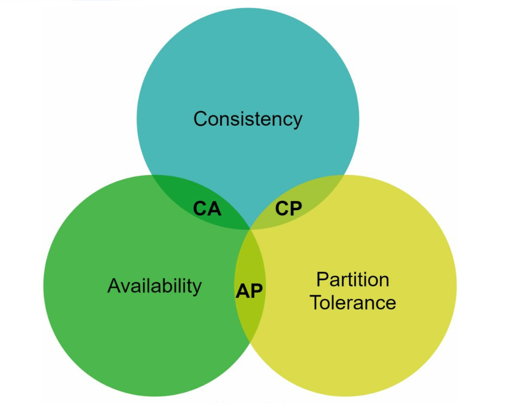
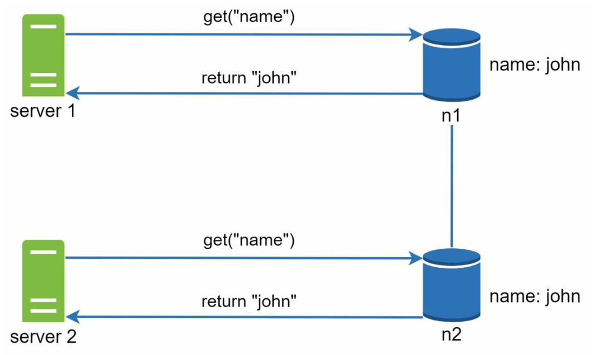
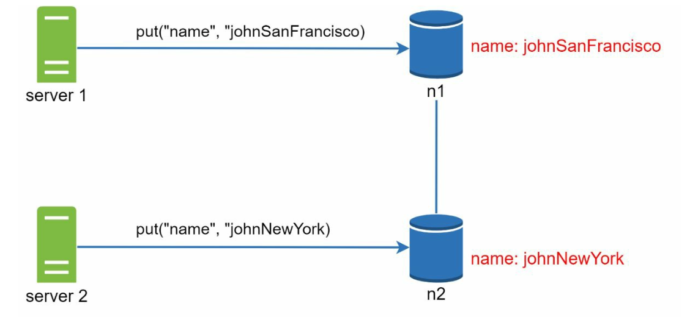
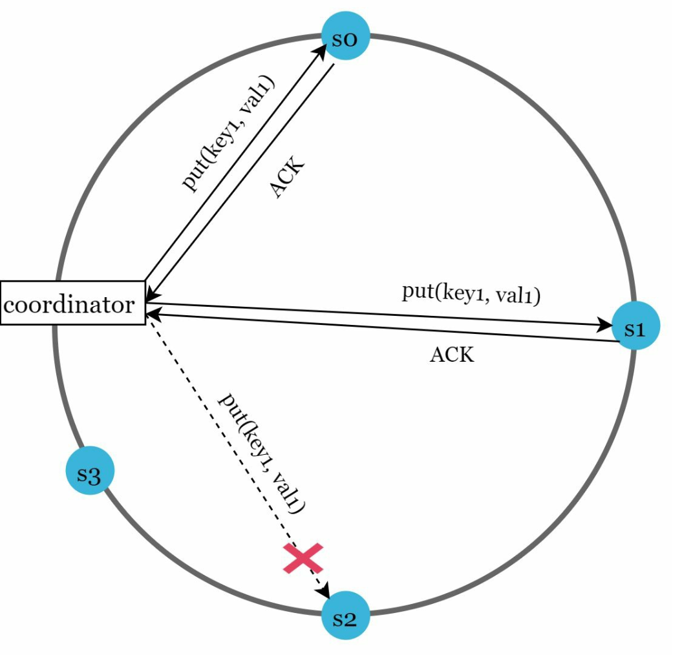
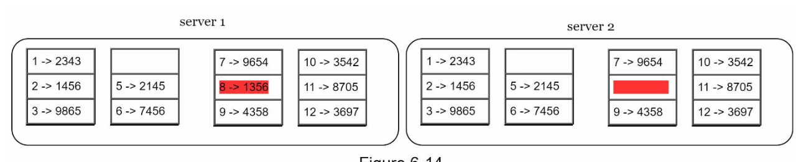
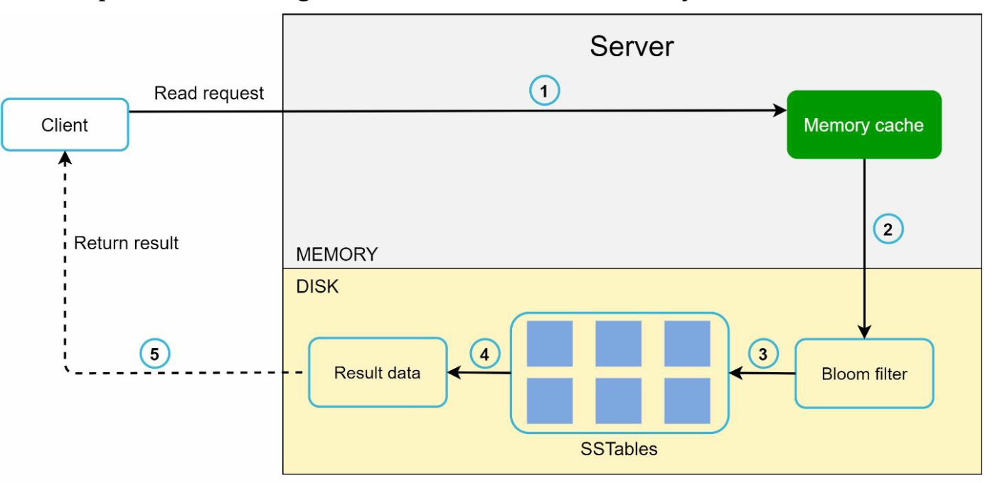
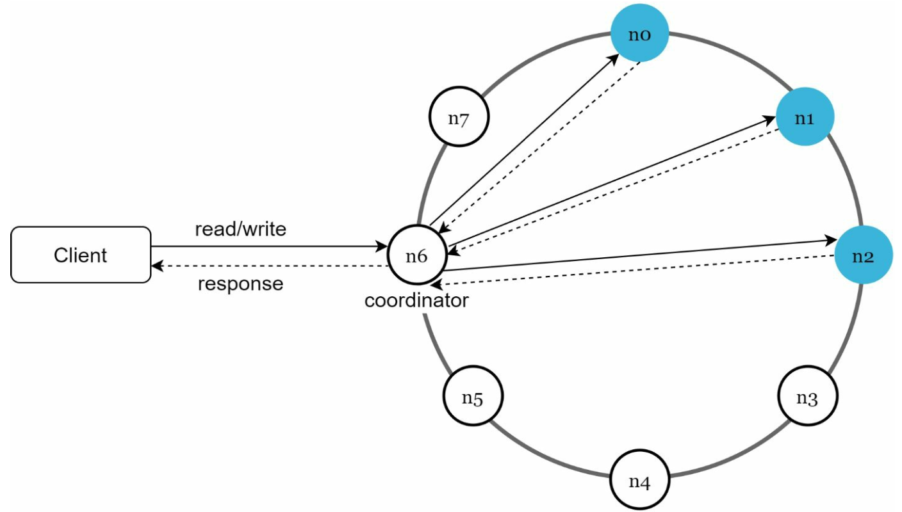

# 6장: 키-값 저장소 설계

## 소개
**키-값 저장소(key-value store)** 는 데이터를 키-값 쌍으로 저장하는 비관계형 데이터베이스다. 각 키는 유일하며, 값은 키를 통해서만 접근할 수 있다. 이 장에서는 다음 연산을 지원하는, 규모 확장이 쉽고 가용성이 높은 분산 키-값 저장소를 설계하는 방법을 자세히 살펴본다.
- `put(key, value)`: 데이터 저장
- `get(key)`: 데이터 조회

### 설계 특성
- 키-값 쌍의 크기는 작다(10 KB 미만).
- 높은 가용성과 규모 확장성을 갖추고 빅데이터를 지원한다.
- 자동으로 규모를 확장하며, 일관성 수준을 조정할 수 있다.
- 지연 시간이 짧다.

---

## 단일 서버 키-값 저장소
### 구현
- **해시 테이블**을 사용해 키-값 쌍을 메모리에 저장한다.
- 최적화 방법:
  - 데이터 압축
  - 자주 쓰지 않는 데이터는 디스크에 저장

### 한계
서버 한 대의 메모리는 한정되어 있으므로, 규모를 키우려면 **분산 방식**이 필요하다.

---

## 분산 키-값 저장소
**분산 키-값 저장소**는 데이터를 여러 서버에 나눠 저장하며, **CAP 정리**가 말하는 트레이드오프를 고려해야 한다.

### CAP 정리
1. **일관성(Consistency):** 모든 클라이언트가 동시에 같은 데이터를 본다.
2. **가용성(Availability):** 일부 노드에 장애가 생겨도 시스템은 모든 요청에 응답한다.
3. **파티션 감내(Partition Tolerance):** 네트워크 파티션이 생겨도 시스템은 계속 동작한다.

**트레이드오프:** CAP 정리에 따르면 세 가지 중 두 가지만 동시에 만족할 수 있다.

  

#### 시스템 유형
- **CP 시스템:** 가용성을 희생하고 일관성과 파티션 감내를 지원한다(예: 은행 시스템).
- **AP 시스템:** 일관성을 희생하고 가용성과 파티션 감내를 지원한다(예: 결과적 일관성).
- **CA 시스템:** 파티션 감내를 희생하고 일관성과 가용성을 지원한다.

    **네트워크 장애는 피할 수 없으므로 분산 시스템은 반드시 네트워크 파티션을 감내해야 한다. 따라서 실제 환경에서 CA 시스템은 존재할 수 없다.**

    분산 시스템에서 파티션은 피할 수 없다. 파티션이 생기면 일관성과 가용성 중 하나를 골라야 한다. 예를 들어 노드 n3가 다운되면 n1이나 n2에 기록된 데이터는 n3로 전파되지 않는다. 반대로 n3에 기록되었지만 아직 n1과 n2로 전파되지 않은 데이터가 있다면, n1과 n2는 오래된 데이터를 갖게 된다.

    

    
    

    
- CP 시스템을 선택하면 데이터 불일치를 피하기 위해 n1과 n2에 대한 쓰기 연산을 모두 막아야 한다.
- AP 시스템을 선택하면 오래된 데이터를 반환할 위험이 있더라도 읽기 연산을 계속 허용한다. 쓰기의 경우 n1과 n2는 계속 쓰기 연산을 받아들이고, 파티션 문제가 해결되면 데이터를 n3로 동기화한다.

---

## 시스템 컴포넌트
### 1. 데이터 파티션
- **기법:** 안정 해시를 사용해 데이터를 여러 서버에 고르게 분산한다.
- **장점:**
  - 서버를 추가·제거할 때 자동으로 규모가 조정된다.
  - 가상 노드로 서버 간 성능 차이(다양성, heterogeneity)를 반영할 수 있다. 서버에 할당하는 가상 노드 수는 서버 용량에 비례한다.

### 2. 데이터 다중화
- 높은 가용성을 위해 데이터를 `N`개 서버에 다중화한다.
- N개 서버는 링 위에서 키 위치로부터 시계 방향으로 돌면서 처음 만나는 N개 서버를 골라 데이터 사본을 저장한다. 가상 노드를 쓰는 경우, 안정성을 높이려면 사본을 서로 다른 데이터 센터에 둔다.

    

    
    

### 3. 일관성
데이터가 여러 노드에 다중화되므로 사본 간에 동기화가 필요하다.
- **정족수 합의(quorum consensus):**
  - `N`: 사본 수
  - `W`: 쓰기 정족수. 쓰기 연산이 성공했다고 보려면 W개 사본으로부터 쓰기 응답을 받아야 한다.
  - `R`: 읽기 정족수. 읽기 연산이 성공했다고 보려면 최소 R개 사본으로부터 응답을 받아야 한다.
  - **규칙:** `W + R > N`이면 강한 일관성이 보장된다.
  - W, R, N 값을 정하는 것은 응답 지연과 데이터 일관성 사이의 전형적인 트레이드오프다.

    

    
    

    
    - R = 1, W = N이면 빠른 읽기 연산에 최적화된 시스템이다.
    - W = 1, R = N이면 빠른 쓰기 연산에 최적화된 시스템이다.
    - W + R > N이면 강한 일관성이 보장된다(보통 N = 3, W = R = 2).
    - W + R <= N이면 강한 일관성이 보장되지 않는다.

- **일관성 모델**:
  - **강한 일관성(strong consistency):** 읽기 연산은 항상 가장 최근에 갱신된 결과를 반환한다.
  - **약한 일관성(weak consistency):** 읽기 연산이 가장 최근에 갱신된 결과를 반환하지 못할 수 있다.
  - **결과적 일관성(eventual consistency):** 충분한 시간이 지나면 모든 갱신 결과가 전파되어 모든 사본이 일관된 상태가 된다.

### 4. 비일관성 해소
다중화는 가용성을 높이지만 사본 간 불일치를 일으킨다. 이 문제는 버전 관리와 벡터 시계(vector clock)로 해결한다.
- **데이터 버전 관리:** 
    - **벡터 시계**로 데이터 버전을 추적하고 충돌을 해소한다.
    - 버전 관리란 데이터를 변경할 때마다 해당 데이터의 새로운 버전을 만드는 것을 말한다. 각 버전은 변경할 수 없다.
        

        
        
        

    
    - 서버 1이 이름을 바꾸고, 서버 2도 이름을 바꾼다. 두 변경이 동시에 일어나면 v1과 v2라는 서로 충돌하는 두 버전이 생긴다.

- **벡터 시계**
    1. **구성**: 벡터 시계는 데이터에 붙는 [서버, 버전] 순서쌍이다. 어떤 버전이 다른 버전보다 앞서는지, 뒤처지는지, 충돌하는지 판별하는 데 쓴다.
        - 벡터 시계를 D([S1, v1], [S2, v2], …, [Sn, vn])로 표현한다고 하자. 데이터 D를 서버 Si에 기록하면 시스템은 아래 작업 중 하나를 수행한다.
        - 여기서 `D`는 데이터, `Si`는 서버 식별자, `vi`는 서버 `Si`에 있는 데이터의 버전 카운터다.

    2. **벡터 시계 갱신:** 서버에서 데이터가 변경되면:
        - 해당 서버가 벡터 시계에 이미 있으면 버전 카운터를 1 증가시킨다.
        - 없으면 벡터 시계에 새 항목을 추가한다.

    3. **충돌 감지:**
        - **충돌 없음:** 버전 X의 모든 카운터가 버전 Y의 해당 카운터보다 작거나 같으면, X는 Y의 이전 버전이다.
        - **충돌 있음:** Y의 카운터 중 X의 해당 카운터보다 작은 것이 하나라도 있으면, 두 버전은 서로 형제(sibling) 관계, 즉 충돌 관계다.

    4. **충돌 해소:** 충돌(형제 버전)이 감지되면 시스템은 애플리케이션별 로직이나 클라이언트의 개입으로 데이터를 조정한다.

        

        
        

- **문제점:**
  - 클라이언트 구현이 복잡해진다.
  - 갱신이 많아지면 벡터 시계 크기가 커질 수 있으므로, 크기를 제한하는 정리(trimming) 전략이 필요하다.

### 5. 장애 처리

#### a. 장애 감지
다른 서버 한 대가 어떤 서버가 다운되었다고 말한다고 해서 바로 장애로 판단하기에는 부족하다. 보통 독립된 정보원 두 곳 이상이 같은 내용을 알려야 서버를 장애 상태로 표시한다.
- **가십 프로토콜(gossip protocol):**
    

        
    

    - 각 노드는 멤버 ID와 박동 카운터(heartbeat counter) 목록을 유지한다.
    - 각 노드는 주기적으로 자신의 박동 카운터를 증가시킨다.
    - 각 노드는 무작위로 선정한 노드들에게 주기적으로 박동 카운터 목록을 보낸다.
    - 미리 정한 시간 동안 박동 카운터가 증가하지 않은 멤버는 장애 상태로 간주한다.

#### b. 일시적 장애 처리
- **느슨한 정족수(sloppy quorum):** 정상 노드를 활용해 일시적으로 운영을 유지한다.
        

        
        

    - 장애를 감지한 뒤에는 가용성을 보장하기 위한 장치가 필요하다.
    - 정족수 요구 사항을 강제하는 대신, 해시 링에서 쓰기 연산은 정상 서버 W대를, 읽기 연산은 정상 서버 R대를 먼저 골라 수행한다.
    - 장애 서버는 무시한다. 어떤 서버가 응답하지 않으면 다른 서버가 일시적으로 요청을 대신 처리한다.

- **단서 후 임시 위탁(hinted handoff):** 장애 서버는 복구된 뒤 그동안의 변경 사항을 따라잡는다.
    - 장애 서버가 복구되면 그동안의 변경 사항을 일괄 반영해 데이터 일관성을 회복한다.

#### c. 영구 장애 처리
- 사본 간 동기화를 효율적으로 하기 위해 **머클 트리(Merkle tree)** 를 사용한다.
    **머클 트리**(해시 트리)는 영구 장애가 났을 때 사본 간 불일치를 효율적으로 찾아 해소하기 위한 자료 구조다.

- 동작 방식
    1. **구조:**
        - **단말 노드**는 개별 데이터 블록의 해시를 저장한다.
        - **비단말 노드**는 자식 노드들의 해시를 저장한다.
        - **루트 해시**는 트리에 담긴 전체 데이터의 상태를 나타낸다.

    2. **머클 트리 만들기:**
        - **1단계:** 키 공간을 버킷으로 나눈다.
            
            

        - **2단계:** 버킷에 포함된 각 키를 균등 분포 해시 함수로 해싱한다.

            

        - **3단계:** 버킷별로 해시 값 하나를 만든다.
        
            

        - **4단계:** 버킷 해시들을 결합해 상위 해시를 계산하고, 최종적으로 루트 해시를 만든다.

            

    3. **동기화:**
        - 두 사본을 동기화하려면:
            - 두 사본의 루트 해시를 비교한다.
            - 루트 해시가 같으면 두 사본은 일치한다.
            - 루트 해시가 다르면 자식 해시를 재귀적으로 비교해 불일치가 있는 버킷을 찾는다.
        - 불일치가 있는 데이터만 동기화한다.

- 장점
    - **효율성:** 불일치 데이터만 동기화하므로 전송량이 줄어든다.
    - **규모 확장성:** 대규모 데이터에서도 동기화 부담이 적다.
    - **신뢰성:** 사본 간 데이터 일관성을 보장한다.

### 6. 데이터 센터 장애 처리
- 데이터 센터 장애 중에도 가용성을 유지하려면 데이터를 여러 데이터 센터에 다중화한다.

---

## 쓰기 경로와 읽기 경로
### 1. 쓰기 경로(Cassandra 아키텍처 기준)

    

- 쓰기 요청을 **커밋 로그(commit log)** 에 기록한다.
- 데이터를 **메모리 캐시**에 저장한다.
- 메모리 캐시가 가득 차면 데이터를 디스크의 **SSTable**(Sorted String Table)로 내보낸다(flush).

   

### 2. 읽기 경로

    
    

- 먼저 **메모리 캐시**에 데이터가 있는지 확인한다.
- 없으면 **블룸 필터(Bloom filter)** 로 데이터가 어느 SSTable에 있는지 찾는다.
- 데이터를 읽어 반환한다.

---

## 최종 아키텍처

-  클라이언트는 get(key)와 put(key, value)라는 단순한 API로 키-값 저장소와 통신한다.
- 중재자(coordinator)는 클라이언트와 키-값 저장소 사이에서 프록시 역할을 하는 노드다.
- 노드는 안정 해시를 사용해 해시 링 위에 분산된다.
- 시스템이 완전히 분산되어 있어 노드를 자동으로 추가하거나 옮길 수 있다.
- 데이터는 여러 노드에 다중화된다.
- 모든 노드가 같은 책임을 지므로 단일 장애 지점(SPOF)이 없다.

