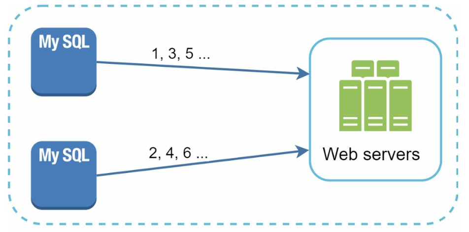
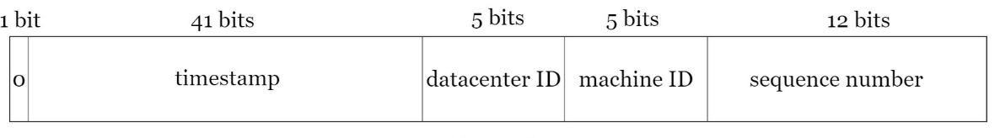
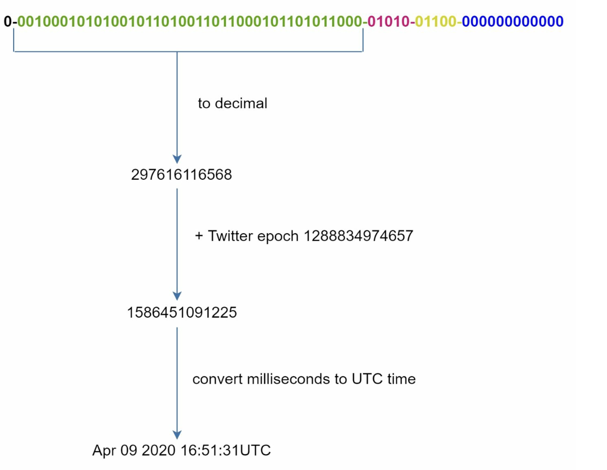

# 7장: 분산 시스템을 위한 유일 ID 생성기 설계

## 소개
이 장에서는 분산 시스템에서 쓸 **유일 ID 생성기(unique ID generator)** 를 설계하는 문제를 다룬다. 전통적인 auto-increment 키는 규모 확장과 동기화 문제 때문에 분산 환경에 맞지 않는다. 여기서는 다음 요구 사항을 만족하는, 유일하고 정렬 가능한 64비트 숫자 ID를 만드는 데 집중한다.
- ID는 **유일**해야 하며 **발급 날짜순으로 정렬**되어야 한다.
- ID는 **64비트**로 표현할 수 있어야 한다.
- 시스템은 **초당 10,000개 이상**의 ID를 만들 수 있어야 한다.

---

## 1단계: 문제 이해
### 기본 요구 사항
- ID는 유일한 숫자 값이어야 하며 64비트에 들어가야 한다.
- ID는 시간이 지날수록 커지지만, 반드시 `+1`씩 증가할 필요는 없다.
- ID는 발급 날짜순으로 정렬할 수 있어야 한다.
- 시스템은 높은 처리량(초당 10,000개)을 감당해야 한다.

---

## 2단계: 개략적인 설계안
### 1. 다중 마스터 복제(multi-master replication)
- **방식:** 데이터베이스의 `auto_increment`를 사용하되, 증가 폭을 서버 수만큼(예: 서버 k대면 `+k`) 둔다.

    

    
    

- **단점:**
  - 여러 데이터 센터로 확장하기 어렵다.
  - ID가 항상 시간 순서대로 커지지는 않는다.
  - 서버를 추가하거나 제거할 때 확장 문제가 생긴다.

### 2. UUID(Universally Unique Identifier)
- **방식:** 
    - 각 서버가 UUID로 128비트 유일 식별자를 독립적으로 생성한다.
    - 서버 간 조율 없이 UUID를 독립적으로 만들 수 있다.

        

        
        

- **장점:**
  - 서버 간 조율이 필요 없다.
  - 웹 서버와 함께 쉽게 규모를 확장할 수 있다.
- **단점:**
  - 64비트 요구 사항을 넘는다.
  - 시간순으로 정렬할 수 없고, 숫자가 아닌 값이 포함될 수 있다.

### 3. 티켓 서버(ticket server)
- **방식:** 중앙 집중형 데이터베이스 서버 하나가 ID를 증가시켜 발급한다.

    

    
    

- **장점:**
  - 소규모 시스템에서는 구현이 간단하다.
  - 숫자로 된 ID를 만든다.
- **단점:**
  - 단일 장애 지점(SPOF)이 된다.
  - 여러 서버로 구성하면 동기화 문제가 생긴다.

### 4. 트위터 스노플레이크(Snowflake) 방식
- **방식:** 

    

      
    

    

      
    

    - ID를 여러 절(section)로 나눠 유일성과 확장성을 보장한다.
    - **사인(sign) 비트(1비트):** 항상 `0`이다. 나중에 음수와 양수를 구별하는 데 쓸 수도 있다.
    - **타임스탬프(41비트):** 기준 시점(epoch) 이후 경과한 밀리초다(트위터 기본값은 `1288834974657`로, 2010년 11월 4일 01:42:54 UTC에 해당). ID가 시간순으로 정렬되게 한다.
    - **데이터 센터 ID(5비트):** 최대 `2^5 = 32`개 데이터 센터를 구분한다.
    - **서버 ID(5비트):** 데이터 센터마다 최대 `2^5 = 32`대 서버를 구분한다.
    - **일련번호(12비트):** 같은 서버에서 같은 밀리초 안에 만든 ID를 구분하며, 밀리초당 최대 `2^12 = 4096`개를 지원한다. 일련번호는 밀리초마다 `0`으로 초기화된다.

- **장점:**
    - **규모 확장성:** 여러 서버에서 초당 10,000개 이상의 ID를 만든다.
    - **시간순 정렬:** ID를 시간순으로 정렬할 수 있다.
    - **탈중앙화:** 단일 장애 지점이 없다.

## 4단계: 추가 고려 사항
### 1. 시계 동기화
- **문제:** ID 생성은 서버들의 시계가 동기화되어 있다고 가정한다.
- **해결:** **NTP(Network Time Protocol)** 로 시계 오차를 최소화한다.

### 2. 각 절의 길이 조정
- 사용 사례에 따라 각 절의 길이를 조정한다(예: 일련번호 비트를 줄이고 타임스탬프 비트를 늘림).

### 3. 고가용성
- ID 생성기는 핵심 컴포넌트이므로 장애에 강해야 한다.
- 다중화와 장애 조치(failover) 방안을 고려한다.

