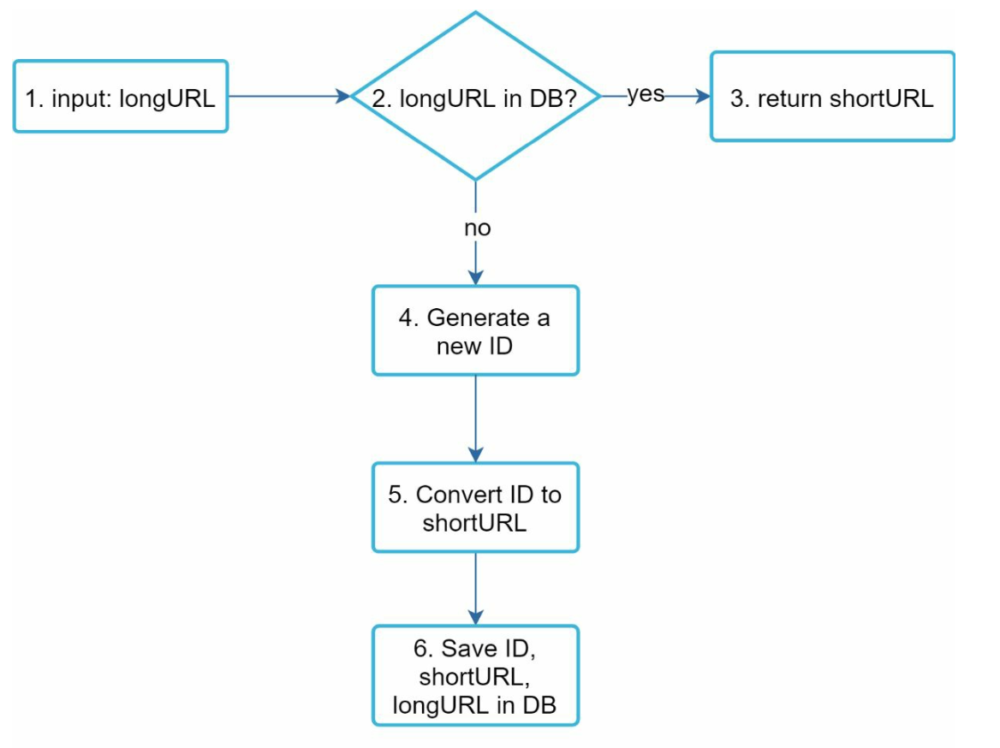
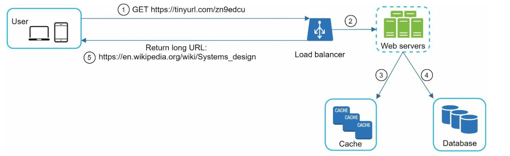

# 8장: URL 단축기 설계

## 소개
이 장에서는 TinyURL 같은 URL 단축 서비스의 설계를 다룬다. 시스템의 주요 목표는 **URL 단축**, **리디렉션**, 그리고 많은 트래픽을 감당할 **높은 규모 확장성**이다.

### 요구 사항
- 단축 URL은 **유일**해야 하며 **가능한 한 짧아야** 한다.
- **하루 1억 개의 URL 생성**을 처리하고, 10년 동안 운영할 수 있어야 한다.
- 읽기 대 쓰기 비율이 10:1이므로 **읽기 연산을 효율적으로** 지원해야 한다.
- 10년 동안 3,650억 개의 레코드를 저장해야 하며, 약 **365 TB**의 저장 공간이 필요하다.

---

## 1단계: 개략적인 설계

### API 엔드포인트
1. **URL 단축:**  
   - 엔드포인트: `POST api/v1/data/shorten`  
   - 인자: `{longUrl: longURLString}`  
   - 반환: `shortURL`

2. **URL 리디렉션:**  
   - 엔드포인트: `GET api/v1/shortUrl`  
   - 반환: 리디렉션할 `longURL`

    

    
    

### URL 리디렉션
- **301 리디렉션:** 요청한 URL이 긴 URL로 '영구적으로' 이동했음을 뜻한다. 브라우저가 응답을 캐시하므로, 같은 URL에 대한 이후 요청은 URL 단축 서비스로 보내지 않는다.
- **302 리디렉션:** '일시적으로' 이동했음을 뜻한다. 클릭 추적 같은 분석에 유용하다.

### URL 단축

    

- **해시 함수**를 사용해 긴 URL을 유일한 단축 URL로 대응시킨다.
- 해시 함수는 다음 요구 사항을 만족해야 한다.
    - 각 긴 URL은 하나의 해시 값으로 변환되어야 한다.
    - 각 해시 값은 원래의 긴 URL로 되돌릴 수 있어야 한다.
    

---

## 2단계: 상세 설계

### 데이터 모델
메모리 사용을 최적화하기 위해 `<shortURL, longURL>` 대응 관계를 관계형 데이터베이스에 저장한다. 테이블 스키마는 다음과 같다.
- `id`(기본 키)
- `shortURL`
- `longURL`

    

### 해시 함수
#### 1. 62진법 변환(base 62 conversion)
- `[0-9, a-z, A-Z]` 문자를 사용해 숫자를 인코딩하므로 **사용할 수 있는 문자는 62개**다.
- 진법 변환은 URL 단축기에서 흔히 쓰는 또 다른 방법이다.
- 단축 URL마다 유일한 ID를 할당하고, 이 ID를 62진법으로 변환해 단축 URL을 얻는다.
- 7자리 해시로 최대 **약 3.5조 개의 유일한 URL**을 만들 수 있으므로 3,650억 개를 충분히 감당한다.

**예시:**  
ID `2009215674938`을 62진법으로 변환하면:
- `2009215674938` → `zn9edcu`

#### 2. 해시 후 충돌 해소
- CRC32, MD5, SHA-1 같은 해시 함수를 사용한다.

    

- 해시 값의 처음 7자리만 취하는 방법이 있지만, 이 경우 해시 충돌이 생길 수 있다.
- 충돌을 해소하려면 충돌이 없어질 때까지 미리 정한 문자열을 재귀적으로 덧붙이면 되지만, 비용이 많이 들 수 있다.
- **블룸 필터(Bloom filter)** 로 효율적으로 조회해 충돌을 해소한다.

    

    
    

### 비교

-  **해시 후 충돌 해소:**
    - 단축 URL 길이가 고정된다.
    - 유일 ID 생성기가 필요 없다.
    - 충돌이 생길 수 있어 해소 전략이 필요하다.
    - ID에 의존하지 않으므로 다음에 쓸 수 있는 단축 URL을 알아낼 수 없다.

- **62진법 변환**
    - 길이가 고정되지 않고 ID가 커지면 함께 길어진다.
    - 유일 ID 생성기가 필요하다.
    - 충돌이 생기지 않는다.
    - ID가 1씩 증가한다면 다음 단축 URL을 쉽게 알아낼 수 있다(보안상 문제가 될 수 있음).

---

### URL 단축 흐름

    

1. `longURL`이 데이터베이스에 있는지 확인한다.
2. 있으면 기존 `shortURL`을 반환한다.
3. 없으면:
   - **분산 ID 생성기**로 유일한 ID를 만든다.
   - 62진법 변환으로 ID를 `shortURL`로 바꾼다.
   - `<id, shortURL, longURL>` 대응 관계를 데이터베이스에 저장한다.

---

### URL 리디렉션 흐름

    

1. 사용자가 `shortURL`을 클릭한다.
2. `<shortURL, longURL>` 대응 관계를 조회한다.
   - 빠른 접근을 위해 먼저 **캐시**를 확인한다.
   - 캐시에 없으면 데이터베이스를 조회한다.
3. 사용자를 `longURL`로 리디렉션한다.

---

## 추가 고려 사항
### 처리율 제한 장치
- IP별 요청 수를 제한해 악용을 막는다.

### 규모 확장성
1. **웹 계층:** 무상태이므로 웹 서버를 추가·제거해 규모를 조정할 수 있다.
2. **데이터베이스 계층:** 다중화와 샤딩을 사용한다.

### 데이터 분석
- 클릭 수, 유입 경로, 시각 같은 데이터를 수집해 비즈니스 통찰을 얻는다.

### 가용성, 일관성, 안정성
- 데이터베이스 다중화와 결함 감내 설계로 일관되고 안정적인 서비스를 보장한다.

