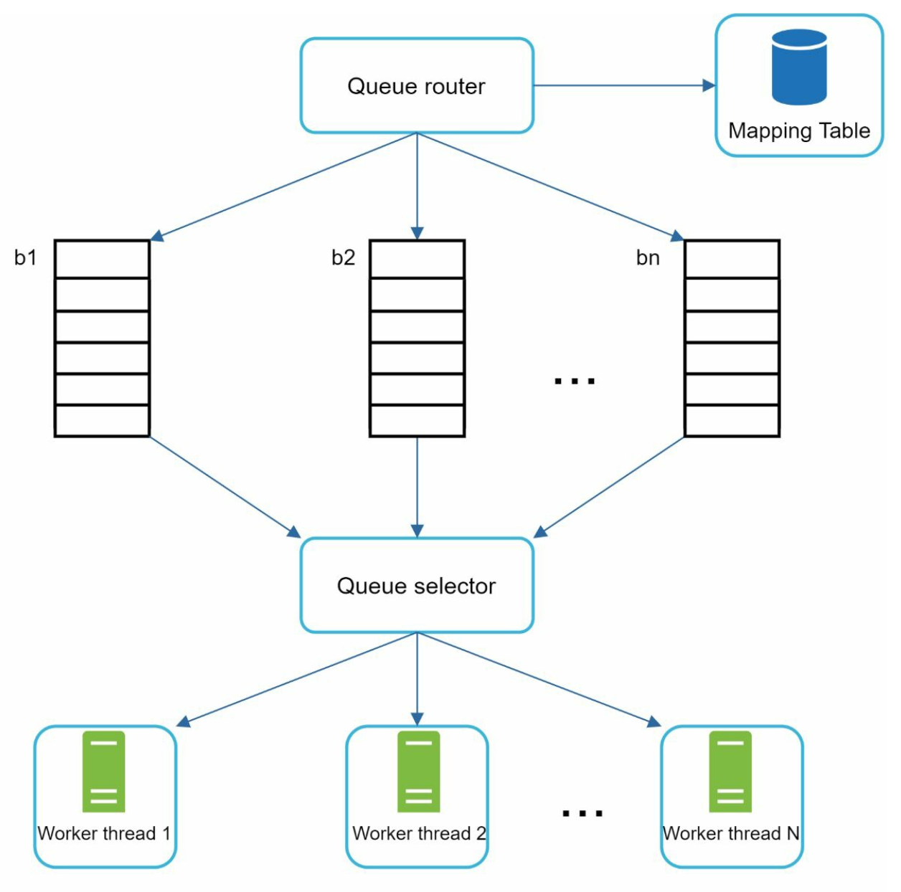
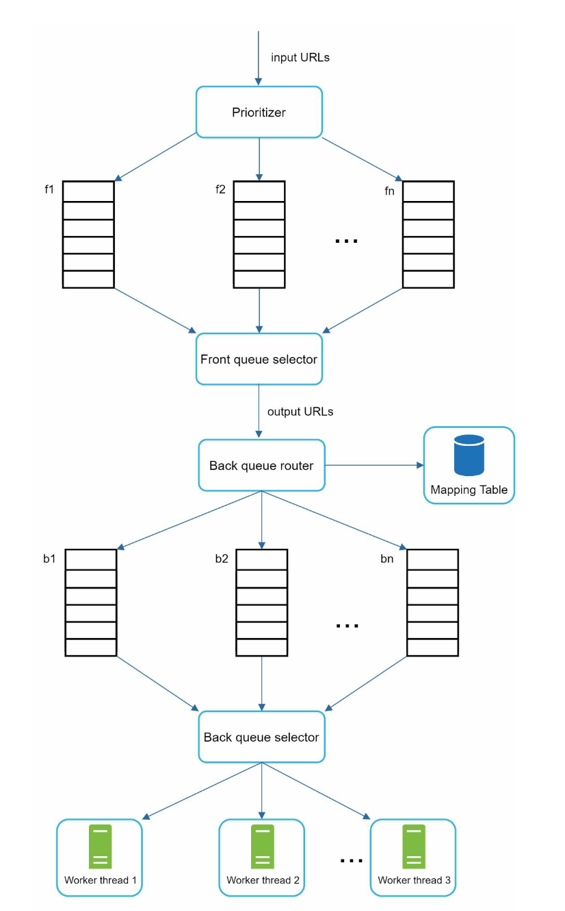

# 9장: 웹 크롤러 설계

## 소개
**웹 크롤러(web crawler)** 는 스파이더(spider) 또는 로봇(robot)이라고도 부르며, 웹 페이지, 이미지, 동영상 같은 웹 콘텐츠를 찾아 수집하는 데 쓴다. 이 장에서는 **검색 엔진 색인**용으로 확장 가능한 웹 크롤러를 설계하는 데 집중한다.

### 웹 크롤러의 용도
1. **검색 엔진 색인(search engine indexing):** 웹 페이지를 모아 검색 가능한 색인을 만든다(예: Googlebot).
2. **웹 아카이빙(web archiving):** 나중에 쓸 수 있도록 웹 데이터를 보존한다(예: 미국 국회도서관).
3. **웹 마이닝(web mining):** 웹 데이터에서 지식을 추출한다(예: 주주 보고서를 통한 재무 분석).
4. **웹 모니터링(web monitoring):** 저작권이나 상표권 침해를 찾아낸다.

### 설계 과제
좋은 웹 크롤러는 다음을 만족해야 한다.
- **규모 확장성:** 병렬 처리로 수십억 개의 페이지를 처리한다.
- **안정성(robustness):** 잘못된 HTML, 서버 장애, 악성 링크에 대응한다.
- **예의(politeness):** 짧은 시간에 너무 많은 요청을 보내 서버를 괴롭히지 않는다.
- **확장성(extensibility):** 최소한의 변경으로 새로운 콘텐츠 유형을 지원한다.

---

## 1단계: 문제 이해

### 요구 사항
1. **매달 웹 페이지 10억 개**를 수집한다(초당 400페이지, 최대 800 QPS).
2. **HTML 콘텐츠만** 수집한다.
3. 새로 생기거나 수정된 페이지를 추적한다.
4. 중복 콘텐츠는 무시한다.
5. 수집한 데이터를 **5년간** 보관하며, 약 30 PB의 저장 공간이 필요하다.

---

## 2단계: 개략적인 설계

### 구성 요소

1. **시작 URL(seed URL):** 크롤러가 수집을 시작하는 지점이다.
    - 크롤러가 가능한 한 많은 링크를 탐색할 수 있는 좋은 출발점을 골라야 한다.
    - 지역별 인기 웹사이트나 주제를 기준으로 고를 수 있다.
    - 전략: 지역이나 주제(예: 스포츠, 건강)별로 나눈다.

2. **미수집 URL 저장소(URL frontier):** 다운로드할 URL을 저장한다.
   - **FIFO 큐**로 구현한다.

3. **HTML 다운로더:** 미수집 URL 저장소가 제공한 URL의 웹 페이지를 다운로드한다.

4. **도메인 이름 변환기(DNS resolver):** URL을 IP 주소로 변환한다.

5. **콘텐츠 파서(content parser):** 웹 페이지를 검증하고 파싱한다.
   - 형식이 잘못된 페이지는 버린다.

6. **중복 콘텐츠인가?(Content Seen?):** 해시 비교로(두 웹 페이지의 해시 값을 비교해) 중복 콘텐츠를 걸러 낸다.

7. **콘텐츠 저장소:** HTML 페이지를 디스크에 저장한다(인기 있는 콘텐츠는 지연 시간을 줄이기 위해 메모리에 둔다).

8. **URL 추출기:** 파싱된 페이지에서 새 링크를 뽑아낸다.

9. **URL 필터:** 접근 금지 목록에 있거나 오류가 있는 URL을 제외한다.

10. **이미 방문한 URL인가?(URL Seen?)** 방문한 URL을 추적해 중복 방문을 막는다.

11. **URL 저장소:** 이미 방문한 URL을 저장한다.

---

### 작업 흐름
1. **시작 URL**을 미수집 URL 저장소에 넣는다.
2. **HTML 다운로더**가 URL을 가져오고 도메인 이름 변환기로 IP 주소를 알아낸다.
3. **콘텐츠 파서**가 콘텐츠를 검증한 뒤 '중복 콘텐츠인가?' 컴포넌트로 넘긴다.
4. 새로운 콘텐츠라면 **URL 추출기**로 링크를 뽑아낸다.
5. 링크를 필터링한 뒤 중복되지 않은 링크를 미수집 URL 저장소에 넣는다.

---

## 3단계: 핵심 컴포넌트 상세 설계
### DFS vs BFS
-  웹은 웹 페이지를 노드로, 하이퍼링크(URL)를 에지로 하는 유향 그래프로 볼 수 있다.
-  그래프 깊이가 매우 깊을 수 있어 DFS는 적합하지 않으므로, 보통 BFS로 그래프를 탐색한다.
-  표준 BFS는 URL 간 우선순위를 고려하지 않는다. 하지만 모든 페이지가 같은 수준의 품질과 중요도를 갖지는 않는다.

### 미수집 URL 저장소
- **예의:** 
    - 같은 호스트에는 한 번에 요청 하나만 보낸다. 두 다운로드 작업 사이에 지연 시간을 둔다.
    - 호스트 이름을 큐와 작업(다운로드) 스레드에 대응시킨다.
    - 다운로드 스레드마다 별도의 FIFO 큐를 두고, 스레드는 자기 큐에서 꺼낸 URL만 다운로드한다.

        

    - **큐 라우터(queue router):** 각 큐(b1, b2, … bn)에 같은 호스트의 URL만 들어가도록 보장한다.
    - **매핑 테이블(mapping table):** 호스트 이름과 큐 사이의 대응 관계를 보관한다.
    - **큐 선택기(queue selector):** 작업 스레드는 FIFO 큐 하나에 대응되며 그 큐의 URL만 다운로드한다. 어떤 큐를 고를지는 큐 선택기가 정한다.
    - **작업 스레드 1~N:** 작업 스레드는 같은 호스트의 웹 페이지를 차례로 다운로드한다. 두 다운로드 작업 사이에 지연 시간을 둘 수 있다.

- **우선순위:** 
    - 중요한 페이지(예: 페이지랭크나 갱신 빈도 기준)에 높은 우선순위를 준다.

        
    
    - **우선순위 결정 장치(prioritizer):** URL을 입력받아 우선순위를 계산한다.
    - **큐 f1~fn:** 큐마다 우선순위가 할당된다. 우선순위가 높은 큐일수록 더 자주 선택된다.
    - **큐 선택기:** 우선순위가 높은 큐에 가중치를 두고 무작위로 큐를 고른다.
    - **전면 큐(front queue):** 우선순위 결정을 담당한다.
    - **후면 큐(back queue):** 예의를 담당한다.

- **신선도(freshness):** 갱신 이력이나 중요도를 바탕으로 페이지를 다시 수집한다.

### HTML 다운로더
- **robots.txt 준수:** robots.txt 파일에 정의된 규칙을 따른다.
- **성능 최적화:**
  1. 여러 서버로 분산 크롤링한다.
  2. **DNS 캐시**를 두어 반복 조회를 피한다.
  3. 크롤링 서버를 지역별로 분산해 다운로드 속도를 높인다.
  4. 응답이 느리거나 없는 서버를 피하도록 타임아웃을 짧게 둔다.

### 안정성
1. **안정 해시:** 다운로더 서버들에 부하를 효과적으로 분산한다.
2. **예외 처리:** 예외가 발생해도 시스템 전체가 중단되지 않게 한다.
3. **데이터 검증:** 콘텐츠의 무결성을 보장한다.

### 확장성
- 새로운 콘텐츠 유형을 위한 모듈을 추가한다(예: PNG 다운로더, 웹 모니터).
- 예: 저작권 침해 여부를 감시하는 모듈을 끼워 넣는다.

    
---

### 문제 있는 콘텐츠 감지 및 회피
1. **중복 콘텐츠:** 해시 비교로 감지한다.
2. **거미 덫(spider trap):** URL 최대 길이 제한 같은 방법으로 무한 루프를 피한다.
3. **데이터 노이즈:** 광고나 스팸처럼 가치 없는 콘텐츠를 걸러 낸다.

---

## 4단계: 마무리
### 핵심 정리
1. 웹 크롤러는 규모 확장성, 안정성, 예의, 확장성 사이에서 균형을 잡아야 한다.
2. **예의**는 서버 과부하를 막고, **우선순위**는 중요한 페이지부터 수집하게 한다.
3. 대규모 크롤링에서는 효율적인 저장과 오류 처리가 매우 중요하다.

### 추가 고려 사항
- **서버 측 렌더링:** JavaScript나 AJAX로 동적으로 생성되는 콘텐츠를 처리한다.
- **원치 않는 페이지 필터링:** 품질이 낮거나 관련 없는 페이지를 제외한다.
- **데이터베이스 샤딩:** 다중화와 샤딩으로 데이터 계층을 확장한다.
- **수평적 규모 확장:** 무상태 서버로 크롤링 작업을 효율적으로 확장한다.
- **데이터 분석:** 데이터를 수집·분석해 통찰을 얻는다.

