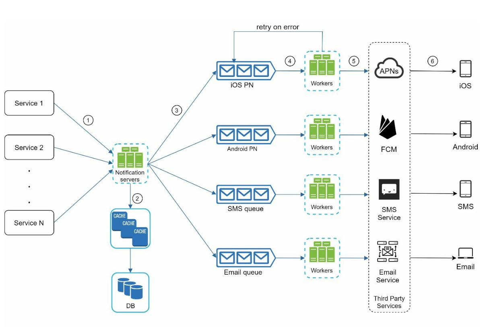
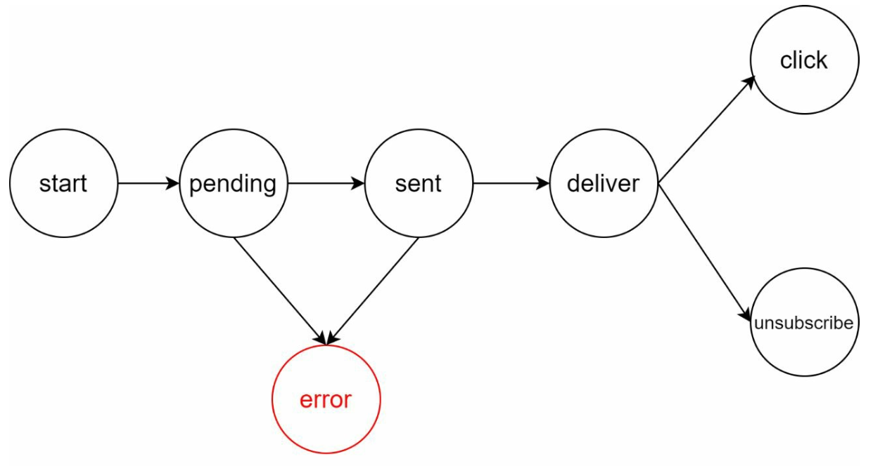

# 10장: 알림 시스템 설계

## 소개
**알림 시스템(notification system)** 은 현대 애플리케이션에 꼭 필요한 기능으로, 제품 소식, 이벤트, 혜택, 경고 같은 정보를 제때 전달한다. 알림은 다음 경로로 보낼 수 있다.
1. **푸시 알림**(모바일 또는 데스크톱)
2. **SMS 메시지**
3. **이메일**

이 장에서는 매일 수백만 건의 알림을 보낼 수 있는 확장 가능한 시스템을 설계하는 데 집중한다.

---

## 1단계: 문제 이해
### 요구 사항
- **알림 유형:** 푸시 알림, SMS, 이메일
- **전달:** 지연을 최소화한 연성 실시간(soft real-time) 시스템
- **지원 단말:** iOS, 안드로이드, 데스크톱
- **알림 발생 주체:** 클라이언트 애플리케이션이 알림을 만들 수도 있고, 서버에서 스케줄링할 수도 있다.
- **규모:**
  - **푸시 알림:** 하루 1,000만 건
  - **SMS:** 하루 100만 건
  - **이메일:** 하루 500만 건
- **수신 거부 지원:** 사용자는 특정 유형의 알림을 끌 수 있다.

---

## 2단계: 개략적인 설계

### 구성 요소

1. **알림 유형별 지원 방안:**
   - **iOS 푸시 알림:** **APNS(Apple Push Notification Service)** 를 사용한다.
   - **안드로이드 푸시 알림:** **FCM(Firebase Cloud Messaging)** 을 사용한다.
   - **SMS 메시지:** Twilio나 Nexmo 같은 제3자 서비스를 사용한다.
   - **이메일:** SendGrid나 Mailchimp 같은 상용 이메일 서비스를 사용한다.

2. **연락처 정보 수집:**
   

      
   

   - 앱 설치나 회원 가입 시점에 단말 토큰, 전화번호, 이메일 주소를 수집한다.
   - 연락처 정보는 데이터베이스에 저장한다.
     - **단말 토큰 테이블:** 푸시 알림용
     - **사용자 테이블:** 이메일 주소와 전화번호용

3. **알림 전송 흐름:**

   

      
   

   - **알림 발생 서비스:**
      - 알림을 시작하는 이벤트를 만든다(예: 결제 안내, 배송 현황).
      - 마이크로서비스, 크론 잡, 분산 시스템 등 알림 전송 이벤트를 발생시키는 무엇이든 될 수 있다.
   - **알림 서버:** 
      - 서비스들이 알림을 보낼 수 있도록 API를 제공한다.
      - 이메일 주소나 전화번호 같은 기본 정보를 검증한다.
      - 알림을 만드는 데 필요한 데이터를 데이터베이스나 캐시에서 가져온다.
   - **제3자 서비스:** 사용자에게 알림을 실제로 전달한다.

     

### 초기 설계의 문제점
- **단일 장애 지점(SPOF):** 알림 서버 한 대가 죽으면 시스템 전체가 멈출 수 있다.
- **규모 확장성 문제:** 데이터베이스, 캐시, 처리 컴포넌트를 독립적으로 확장하기 어렵다.
- **성능 병목:** 알림 전송에 자원이 많이 든다.

### 개선된 설계

   

      
   

- 데이터베이스와 캐시를 알림 서버 밖으로 분리한다.
- 알림 서버를 여러 대 두어 **수평적 규모 확장**을 도입한다.
- **메시지 큐**로 시스템 컴포넌트 간 결합을 끊는다.
   -  보내야 할 알림이 많을 때 메시지 큐가 버퍼 역할을 한다.
- 메시지 큐에서 알림 이벤트를 꺼내 해당 제3자 서비스로 보내는 작업 서버(worker)를 추가한다.

   

---

## 3단계: 상세 설계

### 안정성
1. **데이터 손실 방지:** 
   

   
   

   - 알림 데이터를 데이터베이스에 보관하고 재시도 메커니즘을 구현한다.
   - 데이터를 영속적으로 보관하기 위해 알림 로그 데이터베이스를 둔다.

2. **중복 전송 방지:** 
   - 이벤트 ID를 확인해 같은 알림이 중복 전송되지 않게 한다.
   - 알림 이벤트가 처음 도착하면 이벤트 ID로 이전에 본 적이 있는지 확인한다. 본 적이 있으면 버리고, 없으면 알림을 보낸다.

### 추가로 필요한 컴포넌트
   

   
   

1. **알림 템플릿:** 미리 형식을 정해 둔 템플릿으로 알림을 일관되고 효율적으로 만든다.
2. **알림 설정:**
   - 사용자는 채널(푸시, SMS, 이메일)별로 알림 수신 여부를 정할 수 있다.
   - 알림 설정은 전용 테이블에 저장한다.
3. **전송률 제한:** 사용자에게 보내는 알림의 빈도에 상한을 둔다.
4. **재시도 방안:** 제3자 서비스가 실패하면 알림 전송을 재시도한다.
5. **큐 모니터링:** 큐에 쌓인 알림 수를 추적해 작업 서버 수를 동적으로 조정한다.
6. **이벤트 추적:** 열람률, 클릭률, 참여율 같은 지표를 수집한다.

### 보안
- 푸시 알림 API는 **AppKey**와 **AppSecret**으로 인증해 보호한다.

### 알림 흐름

   

   
   

1. 알림 발생 서비스가 API를 호출해 알림을 보낸다.
2. 알림 서버는 요청을 검증하고 캐시나 데이터베이스에서 메타데이터를 가져온다.
3. 알림 이벤트를 메시지 큐에 넣는다.
4. 작업 서버가 이벤트를 처리하며 제3자 서비스와 통신한다.
5. 제3자 서비스가 사용자에게 알림을 전달한다.

---

## 핵심 최적화
1. **수평적 규모 확장:** 알림 서버를 늘려 부하를 분산한다.
2. **메시지 큐:** 처리 과정을 분리해 대량의 알림을 감당한다.
3. **캐시:** 자주 쓰는 데이터를 캐시해 지연 시간을 줄인다.
4. **지역 분산:** 메시지 전달을 지역별로 최적화해 성능을 높인다.

