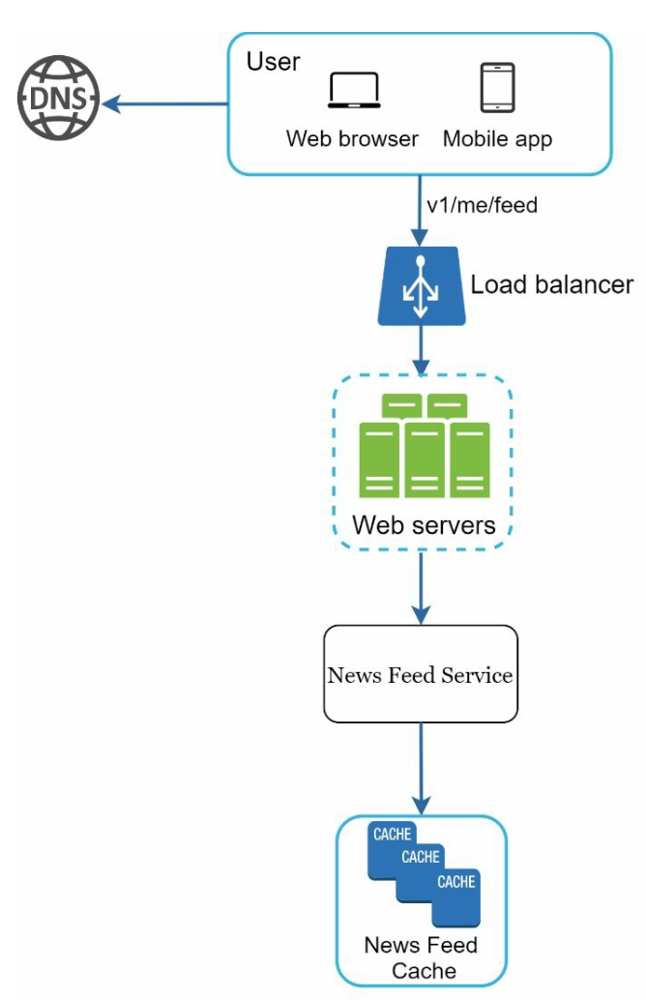
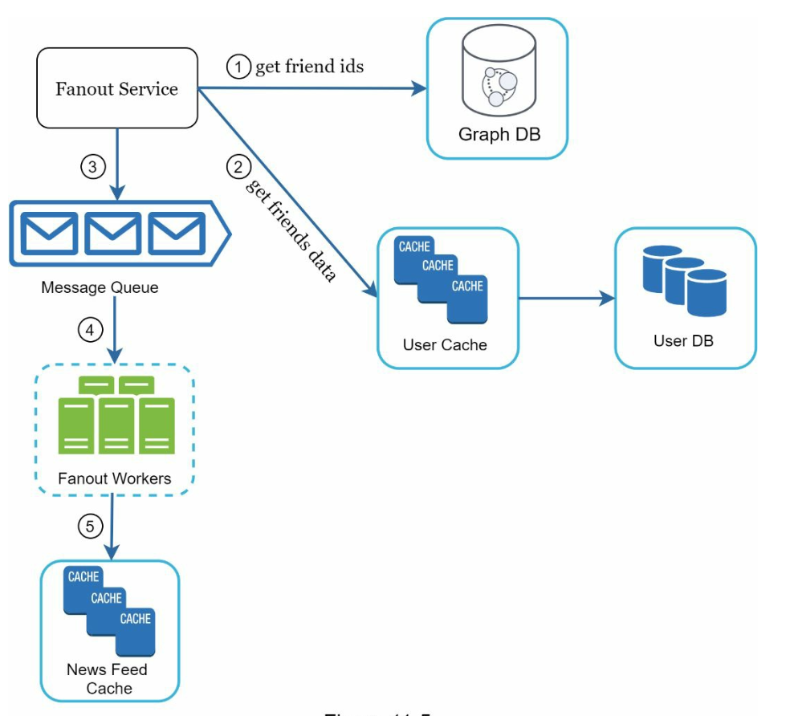
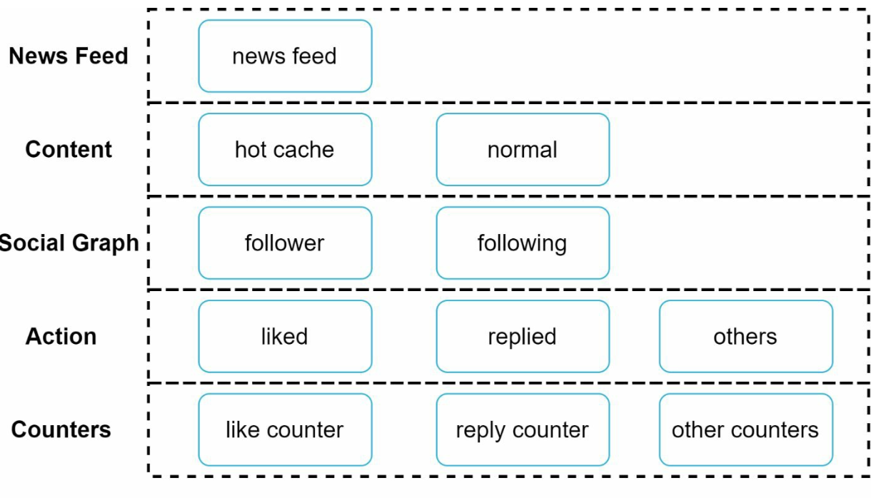

# 11장: 뉴스 피드 시스템 설계

## 소개
**뉴스 피드 시스템(news feed system)** 은 사용자와 연결된 사람들의 게시물(상태 업데이트, 사진, 동영상, 링크)을 계속 갱신되는 목록으로 보여 준다. 페이스북 뉴스 피드, 인스타그램 피드, 트위터 타임라인이 대표적인 예다. 이 장에서는 확장 가능한 뉴스 피드 시스템의 설계를 살펴본다.

---

## 1단계: 문제 이해

### 요구 사항
1. **지원 단말:** 웹과 모바일 앱을 모두 지원한다.
2. **기능:**
   - 사용자는 게시물을 올릴 수 있다.
   - 사용자는 뉴스 피드에서 친구들의 게시물을 볼 수 있다.
3. **정렬:** 단순화를 위해 피드는 **시간 역순**으로 정렬한다.
4. **규모:**
   - 사용자는 최대 5,000명의 친구를 둘 수 있다.
   - 일간 능동 사용자(DAU)는 1,000만 명이다.
   - 피드에는 텍스트, 이미지, 동영상이 포함될 수 있다.

---

## 2단계: 개략적인 설계

### 개요
설계는 두 가지 주요 흐름으로 나뉜다.
1. **피드 발행(feed publishing):** 사용자가 게시물을 올리면 데이터베이스에 기록되고 친구들의 피드로 전파된다.
2. **뉴스 피드 생성(news feed building):** 친구들의 게시물을 시간 역순으로 모아 사용자의 뉴스 피드를 만든다.

---

### 뉴스 피드 API
1. **피드 발행 API:**
   - **엔드포인트:** `POST /v1/me/feed`
   - **인자:** `content`(게시물 본문), `auth_token`(인증)

2. **피드 조회 API:**
   - **엔드포인트:** `GET /v1/me/feed`
   - **인자:** `auth_token`(인증)

---

### 피드 발행

   

      
   

1. **사용자:** 피드 발행 API로 게시물을 올린다.
2. **로드밸런서:** 트래픽을 웹 서버들로 분산한다.
3. **웹 서버:** 요청을 인증하고 내부 서비스로 중계한다.
4. **포스팅 저장 서비스(post service):** 게시물을 데이터베이스와 캐시에 저장한다.
5. **포스팅 전송 서비스(fanout service):** 게시물을 캐시에 있는 친구들의 뉴스 피드로 전파한다.
6. **알림 서비스:** 친구들에게 알림을 보낸다.

---

### 뉴스 피드 생성

   

      
   

1. **사용자:** 조회 API로 자신의 뉴스 피드를 요청한다.
2. **로드밸런서:** 트래픽을 웹 서버들로 분산한다.
3. **웹 서버:** 요청을 뉴스 피드 서비스로 전달한다.
4. **뉴스 피드 서비스:** 뉴스 피드 캐시에서 게시물 ID를 가져오고, 데이터베이스나 캐시에서 게시물 상세 정보를 가져온다.

   
---

## 3단계: 상세 설계

### 피드 발행 흐름 상세 설계
1. **웹 서버:**
   - `auth_token`으로 사용자를 인증한다.
   - 스팸을 막기 위해 처리율을 제한한다.

2. **포스팅 전송(팬아웃) 서비스:**
   - **쓰기 시점 팬아웃(fanout on write):** 게시물을 쓰는 시점에 친구들의 피드로 밀어 넣는다(push).
     - **장점:** 피드가 실시간으로 갱신되고, 피드를 빠르게 조회할 수 있다.
     - **단점:** 친구가 많은 사용자라면 자원이 많이 든다.
   - **읽기 시점 팬아웃(fanout on read):** 피드를 읽는 시점에 게시물을 끌어온다(pull).
     - **장점:** 비활성 사용자에게 효율적이다.
     - **단점:** 피드 조회가 느리다.
   - **혼합 방식:** 대부분의 사용자에게는 푸시 모델을, 연결이 아주 많은 사용자(예: 유명인)에게는 풀 모델을 쓴다.

        

    **팬아웃 서비스**는 다음과 같이 동작한다.

    1. **친구 ID 목록 가져오기:** 그래프 데이터베이스에서 친구 목록을 가져온다.
    2. **캐시에서 친구 정보 필터링:** 캐시에 있는 사용자 설정을 확인해 일부 친구를 제외한다(예: 숨김 처리한 친구, 선택적 공유 설정).
    3. **메시지 큐로 전송:** 걸러 낸 친구 목록과 새 게시물 ID를 메시지 큐에 넣는다.
    4. **팬아웃 작업 서버:** 작업 서버가 메시지 큐에서 데이터를 꺼내 뉴스 피드 캐시를 갱신한다. 메모리를 아끼기 위해 캐시에는 사용자와 게시물 객체 전체 대신 `<post_id, user_id>` 대응 관계만 저장한다.
    5. **뉴스 피드 캐시에 저장:** 친구들의 뉴스 피드 캐시에 새 게시물 ID를 추가한다. 대부분의 사용자는 최신 콘텐츠만 보므로, 설정 가능한 한도를 두어 최근 게시물만 저장해 캐시 메모리 사용량을 관리한다.

        

## 피드 조회 흐름 상세 설계

### 캐시 구조
캐시는 다섯 계층으로 나뉜다.
1. **뉴스 피드 캐시:** 빠른 조회를 위해 게시물 ID를 저장한다.
2. **콘텐츠 캐시:** 게시물 상세 정보를 저장한다(인기 게시물은 별도의 핫 캐시에 둔다).
3. **소셜 그래프 캐시:** 사용자 간 관계 정보를 저장한다.
4. **행동(action) 캐시:** 사용자 행동(좋아요, 답글, 공유)을 추적한다.
5. **횟수(counter) 캐시:** 좋아요, 답글, 팔로워 수 등을 관리한다.

    
---

## 핵심 최적화

### 규모 확장
1. **데이터베이스 규모 확장:**
   - 수평적 규모 확장과 샤딩
   - 트래픽이 많은 질의에는 읽기 전용 사본(read replica) 사용
2. **무상태 웹 계층:** 웹 서버를 무상태로 유지해 수평적 규모 확장이 가능하게 한다.

### 캐시
1. 자주 접근하는 데이터는 메모리에 저장한다.
2. 캐시 계층을 두어 지연 시간과 데이터베이스 부하를 줄인다.

### 안정성
1. **안정 해시:** 요청을 서버들에 고르게 분산한다.
2. **메시지 큐:** 시스템 컴포넌트 간 결합을 끊고 트래픽을 버퍼링한다.

### 모니터링
1. QPS(초당 질의 수)와 지연 시간 같은 핵심 지표를 추적한다.
2. 캐시 적중률을 모니터링하고 그에 맞게 설정을 조정한다.
