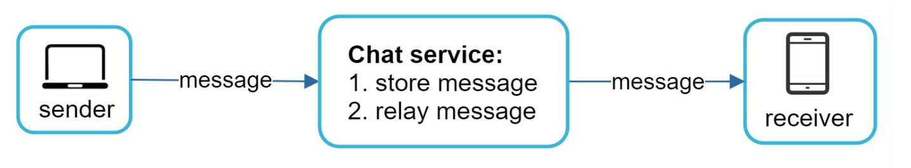
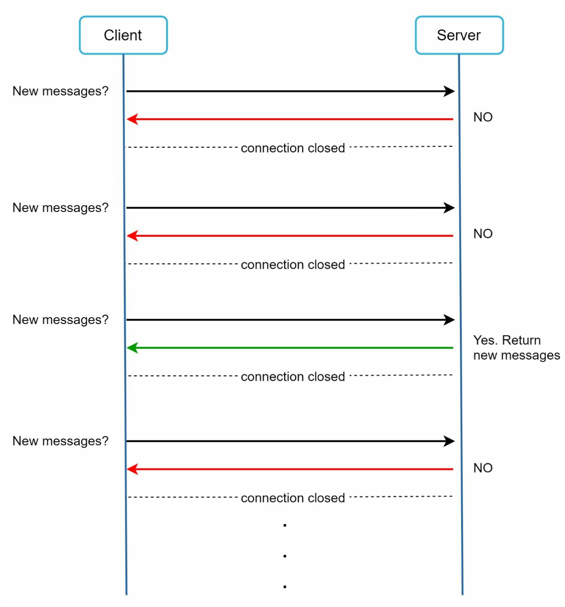
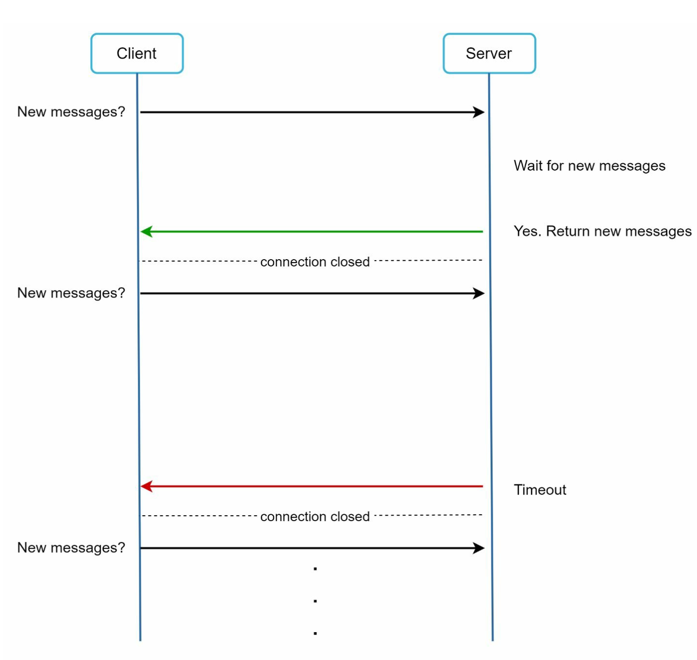
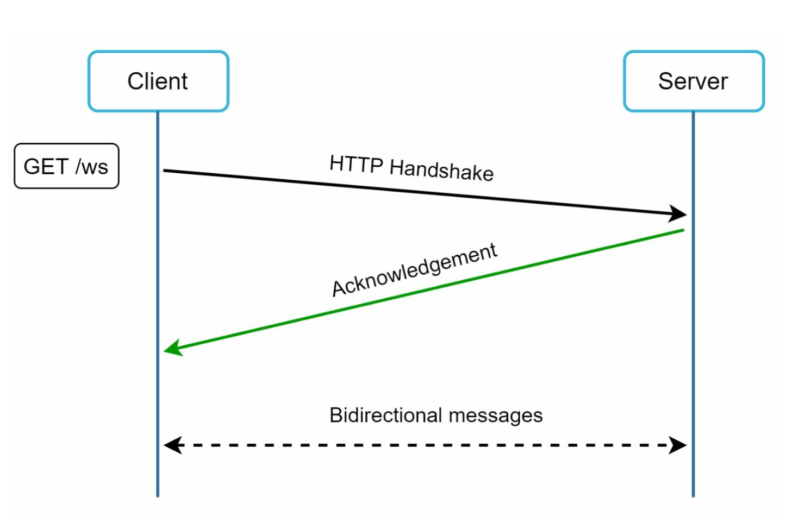
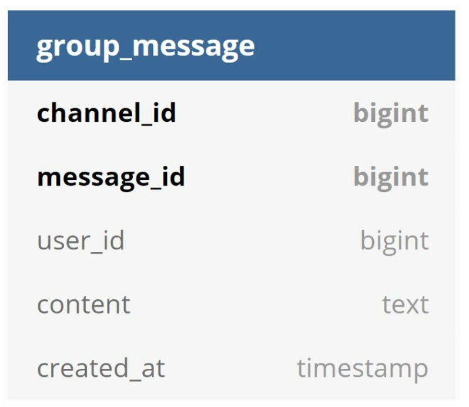
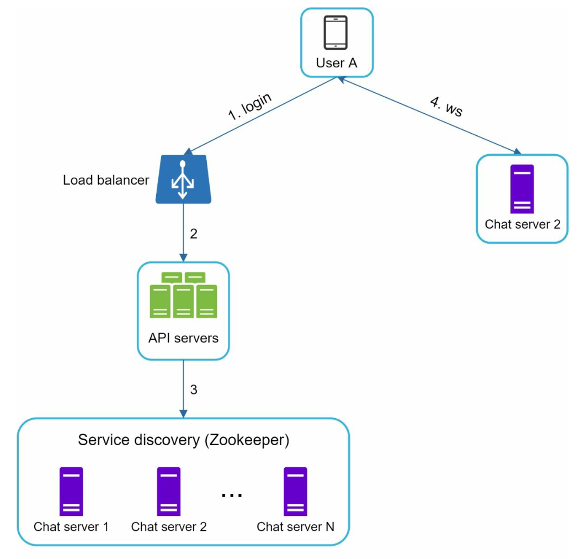
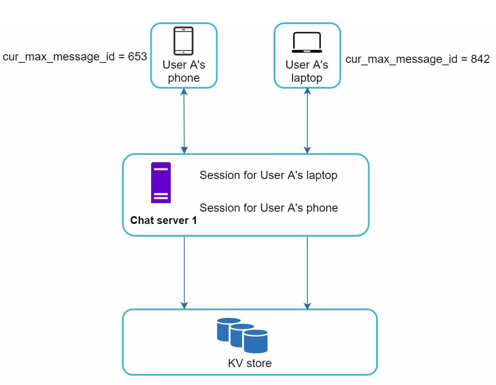
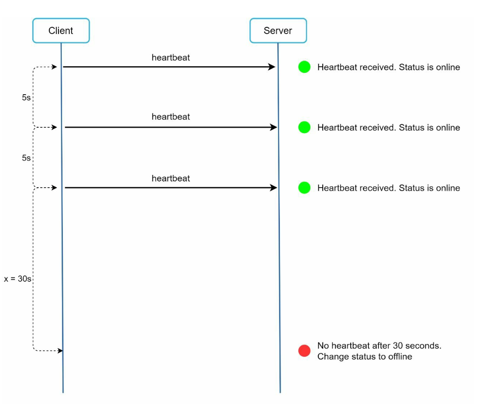
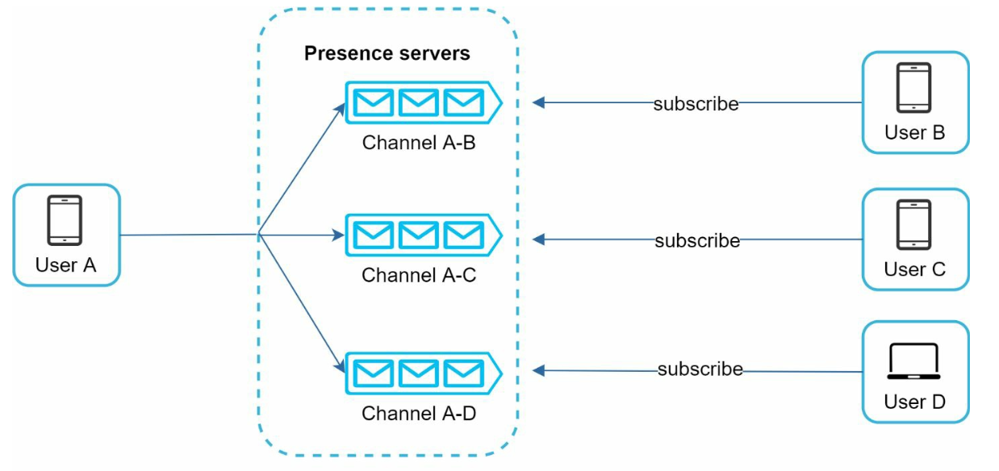

# 12장: 채팅 시스템 설계

## 소개
**채팅 시스템(chat system)** 은 사용자 간 실시간 메시지 교환을 지원한다. 이 장에서는 다음 기능을 갖춘 채팅 앱을 설계하는 데 집중한다.
- **1:1 채팅**
- **그룹 채팅(최대 100명)**
- **접속 상태 표시**
- **다중 단말 지원**
- **푸시 알림**

시스템은 **일간 능동 사용자(DAU) 5,000만 명**을 대상으로 하며, 채팅 이력을 영구 보관한다.

---

## 1단계: 문제 이해

### 요구 사항
1. **기능:**
   - 1:1 채팅과 그룹 채팅(최대 100명)
   - 텍스트 메시지(최대 100,000자)
   - 온라인/오프라인 상태 표시
   - 다중 단말 지원
   - 푸시 알림
2. **규모:** DAU 5,000만 명을 기준으로 설계한다.
3. **저장:** 채팅 이력을 영구 보관한다.

---

## 2단계: 개략적인 설계

### 통신 프로토콜
1. **송신 측:** 메시지를 보낼 때는 HTTP를 사용하며, 효율을 위해 지속 연결(keep-alive)을 활용한다.

      

          
      

2. **수신 측:**
   - **폴링(polling):**
      - 클라이언트가 주기적으로 서버에 새 메시지가 있는지 묻는다.
      - 불필요한 요청이 자주 발생해 비효율적이다.

             

   - **롱 폴링(long polling):** 
      - 새 메시지가 도착할 때까지 연결을 열어 둔다.
      - 활동이 적은 사용자에게는 비효율적이다.

         

   - **웹소켓(WebSocket):** 
      - 실시간 통신을 위한 양방향 지속 연결로, 메시지 송신과 수신 모두에 쓰기로 한다.
      - 메시지를 주고받을 때 웹소켓(ws) 프로토콜을 사용한다.

             
   
---

### 구성 요소

       
   

1. **무상태 서비스:**
   - 회원 가입, 로그인, 사용자 프로필 관리를 처리한다.
   - 서비스 탐색(service discovery)과 연동해 클라이언트에 가장 적합한 채팅 서버를 추천한다.
2. **상태 유지 서비스:**
   - 채팅 서버는 웹소켓 지속 연결을 유지한다.
   - 메시지 전달과 동기화를 책임진다.
3. **제3자 서비스 연동:**
   - 푸시 알림 서비스로 새 메시지가 왔음을 사용자에게 알린다.
   - 알림 구현은 10장 알림 시스템을 참고한다.

---
### 설계

클라이언트는 실시간 메시지 교환을 위해 채팅 서버와 웹소켓 지속 연결을 유지한다.

       

- 채팅 서버는 메시지 송수신을 담당한다.
- 접속 상태 서버(presence server)는 온라인/오프라인 상태를 관리한다.
- API 서버는 로그인, 회원 가입, 프로필 변경 등 나머지 모든 것을 처리한다.
- 알림 서버는 푸시 알림을 보낸다.
- 마지막으로, 채팅 이력은 키-값 저장소에 보관한다. 채팅 이력 데이터베이스로 키-값 저장소를 쓰는 이유는 다음과 같다.
   - 수평적 규모 확장이 쉽다.
   - 데이터 접근 지연 시간이 매우 짧다.
   - 관계형 데이터베이스는 롱 테일(long tail)에 해당하는 데이터를 잘 처리하지 못한다. 인덱스가 커지면 임의 접근(random access) 비용이 커진다.
   - 검증된 다른 채팅 애플리케이션도 키-값 저장소를 채택했다. 페이스북 메신저와 디스코드가 그 예다.

다음은 1:1 채팅과 그룹 채팅의 데이터 모델이다.
   - 기본 키는 메시지 ID이며, 메시지 순서를 정하는 데 쓰인다.
   - 그룹 채팅의 기본 키는 (channel_id, message_id) 복합 키다.
      - ID는 Snowflake 같은 전역 64비트 일련번호 생성기로 만들 수 있다.
      - 더 나은 방법은 지역적 일련번호 생성기(local sequence number generator)를 쓰는 것이다. 여기서 지역적이란 ID가 그룹 안에서만 유일하면 된다는 뜻이다.
      - 지역적 ID로 충분한 이유는 1:1 채널이나 그룹 채널 안에서만 메시지 순서를 유지하면 되기 때문이다.
      
         
         

## 3단계: 상세 설계

### 서비스 탐색

      

- 서비스 탐색의 주된 역할은 지리적 위치, 서버 용량 같은 기준에 따라 클라이언트에 가장 적합한 채팅 서버를 추천하는 것이다.
- **Apache Zookeeper**를 사용해 지리적 위치와 서버 용량 등을 기준으로 채팅 서버를 할당한다.
- 부하를 효율적으로 분산하고 지연 시간을 최소화한다.

### 메시지 흐름
#### 1:1 채팅

1. 사용자 A가 채팅 서버 1로 메시지를 보낸다.
2. 채팅 서버 1은 유일한 메시지 ID를 부여하고 메시지를 키-값 저장소에 저장한다.
3. 사용자 B가 온라인이면, 메시지는 사용자 B와 웹소켓 지속 연결을 유지하고 있는 채팅 서버 2로 전달된다.
4. 사용자 B가 오프라인이면 푸시 알림을 보낸다.

#### 그룹 채팅

     

- 메시지는 그룹의 수신자마다 개별 수신함에 복사된다.
- 동기화가 단순해지지만, 그룹이 커지면 비용이 많이 든다.
- 수신자 측에서는 여러 사용자로부터 메시지를 받을 수 있다. 각 수신자는 여러 발신자의 메시지를 담는 수신함(메시지 동기화 큐)을 갖는다.

---

#### 메시지 동기화

사용자는 대개 단말을 여러 대 쓰므로 단말 간에 메시지를 동기화해야 한다. 각 단말은 해당 단말에서 관측된 가장 최신 메시지 ID를 추적하는 cur_max_message_id 변수를 유지한다. 다음 두 조건을 만족하는 메시지는 새 메시지로 간주한다.

     

- 수신자 ID가 현재 로그인한 사용자 ID와 같다.
- 키-값 저장소에 보관된 메시지의 ID가 cur_max_message_id보다 크다.

---

### 접속 상태 표시
1. **박동(heartbeat) 검사:** 
   

       
   

   
   - 클라이언트는 접속 상태 서버에 주기적으로 박동 이벤트를 보내 온라인임을 알린다.
   - 정해진 시간(예: x = 30초) 안에 박동 이벤트를 받지 못하면 사용자를 오프라인으로 표시한다.

     

2. **상태 정보 전송(팬아웃):** 

   

       
   

   - 발행-구독(publish-subscribe) 모델로 친구들에게 상태 변화를 전달하며, 친구 관계마다 채널을 하나씩 둔다.
   - 사용자 A의 접속 상태가 바뀌면 A-B, A-C, A-D 세 채널에 이벤트를 발행한다.
   - 사용자 B, C, D가 각 채널을 구독하고 있으므로 상태 변화를 전달받는다.
   - 이 설계는 그룹 크기가 작을 때 효과적이다.

---

## 추가 고려 사항
### 규모 확장성
- **수평적 규모 확장:** 사용자 수가 늘어나면 서버를 추가한다.
- **로드밸런싱:** 트래픽을 서버들에 고르게 분산한다.
- **캐시:** 데이터베이스 부하를 줄이고 지연 시간을 개선한다.

### 오류 처리
- **재시도 메커니즘:** 메시지 전달이 실패하면 재시도와 큐잉으로 처리한다.
- **서버 장애:** 장애가 나면 서비스 탐색으로 새 서버를 할당한다.

### 향후 확장
1. **미디어 지원:** 사진과 동영상을 처리하며, 압축과 클라우드 저장소 사용을 포함한다.
2. **종단 간 암호화(end-to-end encryption):** 메시지의 기밀성을 보장한다.
3. **클라이언트 측 캐시:** 데이터 전송량을 줄여 성능을 높인다.
4. **로딩 속도 개선:** 지리적으로 분산된 캐시 네트워크를 사용한다.

