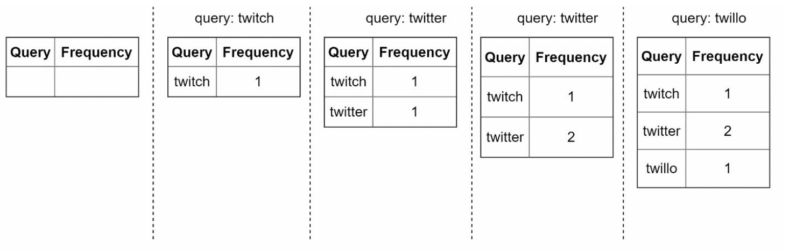
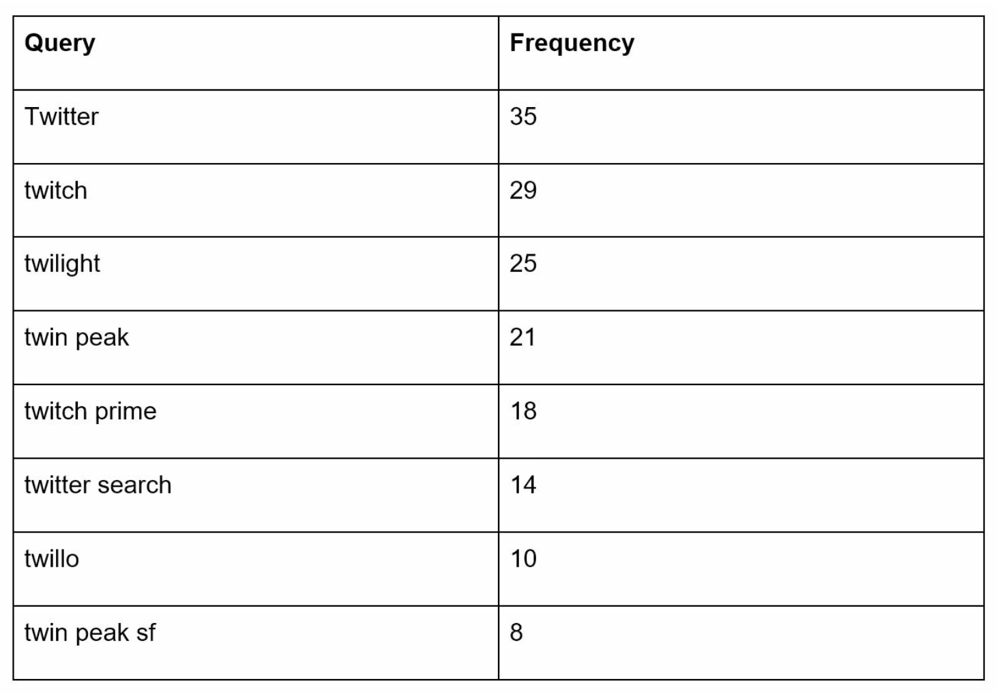
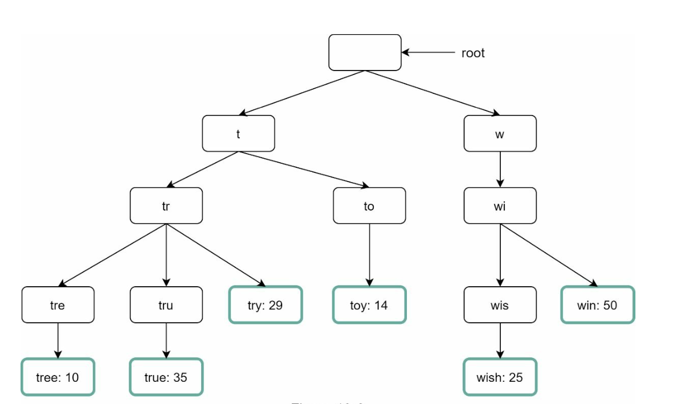
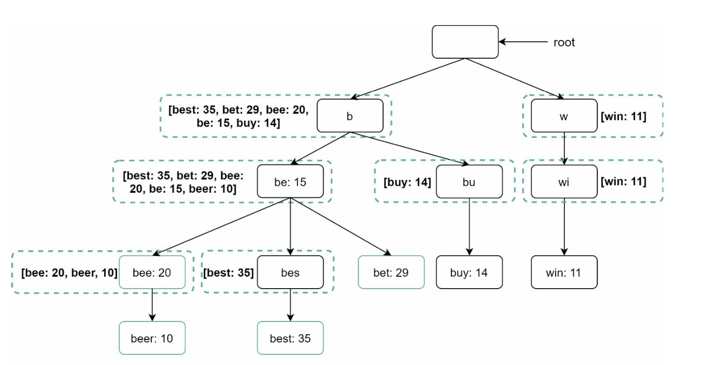
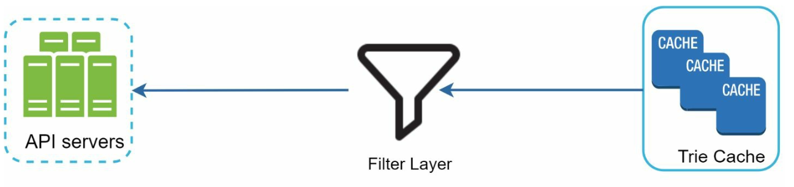
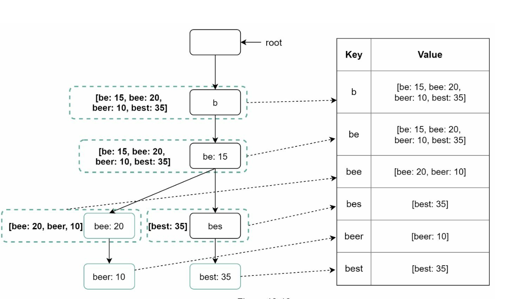
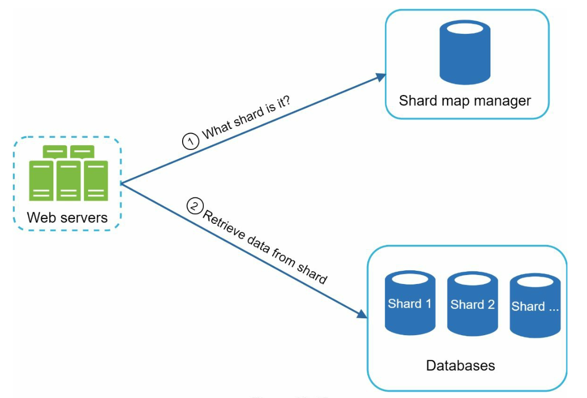

# 13장: 검색어 자동완성 시스템 설계

## 소개
자동완성(autocomplete)은 타입어헤드(typeahead), 점진 검색(incremental search)이라고도 하며, 사용자가 검색창에 입력하는 동안 실시간으로 추천 검색어를 보여 준다. 시스템은 과거 질의 데이터를 바탕으로 관련성 높고 인기 있는 상위 k개 검색어를 효율적으로 제공해야 한다.

### 핵심 기능
- 자동완성 검색어를 **최대 5개**까지 제시한다.
- **질의 인기도**(빈도)를 기준으로 한다.
- **영어 소문자만** 지원한다.
- 응답 속도가 빠르고(100 ms 미만) 규모 확장이 가능해야 한다.

---

## 1단계: 문제 이해

### 요구 사항
1. **실시간 추천:** 사용자가 입력하는 동안 관련 검색어를 보여 준다.
2. **상위 k개 결과:** 인기순으로 정렬된 검색어를 최대 5개 반환한다.
3. **규모 확장성:** **DAU 1,000만 명**, 최대 QPS **48,000**을 처리한다.
4. **고가용성:** 장애가 나도 시스템이 중단되지 않는다.
5. **데이터 증가:** 새 질의 데이터로 매일 **0.4 GB**씩 늘어나는 저장 공간을 감당한다.

---

## 2단계: 개략적인 설계
개략적으로 보면 시스템은 두 서비스로 나뉜다.
1. **데이터 수집 서비스(data gathering service):** 
    - 사용자 질의를 수집해 실시간으로 빈도를 집계한다.
    - 데이터가 많으면 실시간 처리는 현실적이지 않지만, 출발점으로는 괜찮다.

2. **질의 서비스(query service):** 사용자 입력에 맞는 상위 k개 검색어를 제공한다.

---

### 데이터 수집 서비스

    

- 분석 로그에서 질의 데이터를 집계해 빈도 테이블을 갱신한다.
- 과거 데이터를 매주 처리해 **트라이(trie)**(접두어 트리)를 만든다.

### 질의 서비스

    
    

- 데이터 수집 서비스가 만든 빈도 테이블을 사용한다.
- 사용자 입력을 받아 트라이를 이용해 빈도 테이블에서 상위 k개 검색어를 찾는다.
- 캐시와 효율적인 자료 구조로 빠른 조회에 최적화한다.
- 예를 들어 사용자가 검색창에 "tw"를 입력하면, 다음과 같이 가장 많이 검색된 질의 5개가 표시된다.

---

## 3단계: 상세 설계

### 트라이 자료 구조
**트라이**는 질의 문자열을 효율적으로 저장하고 찾기 위한 트리 형태의 자료 구조다.

#### 핵심 특징
1. **압축 저장:** 접두어를 계층적으로 표현해 중복을 줄인다.
2. **빈도 정보:** 각 노드에 질의의 인기도를 저장한다.

4. **가장 많이 검색된 질의 k개를 찾는 단계**
   

      
   

    - 해당 접두어를 표현하는 노드를 찾는다.
    - 접두어 노드부터 하위 트리를 탐색해 유효한 자식 노드를 모두 찾는다.
    - 자식 노드를 정렬해 상위 k개를 고른다.

3. **최적화:**
   - 각 노드에 상위 k개 질의를 캐시해 두면 트라이 전체를 탐색하지 않고 빠르게 찾을 수 있다.

        

   - 사용자가 아주 긴 검색어를 입력하는 일은 드물므로, 접두어 최대 길이(예: 50)를 제한해 탐색 범위를 줄인다.

#### 트라이 연산
1. **생성:** 
    - 집계된 질의 데이터로 매주 만든다.
    - 데이터 출처는 분석 로그나 데이터베이스다.
2. **갱신:** 실시간으로 갱신하는 일은 드물며, 매주 새 트라이로 기존 데이터를 대체한다.
3. **삭제:** 
      

         
      

    - 필터로 원치 않거나 유해한 검색어(예: 혐오 발언)를 제거한다.
    - 필터 계층을 두면 다양한 필터 규칙에 따라 결과를 유연하게 제거할 수 있다.
    - 원치 않는 검색어는 데이터베이스에서 비동기적으로 물리 삭제한다.
    

---

### 질의 처리 흐름
1. **접두어 검색:**
   - 사용자 입력에 해당하는 접두어 노드를 찾는다.
   - 하위 트리를 탐색해 유효한 검색어를 모은다.
2. **상위 k개 정렬:**
   - 각 노드에 상위 k개 검색어를 캐시해 정렬 부담을 최소화한다.
3. **응답 구성:**
   - 캐시된 데이터로 결과를 구성해 응답 시간을 줄인다.

---

### 최적화
1. **노드마다 캐시:**
   - 상위 k개 질의를 저장해 중복 탐색을 피한다.
2. **접두어 길이 제한:**
   - 접두어 최대 길이를 작은 값(예: 50자)으로 제한해 조회 속도를 높인다.
3. **AJAX 요청:**
   - 가벼운 비동기 요청으로 실시간 응답을 제공한다.
4. **브라우저 캐시:**
   - 자주 검색되는 검색어의 자동완성 결과를 브라우저 캐시에 저장한다.

---

### 데이터 수집 파이프라인
개략적인 설계에서는 사용자가 검색어를 입력할 때마다 데이터를 실시간으로 갱신했다. 이 방법은 현실적이지 않다.
- 사용자는 하루에 수십억 개의 질의를 입력할 수 있다. 질의마다 트라이를 갱신하는 것은 불가능하다.
- 트라이가 한번 만들어지면 상위 검색어는 크게 바뀌지 않을 것이다.

#### 수정된 설계

   

1. **데이터 분석 서비스 로그:**
   - 매주 집계할 수 있도록 원시 질의 데이터를 로그로 저장한다.
   - 로그는 추가만 가능하며(append-only) 인덱스를 걸지 않는다.
2. **로그 취합 서버(aggregator):**
   - 로그를 트라이 생성에 적합한 빈도 테이블로 가공한다.
   - 트위터처럼 실시간성이 중요한 애플리케이션이라면 짧은 주기로 데이터를 취합한다.
   - 그 밖의 경우에는 덜 자주, 예를 들어 일주일에 한 번 취합해도 충분하다.
3. **작업 서버(worker):**
   - 비동기적으로 트라이를 다시 만들고 영구 저장소에 저장하는 서버들이다.
4. **저장 방법:**
    - **트라이 캐시**: 트라이를 메모리에 유지해 읽기 연산 성능을 높이는 분산 캐시 시스템이다.
    - **트라이 데이터베이스** 
        1. **문서 저장소(예: MongoDB)**: 매주 새 트라이를 만들므로, 주기적으로 트라이의 스냅숏을 떠서 직렬화한 뒤 MongoDB 같은 데이터베이스에 저장할 수 있다.
        2. **키-값 저장소:** 
            - 접두어를 노드 데이터에 대응시켜 빠르게 접근할 수 있게 한다.
            - 트라이의 모든 접두어를 해시 테이블의 키로 변환한다.
            - 각 트라이 노드에 보관된 데이터를 해시 테이블의 값으로 변환한다.

                
---

### 규모 확장성
1. **샤딩:**
   - 접두어 범위(예: `a-m`, `n-z`)를 기준으로 트라이 노드를 여러 서버에 분산한다.
   - 분포가 고르지 않으면 접두어를 더 잘게 나눠 샤딩한다(예: `aa-ag`, `ah-an`).
2. **로드밸런싱:**
   

      
   

   - 샤드 맵 관리자(shard map manager)를 두어 요청을 알맞은 서버로 보낸다.

---

## 4단계: 고급 기능

### 다국어 지원
1. **유니코드 문자:** 영어 이외의 언어를 지원하기 위해 유니코드를 사용한다.
2. **국가별 트라이:** 국가나 지역별로 별도의 트라이를 만든다.

### 실시간으로 변하는 검색어 추이
- 트라이 노드를 동적으로 갱신하거나 최근 질의에 더 큰 가중치를 주어 실시간 이벤트에 대응한다.

