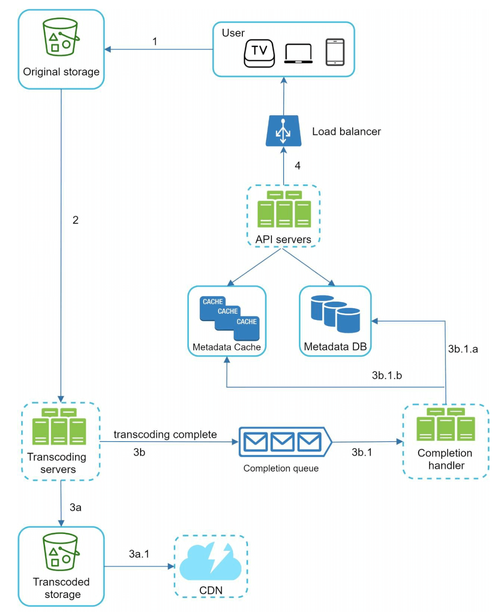
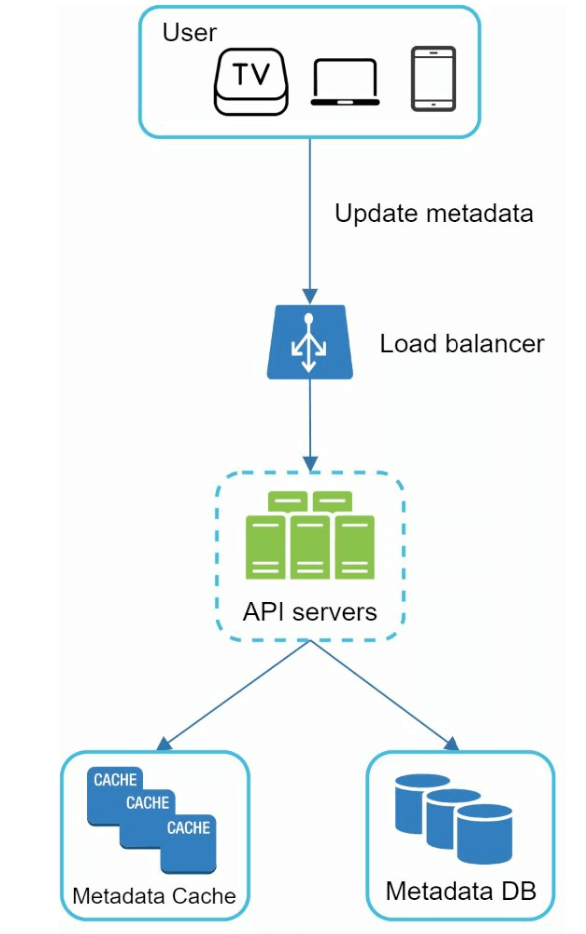
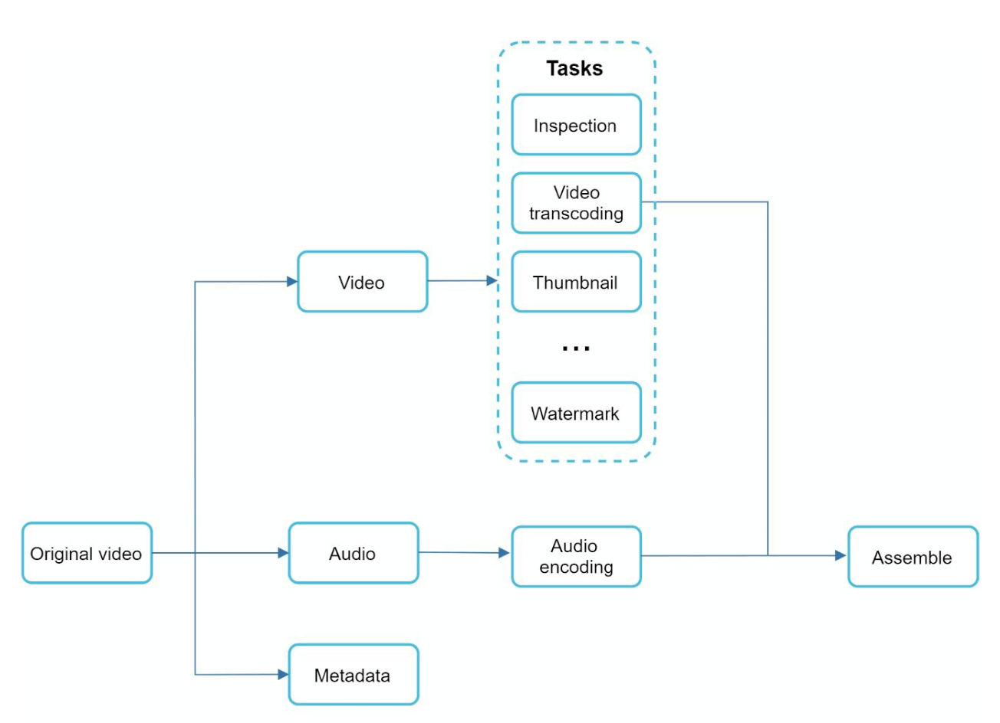
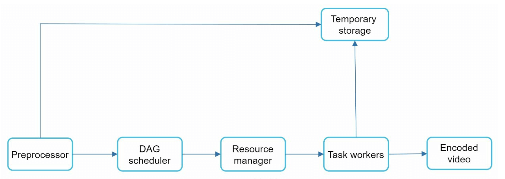
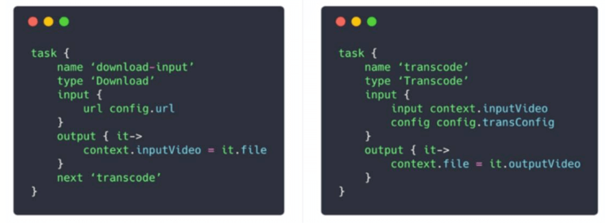
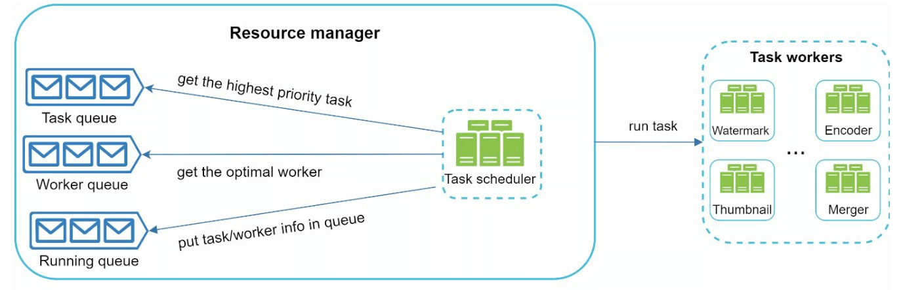
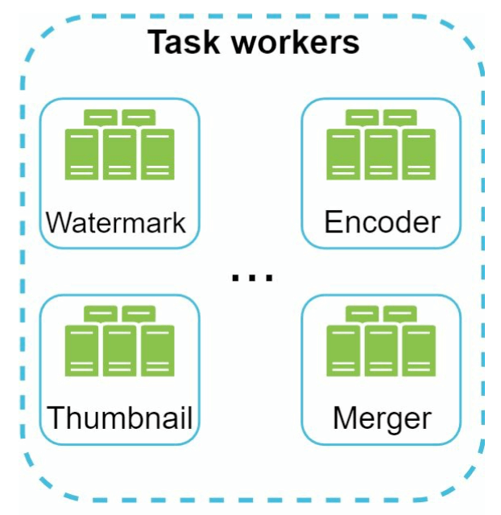
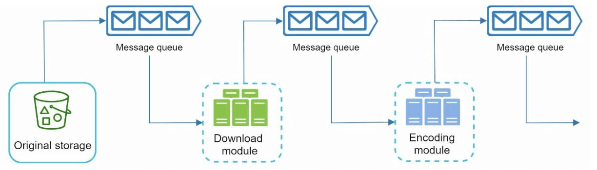

# 14장: 유튜브 설계

## 소개
유튜브는 동영상 업로드, 재생, 다양한 상호작용을 지원하는 거대한 동영상 스트리밍 플랫폼이다. 이 장에서는 다음 핵심 기능을 갖춘 확장 가능한 동영상 스트리밍 시스템을 설계하는 데 집중한다.
- **빠른 동영상 업로드**
- **원활한 동영상 재생**
- **화질 변경 기능**
- **낮은 인프라 비용**
- **높은 가용성과 안정성**

### 주요 통계(2020년)
- **월간 능동 사용자 20억 명**
- **하루 동영상 시청 횟수 50억 회**
- **모바일 인터넷 트래픽의 37%가 유튜브**
- **80개 언어**로 이용 가능
- 2019년 **광고 수입 151억 달러**

---

## 1단계: 문제 이해 및 설계 범위 확정

### 핵심 기능
1. 동영상 업로드
2. 동영상 시청

### 지원 단말
- 모바일 앱, 웹 브라우저, 스마트 TV

### 가정
- **일간 능동 사용자(DAU):** 500만 명
- **평균 동영상 크기:** 300 MB
- **업로드 제한:** 동영상당 최대 1 GB
- **일일 저장 공간 요구량:** 150 TB
- **CDN 비용:** 5 million * 5 videos * 0.3GB * $0.02 =  하루 $150,000(Amazon CloudFront 기준)

---

## 2단계: 개략적인 설계

### 구성 요소

    

1. **클라이언트:** 스마트폰, 컴퓨터, TV 같은 단말이다.
2. **CDN(콘텐츠 전송 네트워크):** 동영상을 저장하고 스트리밍한다.
3. **API 서버:** 동영상 스트리밍을 제외한 모든 사용자 요청(예: 업로드, 메타데이터 갱신)을 처리한다.
4. **메타데이터 데이터베이스:** 동영상 메타데이터(예: 제목, 설명, 크기)를 저장한다.
5. **원본 저장소:** 업로드된 원본 동영상을 보관하는 BLOB 저장소다.
6. **트랜스코딩 서버:** 동영상을 여러 해상도와 포맷으로 변환한다.
7. **트랜스코딩 동영상 저장소:** 트랜스코딩이 끝난 동영상을 보관하는 BLOB 저장소다.

---

### 핵심 흐름
#### 1. 동영상 업로드 흐름
- **병렬로 진행되는 두 과정:**
  1. 동영상을 원본 저장소에 업로드한다.
  2. 데이터베이스의 동영상 메타데이터를 갱신한다.

- **동영상 업로드(단계별):**

    

        
    

    - [1] 동영상을 BLOB 저장소에 업로드한다.
    - [2] 트랜스코딩 서버가 동영상을 여러 포맷으로 변환한다.
    - [3] 트랜스코딩이 끝나면 다음 두 단계가 병렬로 실행된다.
        - [3a] 트랜스코딩된 동영상을 트랜스코딩 동영상 저장소로 보낸다.
        - [3b] 트랜스코딩 완료 이벤트를 완료 큐(completion queue)에 넣는다.
    - [3a.1] 동영상을 CDN에 배포한다.
    - [3b.1] 완료 핸들러(completion handler)가 메타데이터를 갱신하고 사용자에게 알린다.

- **메타데이터 갱신(단계별):**

    

        
    

    - 클라이언트는 업로드와 병렬로 동영상 메타데이터 갱신 요청을 보낸다.
    - 요청에는 파일 이름, 크기, 포맷 등 동영상 메타데이터가 들어 있다.
    
       

#### 2. 동영상 스트리밍 흐름

  

- 지연 시간을 최소화하기 위해 동영상은 CDN의 에지 서버에서 바로 스트리밍된다.
- 널리 쓰이는 스트리밍 프로토콜로는 MPEG_DASH, Apple HLS, Adobe HDS 등이 있다.
-  *스트리밍 프로토콜마다 지원하는 동영상 인코딩과 플레이어가 다르다.*

---

## 3단계: 상세 설계

### 동영상 트랜스코딩
#### 중요성
1. 원본 동영상은 저장 공간을 많이 차지한다. 트랜스코딩은 저장 공간을 줄여 준다.
2. 여러 단말과 브라우저에서 재생할 수 있도록 호환성을 보장한다.
3. 네트워크 상태에 맞게 화질을 조정할 수 있다.

#### 구성 요소
- **컨테이너(container):** 동영상, 오디오, 메타데이터를 담는 바구니다(예: MP4, AVI).
- **코덱(codec):** 압축 및 압축 해제 알고리즘이다(예: H.264, VP9).

#### 방향성 비순환 그래프(DAG) 모델

    

- 동영상 트랜스코딩은 컴퓨팅 자원을 많이 쓰고 시간이 오래 걸린다.
- DAG 모델로 인코딩, 섬네일 생성, 워터마크 추가 같은 작업을 정의한다.
- 동영상 처리를 높은 수준으로 병렬화할 수 있다.

- 원본 동영상은 비디오, 오디오, 메타데이터로 나뉜다.
    - 비디오 인코딩: 다양한 해상도, 코덱, 비트레이트를 지원하도록 동영상을 변환한다.
    - 섬네일: 사용자가 직접 올릴 수도 있고 시스템이 자동으로 만들 수도 있다.
    - 워터마크: 동영상 위에 겹쳐 표시하는 이미지로, 동영상의 식별 정보를 담는다.

---

### 동영상 트랜스코딩 아키텍처

1. **전처리기(preprocessor):** 동영상을 작은 단위(GOP 정렬)로 나눈다. 네 가지 책임을 진다.

    

        
    

    - 동영상 분할: 동영상 스트림을 GOP(Group of Pictures)라는 더 작은 단위로 나눈다.
    - 분할을 지원하지 못하는 구형 클라이언트를 위해 전처리기가 GOP 단위로 동영상을 나눈다.
    - 클라이언트 프로그래머가 작성한 설정 파일을 바탕으로 DAG를 만든다.
    - 인코딩이 실패하면 저장해 둔 데이터로 재시도할 수 있도록, GOP와 메타데이터를 임시 저장소에 보관한다.

2. **DAG 스케줄러:** 작업을 순차 또는 병렬 단계로 구성한다.
    

        
    

    - DAG를 여러 단계(stage)의 작업으로 나눠 자원 관리자의 작업 큐에 넣는다.
    - 1단계: 비디오, 오디오, 메타데이터로 나눈다.
    - 2단계: 비디오 파일을 다시 비디오 인코딩과 섬네일 추출이라는 두 작업으로 나눈다.

3. **자원 관리자(resource manager):** 자원 배분을 효과적으로 관리한다. 큐 세 개와 작업 스케줄러로 구성된다.
    

        
    

    - 작업 큐(task queue): 실행할 작업이 담긴 우선순위 큐다.
    - 작업 서버 큐(worker queue): 작업 서버의 가용 상태 정보가 담긴 우선순위 큐다.
    - 실행 큐(running queue): 현재 실행 중인 작업과 그 작업을 실행 중인 작업 서버 정보가 담긴다.
    - 작업 스케줄러(task scheduler): 최적의 작업과 작업 서버를 골라 해당 작업 서버에 작업 실행을 지시한다.

4. **작업 서버(task worker):** 트랜스코딩과 기타 작업을 수행한다.
    

        
   

    - 작업 서버마다 서로 다른 작업을 실행할 수 있다.

5. **임시 저장소:** 재시도를 위한 중간 데이터를 보관한다.
    - 어떤 저장 시스템을 쓸지는 데이터 유형, 크기, 접근 빈도, 보관 기간 등에 따라 정한다.
6. **출력:** 배포할 준비가 끝난, 트랜스코딩된 동영상이다.

---

## 시스템 최적화

### 속도 최적화
1. **동영상 병렬 업로드:** 동영상을 작은 조각으로 나눠 업로드 속도를 높이고, 실패하면 이어서 올릴 수 있게 한다.

    

2. **업로드 센터 분산:** 사용자 가까이에 있는 CDN을 업로드 거점으로 활용한다.
3. **모든 절차를 병렬화:** 메시지 큐로 모듈 간 결합을 끊어 병렬성을 높인다.

    
    

### 안전성 최적화
1. **사전 서명된 URL(pre-signed URL):** 권한이 있는 사용자만 동영상을 업로드할 수 있게 한다.

    

2. **동영상 보호:**
   - **DRM 시스템**(예: Apple FairPlay, Google Widevine)
   - **AES 암호화**
   - **워터마크**

### 비용 최적화
1. 인기 있는 동영상만 CDN으로 제공하고, 나머지는 대용량 저장소 서버에서 제공한다.
2. 거의 보지 않는 동영상은 요청이 있을 때 인코딩한다.
3. 인기도에 따라 지역별로 동영상을 배포한다.
4. 자체 CDN을 구축하고 인터넷 서비스 제공자(ISP)와 제휴해 대역폭 비용을 줄인다.

---

## 오류 처리
### 회복 가능한 오류
- 실패한 업로드, 트랜스코딩, 자원 할당 작업은 재시도한다.

### 회복 불가능한 오류
- 형식이 잘못된 동영상은 처리를 중단하고 오류 코드를 반환한다.

