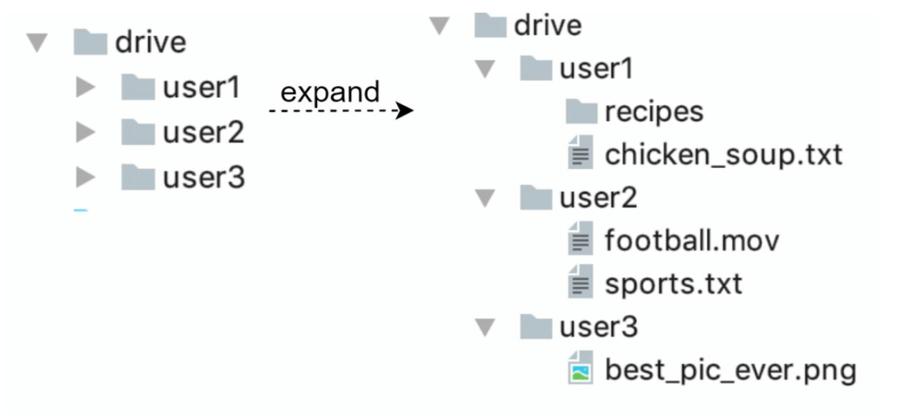
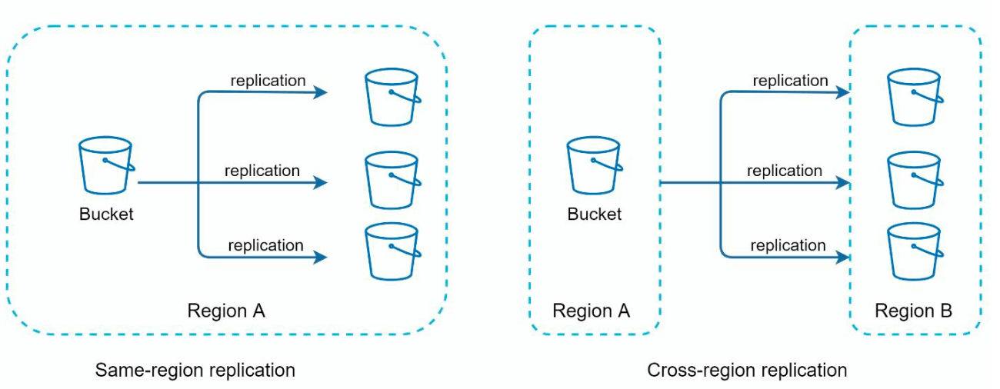
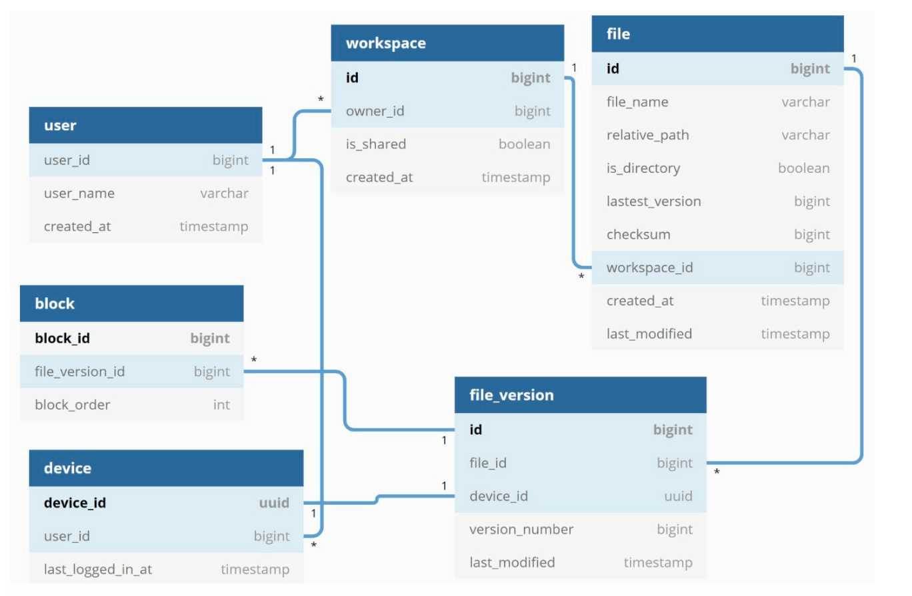
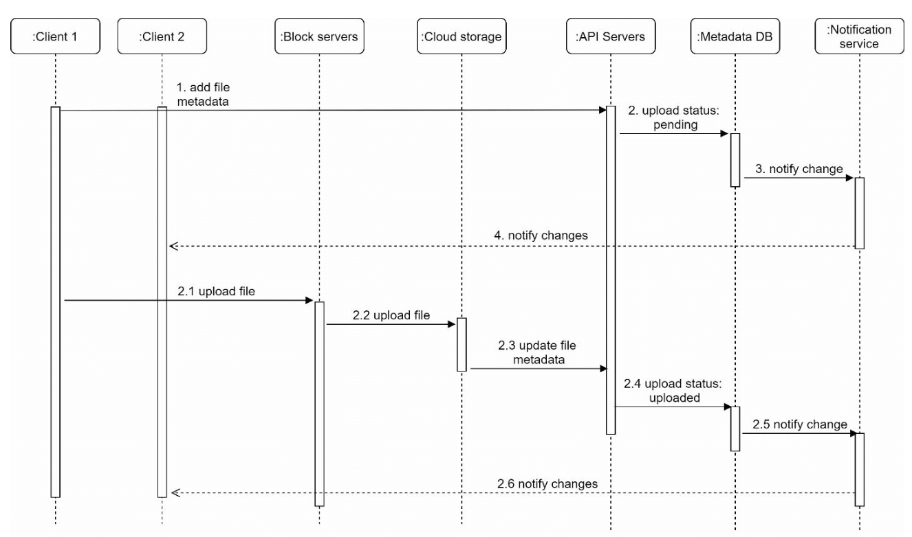

# 15장: 구글 드라이브 설계

## 소개
구글 드라이브는 여러 단말에서 파일을 저장하고, 접근하고, 공유할 수 있게 해 주는 클라우드 기반 파일 저장 및 동기화 서비스다. 이 장에서는 다음 기능을 갖춘 확장 가능한 시스템을 설계한다.
- **파일 업로드와 다운로드**
- **여러 단말 간 파일 동기화**
- **파일 공유**
- **파일 갱신 이력 조회**
- **파일 편집·삭제·공유 시 알림**

---

## 1단계: 문제 이해

### 핵심 요구 사항
#### 기능 요구 사항
- 파일을 업로드하고 다운로드한다.
- 여러 단말 간에 파일을 동기화한다.
- 파일 갱신 이력을 보관한다.
- 권한을 지정해 파일을 공유할 수 있다.
- 파일이 편집·삭제·공유되면 알림을 보낸다.

#### 비기능 요구 사항
- **안정성:** 데이터 손실은 용납되지 않는다.
- **빠른 동기화 속도:** 동기화가 늦어 사용자가 답답해하지 않게 한다.
- **네트워크 대역폭:** 불필요한 데이터 사용을 최소화한다.
- **규모 확장성:** 일간 능동 사용자(DAU) 1,000만 명을 처리한다.
- **높은 가용성:** 서버 장애나 네트워크 문제가 있어도 끊김 없이 동작한다.

### 제약 조건과 가정
- 사용자에게 **10 GB 무료 저장 공간**을 제공한다.
- 최대 파일 크기: **10 GB**
- 평균 업로드 파일 크기: **500 KB**
- 업로드 빈도: **사용자당 하루 2개**
- 필요한 전체 저장 공간: **500 PB**

---

## 2단계: 개략적인 설계
### 서버 한 대로 구성
기본 구성은 다음과 같다.
1. **웹 서버:** 업로드와 다운로드를 처리한다.
2. **메타데이터 데이터베이스:** 사용자 데이터, 로그인 정보, 파일 정보 같은 메타데이터를 관리한다.
3. **저장소 디렉터리:** 파일을 네임스페이스별로 나눠 보관한다.

    

- 웹 서버 한 대를 두고, 업로드된 파일을 저장할 루트 디렉터리로 drive/를 만든다.
- drive/ 아래에는 네임스페이스(namespace)라고 부르는 디렉터리들이 있다.
- 각 네임스페이스에는 해당 사용자가 업로드한 파일이 모두 들어 있다.
- 네임스페이스 이름과 상대 경로를 합치면 각 파일이나 폴더를 유일하게 식별할 수 있다.

이 설계는 출발점으로는 괜찮지만 규모를 확장하기에는 부족하다.

#### API
1. **파일 업로드:** 두 가지 업로드 방식을 지원한다.
    - 단순 업로드: 파일 크기가 작을 때 쓴다.
    - 이어 올리기(resumable upload): 
        - 엔드포인트: https://api.example.com/files/upload?uploadType=resumable
        - 이어 올리기용 URL을 받기 위한 최초 요청을 보낸다.
        - 데이터를 업로드하고 업로드 상태를 모니터링한다.
        - 업로드가 중단되면 이어서 업로드한다.
2. **파일 다운로드:**
    -  엔드포인트: https://api.example.com/files/download
3. **파일 갱신 이력 조회:**
    - 엔드포인트: https://api.example.com/files/list_revisions

### 분산 시스템으로 전환

#### 개선 사항
1. **샤딩:** `user_id`를 기준으로 저장소를 여러 서버에 나눈다.
2. **Amazon S3:** 규모 확장성과 다중화를 위해 S3를 파일 저장소로 쓰고, 다른 리전으로 다중화한다.

    
     
3. **로드밸런서:** 트래픽을 여러 웹 서버에 분산한다.
4. **메타데이터 데이터베이스 다중화:** 데이터베이스 샤딩과 다중화로 가용성을 보장한다.

#### 동기화 충돌
구글 드라이브 같은 대형 저장소 시스템에서는 동기화 충돌이 종종 발생한다. 두 사용자가 같은 파일이나 폴더를 동시에 수정하면 충돌이 생긴다.

- 예시에서 사용자 1과 사용자 2가 같은 파일을 동시에 갱신하려 하지만, 시스템은 사용자 1의 파일을 먼저 처리한다.
- 사용자 1의 갱신은 성공하고, 사용자 2에게는 동기화 충돌이 발생한다.
- 시스템은 같은 파일의 두 사본, 즉 사용자 2의 로컬 사본과 서버의 최신 버전을 함께 보여 준다.
- 사용자 2는 두 파일을 병합할지, 한쪽 버전으로 다른 쪽을 덮어쓸지 선택할 수 있다.

### 개선된 설계

1. **사용자 단말:** 사용자는 브라우저나 모바일 앱으로 애플리케이션에 접근한다.

2. **블록 저장소 서버(block server):**
   - 파일을 **최대 4 MB 크기의 블록**으로 나누고 블록마다 고유한 해시 값을 부여한다.
   - 블록은 클라우드 저장소(예: Amazon S3)에 독립적으로 저장된다.
   - 파일을 복원하려면 블록들을 정해진 순서대로 이어 붙인다.

3. **클라우드 저장소:** 규모 확장성과 다중화를 위해 블록을 클라우드 저장소에 보관한다.

4. **아카이빙 저장소(cold storage):** 오랫동안 쓰지 않은 파일은 비용을 줄이기 위해 아카이빙 저장소로 옮긴다.

5. **로드밸런서:** 요청을 API 서버들에 고르게 분산해 효율적으로 운영한다.

6. **API 서버:**
   - 사용자 인증, 프로필 관리, 파일 메타데이터 갱신을 처리한다.
   - 파일 업로드 외의 거의 모든 작업을 담당한다.

7. **메타데이터 데이터베이스와 캐시:**
   - 사용자, 파일, 블록, 버전에 대한 메타데이터를 저장한다.
   - 자주 쓰는 메타데이터는 빠르게 조회할 수 있도록 캐시에 둔다.

8. **알림 서비스:**
   - 파일 변경(추가, 편집, 삭제)을 클라이언트에 알리는 **발행/구독 시스템**이다.
   - 클라이언트가 최신 변경 사항을 가져갈 수 있게 한다.

9. **오프라인 사용자 백업 큐:** 오프라인 클라이언트가 다시 접속했을 때 동기화할 수 있도록 파일 변경 정보를 임시로 보관한다.

---

## 3단계: 상세 설계

### 메타데이터 데이터베이스
아래는 가장 중요한 테이블과 필드만 담아 크게 단순화한 버전이다.
#### 스키마 설계
- **user 테이블:** 사용자 프로필과 설정을 저장한다.
- **file 테이블:** 파일 메타데이터(예: 크기, 이름, 경로)를 관리한다.
- **block 테이블:** 파일을 복원하는 데 필요한 블록 정보를 추적한다.
- **file_version 테이블:** 파일 갱신 이력을 저장한다.

---

### 업로드 절차

1. **파일 업로드:**
   - 블록 저장소 서버가 파일을 블록으로 나누고 압축·암호화한다.
   - 블록은 블록 저장소 서버를 거쳐 S3에 저장된다.
2. **메타데이터 업로드:**
   - 클라이언트가 API 서버로 메타데이터를 보낸다.
   - 메타데이터는 `pending` 상태로 데이터베이스에 저장된다.
3. **완료:**
   - S3가 콜백을 호출해 파일 상태를 `uploaded`로 바꾼다.
   - 알림 서비스가 관련 사용자에게 알린다.

---

### 파일 동기화
1. **델타 동기화(delta sync):** 파일 전체가 아니라 수정된 블록만 전송한다.

    

    
    

2. **압축:** 파일 유형에 맞는 압축 알고리즘으로 블록을 압축한다.
3. **충돌 해소:**
   - 먼저 처리된 버전이 이긴다.
   - 충돌한 버전은 사용자가 해결할 수 있도록 따로 저장한다.

---

### 다운로드 절차
다운로드 절차는 다른 곳에서 파일이 추가되거나 편집되었을 때 시작된다. 클라이언트가 이를 알아내는 방법은 두 가지다.
- 다른 클라이언트가 파일을 변경할 때 클라이언트 A가 온라인이면, 알림 서비스가 클라이언트 A에게 알린다.
- 다른 클라이언트가 파일을 변경할 때 클라이언트 A가 오프라인이면, 변경 정보는 캐시에 보관된다. 오프라인 클라이언트가 다시 온라인이 되면 최신 변경 사항을 가져간다.

파일이 변경되었음을 알게 된 클라이언트는 먼저 API 서버로 메타데이터를 요청하고, 이어서 블록들을 다운로드해 파일을 재구성한다.

1. **시작:** 알림 서비스가 클라이언트에게 파일이 갱신되었음을 알린다.
2. **메타데이터 조회:** 클라이언트가 API로 갱신된 메타데이터를 가져온다.
3. **블록 다운로드:** 클라이언트가 블록 저장소 서버에서 갱신된 블록을 내려받아 파일을 재구성한다.

---

### 알림 서비스
1. **목적:** 파일 변경 사항을 클라이언트에 계속 알린다.
2. **방식:** 비동기 알림을 위해 **롱 폴링**을 사용한다.
3. **예시:** 파일이 추가·편집·삭제되면 관련된 모든 클라이언트에 알림을 보낸다.

---

### 저장소 공간 절약
1. **중복 제거(de-dupe):** 해시 비교로 계정 단위의 중복 블록을 제거한다.
2. **버전 관리 전략:**
   - 보관할 갱신 이력 수에 상한을 둔다.
   - 자주 편집되는 파일은 최근 버전 위주로 보관한다.
3. **아카이빙 저장소:** 거의 쓰지 않는 파일은 더 저렴한 저장소(예: Amazon S3 Glacier)로 옮긴다.

---

### 장애 처리
1. **로드밸런서 장애:** 부(secondary) 로드밸런서가 활성화된다.
2. **블록 저장소 서버 장애:** 처리 중이던 작업을 다른 서버에 재할당한다.
3. **메타데이터 데이터베이스 장애:**
   - 부 노드를 주 노드로 승격한다.
   - 트래픽을 남은 사본들로 돌린다.
4. **클라우드 저장소 장애:** 다른 리전에 다중화된 사본에서 파일을 가져온다.
5. **알림 서비스 장애:** 클라이언트가 다른 서버로 다시 접속한다.

