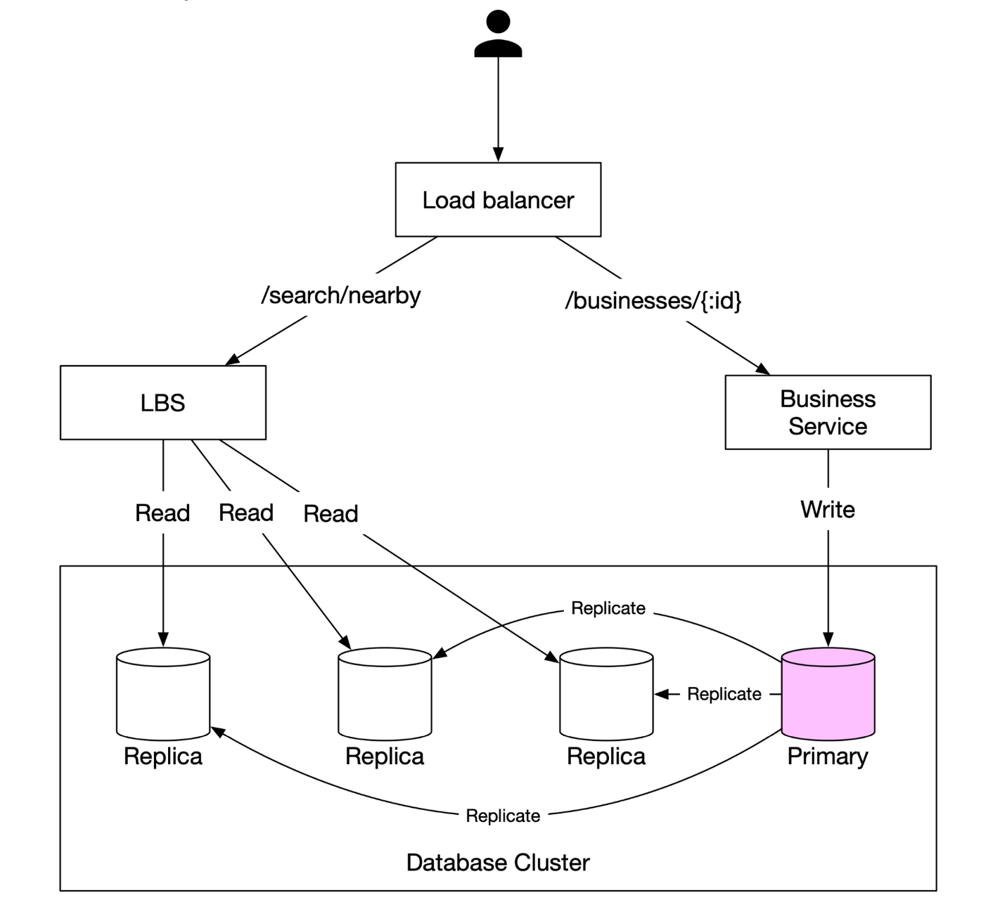
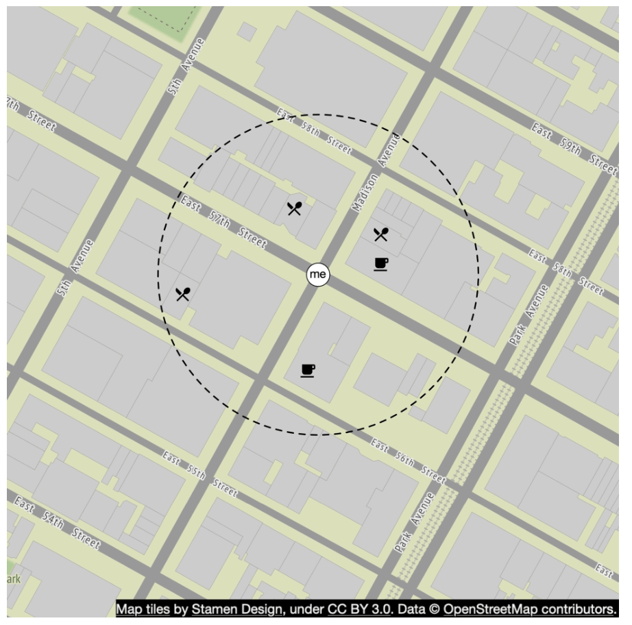
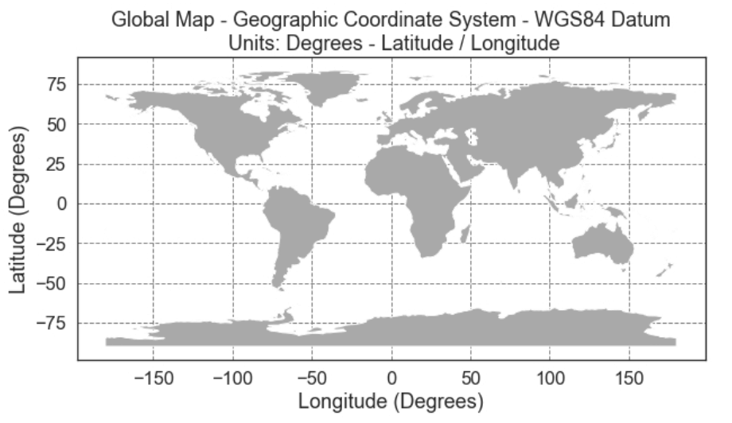
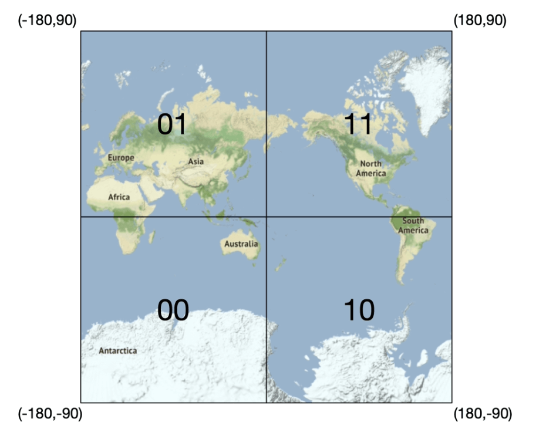
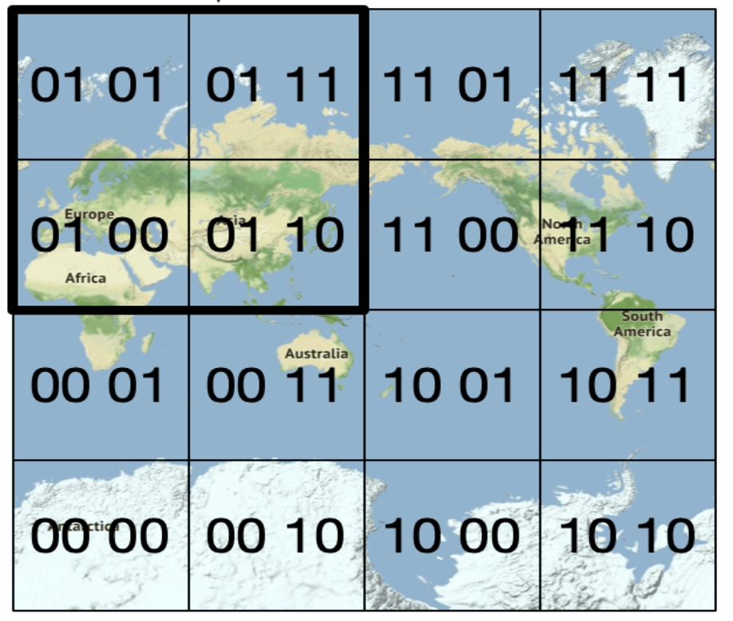
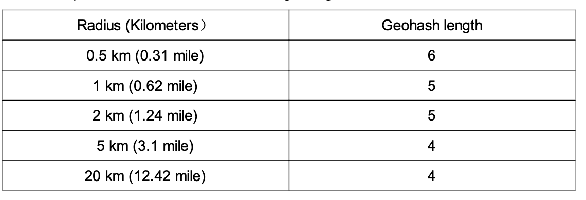
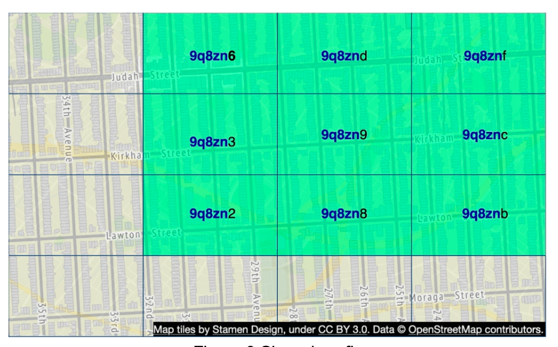
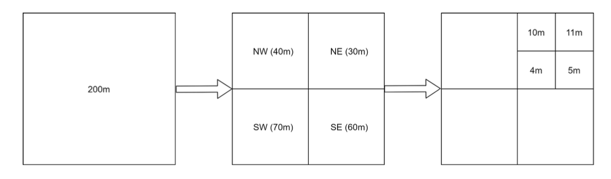
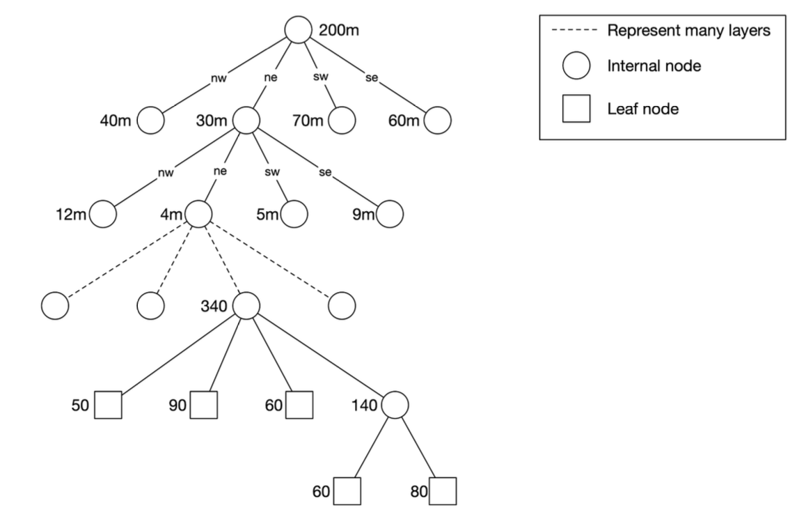
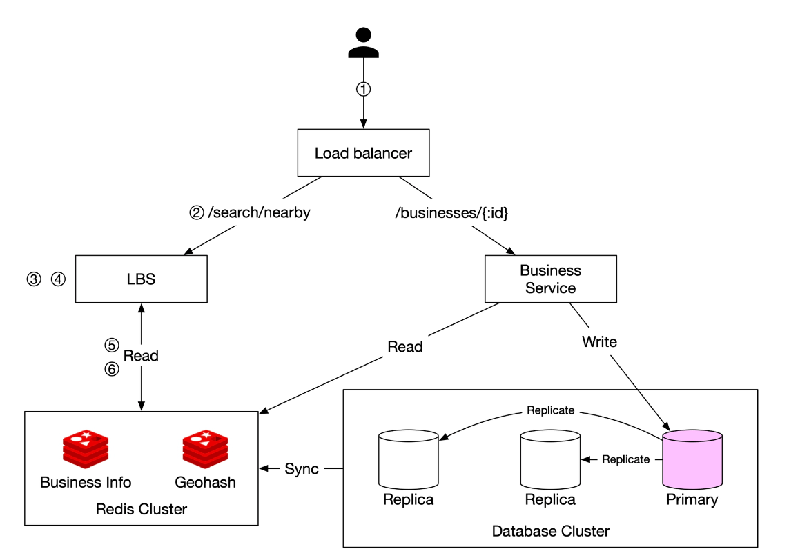

# 16장: 근접성 서비스

## 소개
**근접성 서비스(proximity service)** 는 음식점, 호텔, 주유소 같은 가까운 장소(사업장)를 찾아 주는 서비스다. **구글 맵**이나 **옐프(Yelp)** 같은 애플리케이션에서 사용자가 정해진 반경 안의 장소를 찾을 수 있게 하는 데 쓰인다.


## 1단계: 문제 이해 및 설계 범위 확정

### **기능 요구 사항**
1. 사용자 위치(위도, 경도)와 검색 반경을 바탕으로 **사업장을 검색**한다.
2. **사업장 소유주**는 사업장을 추가·수정·삭제할 수 있다(실시간 반영은 필요 없음).
3. 요청하면 **사업장 상세 정보를 제공**한다.

### **비기능 요구 사항**
- **낮은 응답 지연**: 사용자는 빠르게 응답을 받아야 한다.
- **데이터 보호**: GDPR과 CCPA 같은 개인정보 보호 법규를 준수한다.
- **고가용성**: 붐비는 지역의 피크 시간대 트래픽 급증을 감당한다.

### **개략적인 규모 추정**
- **일간 능동 사용자 1억 명**
- 시스템에 등록된 **사업장 2억 개**
- **검색 QPS 계산**:
  - 사용자는 **하루 5회** 검색한다.
  - **검색 QPS** = (100M × 5) / 86,400 ≈ **5,000 QPS**

---

## 2단계: 개략적인 설계

### **API 설계**
#### **주변 사업장 검색**
GET /v1/search/nearby

- **요청 인자**:
  - `latitude`: 사용자 위치의 위도
  - `longitude`: 사용자 위치의 경도
  - `radius`: 검색 반경(기본값: 5000m)

#### **사업장 API**
| API 엔드포인트                     | 설명                                      |
|-----------------------------------|--------------------------------------------------|
| `GET /v1/businesses/{id}`         | 사업장 상세 정보 조회                    |
| `POST /v1/businesses`             | 새 사업장 추가                              |
| `PUT /v1/businesses/{id}`         | 사업장 상세 정보 수정                         |
| `DELETE /v1/businesses/{id}`      | 사업장 삭제               |


### **데이터 모델**
- 다음 두 기능이 매우 자주 쓰여 읽기 연산이 많으므로, MySQL 같은 관계형 데이터베이스가 적합하다.
  - 주변 사업장 검색
  - 사업장 상세 정보 보기

### **데이터 스키마**
- 핵심 테이블은 사업장(business) 테이블과 지리 공간 색인(geospatial index) 테이블이다.
- 사업장 테이블에는 사업장의 상세 정보가 들어 있다.

### **개략적인 시스템 아키텍처**
시스템은 위치 기반 서비스(LBS)와 사업장 관련 서비스, 두 부분으로 구성된다.

<div style="margin-left:3rem">
    
</div>

- **위치 기반 서비스(Location-Based Service, LBS)**: 
  - 위치 기반 검색 질의를 처리한다.
  - 쓰기 요청이 없는, 읽기 위주의 서비스다.
  - 특히 밀집 지역의 피크 시간대에 QPS가 높으며, 시스템은 무상태다.
- **사업장 서비스(business service)**: 두 종류의 요청을 처리한다.
  - 사업장 소유주의 사업장 생성·수정·삭제 요청
  - 고객의 사업장 상세 정보 조회 요청
- **로드밸런서**: 트래픽을 LBS와 사업장 서비스로 보낸다.
- **데이터베이스 클러스터**: 
  - 읽기 위주 작업에 맞게 **주-부(primary-replica) 구조**를 사용한다.
  - LBS가 읽는 데이터와 주 데이터베이스에 기록된 데이터 사이에 차이가 있을 수 있다.
  - 사업장 정보는 실시간으로 갱신될 필요가 없으므로 이런 불일치는 문제가 되지 않는다.


---

## 3단계: 주변 사업장 검색 알고리즘

### **방안 1: 2차원 검색(단순한 방법)**

<div style="margin-left:3rem">
    
</div>

가장 직관적인 방법은 미리 정한 반경으로 원을 그리고 그 안에 있는 사업장을 모두 찾는 것이다.

**SQL 질의:**
```
SELECT business_id, latitude, longitude
FROM business
WHERE (latitude BETWEEN :lat - radius AND :lat + radius)
AND (longitude BETWEEN :long - radius AND :long + radius);
```
**문제점:**
- **비효율적**: 데이터베이스 전체를 훑어야 한다.
- **1차원 색인의 한계**: 색인은 위도나 경도 중 한 차원에만 걸 수 있다.

경도와 위도 칼럼에 색인을 만드는 개선책을 생각해 볼 수 있지만, 조금 나아질 뿐 여전히 매우 느리다.

### 더 나은 방법
- 앞의 방법이 가진 문제는 데이터베이스 색인으로는 한 차원의 검색 속도만 높일 수 있다는 점이다.
- 최적의 방법은 지리 공간 색인을 사용해 2차원 데이터를 1차원으로 표현하는 것이다.
  - 해시 기반: 균등 격자(even grid), 지오해시(geohash)
  - 트리 기반: 쿼드트리(quadtree), 구글 S2, R 트리(R-tree)

  <div style="margin-left:3rem">
    
  </div>


### **방안 2: 균등 격자**

  <div style="margin-left:3rem">
    
  </div>

- **지도를 고정된 크기의 격자로 나눈다.**
- **문제점**: 사업장 분포가 고르지 않다(도시는 밀집해 있고 시골은 듬성듬성하다).

### **방안 3: 지오해시**
- 지구를 본초 자오선과 적도를 기준으로 사분면 네 개로 나눈다. 그런 다음 각 격자를 다시 작은 격자 네 개로 나눈다.
- 각 격자는 경도 비트와 위도 비트를 번갈아 배치한 값으로 표현할 수 있다.
- 이 분할을 반복한다.

  <div style="margin-left:3rem">
    
    
  </div>


- **위도와 경도를 하나의 영숫자 문자열로 인코딩한다.** 정밀도(레벨)는 12단계다.
- **계층적인 격자 구조** 덕분에 효율적으로 검색할 수 있다.
- 표를 참고해, 검색 반경을 담을 수 있는 가장 짧은 지오해시 길이를 정밀도로 고른다.
  <div style="margin-left:3rem">
    
  </div>
- 지오해시는 두 지오해시 사이의 공통 접두어가 길수록 두 위치가 가깝다는 것을 보장한다.

- **문제점**:
  <div style="margin-left:3rem">
    
  </div>

  - **격자 가장자리 문제**(격자 경계 근처의 사업장이 검색에서 빠질 수 있음)
    - 두 위치가 아주 가까워도 공통 접두어가 전혀 없을 수 있다(예: 적도를 사이에 둔 경우).
    - 두 위치가 긴 공통 접두어를 갖더라도 서로 다른 지오해시에 속할 수 있다.
  - 해결책: 이웃 격자까지 함께 검색해야 한다.


### **방안 4: 쿼드트리**

  쿼드트리는 2차원 공간을 재귀적으로 사분면 네 개로 나누는 트리 자료 구조다. 각 내부 노드는 정확히 자식 노드 네 개를 가지며, 이는 공간의 하위 영역 네 개를 나타낸다.
  - 쿼드트리는 메모리 안에 두는 자료 구조로, 각 LBS 서버에서 동작하며 서버가 시작될 때 만들어진다.

  <div style="margin-left:3rem">
    
  </div>

  - 루트 노드는 사업장 수가 x개(이 예에서는 100개)를 넘는 노드가 없을 때까지 재귀적으로 사분면 네 개로 나뉜다.

  <div style="margin-left:3rem">
    
  </div>

- 쿼드트리 색인은 메모리를 많이 차지하지 않으므로(보통 수 GB 수준) 서버 한 대에 충분히 올라간다.
- 트리 구축 시간 복잡도가 n log n이므로 트리를 만드는 데 몇 분이 걸릴 수 있다.
- **k개의 가장 가까운 사업장 검색에 효율적이다**(예: 가장 가까운 주유소 찾기).

  <div style="margin-left:3rem">
    
  </div>

#### 운영 시 고려 사항
 - 사업장이 약 2억 개라면 서버 시작 시점에 쿼드트리를 만드는 데 몇 분이 걸릴 수 있다.
 - 쿼드트리를 만드는 동안에는 트래픽을 처리할 수 없으므로, 새 버전은 일부 서버에 점진적으로 배포해야 한다.
 - 사업장을 수정하거나 추가할 때 가장 쉬운 방법은 쿼드트리를 점진적으로 다시 만드는 것이다(캐시 무효화가 많이 발생함).
 - 쿼드트리를 실시간으로 갱신할 수도 있지만 구현이 더 복잡하다(락 메커니즘이 필요함).

### **방안 5: 구글 S2**
힐베르트 곡선(Hilbert curve)을 기반으로 구(sphere)를 1차원 색인에 대응시킨다. 힐베르트 곡선에서 서로 가까운 두 점은 1차원 공간에서도 가깝다.


  <div style="margin-left:3rem">
    
    
  </div>

- **힐베르트 곡선을 사용해 지구를 작은 셀(cell)로 나눈다.**
- 다양한 수준으로 임의의 영역을 덮을 수 있어 지오펜스(geofence)에 매우 유용하다.
- 지오펜스를 쓰면 관심 영역을 둘러싸는 경계를 정의할 수 있다.
- 또 다른 장점은 고정된 정밀도 대신 S2에서 최소 레벨, 최대 레벨, 최대 셀 수를 지정할 수 있다는 것이다.


## 트레이드오프 비교

#### 지오해시
- 사용과 구현이 쉽다. 트리를 만들거나 다시 만들 필요가 없다.
- 지정한 반경 이내의 사업장 검색을 지원한다.
- 색인 갱신이 쉽다.
- 인구 밀도에 따라 격자 크기를 동적으로 조정할 수 없다.

#### 쿼드트리
- 구현이 조금 더 어렵다.
- k개의 가장 가까운 사업장 검색을 지원한다.
- 인구 밀도에 따라 격자 크기를 동적으로 조정할 수 있다.
- 트리 전체를 다시 만들어야 할 수도 있어 색인 갱신이 더 복잡하다.

---

## 4단계: 데이터베이스 규모 확장과 캐시 전략

### **사업장 테이블의 규모 확장**
- **사업장 ID를 기준으로 샤딩**하면 데이터를 고르게 분산할 수 있다.
- 테이블에는 사업장마다 별도의 행을 둔다.

| 지오해시 | 사업장 ID |
|---------|------------|
| 9q9hvu  | 343        |
| 9q9hvu  | 347        |
| 9q9hvu  | 112        |

### **지리 공간 색인의 규모 확장**
- 지오해시 테이블에는 샤딩이 적합하지 않을 수 있다. 이 경우 전체 데이터가 서버 한 대에 들어가므로 샤딩해야 할 기술적 이유가 없다.
- 읽기 부하는 읽기 전용 사본(read replica)을 두어 처리하는 편이 낫다.


---

### **캐시 전략**
가장 먼저 떠오르는 캐시 키는 위치 좌표지만, 몇 가지 문제가 있다.
 - GPS가 반환하는 위치 좌표는 정확하지 않다.
 - 사용자가 이동하면 위치 좌표가 바뀐다.
 - 지오해시를 캐시 키로 쓰는 편이 낫다.

| 캐시 키  | 캐시 값 |
|------------|------------|
| `geohash`  | 해당 격자 안에 있는 사업장 ID 목록 |
| `business_id` | 사업장 상세 정보(이름, 주소, 리뷰 등) |

---

## 5단계: 배포 전략과 최종 아키텍처

### **지역과 가용성 구역**
- LBS와 사업장 서비스를 **여러 지역에 걸쳐** 배포한다.

### **실시간 갱신 처리**
- **사업장 정보 갱신은 하루 한 번 일괄 처리한다.**

### **최종 시스템 아키텍처**


  <div style="margin-left:3rem">
    
  </div>


최종 알고리즘은 다음과 같다.

## 주변 사업장 검색 단계
1. **사용자 요청:**  
   - 사용자가 **500미터** 안에 있는 음식점을 검색한다.  
   - 클라이언트는 **위도(37.776720), 경도(-122.416730), 반경(500m)** 을 **로드밸런서**로 보낸다.

2. **요청 전달:**  
   - **로드밸런서**가 요청을 **위치 기반 서비스(LBS)** 로 전달한다.

3. **지오해시 길이 계산:**  
   - LBS는 반경에 맞는 **지오해시 길이**를 정한다.  
   - 대응표에 따르면 **500m는 지오해시 길이 6**에 해당한다.

4. **이웃 지오해시 계산:**  
   - LBS는 주변 지역을 포함하기 위해 **이웃 지오해시**를 계산한다.  
   - 결과는 다음과 같은 목록이다.  
     ```
     [my_geohash, neighbor1_geohash, neighbor2_geohash, ..., neighbor8_geohash]
     ```

5. **Redis에서 사업장 ID 가져오기:**  
   - LBS는 목록의 각 지오해시에 대해 **지오해시 Redis 서버**에 질의해 **사업장 ID**를 가져온다.  
   - 지연 시간을 최소화하기 위해 질의를 병렬로 보낸다.

6. **사업장 정보 조회와 순위 매기기:**  
   - LBS는 **사업장 정보 Redis 서버**에서 **사업장 상세 정보**를 가져온다.  
   - 사업장을 사용자 위치로부터의 **거리순으로 정렬**한다.  
   - **순위가 매겨진 결과**를 클라이언트에 반환한다.

## 핵심 최적화
- **Redis 병렬 호출**: 응답 시간을 줄인다.  
- **지오해시 색인**: 공간 질의를 효율적으로 처리한다.  
- **캐시**: 사업장 데이터 조회 속도를 높인다.  

이 방법으로 사용자 위치 주변의 사업장을 **낮은 지연 시간으로, 확장 가능하게** 검색할 수 있다.

---

### **최적의 색인 방법 선택**
| 색인 방법 | 장점 | 단점 |
|----------------|------|------|
| **지오해시** | 구현이 쉽고 근접 검색에 효율적 | 격자 경계 문제, 고정된 격자 크기 |
| **쿼드트리** | 밀도에 따라 동적으로 조정, k개 최근접 검색 지원 | 더 복잡하고 트리 재조정이 필요 |
| **구글 S2** | 고급 지오펜스 지원, 구글 맵에서 사용 | 구현이 더 어려움 |

---

## 참고 자료
1. [Geohash Algorithm](https://www.movable-type.co.uk/scripts/geohash.html)
2. [Quadtree Indexing](https://en.wikipedia.org/wiki/Quadtree)
3. [Google S2 Geometry](https://s2geometry.io/)


