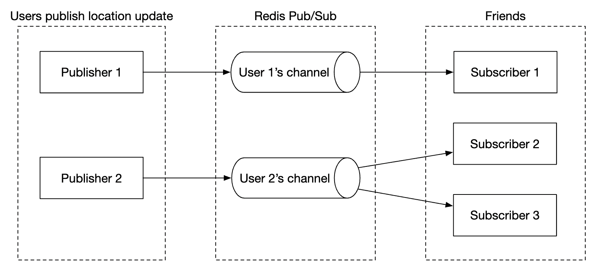
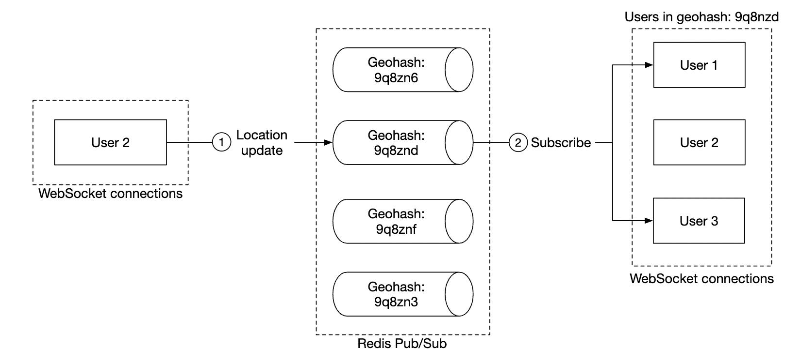

# 17장: 주변 친구

## 소개

이 장에서는 사용자가 자기 위치를 공유하고 **주변에 있는** 친구를 찾을 수 있게 해 주는 애플리케이션의 확장 가능한 백엔드를 설계한다.

16장 근접성 서비스와의 가장 큰 차이는, 사업장 주소는 거의 바뀌지 않지만 이 문제에서는 **위치가 계속 바뀐다**는 점이다.

---

## 1단계: 문제 이해 및 설계 범위 확정

면접을 이끌어 갈 몇 가지 질문(지: 지원자, 면: 면접관):
 * 지: 지리적으로 얼마나 가까워야 '주변'이라고 보나요?
 * 면: 5마일입니다. 이 값은 설정할 수 있어야 합니다.
 * 지: 거리는 직선거리로 계산하나요, 아니면 친구 사이에 강이 있는 경우 등을 고려하나요?
 * 면: 직선거리로 가정해도 됩니다.
 * 지: 앱 사용자는 몇 명인가요?
 * 면: 사용자는 10억 명이고, 그중 10%가 주변 친구 기능을 씁니다.
 * 지: 위치 이력을 저장해야 하나요?
 * 면: 네. 머신러닝 등에 유용하게 쓸 수 있습니다.
 * 지: 10분 동안 활동이 없는 친구는 목록에서 사라진다고 가정해도 될까요?
 * 면: 네.
 * 지: GDPR 같은 규정도 고려해야 하나요?
 * 면: 아니요. 단순화를 위해 고려하지 않습니다.

### **기능 요구 사항**

 * 사용자는 모바일 앱에서 주변 친구를 볼 수 있어야 한다. 친구마다 거리와, 그 위치가 마지막으로 갱신된 시각을 함께 표시한다.
 * 주변 친구 목록은 몇 초마다 갱신되어야 한다.

### **비기능 요구 사항**

- **낮은 지연 시간**: 위치 변경을 너무 늦지 않게 받아야 한다.
- **안정성**: 가끔 데이터가 유실되는 것은 괜찮지만, 시스템은 전반적으로 가용해야 한다.
- **결과적 일관성**: 위치 데이터 저장소는 강한 일관성을 지원할 필요가 없다. 사본마다 위치 데이터가 반영되는 데 몇 초 정도 차이가 나는 것은 괜찮다.

### **개략적인 규모 추정**

예상 규모를 가늠하기 위한 추정:
 * 주변 친구란 반경 5마일 안에 있는 친구다.
 * 위치 갱신 주기는 30초다. 사람이 걷는 속도는 느리므로 위치를 너무 자주 갱신할 필요는 없다.
 * 매일 평균 1억 명이 이 기능을 쓰고, 동시 접속자는 그중 10%인 1,000만 명이다.
 * 사용자는 평균 400명의 친구를 두며, 친구 모두가 주변 친구 기능을 쓴다.
 * 앱은 한 페이지에 주변 친구 20명을 보여 준다.
 * **위치 갱신 QPS** = 10mil / 30 == 초당 약 334,000건

---

## 2단계: 개략적인 설계안 제시 및 동의 구하기

API와 데이터 모델 설계를 살펴보기 전에, 전통적인 요청-응답 방식보다 덜 흔한 통신 프로토콜부터 알아본다.

### **개략적인 설계**

개략적으로는 사용자들 사이에 효과적으로 메시지를 주고받을 수 있어야 한다. P2P 프로토콜로도 가능하지만, 연결이 불안정하고 전력 소모 제약이 엄격한 모바일 앱에는 현실적이지 않다.

더 현실적인 방법은 공용 백엔드를 두고, 이 백엔드가 메시지를 받아야 할 친구들에게 전달(팬아웃)하는 것이다.

    

백엔드가 하는 일은 다음과 같다.
 * 모든 활성 사용자의 위치 변경 내역을 수신한다.
 * 위치 변경 내역마다 이를 받아야 할 활성 사용자를 모두 찾아 전달한다.
 * 친구 사이의 거리가 설정된 임계치보다 멀면 위치 정보를 전달하지 않는다.

간단해 보이지만, 문제는 우리가 다루는 규모에 맞게 시스템을 설계하는 것이다.

먼저 단순한 설계로 시작하고, 더 발전된 방법은 상세 설계에서 논의한다.

    

- **로드밸런서**: RESTful API 서버와 양방향 웹소켓 서버로 트래픽을 분산한다.
- **RESTful API 서버**: 친구 관리, 프로필 갱신 같은 부가 작업을 처리한다.
- **웹소켓 서버**: 상태 유지 서버로, 위치 갱신 요청을 해당 클라이언트들에 전달한다. 또한 모바일 클라이언트가 처음 연결될 때 주변 친구들의 위치를 채워 넣는 일도 맡는다(뒤에서 자세히 다룸).
- **Redis 위치 정보 캐시**: 활성 사용자마다 가장 최근 위치 정보를 저장한다. 캐시 항목마다 TTL을 둔다. TTL이 만료되면 사용자는 더 이상 활성 상태가 아니며 데이터는 캐시에서 삭제된다.
- **사용자 데이터베이스**: 사용자 정보와 친구 관계 정보를 저장한다. 관계형 데이터베이스와 NoSQL 데이터베이스 모두 쓸 수 있다.
- **위치 이동 이력 데이터베이스**: 사용자의 위치 이력을 저장한다. 주변 친구 기능에 직접 쓰이지는 않지만, 분석 목적으로 과거 데이터를 추적하는 데 쓴다.
- **Redis 발행/구독(pub/sub)**: 가벼운 메시지 버스로, 사용자마다 위치 변경 내역을 위한 채널(토픽)을 둘 수 있게 해 준다.

    

위 예에서 웹소켓 서버는 자신에게 연결된 사용자들을 위한 채널을 구독하고, 위치 변경 내역을 받을 때마다 적절한 사용자에게 전달한다.

### **주기적인 위치 갱신**

주기적인 위치 갱신 흐름은 다음과 같다.

    

 * 모바일 클라이언트가 위치 변경 내역을 로드밸런서로 보낸다.
 * 로드밸런서는 그 클라이언트와 지속 연결을 맺고 있는 웹소켓 서버로 위치 변경 내역을 전달한다.
 * 웹소켓 서버는 위치 데이터를 위치 이동 이력 데이터베이스에 저장한다.
 * 위치 정보 캐시의 위치 데이터를 갱신한다. 웹소켓 서버는 이후 해당 사용자에 대한 거리 계산에 쓰기 위해 위치 데이터를 메모리에도 보관한다.
 * 웹소켓 서버는 Redis pub/sub의 해당 사용자 채널에 위치 데이터를 발행한다.
 * Redis pub/sub은 그 사용자 채널의 모든 구독자, 즉 그 사용자의 친구들을 담당하는 서버들에 위치 변경 내역을 브로드캐스트한다.
 * 구독 중인 웹소켓 서버는 위치 변경 내역을 받아, 이를 받아야 할 사용자를 계산한 뒤 전송한다.

다음은 같은 흐름을 더 자세히 나타낸 것이다.

    

사용자는 평균 400명의 친구가 있고 그중 10%가 동시에 접속해 있으므로, 위치 변경 하나당 평균 40건을 전달하게 된다.

### **API 설계**

지원해야 할 웹소켓 루틴:
 * 주기적인 위치 갱신 - 사용자가 웹소켓 서버로 위치 데이터를 보낸다.
 * 클라이언트의 위치 변경 내역 수신 - 서버가 친구의 위치 데이터와 타임스탬프를 보낸다.
 * 웹소켓 클라이언트 초기화 - 클라이언트가 사용자 위치를 보내면, 서버가 주변 친구들의 위치 데이터를 돌려준다.
 * 새 친구 구독 - 웹소켓 서버가 모바일 클라이언트가 추적해야 할 친구 ID를 보낸다(예: 친구가 처음으로 온라인이 됨).
 * 친구 구독 해지 - 웹소켓 서버가 모바일 클라이언트가 구독을 해지해야 할 친구 ID를 보낸다(예: 친구가 오프라인이 됨).

HTTP API - 부가 기능을 위한 전통적인 요청/응답 API다.

### **데이터 모델**

 * 위치 정보 캐시는 `user_id`와 `lat,long,timestamp` 사이의 대응 관계를 저장한다. 현재 위치만 관심 대상이고, 이 사용 사례에 필요한 TTL 기반 만료를 지원하므로 Redis가 아주 좋은 선택이다.
 * 위치 이동 이력 테이블은 같은 데이터를 위에서 말한 네 개 칼럼을 가진 테이블에 저장한다. 쓰기 연산이 많은 부하에 최적화된 Cassandra를 쓸 수 있다.

---

## 3단계: 상세 설계

목표 규모에서도 동작하도록 개략적인 설계를 어떻게 확장할지 논의한다.

### **컴포넌트별 규모 확장성**

- **API 서버**: 오토스케일링 그룹과 서버 인스턴스 복제로 쉽게 확장할 수 있다.
- **웹소켓 서버**: 웹소켓 서버도 쉽게 늘릴 수 있지만, 서버를 내릴 때 기존 연결을 정상적으로 종료하도록 해야 한다. 예를 들어 서버 풀에서 최종 제거하기 전에 로드밸런서에서 해당 서버를 '연결 종료 중(draining)'으로 표시하고 새 연결을 보내지 않는다.
- **클라이언트 초기화**: 클라이언트가 처음 서버에 연결되면, 서버는 사용자의 친구 목록을 가져와 Redis pub/sub에서 친구들의 채널을 구독하고, 캐시에서 친구들의 위치를 가져와 클라이언트에 전달한다.
- **사용자 데이터베이스**: user_id를 기준으로 샤딩할 수 있다. 전담 팀이 관리하는 별도 서비스와 API로 사용자·친구 데이터를 제공하는 것도 합리적이다.
- **위치 정보 캐시**: Redis 노드를 여러 대 띄워 쉽게 샤딩할 수 있다. TTL 덕분에 한 번에 차지할 수 있는 최대 메모리에도 상한이 생긴다. 하지만 많은 쓰기 부하는 여전히 감당해야 한다.
- **Redis pub/sub 서버**: 채널을 만들어 두기만 하고 쓰지 않으면 메모리를 소비하지 않는다는 점을 활용한다. 따라서 주변 친구 기능을 쓰는 모든 사용자의 채널을 미리 할당해 둘 수 있다. 그러면 사용자가 온라인이 될 때 새 채널을 만들고 활성 웹소켓 서버에 알리는 등의 일을 처리하지 않아도 된다.

### **Redis pub/sub 컴포넌트의 규모 확장**

모든 pub/sub 채널을 유지하려면 약 200 GB의 메모리가 필요하다. 100 GB짜리 Redis 서버 두 대로 감당할 수 있다.

하지만 초당 약 1,400만 건의 위치 변경 내역을 전달해야 하므로, 서버 한 대가 초당 약 10만 건을 전달할 수 있다고 가정하면 최소 140대의 Redis 서버가 필요하다.

따라서 높은 CPU 부하를 감당하려면 분산 Redis 서버 클러스터가 필요하다.

분산 Redis 클러스터를 지원하려면 ZooKeeper나 etcd 같은 서비스 탐색(service discovery) 컴포넌트로 어떤 서버가 살아 있는지 추적해야 한다.

서비스 탐색 컴포넌트에 저장해야 하는 데이터는 다음과 같다.

    

웹소켓 서버는 ZooKeeper에서 가져온 이 데이터로 특정 채널이 어느 서버에 있는지 판단한다. 효율을 위해 해시 링 데이터를 각 웹소켓 서버의 메모리에 캐시해 둘 수 있다.

클러스터 규모를 늘리거나 줄이려면, 과거 트래픽 데이터를 바탕으로 필요에 따라 클러스터 규모를 조정하는 일일 작업을 둘 수 있다. 부하 급증에 대비해 클러스터를 여유 있게 마련해 둘 수도 있다.

Redis 클러스터는 상태 유지 저장소 서버로 취급해야 한다. 채널별로 유지되는 상태가 있고, 구독자들이 클러스터에 새로 추가된 노드로 넘어가도록 조율해야 하기 때문이다.

규모를 조정하는 동안 생길 수 있는 문제에 유의해야 한다.
 * 채널이 다른 서버로 옮겨지면서 웹소켓 서버들로부터 재구독 요청이 대량으로 발생한다.
 * 작업 중에 클라이언트의 위치 변경 내역 일부가 누락될 수 있다. 이 문제에서는 허용되지만 최소화해야 한다. 하루 중 트래픽이 가장 적은 시간에 작업하는 것을 고려한다.
 * 안정 해시를 활용하면 서버를 추가·제거할 때 옮겨지는 채널 수를 최소화할 수 있다.

    

### **친구 추가/삭제**

친구가 추가되거나 삭제될 때마다, 해당 사용자를 담당하는 웹소켓 서버는 그 친구의 채널을 구독하거나 구독 해지해야 한다.

'주변 친구' 기능은 더 큰 앱의 일부이므로, 이런 이벤트가 생길 때 호출될 콜백을 모바일 클라이언트에 등록해 둘 수 있다고 가정한다. 클라이언트는 웹소켓 서버에 메시지를 보내 적절한 작업을 하게 한다.

### **친구가 많은 사용자**

한 사용자가 가질 수 있는 친구 수에 상한을 둘 수 있다. 예를 들어 페이스북은 친구 수 상한이 5,000명이다.

'고래' 사용자를 담당하는 웹소켓 서버는 부하가 더 높을 수 있지만, 웹소켓 서버가 충분하다면 문제없다.

### **주변의 임의 사용자**

면접관이 주변 친구 지도에 가끔 임의의 사람이 나타나는 기능을 추가하도록 설계를 바꾸고 싶어 한다면 어떻게 할까?

한 가지 방법은 지오해시를 기준으로 pub/sub 채널 풀을 정의하는 것이다.

    

해당 지오해시 안에 있는 사람은 모두 그 채널을 구독해 임의 사용자의 위치 변경 내역을 받는다.

    

가까이 있지만 이웃한 지오해시에 속한 사람도 처리하려면 지오해시 여러 개를 구독할 수도 있다.

    

### **Redis pub/sub의 대안**

pub/sub에 Redis를 쓰는 대신 분산 컴퓨팅 애플리케이션에 최적화된 범용 프로그래밍 언어인 얼랭(Erlang)을 활용할 수 있다.

얼랭을 쓰면 서로 통신하는 작은 얼랭 프로세스를 수백만 개 띄울 수 있다. 분산 얼랭 애플리케이션 안에서 웹소켓 연결과 pub/sub 채널을 모두 처리할 수 있다.

다만 얼랭은 널리 쓰이지 않는 언어여서 실력 있는 얼랭 개발자를 구하기 어려울 수 있다는 문제가 있다.

---

## 4단계: 마무리

주변 친구 기능을 지원하는 시스템을 설계했다.

핵심 컴포넌트:
- **웹소켓 서버**: 클라이언트와 서버 간 실시간 통신
- **Redis**: 위치 데이터의 빠른 읽기·쓰기와 pub/sub 채널

또한 RESTful API 서버, 웹소켓 서버, 데이터 계층, Redis pub/sub 서버의 규모 확장 방법과 Redis pub/sub의 대안을 살펴보았다. '주변의 임의 사용자' 기능도 살펴보았다.
