# 18장: 구글 맵 설계

## 소개

**구글 맵**의 단순화된 버전을 설계한다.

구글 맵에 관한 몇 가지 사실:
 * 2005년에 시작했다.
 * 위성 이미지, 거리 지도, 실시간 교통 상황, 경로 계획 등 다양한 서비스를 제공한다.
 * 2021년 기준으로 일간 능동 사용자 10억 명, 전 세계 99% 지역 지원, 하루 2,500만 건의 실시간 위치 정보 갱신을 처리했다.

---

## 1단계: 문제 이해 및 설계 범위 확정

지원자와 면접관 사이의 질의응답 예(지: 지원자, 면: 면접관):
 * 지: 일간 능동 사용자는 몇 명인가요?
 * 면: DAU 10억 명입니다.
 * 지: 어떤 기능에 집중해야 하나요?
 * 면: 위치 갱신, 경로 안내, 도착 예정 시간(ETA), 지도 표시입니다.
 * 지: 도로 데이터는 얼마나 큰가요? 접근할 수 있나요?
 * 면: 여러 곳에서 도로 데이터를 확보했고, 원시 데이터가 수 TB입니다.
 * 지: 교통 상황도 고려해야 하나요?
 * 면: 네. 정확한 시간 추정을 위해 고려해야 합니다.
 * 지: 도보, 자전거, 자동차 같은 다양한 이동 수단은요?
 * 면: 지원해야 합니다.
 * 지: 경유지가 여러 곳인 경로 안내는요?
 * 면: 이번 면접 범위에서는 다루지 않겠습니다.
 * 지: 사업장 위치와 사진은요?
 * 면: 좋은 질문이지만 고려하지 않아도 됩니다.

사용자 위치 갱신, ETA를 포함한 경로 안내 서비스, 지도 표시라는 세 가지 핵심 기능에 집중한다.

### **비기능 요구 사항**

- **정확도**: 사용자에게 잘못된 경로를 안내하면 안 된다.
- **부드러운 경로 안내**: 지도 표시가 매끄러워야 한다.
- **데이터와 배터리 사용량**: 클라이언트는 데이터와 배터리를 가능한 한 적게 써야 한다. 모바일 단말에서 중요하다.
- 일반적인 가용성과 규모 확장성 요구 사항

### **지도 101**

설계에 들어가기 전에 알아 둘 지도 관련 개념이 있다.

#### 측위 시스템

지구는 자전축을 중심으로 회전하는 구다. 위치는 위도(얼마나 북쪽/남쪽에 있는지)와 경도(얼마나 동쪽/서쪽에 있는지)로 정의한다.

<div style="margin-left:3rem">
    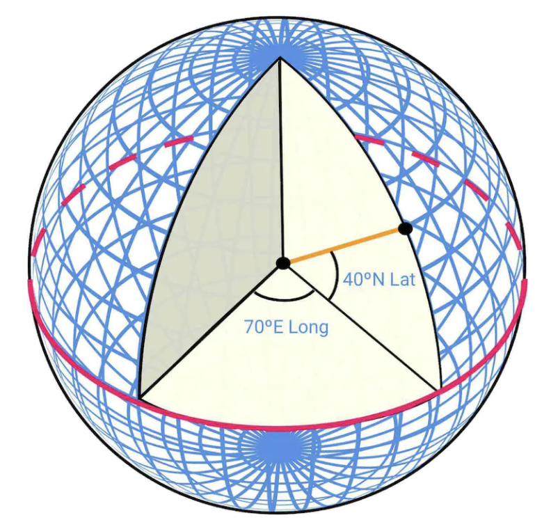
</div>

#### 3차원 위치의 2차원 변환

3차원 구 위의 점을 2차원 평면에 대응시키는 과정을 '지도 투영법(map projection)'이라고 한다.

방법은 여러 가지이고 각각 장단점이 있다. 거의 모든 방법이 실제 지형을 왜곡한다.

<div style="margin-left:3rem">
    
</div>

구글 맵은 메르카토르 도법을 조금 변형한 '웹 메르카토르(Web Mercator)' 도법을 택했다.

#### 지오코딩

지오코딩(geocoding)은 주소를 지리적 좌표로 바꾸는 과정이다.

반대 과정은 '역 지오코딩(reverse geocoding)'이라고 한다.

한 가지 방법은 보간(interpolation)이다. 도로망을 지리 좌표 공간에 대응시켜 둔 여러 출처(예: GIS)의 데이터를 활용한다.

#### 지오해싱

지오해싱(geohashing)은 지리적 영역을 문자와 숫자로 된 문자열로 인코딩하는 방식이다.

지구를 평면으로 펼친 뒤, 재귀적으로 사분면 네 개로 나눈다.

<div style="margin-left:3rem">
    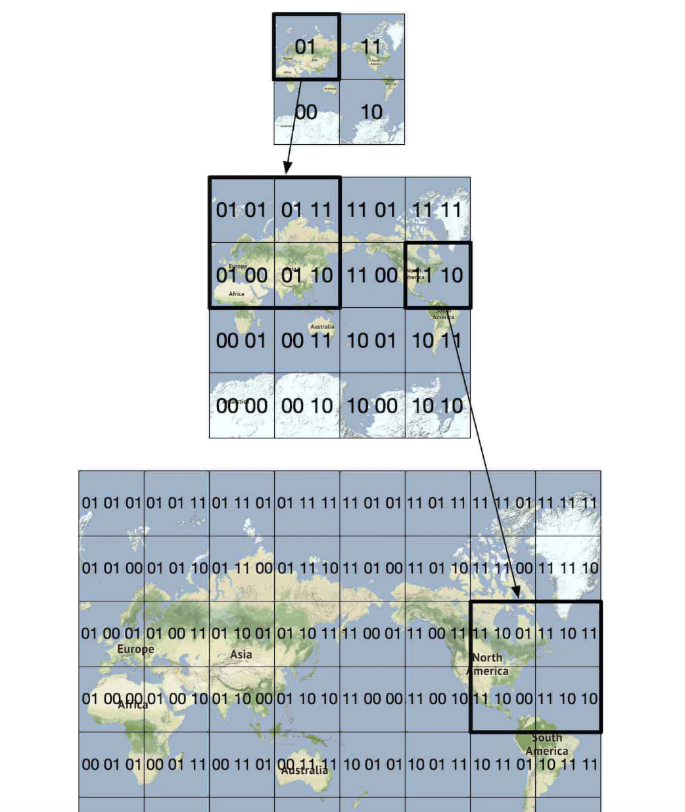
</div>

#### 지도 표시

지도는 타일(tile) 단위로 표시한다. 지도 전체를 하나의 큰 이미지로 그리는 대신, 세계를 작은 타일로 나눈다.

클라이언트는 필요한 타일만 내려받아 모자이크처럼 이어 붙여 화면에 그린다.

확대 수준(zoom level)마다 서로 다른 타일이 있다. 클라이언트는 현재 확대 수준에 맞는 타일을 고른다.

예를 들어 세계 전체가 보이도록 축소하면, 세계 전체를 나타내는 256x256 타일 하나만 내려받는다.

#### 경로 안내 알고리즘을 위한 도로 데이터 처리

대부분의 경로 탐색 알고리즘은 교차로를 노드로, 도로를 에지로 표현한다.

<div style="margin-left:3rem">
    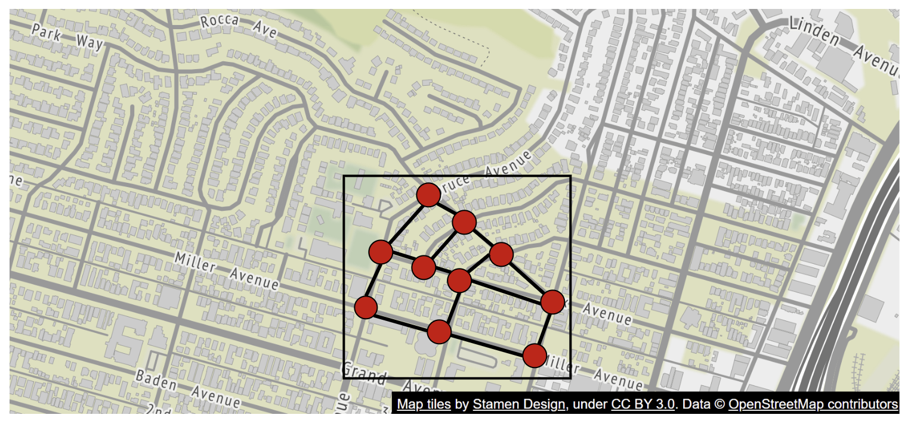
</div>

대부분의 경로 안내 알고리즘은 다익스트라(Dijkstra)나 A* 알고리즘을 변형해 사용한다.

경로 탐색 성능은 그래프 크기에 민감하다. 대규모로 동작하려면 세계 전체를 하나의 그래프로 표현해 알고리즘을 돌릴 수 없다.

대신 타일과 비슷한 기법을 써서 세계를 점점 더 작은 그래프로 나눈다.

경로 안내 타일(routing tile)은 이웃 타일에 대한 참조를 갖고 있으며, 알고리즘은 연결된 타일을 따라가며 더 큰 도로 그래프를 이어 붙일 수 있다.

<div style="margin-left:3rem">
    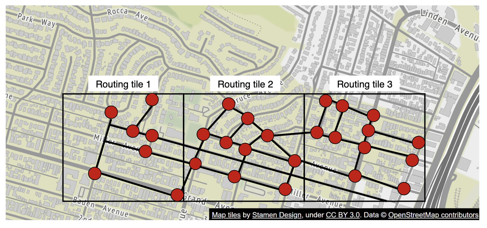
</div>

이 기법을 쓰면 메모리 대역폭을 크게 줄이고, 주어진 출발지/목적지 쌍에 필요한 타일만 불러올 수 있다.

하지만 경로가 길어지면 작고 상세한 경로 안내 타일을 이어 붙이는 데에도 시간과 메모리가 많이 든다. 그래서 상세 수준이 서로 다른 경로 안내 타일을 두고, 알고리즘은 목적지에 따라 적절한 상세 수준의 타일을 사용한다.

<div style="margin-left:3rem">
    
</div>

### **개략적인 규모 추정**

저장해야 하는 데이터:
 * 세계 지도 - 저장해야 할 타일을 모두 고려하면 약 70 PB로 추정되며, 비슷한 타일(예: 넓은 사막)은 압축한다고 가정한다.
 * 메타데이터 - 크기가 무시할 만하므로 계산에서 뺀다.
 * 도로 정보 - 경로 안내 타일로 저장한다.

경로 안내 요청 QPS 추정 - DAU 10억 명이 주당 35분씩 사용하면 하루 50억 분이 된다.
GPS 갱신 요청을 일괄 처리한다고 가정하면 평균 200k QPS, 최대 1mil QPS가 된다.

---

## 2단계: 개략적인 설계안 제시 및 동의 구하기

<div style="margin-left:3rem">
    
</div>

### **위치 서비스**

<div style="margin-left:3rem">
    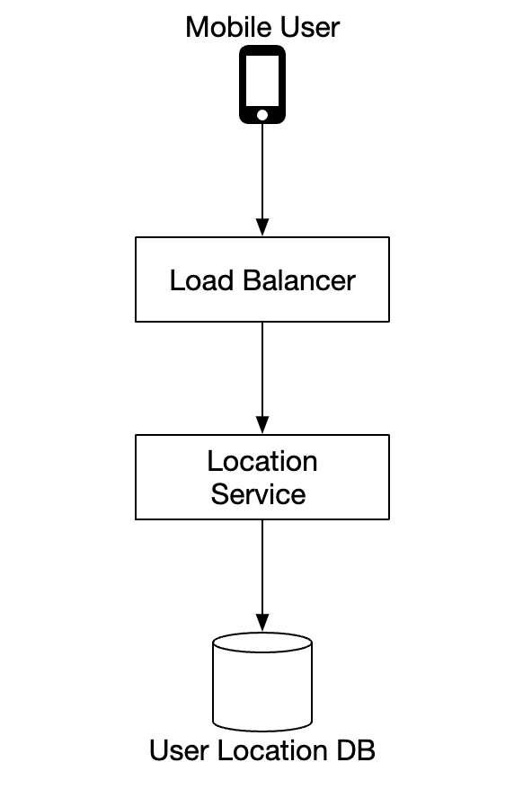
</div>

사용자의 위치 변경을 기록하는 역할을 한다.
 * 위치 변경 내역은 `t`초마다 전송된다.
 * 위치 데이터 스트림은 서비스를 계속 개선하는 데 쓸 수 있다. 예를 들어 더 정확한 ETA 제공, 교통 데이터 모니터링, 폐쇄 도로 감지, 사용자 행동 분석 등이 있다.

위치 변경 내역을 매번 서버로 보내는 대신, 클라이언트에서 모아 일괄 전송할 수 있다.

<div style="margin-left:3rem">
    
</div>

이렇게 최적화해도 구글 맵 규모에서는 부하가 여전히 크다. 그래서 Cassandra처럼 쓰기 연산이 많은 부하에 최적화된 데이터베이스를 활용할 수 있다.

추가 분석을 위해 Kafka로 위치 변경 내역을 효율적으로 스트림 처리할 수도 있다.

위치 갱신 요청 페이로드 예:

```
POST /v1/locations
Parameters
  locs: JSON encoded array of (latitude, longitude, timestamp) tuples.
```

### **경로 안내 서비스**

A에서 B까지 가는 빠른 경로를 적당한 시간 안에(약간의 지연은 괜찮음) 찾는 컴포넌트다. 경로가 가장 빠를 필요는 없지만 정확도는 중요하다.

요청 페이로드 예:

```
GET /v1/nav?origin=1355+market+street,SF&destination=Disneyland
```

응답 예:

```json
{
  "distance": {"text":"0.2 mi", "value": 259},
  "duration": {"text": "1 min", "value": 83},
  "end_location": {"lat": 37.4038943, "Ing": -121.9410454},
  "html_instructions": "Head <b>northeast</b> on <b>Brandon St</b> toward <b>Lumin Way</b><div style=\"font-size:0.9em\">Restricted usage road</div>",
  "polyline": {"points": "_fhcFjbhgVuAwDsCal"},
  "start_location": {"lat": 37.4027165, "lng": -121.9435809},
  "geocoded_waypoints": [
    {
       "geocoder_status" : "OK",
       "partial_match" : true,
       "place_id" : "ChIJwZNMti1fawwRO2aVVVX2yKg",
       "types" : [ "locality", "political" ]
    },
    {
       "geocoder_status" : "OK",
       "partial_match" : true,
       "place_id" : "ChIJ3aPgQGtXawwRLYeiBMUi7bM",
       "types" : [ "locality", "political" ]
    }
  ],
  "travel_mode": "DRIVING"
}
```

교통 상황 변화와 경로 재탐색은 아직 고려하지 않았으며, 상세 설계에서 다룬다.

### **지도 표시**

지도 타일 데이터는 페타바이트 규모이므로 클라이언트에 전부 보관하는 것은 불가능하다.

클라이언트의 위치와 확대 수준에 따라 필요할 때 서버에서 가져와야 한다.

새 타일은 사용자가 확대/축소할 때, 그리고 경로 안내 중 새로운 타일 영역으로 이동할 때 가져와야 한다.

지도 타일을 클라이언트에 어떻게 제공할까?
 * 동적으로 만들 수도 있지만, 서버에 큰 부하가 걸리고 캐시하기도 어렵다.
 * 클라이언트가 계산할 수 있는 지오해시를 기준으로 지도 타일을 정적으로 제공한다. 타일은 미리 만들어 저장해 두고 CDN으로 제공할 수 있다.

<div style="margin-left:3rem">
    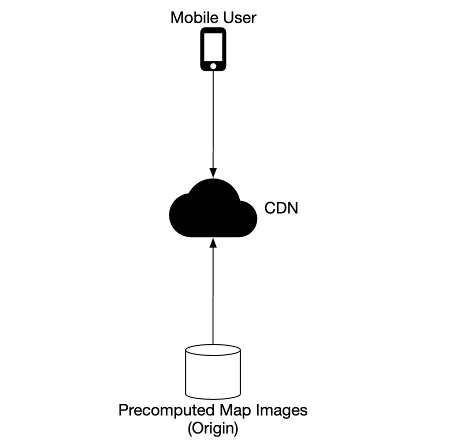
</div>

CDN을 쓰면 사용자는 지연 시간을 최소화하기 위해 가장 가까운 POP(point-of-presence) 서버에서 지도 타일을 가져올 수 있다.

<div style="margin-left:3rem">
    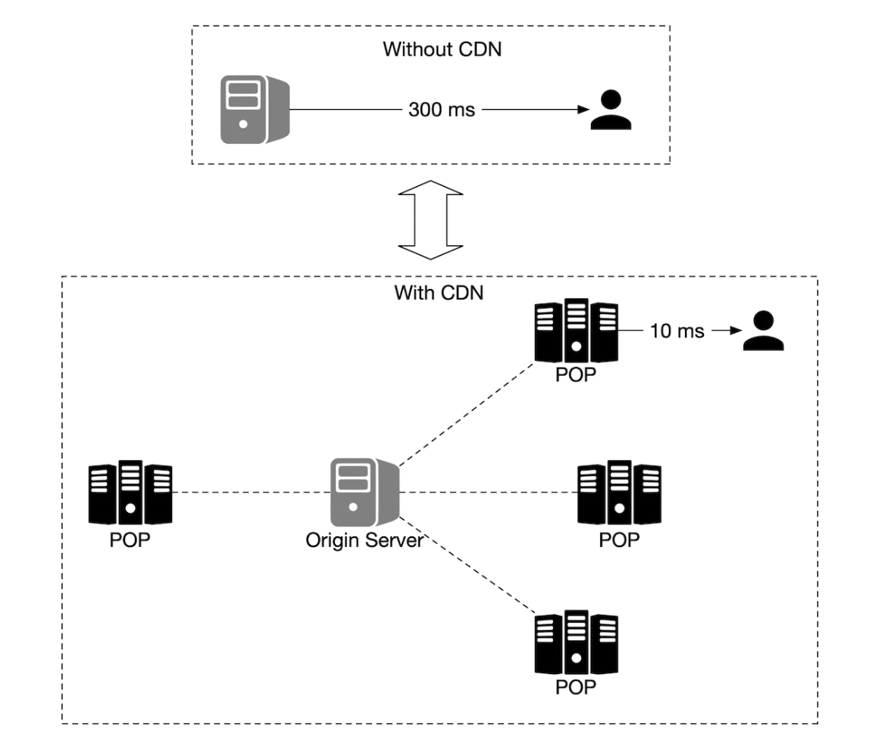
</div>

지도 타일을 결정하는 방법:
 * 지도 타일의 지오해시를 클라이언트에서 계산할 수 있다. 이 경우 클라이언트에 강제로 업데이트를 받게 하기는 어려우므로, 이런 방식의 타일 계산을 장기간 유지해야 한다는 점에 유의해야 한다.
 * 또는 API 호출이 한 번 더 늘어나는 대가를 치르고, 클라이언트 대신 지도 타일 URL을 계산해 주는 간단한 API를 둘 수 있다.

<div style="margin-left:3rem">
    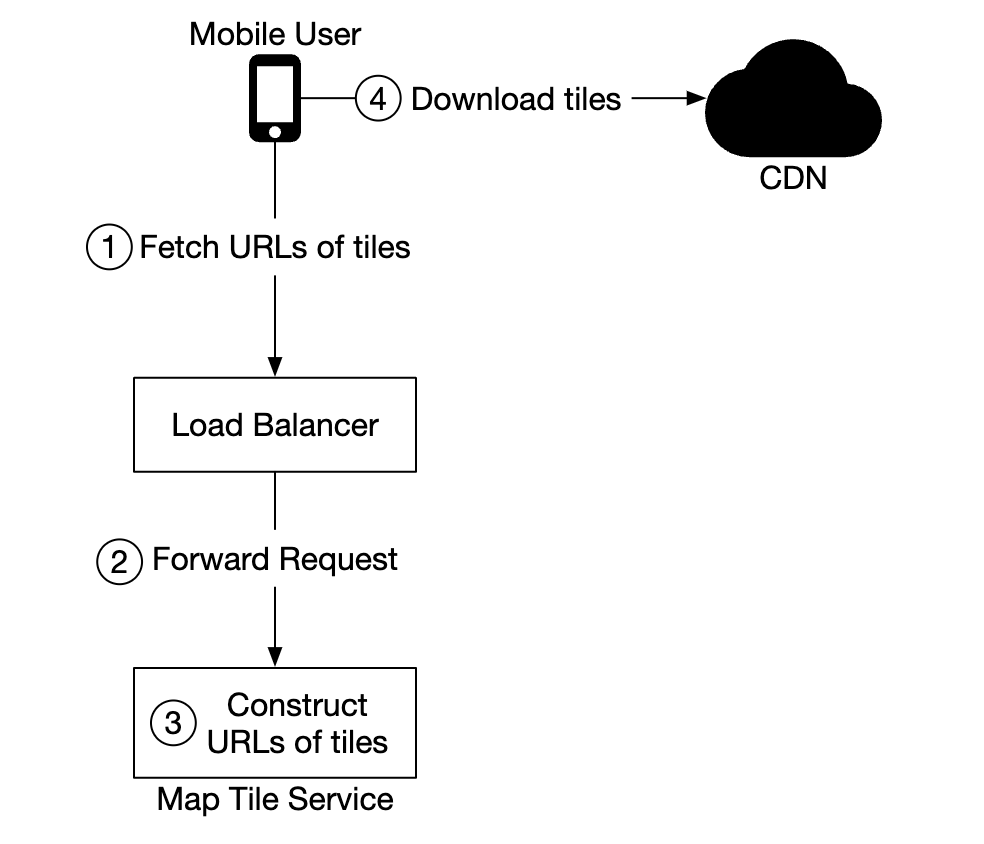
</div>

---

## 3단계: 상세 설계

### **데이터 모델**

다뤄야 할 여러 유형의 데이터를 어떻게 저장할지 논의한다.

#### 경로 안내 타일

최초의 도로 데이터는 여러 출처에서 얻는다. 이후 위치 갱신 데이터를 바탕으로 계속 개선된다.

도로 데이터는 정형화되어 있지 않다. 주기적으로 실행되는 오프라인 처리 파이프라인이 이 원시 데이터를 앱에 필요한 그래프 기반 경로 안내 타일로 변환한다.

데이터베이스 기능이 전혀 필요 없으므로 타일을 데이터베이스에 저장하지 않는다. 대신 S3 같은 객체 저장소에 보관하고 적극적으로 캐시한다.

인접 리스트를 이진 파일로 효율적으로 압축해 주는 라이브러리를 활용할 수도 있다.

#### 사용자 위치 데이터

사용자 위치 데이터는 교통 상황을 갱신하고 각종 분석을 하는 데 매우 유용하다.

이런 데이터는 본질적으로 쓰기 연산이 많으므로 Cassandra에 저장할 수 있다.

행의 예:

<div style="margin-left:3rem">
    
</div>

#### 지오코딩 데이터베이스

위도/경도 쌍과 장소를 키-값 쌍으로 저장한다.

읽기는 잦고 쓰기는 드물므로, 읽기 속도가 빠른 Redis를 쓸 수 있다.

#### 미리 만들어 둔 세계 지도 이미지

앞에서 말했듯 지도 타일 이미지를 미리 만들어 CDN에 저장한다.

<div style="margin-left:3rem">
    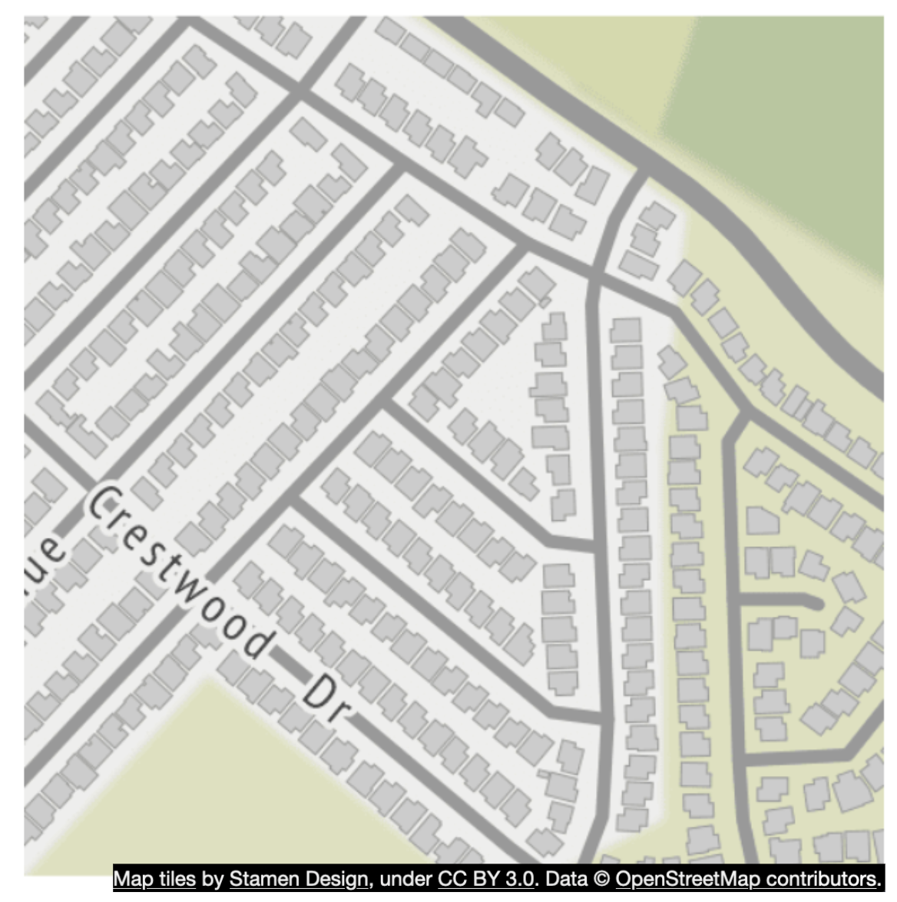
</div>

### **서비스**

#### 위치 서비스

이 서비스의 데이터베이스 설계와 사용자 위치를 저장하는 방법을 자세히 살펴본다.

<div style="margin-left:3rem">
    
</div>

위치 갱신으로 인한 많은 쓰기 부하를 처리하기 위해 NoSQL 데이터베이스를 쓸 수 있다. 사용자 위치는 자주 바뀌고 새 갱신이 도착하면 이전 데이터는 금방 쓸모없어지므로, 일관성보다 가용성을 우선한다.

모든 요구 사항에 잘 맞는 Cassandra를 데이터베이스로 선택한다.

저장할 행의 예:

<div style="margin-left:3rem">
    
</div>

 * `user_id`는 파티션 키로, 특정 사용자의 위치 갱신 내역 전체에 빠르게 접근하기 위한 것이다.
 * `timestamp`는 클러스터링 키로, 위치 갱신을 받은 시각순으로 데이터를 정렬해 저장하기 위한 것이다.

또한 위치 갱신 내역이 필요한 여러 서비스에 Kafka로 위치 갱신 내역을 스트리밍한다.

<div style="margin-left:3rem">
    
</div>

#### 지도 표시

지도 타일은 여러 확대 수준별로 저장된다. 가장 낮은 확대 수준에서는 세계 전체를 256x256 타일 하나로 표현한다.

확대 수준이 한 단계 올라갈 때마다 지도 타일 수는 네 배가 된다.

<div style="margin-left:3rem">
    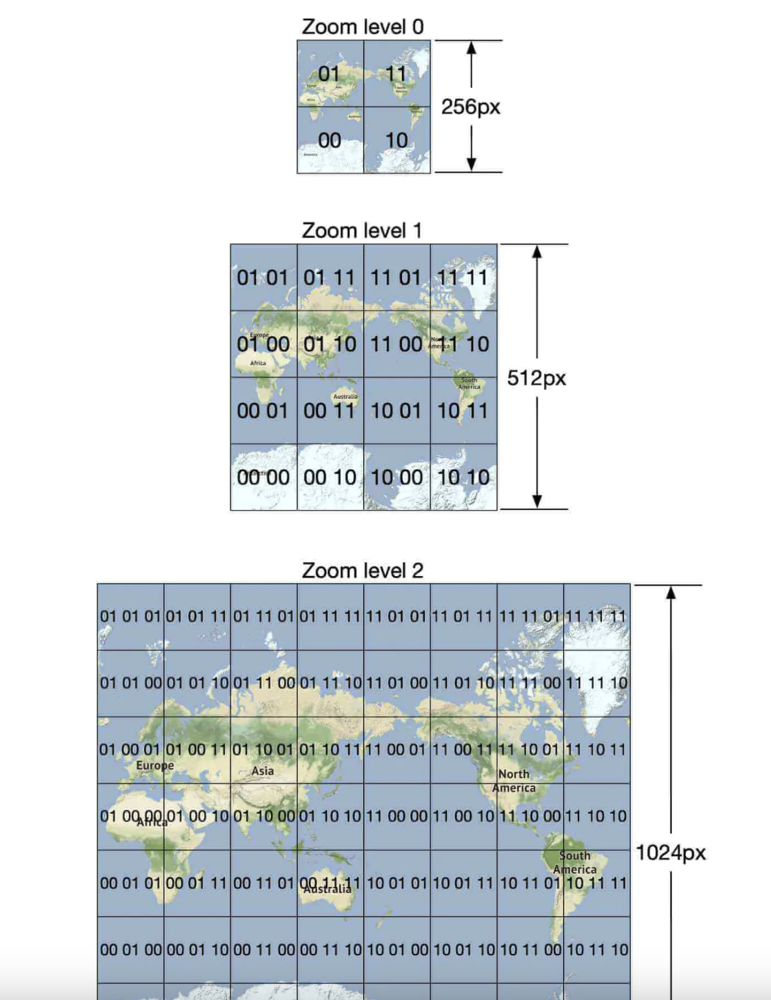
</div>

한 가지 최적화는 이미지 정보를 통째로 네트워크로 보내지 않고, 타일을 벡터(경로와 다각형)로 표현해 클라이언트가 동적으로 그리게 하는 것이다.

이렇게 하면 대역폭을 크게 절약할 수 있다.

#### 경로 안내 서비스

가장 빠른 경로를 찾는 서비스다.

<div style="margin-left:3rem">
    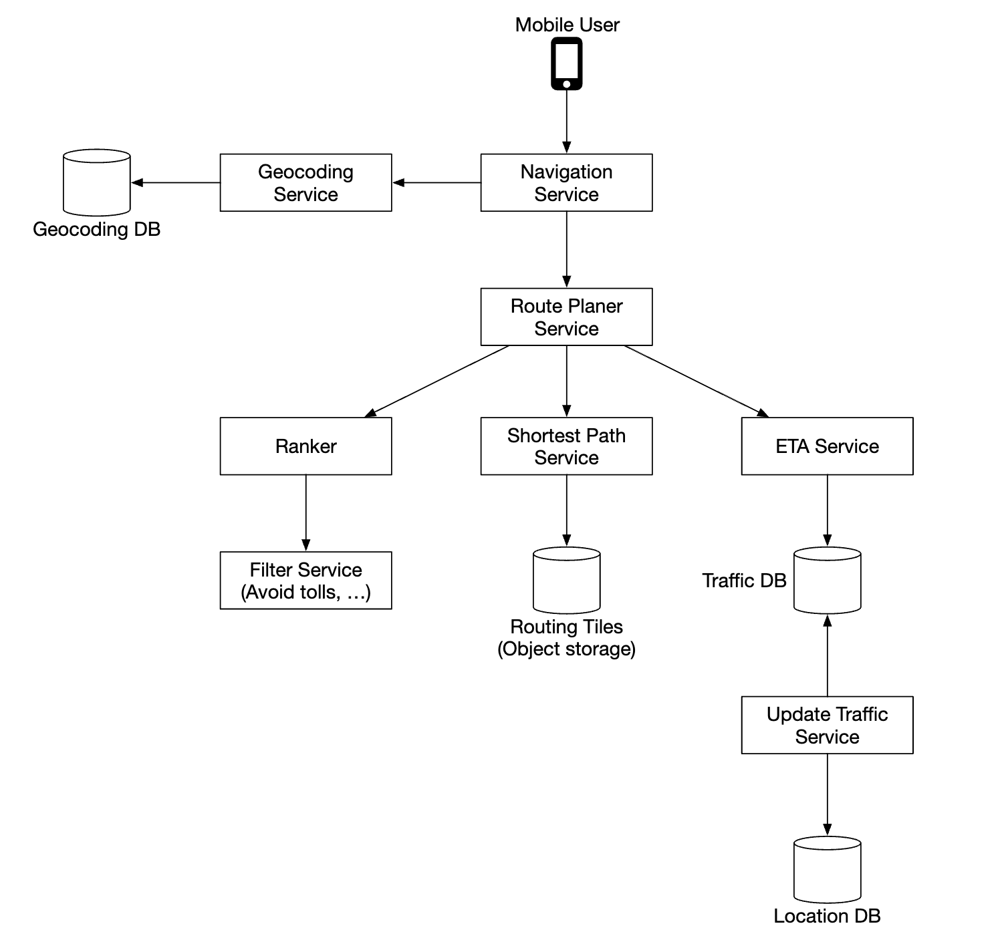
</div>

이 하위 시스템의 각 컴포넌트를 살펴보자.

먼저 지오코딩 서비스는 주소를 위도/경도 쌍으로 변환한다.

요청 예:

```
https://maps.googleapis.com/maps/api/geocode/json?address=1600+Amphitheatre+Parkway,+Mountain+View,+CA
```

응답 예:

```json
{
   "results" : [
      {
         "formatted_address" : "1600 Amphitheatre Parkway, Mountain View, CA 94043, USA",
         "geometry" : {
            "location" : {
               "lat" : 37.4224764,
               "lng" : -122.0842499
            },
            "location_type" : "ROOFTOP",
            "viewport" : {
               "northeast" : {
                  "lat" : 37.4238253802915,
                  "lng" : -122.0829009197085
               },
               "southwest" : {
                  "lat" : 37.4211274197085,
                  "lng" : -122.0855988802915
               }
            }
         },
         "place_id" : "ChIJ2eUgeAK6j4ARbn5u_wAGqWA",
         "plus_code": {
            "compound_code": "CWC8+W5 Mountain View, California, United States",
            "global_code": "849VCWC8+W5"
         },
         "types" : [ "street_address" ]
      }
   ],
   "status" : "OK"
}
```

경로 계획(route planner) 서비스는 현재 교통 상황을 반영해 이동 시간 측면에서 최적화된 경로를 계산해 제안한다.

최단 경로(shortest-path) 서비스는 객체 저장소에 있는 경로 안내 타일을 대상으로 A* 알고리즘의 변형을 실행해 최적 경로를 계산한다.
 * 출발지/목적지 쌍을 받아 위도/경도 쌍으로 바꾸고, 그로부터 지오해시를 계산해 경로 안내 타일을 알아낸다.
 * 알고리즘은 출발지 경로 안내 타일에서 시작해, 목적지 타일까지 충분히 좋은 경로를 찾을 때까지 그래프를 탐색한다.

<div style="margin-left:3rem">
    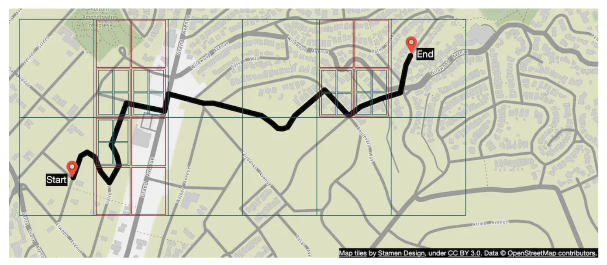
</div>

ETA 서비스는 경로 계획 서비스가 호출하며, 교통 데이터를 바탕으로 머신러닝 알고리즘으로 예상 도착 시간을 계산한다.

순위 결정(ranker) 서비스는 사용자가 지정한 필터(예: 유료 도로나 고속도로 회피)에 따라 가능한 경로들의 순위를 매긴다.

갱신(updater) 서비스는 주요 데이터베이스를 비동기적으로 갱신해 최신 상태로 유지한다.

#### 개선: 적응형 ETA와 경로 재탐색

새로 들어온 교통 데이터를 바탕으로 안내 중인 경로를 적응적으로 갱신하도록 개선할 수 있다.

한 가지 구현 방법은 현재 경로 안내를 받고 있는 사용자와, 그 사용자가 지나갈 타일 전체를 데이터베이스에 저장하는 것이다.

데이터는 다음과 같은 모습이 된다.

```
user_1: r_1, r_2, r_3, …, r_k
user_2: r_4, r_6, r_9, …, r_n
user_3: r_2, r_8, r_9, …, r_m
...
user_n: r_2, r_10, r21, ..., r_l
```

어떤 타일에서 교통사고가 나면, 그 타일을 지나는 경로의 사용자를 모두 찾아 경로를 다시 안내할 수 있다.

데이터베이스에 저장하는 타일 수를 줄이려면, 출발지 경로 안내 타일과 함께 목적지 타일이 포함될 때까지 해상도 수준을 높여 가며 상위 경로 안내 타일 몇 개만 저장하면 된다.

```
user_1, r_1, super(r_1), super(super(r_1)), ...
```

<div style="margin-left:3rem">
    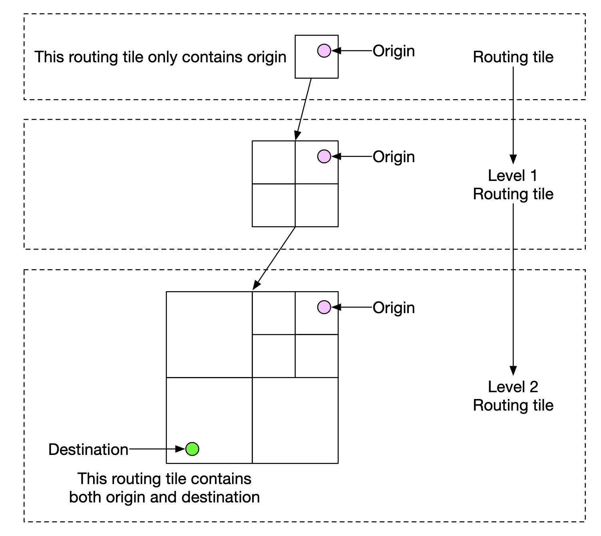
</div>

이렇게 하면 사용자의 마지막 타일이 교통사고 타일을 포함하는지만 확인해 그 사용자가 영향을 받는지 알 수 있다.

경로 안내 중인 사용자의 가능한 경로를 모두 추적해 두었다가, 더 빠른 경로가 생기면 알려 줄 수도 있다.

#### 전송 프로토콜

서버가 클라이언트에 능동적으로 데이터를 보낼 수 있게 해 주는 몇 가지 선택지가 있다.
 * 모바일 푸시 알림은 페이로드 크기가 제한되고 웹 앱에서는 쓸 수 없어 적합하지 않다.
 * 웹소켓은 서버의 컴퓨팅 자원을 덜 쓰므로 일반적으로 롱 폴링보다 낫다.
 * 서버 전송 이벤트(SSE)도 쓸 수 있지만, 양방향 통신을 지원하는 웹소켓이 더 낫다. 양방향 통신은 예를 들어 '라스트 마일' 배송 같은 기능에 유용하다.

---

## 4단계: 마무리

최종 설계는 다음과 같다.

<div style="margin-left:3rem">
    
</div>

추가로 제공할 수 있는 기능으로는 경유지가 여러 곳인 경로 안내가 있다. 여러 장소를 방문하는 최적 경로를 정하는 기능으로, 우버나 리프트 같은 기업 고객에게 판매할 수 있다.
