# 19장: 분산 메시지 큐

## 소개

이 장에서는 **분산 메시지 큐(distributed message queue)** 를 설계한다.

메시지 큐의 이점:
- **결합도 완화(decoupling)**: 컴포넌트 사이의 강한 결합을 없애 각각 독립적으로 갱신할 수 있게 한다.
- **규모 확장성 개선**: 생산자와 소비자를 트래픽에 따라 독립적으로 확장할 수 있다.
- **가용성 개선**: 시스템의 한 부분에 장애가 나도 다른 부분은 계속 큐와 상호작용할 수 있다.
- **성능 개선**: 생산자는 소비자의 확인을 기다리지 않고 메시지를 만들 수 있다.

널리 쓰이는 메시지 큐 구현체로는 Kafka, RabbitMQ, RocketMQ, Apache Pulsar, ActiveMQ, ZeroMQ 등이 있다.

엄밀히 말하면 Kafka와 Pulsar는 메시지 큐가 아니라 이벤트 스트리밍 플랫폼이다.
하지만 기능이 서로 수렴하면서 메시지 큐와 이벤트 스트리밍 플랫폼의 경계가 흐려지고 있다.

이 장에서는 데이터 장기 보관, 메시지 반복 소비 같은 고급 기능을 지원하는 메시지 큐를 만든다.

---

## 1단계: 문제 이해 및 설계 범위 확정

메시지 큐는 기본적으로 생산자가 메시지를 만들고 소비자가 그것을 소비하는 기능을 지원해야 한다.
하지만 성능, 메시지 전달 방식, 데이터 보관 등 고려할 점이 여럿 있다.

지원자와 면접관 사이에 오갈 만한 질문(지: 지원자, 면: 면접관):
 * 지: 메시지의 형태와 평균 크기는 어떻게 되나요? 텍스트만 지원하나요?
 * 면: 메시지는 텍스트만 지원하며 보통 수 KB입니다.
 * 지: 메시지를 반복적으로 소비할 수 있어야 하나요?
 * 면: 네, 여러 소비자가 같은 메시지를 반복해서 소비할 수 있어야 합니다. 전통적인 메시지 큐는 지원하지 않는 추가 요구 사항입니다.
 * 지: 메시지는 생산된 순서대로 소비되어야 하나요?
 * 면: 네, 순서가 보장되어야 합니다. 이것도 전통적인 메시지 큐는 지원하지 않는 추가 요구 사항입니다.
 * 지: 데이터 보관 요구 사항은 어떻게 되나요?
 * 면: 메시지는 2주 동안 보관해야 합니다. 추가 요구 사항입니다.
 * 지: 생산자와 소비자는 몇 개나 지원해야 하나요?
 * 면: 많을수록 좋습니다.
 * 지: 어떤 데이터 전달 방식을 지원해야 하나요? 최대 한 번, 최소 한 번, 정확히 한 번 중에서요.
 * 면: 최소 한 번은 반드시 지원해야 합니다. 이상적으로는 모두 지원하고 설정으로 고를 수 있으면 좋겠습니다.
 * 지: 목표 처리량과 종단 간 지연 시간은 어느 정도인가요?
 * 면: 로그 수집 같은 용도를 위해 높은 처리량을 지원해야 하고, 전통적인 용도를 위해 낮은 처리량도 지원해야 합니다.

### **기능 요구 사항**

 * 생산자는 메시지 큐에 메시지를 보낸다.
 * 소비자는 큐에서 메시지를 소비한다.
 * 메시지는 한 번 또는 반복해서 소비할 수 있다.
 * 오래된 이력 데이터는 삭제할 수 있다.
 * 메시지 크기는 KB 수준이다.
 * 메시지 순서가 보장되어야 한다.
 * 데이터 전달 방식(최대 한 번/최소 한 번/정확히 한 번)은 설정할 수 있어야 한다.

### **비기능 요구 사항**

- **높은 처리량 또는 낮은 지연 시간**: 용도에 따라 설정할 수 있어야 한다.
- **규모 확장성**: 시스템은 분산되어 있어야 하며, 메시지 양이 갑자기 늘어나도 감당해야 한다.
- **지속성과 내구성**: 데이터는 디스크에 저장되고 여러 노드에 복제되어야 한다.

전통적인 메시지 큐는 보통 데이터 보관을 지원하지 않고 순서도 보장하지 않는다. 이 덕분에 설계가 훨씬 단순해지는데, 이에 대해 논의해 보자.

---

## 2단계: 개략적인 설계안 제시 및 동의 구하기

메시지 큐의 핵심 컴포넌트:

    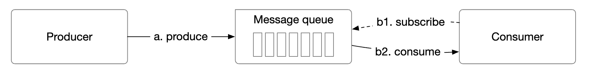

 * 생산자는 메시지를 큐에 보낸다.
 * 소비자는 큐를 구독하고 구독한 메시지를 소비한다.
 * 메시지 큐는 생산자와 소비자 사이에서 둘의 결합을 끊어 각각 독립적으로 확장할 수 있게 해 주는 서비스다.
 * 생산자와 소비자는 모두 클라이언트이고, 메시지 큐는 서버다.

### **메시지 모델**

첫 번째 메시지 모델은 일대일(point-to-point) 모델로, 전통적인 메시지 큐에서 흔히 볼 수 있다.

    

 * 큐에 보낸 메시지는 정확히 한 소비자만 소비한다.
 * 소비자가 여럿일 수 있지만, 메시지는 한 번만 소비된다.
 * 메시지가 소비되었다는 확인(acknowledgment)을 받으면 큐에서 삭제된다.
 * 일대일 모델에는 데이터 보관 기능이 없지만, 이번 설계에는 있다.

반면 발행-구독(publish-subscribe) 모델은 이벤트 스트리밍 플랫폼에서 더 흔하다.

    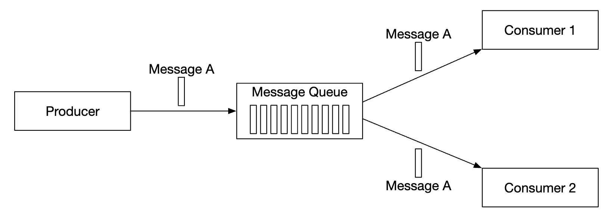

 * 이 모델에서 메시지는 토픽(topic)에 연결된다.
 * 소비자는 토픽을 구독하고, 그 토픽으로 전송된 모든 메시지를 받는다.

### **토픽, 파티션, 브로커**

토픽 하나의 데이터 양이 너무 많으면 어떻게 할까? 한 가지 확장 방법은 토픽을 여러 파티션으로 나누는 것이다(샤딩).

    

 * 토픽으로 보낸 메시지는 파티션들에 고르게 분산된다.
 * 파티션을 유지하는 서버를 브로커(broker)라고 한다.
 * 각 토픽은 FIFO 큐처럼 메시지를 처리한다. 메시지 순서는 파티션 안에서 보장된다.
 * 파티션 안에서 메시지의 위치를 **오프셋(offset)** 이라고 한다.
 * 생산된 메시지는 특정 파티션으로 전송된다. 메시지가 어느 파티션으로 갈지는 파티션 키로 정한다.
   * 예를 들어 `user_id`를 파티션 키로 쓰면 같은 사용자의 메시지 순서를 보장할 수 있다.
 * 각 소비자는 하나 이상의 파티션을 구독한다. 같은 메시지를 소비하는 소비자가 여럿이면 소비자 그룹을 이룬다.

### **소비자 그룹**

소비자 그룹(consumer group)은 토픽에서 메시지를 소비하기 위해 함께 일하는 소비자들의 집합이다.

    

 * 메시지는 소비자 단위가 아니라 소비자 그룹 단위로 복제된다.
 * 소비자 그룹마다 자신의 오프셋을 따로 관리한다.
 * 소비자 그룹이 메시지를 병렬로 읽으면 처리량은 늘지만 순서 보장이 어려워진다.
 * 이 문제는 한 파티션을 그룹 안의 한 소비자만 구독하게 해서 완화할 수 있다.
 * 따라서 그룹 안의 소비자 수는 파티션 수보다 많을 수 없다.

### **개략적인 아키텍처**

    

- **클라이언트**: 생산자와 소비자. 생산자는 지정된 토픽으로 메시지를 보낸다. 소비자 그룹은 토픽의 메시지를 구독한다.
- **브로커**: 여러 파티션을 유지한다. 파티션은 토픽의 메시지 일부를 갖는다.
- **데이터 저장소**: 파티션 안에 메시지를 저장한다.
- **상태 저장소**: 소비자 상태를 저장한다.
- **메타데이터 저장소**: 설정과 토픽 속성을 저장한다.
- **조정 서비스(coordination service)**: 서비스 탐색(어떤 브로커가 살아 있는지)과 리더 선출(어느 브로커가 리더로서 파티션을 할당할지)을 맡는다.

---

## 3단계: 상세 설계

높은 처리량을 달성하고 데이터 장기 보관 요구 사항을 만족하기 위해 몇 가지 중요한 설계 결정을 내렸다.
 * 현대 HDD의 특성과 현대 운영체제의 디스크 캐시 전략을 잘 활용하는 디스크 기반 자료 구조를 택했다.
 * 메시지 자료 구조를 변경 불가능(immutable)하게 해 불필요한 복사를 피했다. 대용량·고트래픽 시스템에서는 복사를 피하는 것이 중요하다.
 * 작은 I/O는 높은 처리량의 적이므로, 일괄 처리(batching)를 중심으로 쓰기 연산을 설계했다.

### **데이터 저장소**

메시지에 가장 적합한 데이터 저장소를 찾으려면 메시지의 특성부터 살펴봐야 한다.
 * 쓰기와 읽기가 모두 빈번하다.
 * 갱신/삭제 연산이 없다. 전통적인 메시지 큐에는 메시지를 보관하지 않으므로 '삭제' 연산이 있다.
 * 순차적인 읽기/쓰기가 대부분이다.

선택지는 다음과 같다.
- **데이터베이스**: 일반적인 데이터베이스는 쓰기와 읽기가 모두 많은 시스템을 잘 지원하지 못하므로 이상적이지 않다.
- **선행 기록 로그(write-ahead log, WAL)**: 새 항목을 추가하기만 하는 일반 파일로, HDD와 아주 잘 맞는다.
  * 파일 하나가 너무 커지지 않도록 파티션을 세그먼트(segment)로 나눈다.
  * 오래된 세그먼트는 읽기 전용이다. 쓰기는 가장 최근 세그먼트에만 허용한다.

    

WAL 파일은 전통적인 HDD와 함께 쓸 때 매우 효율적이다.

HDD 접근은 느리다는 오해가 있지만, 이는 접근 패턴에 크게 좌우된다.
이 경우처럼 접근 패턴이 순차적이면 HDD로도 충분한 수준의 MB/s 읽기/쓰기 속도를 낼 수 있다.
또한 운영체제가 디스크 데이터를 메모리에 적극적으로 캐시한다는 점도 활용한다.

### **메시지 자료 구조**

불필요한 복사를 피하려면 생산자, 큐, 소비자 사이에서 메시지 스키마가 일치해야 한다. 그래야 훨씬 효율적으로 처리할 수 있다.

메시지 구조의 예:

    

메시지 키는 메시지가 어느 파티션에 속할지 정한다. 대응 방식의 예로 `hash(key) % numPartitions`가 있다.
더 유연하게 하려면 생산자가 기본 키 대응 방식을 재정의해, 메시지를 어느 파티션으로 분배할지 제어할 수 있다.

메시지 값은 메시지의 페이로드다. 일반 텍스트일 수도, 압축된 이진 블록일 수도 있다.

**참고:** 메시지 키는 일반적인 키-값 저장소의 키와 달리 유일할 필요가 없다. 키가 중복되어도 되고, 아예 없어도 된다.

메시지의 기타 필드:
- **토픽**: 메시지가 속한 토픽
- **파티션**: 메시지가 속한 파티션의 ID
- **오프셋**: 파티션 안에서 메시지의 위치. 메시지는 `topic`, `partition`, `offset`으로 찾을 수 있다.
- **타임스탬프**: 메시지가 저장된 시각
- **크기**: 메시지 크기
- **CRC**: 메시지 무결성을 보장하기 위한 체크섬

필터링 같은 추가 기능은 필드를 더 추가해 지원할 수 있다.

### **일괄 처리**

일괄 처리는 시스템 성능에 아주 중요하다. 생산자, 소비자, 메시지 큐 모두에 적용한다.

일괄 처리가 중요한 이유:
 * 운영체제가 메시지를 묶어 처리할 수 있게 해, 비싼 네트워크 왕복 비용을 분산시킨다.
 * 메시지를 묶음 단위로 WAL에 순차 기록하므로, 순차 쓰기가 많아지고 디스크 캐시 효과가 커진다.

지연 시간과 처리량 사이에는 트레이드오프가 있다.
 * 묶음을 크게 하면 처리량은 늘지만 지연 시간도 길어진다.
 * 묶음을 작게 하면 처리량은 줄지만 지연 시간도 짧아진다.

시스템을 전통적인 메시지 큐로 배포해 낮은 지연 시간을 지원해야 한다면, 묶음 크기를 작게 조정하면 된다.

처리량에 맞게 조정한다면, 느린 순차 디스크 쓰기 처리량을 보완하기 위해 토픽당 파티션 수를 늘려야 할 수도 있다.

### **생산자 측 작업 흐름**

생산자가 어떤 파티션에 메시지를 보내려면 어느 브로커에 연결해야 할까?

한 가지 방법은 메시지를 올바른 브로커로 보내 주는 라우팅 계층을 두는 것이다. 복제를 사용한다면 올바른 브로커란 리더 사본이 있는 브로커다.

    

 * 라우팅 계층은 메타데이터 저장소에서 사본 분산 계획을 읽어 로컬에 캐시한다.
 * 생산자는 라우팅 계층으로 메시지를 보낸다.
 * 메시지는 해당 파티션의 리더인 브로커 1로 전달된다.
 * 팔로워 사본은 리더로부터 새 메시지를 가져간다. 충분한 수의 확인을 받으면 리더는 데이터를 커밋하고 생산자에게 응답한다.

사본을 두는 이유는 결함 감내를 위해서다.

이 방법은 동작하지만 몇 가지 단점이 있다.
 * 컴포넌트가 하나 더 생기므로 네트워크 홉이 늘어난다.
 * 메시지를 일괄 처리할 수 없는 설계다.

이 문제를 완화하려면 라우팅 계층을 생산자 안에 넣으면 된다.

    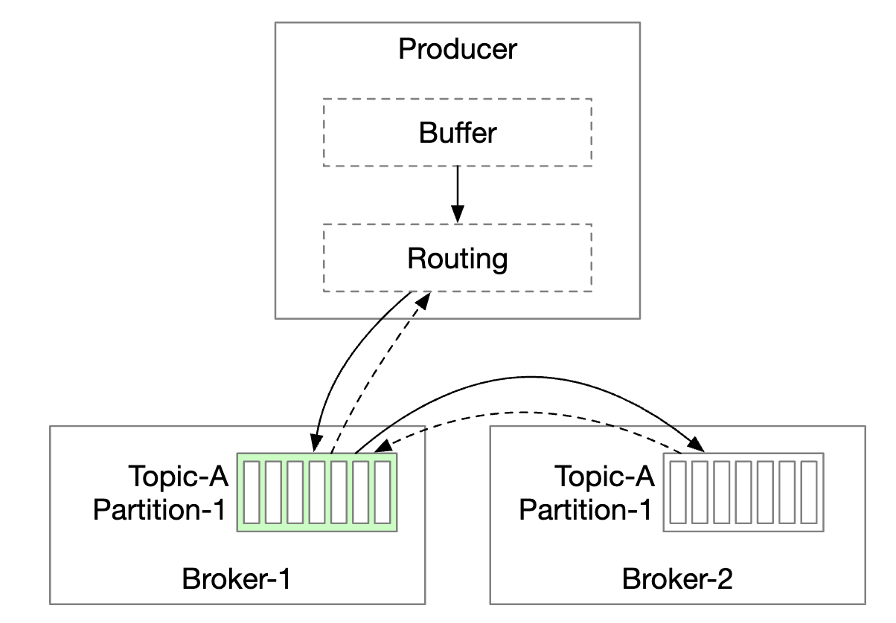

 * 네트워크 홉이 줄어 지연 시간이 짧아진다.
 * 생산자가 메시지를 어느 파티션으로 보낼지 직접 제어할 수 있다.
 * 버퍼에 메시지를 모아 두었다가 큰 묶음을 한 번의 요청으로 보낼 수 있어 처리량이 늘어난다.

묶음 크기를 정하는 것은 처리량과 지연 시간 사이의 전형적인 트레이드오프다.

    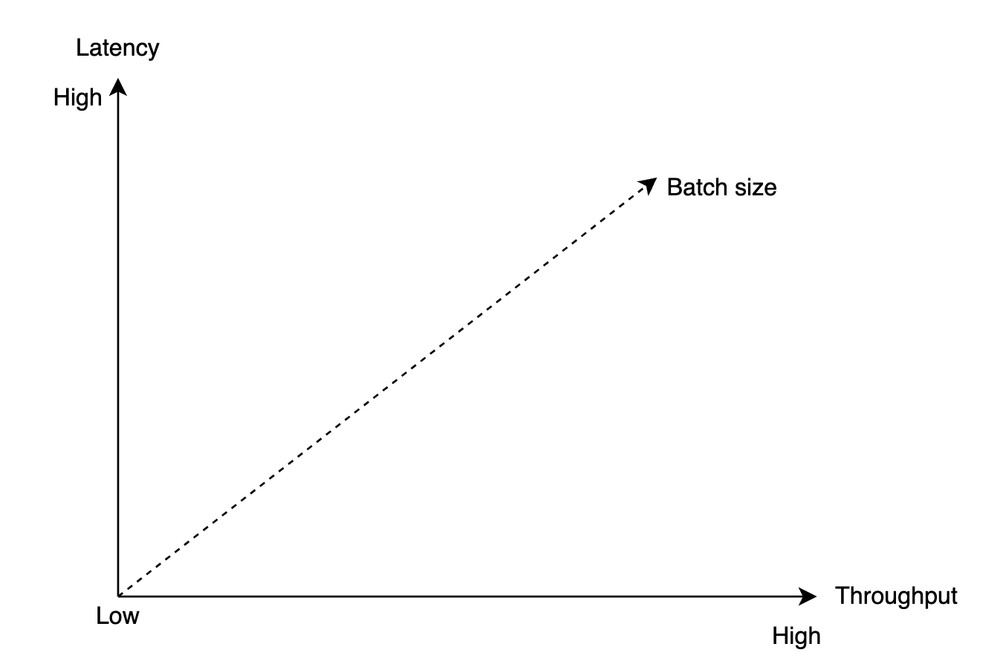

 * 묶음이 크면 커밋되기까지 기다리는 시간이 길어진다.
 * 묶음이 작으면 요청이 더 빨리 전송되어 지연 시간은 짧지만 처리량은 줄어든다.

### **소비자 측 작업 흐름**

소비자는 파티션 안의 오프셋을 지정하고, 그 오프셋부터 시작하는 메시지 묶음을 받는다.

    

소비자를 설계할 때 중요한 고려 사항 하나는 푸시 모델과 풀 모델 중 무엇을 쓸지다.
- **푸시 모델**: 브로커가 메시지를 받는 즉시 소비자에게 보내므로 지연 시간이 짧다.
  * 하지만 소비 속도가 생산 속도를 따라가지 못하면 소비자에게 과부하가 걸릴 수 있다.
  * 소비 속도를 브로커가 정하므로, 처리 능력이 제각각인 소비자들을 다루기 어렵다.
- **풀 모델**: 소비 속도를 소비자가 정한다.
  * 소비 속도가 느려도 소비자에게 과부하가 걸리지 않으며, 소비자를 늘려 따라잡을 수 있다.
  * 푸시 모델에서는 브로커가 소비자가 몇 개의 메시지를 처리할 수 있는지 알 수 없으므로, 일괄 처리에는 풀 모델이 더 적합하다.
  * 반면 풀 모델에서는 소비자가 큰 메시지 묶음을 적극적으로 가져갈 수 있다.
  * 단점은 지연 시간이 더 길고, 새 메시지가 없을 때도 네트워크 호출이 발생한다는 것이다. 뒤의 문제는 롱 폴링으로 완화할 수 있다.

그래서 대부분의 메시지 큐는(그리고 이번 설계도) 풀 모델을 택한다.

    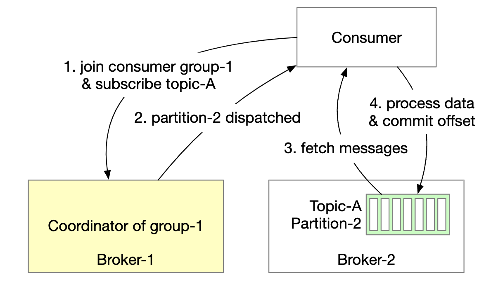

 * 새 소비자가 토픽 A를 구독하고 그룹 1에 참여한다.
 * 그룹 이름을 해싱해 올바른 브로커 노드를 찾는다. 이렇게 하면 같은 그룹의 모든 소비자가 같은 브로커에 연결된다.
 * 이 소비자 그룹 코디네이터는 조정 서비스(ZooKeeper)와는 다르다는 점에 유의한다.
 * 코디네이터는 소비자가 그룹에 참여했음을 확인하고, 그 소비자에게 파티션 2를 할당한다.
 * 파티션 할당 전략에는 라운드 로빈, 범위(range) 등 여러 가지가 있다.
 * 소비자는 마지막으로 소비한 오프셋 이후의 메시지를 가져온다. 소비자 오프셋은 상태 저장소에 보관된다.
 * 소비자는 메시지를 처리하고 오프셋을 브로커에 커밋한다. 이 두 작업의 순서가 메시지 전달 방식을 결정한다.

### **소비자 재조정**

소비자 재조정(consumer rebalancing)은 어떤 소비자가 어떤 파티션을 맡을지 결정하는 과정이다.

이 과정은 소비자가 그룹에 참여하거나 떠날 때, 또는 파티션이 추가되거나 제거될 때 일어난다.

코디네이터 역할을 하는 브로커가 재조정 과정을 조율하는 데 큰 역할을 한다.

    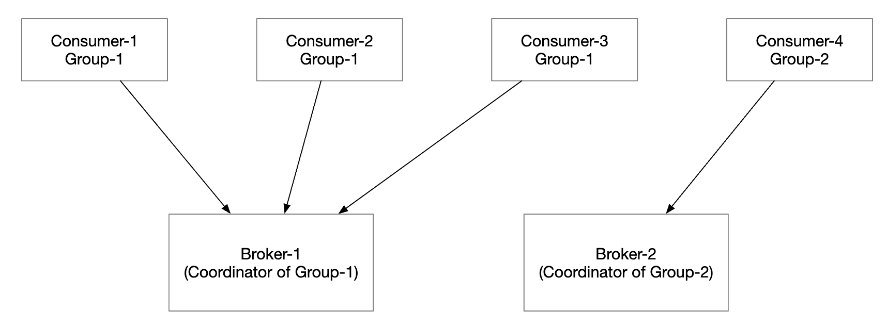

 * 같은 그룹의 모든 소비자는 같은 코디네이터에 연결된다. 코디네이터는 그룹 이름을 해싱해 찾는다.
 * 소비자 목록이 바뀌면 코디네이터는 그룹의 새 리더를 선출한다.
 * 그룹 리더는 새 파티션 배치 계획을 계산해 코디네이터에 보고하고, 코디네이터는 이를 다른 소비자들에게 알린다.

코디네이터가 그룹 안의 소비자로부터 박동(heartbeat) 신호를 받지 못하면 재조정이 시작된다.

    

소비자가 그룹에 참여하면 어떤 일이 일어나는지 살펴보자.

    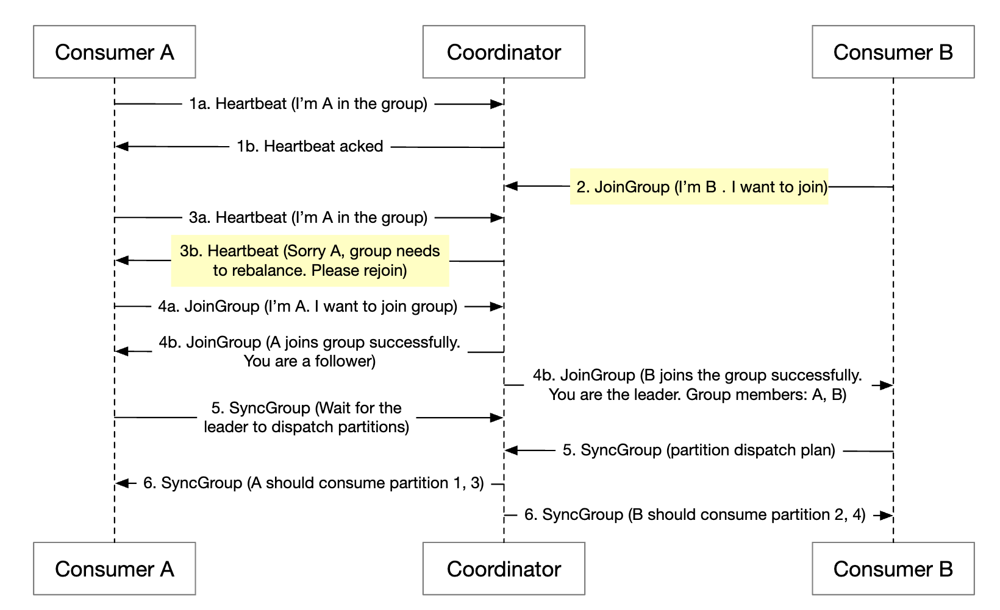

 * 처음에는 그룹에 소비자 A만 있으며, A가 모든 파티션을 소비한다.
 * 소비자 B가 그룹 참여 요청을 보낸다.
 * 코디네이터는 박동 신호에 대한 응답으로 모든 그룹 구성원에게 재조정할 때라고 수동적으로 알린다.
 * 모든 소비자가 그룹에 다시 참여하면, 코디네이터는 리더를 선출하고 나머지에게 선출 결과를 알린다.
 * 리더는 파티션 배치 계획을 만들어 코디네이터에 보낸다. 나머지는 배치 계획을 기다린다.
 * 소비자들은 새로 할당된 파티션에서 소비를 시작한다.

소비자가 그룹을 떠날 때는 다음과 같다.

    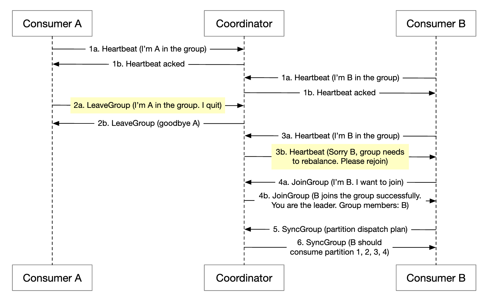

 * 소비자 A와 B가 같은 그룹에 있다.
 * 소비자 B가 그룹 탈퇴를 요청한다.
 * 코디네이터는 A의 박동 신호를 받으면 재조정할 때라고 알린다.
 * 나머지 단계는 앞과 같다.

소비자가 오랫동안 박동 신호를 보내지 않을 때도 과정은 비슷하다.

    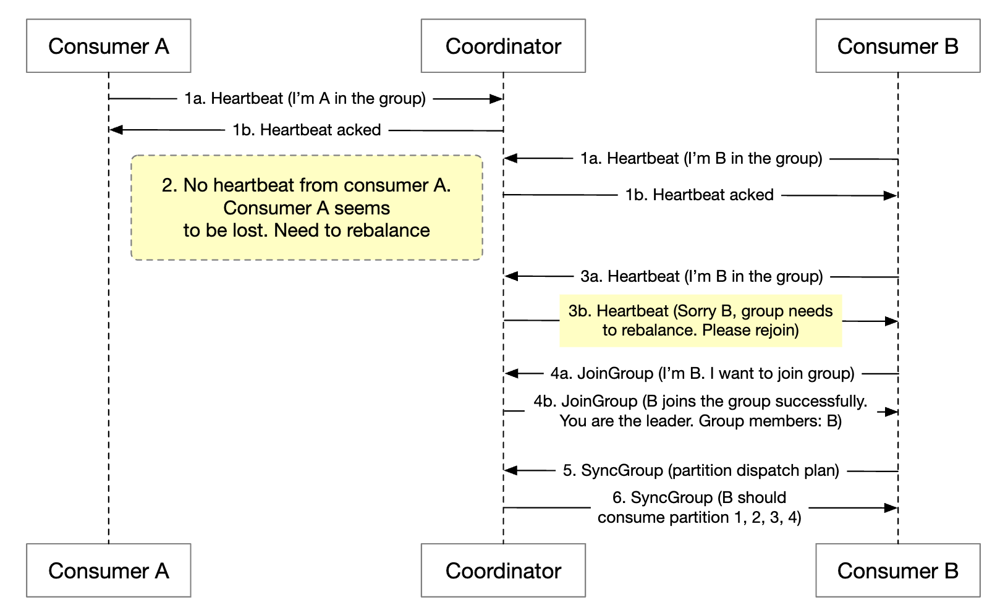

### **상태 저장소**

상태 저장소는 파티션과 소비자 사이의 대응 관계, 그리고 파티션별로 마지막으로 소비한 오프셋을 저장한다.

    

그룹 1의 오프셋은 6이므로, 그 이전 메시지는 모두 소비되었다는 뜻이다. 소비자가 죽으면 새 소비자는 그 메시지부터 이어서 소비한다.
 
소비자 상태 데이터의 접근 패턴:
 * 읽기/쓰기가 빈번하지만 양은 많지 않다.
 * 데이터 갱신은 빈번하지만 삭제는 거의 없다.
 * 읽기/쓰기가 무작위로 일어난다.
 * 데이터 일관성이 중요하다.

이런 요구 사항을 고려하면 ZooKeeper 같은 빠른 키-값 저장소가 이상적이다.

### **메타데이터 저장소**

메타데이터 저장소는 설정과 토픽 속성(파티션 수, 보관 기간, 사본 배치)을 저장한다.

메타데이터는 자주 바뀌지 않고 양도 적지만, 높은 일관성이 필요하다.
ZooKeeper가 이 저장소로 적합하다.

### **ZooKeeper**

ZooKeeper는 분산 메시지 큐를 만드는 데 꼭 필요하다.

계층적 키-값 저장소로, 분산 설정 관리, 동기화 서비스, 이름 레지스트리(즉, 서비스 탐색)에 흔히 쓰인다.

    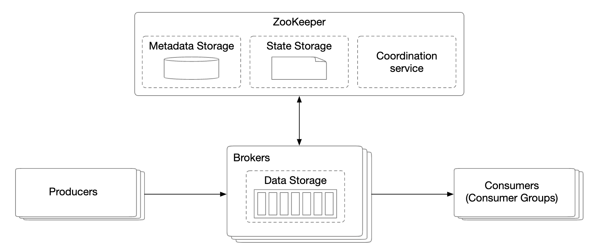

이렇게 바꾸면 브로커는 메시지 데이터만 유지하면 된다. 메타데이터와 상태 저장소는 ZooKeeper에 있다.

ZooKeeper는 브로커 사본의 리더 선출에도 도움을 준다.

### **복제**

분산 시스템에서 하드웨어 문제는 피할 수 없다. 복제를 통해 이에 대처하고 높은 가용성을 확보한다.

    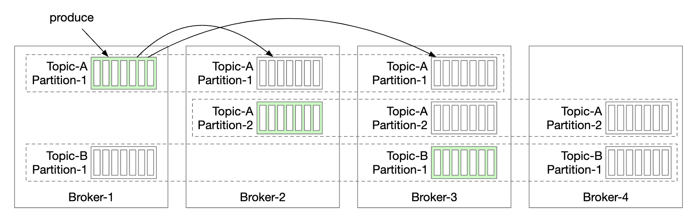

 * 각 파티션은 여러 브로커에 복제되지만, 리더 사본은 하나뿐이다.
 * 생산자는 리더 사본에 메시지를 보낸다.
 * 팔로워는 리더로부터 복제할 메시지를 가져간다.
 * 충분한 수의 사본이 동기화되면 리더는 생산자에게 확인 응답을 보낸다.
 * 파티션별 사본 배치를 사본 분산 계획(replica distribution plan)이라고 한다.
 * 파티션의 리더가 사본 분산 계획을 만들어 ZooKeeper에 저장한다.

### **동기화된 사본**

해결해야 할 문제 하나는 파티션의 리더와 팔로워 사이에 메시지를 동기화된 상태로 유지하는 것이다.

동기화된 사본(in-sync replicas, ISR)은 리더와 동기화된 상태를 유지하는 파티션 사본을 말한다.

`replica.lag.max.messages`는 사본이 리더보다 몇 개의 메시지까지 뒤처져도 동기화된 상태로 볼지 정한다.

    

 * 커밋된 오프셋은 13이다.
 * 새 메시지 두 개가 리더에 기록되었지만 아직 커밋되지 않았다.
 * ISR에 속한 모든 사본이 메시지를 동기화하면 그 메시지는 커밋된다.
 * 사본 2와 3은 리더를 완전히 따라잡았으므로 ISR에 속한다.
 * 사본 4는 뒤처졌으므로 당분간 ISR에서 제외된다.

ISR은 성능과 영속성 사이의 트레이드오프를 반영한다.
 * 생산자가 메시지를 잃지 않으려면 확인 응답을 보내기 전에 모든 사본이 동기화되어야 한다.
 * 하지만 느린 사본 하나 때문에 파티션 전체를 쓸 수 없게 될 수 있다.

확인 응답(ACK) 방식은 설정할 수 있다.

`ACK=all`은 ISR에 속한 모든 사본이 메시지를 동기화해야 한다는 뜻이다. 메시지 전송은 느리지만 영속성은 가장 높다.

    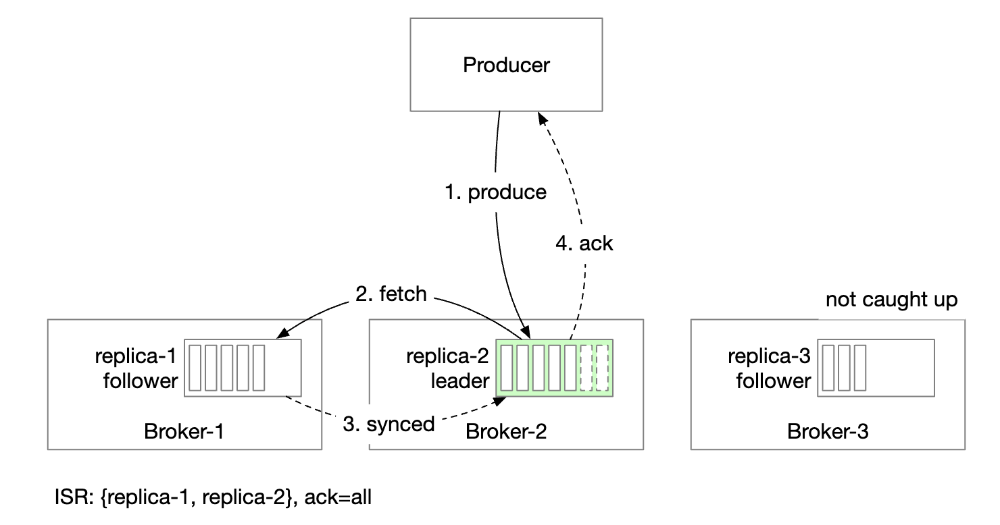

`ACK=1`은 리더가 메시지를 받으면 생산자가 확인 응답을 받는다는 뜻이다. 메시지 전송은 빠르지만 영속성은 낮다.

    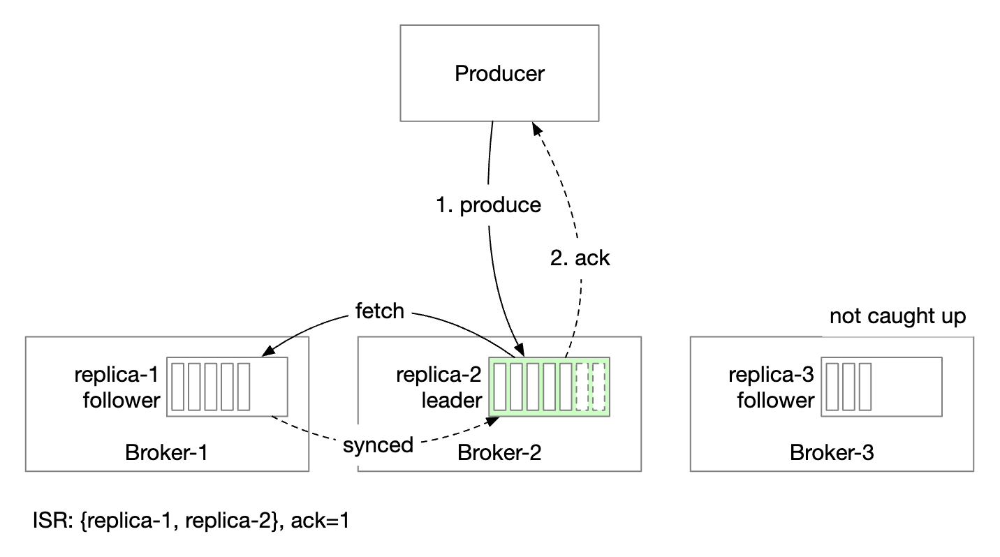

`ACK=0`은 생산자가 리더의 확인 응답을 기다리지 않고 메시지를 보낸다는 뜻이다. 메시지 전송은 가장 빠르고 영속성은 가장 낮다.

    

소비자 측에서는 모든 소비자를 파티션의 리더에 연결해 리더에서 메시지를 읽게 할 수 있다.
 * 가장 단순하고 운영하기 쉬운 설계다.
 * 파티션의 메시지는 그룹 안의 한 소비자에게만 전송되므로 리더 사본에 대한 연결 수가 제한된다.
 * 토픽이 아주 인기 있지 않은 한, 리더 사본에 대한 연결 수는 보통 많지 않다.
 * 인기 토픽은 파티션과 소비자 수를 늘려 확장할 수 있다.
 * 소비자가 다른 데이터 센터에 있는 경우처럼, 상황에 따라 ISR에서 읽게 하는 것이 합리적일 수 있다.

ISR 목록은 리더가 관리하며, 리더는 자신과 각 사본 사이의 차이를 추적한다.

### **규모 확장성**

시스템의 각 부분을 어떻게 확장할 수 있는지 살펴보자.

#### 생산자

생산자는 소비자보다 훨씬 단순하다. 생산자 인스턴스를 추가하거나 제거해 쉽게 확장할 수 있다.

#### 소비자

소비자 그룹은 서로 독립적이므로 소비자 그룹을 마음대로 추가하거나 제거할 수 있다.

소비자가 그룹에 추가되거나 그룹에서 빠지는 경우는 재조정이 매끄럽게 처리한다.

소비자 그룹과 재조정 덕분에 규모 확장성과 결함 감내를 달성할 수 있다.

#### 브로커

브로커는 장애를 어떻게 처리할까?

    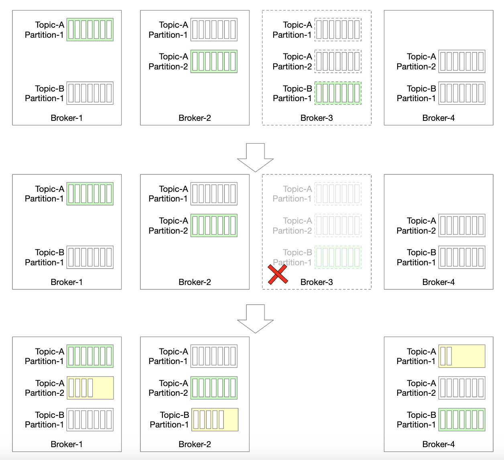

 * 브로커 하나에 장애가 나도 파티션 데이터를 잃지 않을 만큼 사본이 충분히 남아 있다.
 * 새 리더가 선출되고, 브로커 컨트롤러는 장애 난 브로커에 있던 파티션을 기존 브로커들에 재분배한다.
 * 기존 브로커는 새 파티션을 받아 팔로워로 동작하며, 리더를 따라잡으면 ISR이 된다.

브로커의 결함 감내를 높이기 위한 추가 고려 사항:
 * ISR의 최소 개수는 지연 시간과 안전성 사이에서 균형을 잡는다. 필요에 맞게 조정하면 된다.
 * 파티션의 사본이 모두 같은 노드에 있으면 자원 낭비다. 사본은 서로 다른 브로커에 두어야 한다.
 * 파티션의 사본이 모두 죽으면 데이터는 영영 사라진다. 사본을 여러 데이터 센터에 분산하면 도움이 되지만 지연 시간이 크게 늘어난다. 대안으로 [데이터 미러링](https://cwiki.apache.org/confluence/pages/viewpage.action?pageId=27846330)을 쓸 수 있다.

새 브로커가 추가되면 사본 재분배는 어떻게 처리할까?

    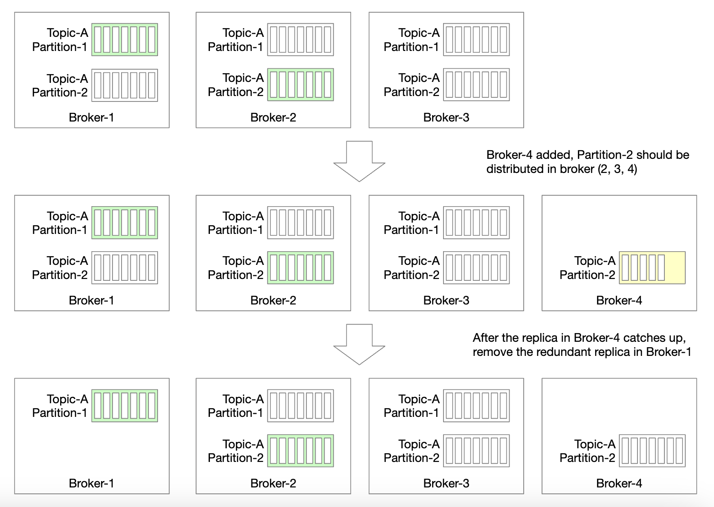

 * 새 브로커가 따라잡을 때까지 설정보다 많은 사본을 일시적으로 허용한다.
 * 새 브로커가 따라잡으면 더 이상 필요 없는 파티션 사본을 제거한다.

#### 파티션

새 파티션이 추가되면 생산자에게 알리고 소비자 재조정을 시작한다.

데이터 저장 측면에서는 기존 메시지를 모두 복사하는 대신, 새 메시지만 새 파티션에 저장하면 된다.

    

파티션 수를 줄이는 것은 더 복잡하다.

    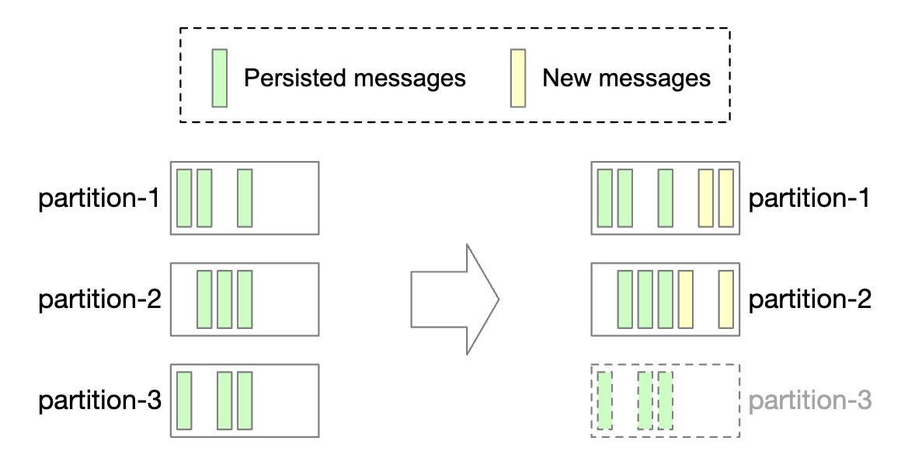

 * 파티션이 퇴역(decommission)하면 새 메시지는 남은 파티션들만 받는다.
 * 퇴역한 파티션의 메시지는 여전히 소비될 수 있으므로 바로 제거하지 않는다.
 * 미리 정한 보관 기간이 지나야 데이터를 삭제하고 저장 공간을 반환한다.
 * 전환 기간 동안 생산자는 활성 파티션에만 메시지를 보내지만, 소비자는 모든 파티션에서 읽는다.
 * 보관 기간이 지나면 소비자를 재조정한다.

### **데이터 전달 방식**

여러 가지 데이터 전달 방식을 살펴보자.

#### 최대 한 번(at-most once)

이 방식에서는 메시지가 두 번 이상 전달되지 않으며, 아예 전달되지 않을 수도 있다.

    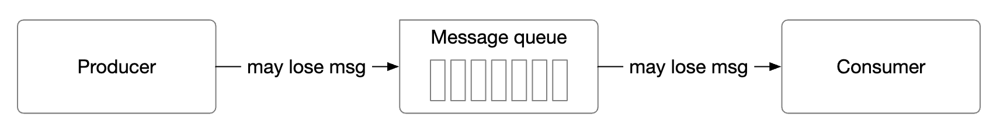

 * 생산자는 토픽에 비동기적으로 메시지를 보낸다. 메시지 전달이 실패해도 재시도하지 않는다.
 * 소비자는 메시지를 가져오자마자 오프셋을 커밋한다. 메시지를 처리하기 전에 소비자가 죽으면 그 메시지는 처리되지 않는다.

#### 최소 한 번(at-least once)

메시지가 두 번 이상 전달될 수는 있지만, 처리되지 않고 남는 메시지는 없어야 한다.

    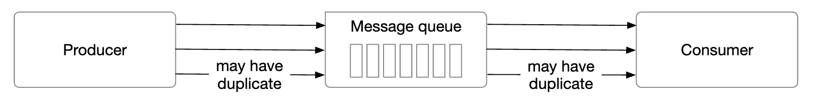

 * 생산자는 `ack=1` 또는 `ack=all`로 메시지를 보낸다. 문제가 생기면 계속 재시도한다.
 * 소비자는 메시지를 가져와 처리를 마친 뒤에만 오프셋을 커밋한다.
 * 예를 들어 소비자가 메시지를 처리한 뒤 오프셋을 커밋하기 전에 죽으면, 메시지가 두 번 이상 전달될 수 있다.
 * 그래서 이 방식은 데이터 중복이 괜찮거나 중복을 제거할 수 있는 용도에 적합하다.

#### 정확히 한 번(exactly once)

사용자에게는 가장 편한 방식이지만, 시스템 입장에서는 구현 비용이 아주 크다.

    

### **고급 기능**

면접에서 논의할 만한 고급 기능을 살펴보자.

#### 메시지 필터링

어떤 소비자는 파티션 안에서 특정 유형의 메시지만 소비하고 싶을 수 있다.

메시지 부분집합마다 별도 토픽을 만들어 해결할 수 있지만, 용도가 아주 다양한 시스템에서는 비용이 많이 든다.
 * 같은 메시지를 여러 토픽에 저장하는 것은 자원 낭비다.
 * 새 소비자 요구 사항이 생길 때마다 생산자를 바꿔야 하므로 생산자와 소비자가 강하게 결합된다.

메시지 필터링으로 이 문제를 해결할 수 있다.
 * 단순한 방법은 소비자 측에서 필터링하는 것이지만, 불필요한 소비자 트래픽이 생긴다.
 * 대신 메시지에 태그를 붙이고, 소비자가 구독할 태그를 지정하게 할 수 있다.
 * 메시지 페이로드로 필터링할 수도 있지만, 암호화되거나 직렬화된 메시지에는 어렵고 안전하지 않다.
 * 더 복잡한 수식을 쓰려면 브로커에 문법 파서나 스크립트 실행기를 구현할 수 있지만, 메시지 큐에는 너무 무거울 수 있다.

    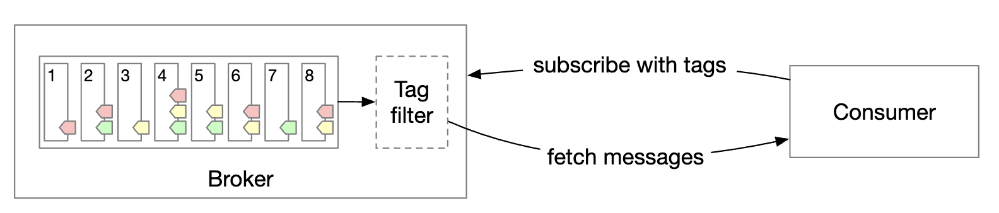

#### 지연 메시지와 예약 메시지

용도에 따라 메시지 전달을 지연하거나 예약해야 할 수도 있다.
예를 들어 지금부터 30분 뒤에 결제 확인 작업을 실행하도록 제출해, 소비자가 결제 성공 여부를 확인하게 할 수 있다.

메시지를 브로커의 임시 저장소에 보냈다가, 적절한 시점에 파티션으로 옮기면 된다.

    

 * 임시 저장소는 하나 이상의 특수 메시지 토픽으로 구성할 수 있다.
 * 타이밍 기능은 전용 지연 큐나 [계층적 타이밍 휠(hierarchical time wheel)](http://www.cs.columbia.edu/~nahum/w6998/papers/sosp87-timing-wheels.pdf)로 구현할 수 있다.

---

## 4단계: 마무리

추가로 논의할 만한 주제:
- **통신 프로토콜**: 모든 용도와 대량의 데이터를 지원하고 메시지 무결성을 검증할 수 있어야 한다. 널리 쓰이는 프로토콜로는 AMQP와 Kafka 프로토콜이 있다.
- **소비 재시도**: 메시지를 바로 처리할 수 없으면, 나중에 다시 시도하도록 전용 재시도 토픽으로 보낼 수 있다.
- **이력 데이터 아카이브**: 오래된 메시지는 HDFS나 객체 저장소(예: S3) 같은 대용량 저장소에 백업할 수 있다.
