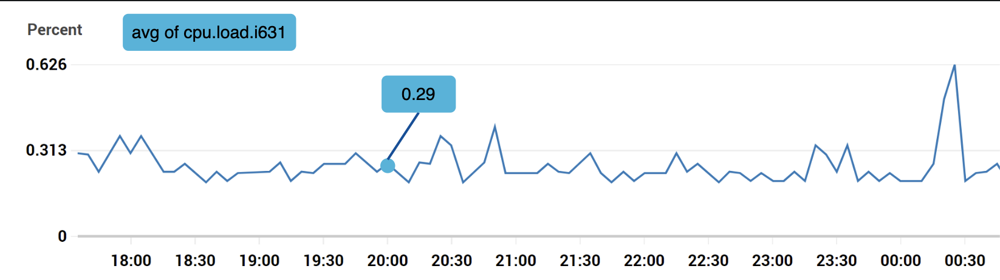
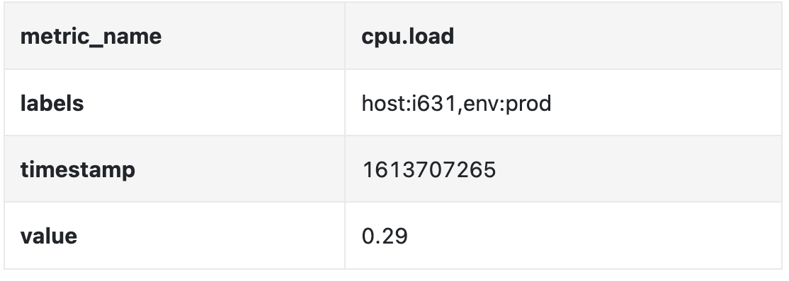
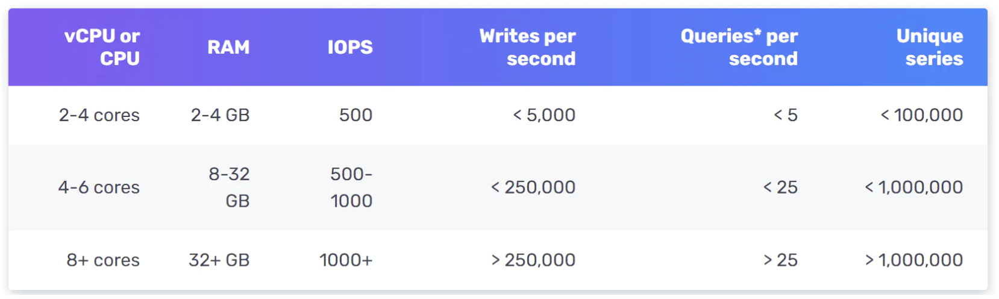
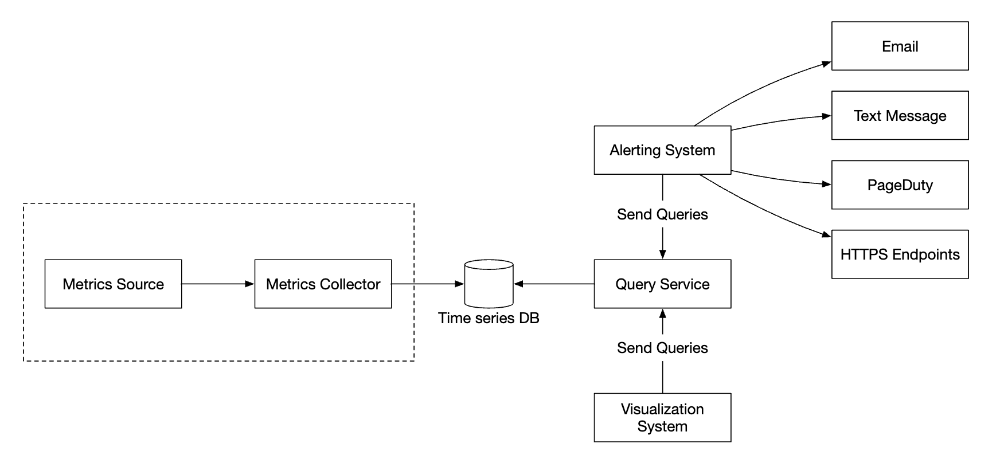
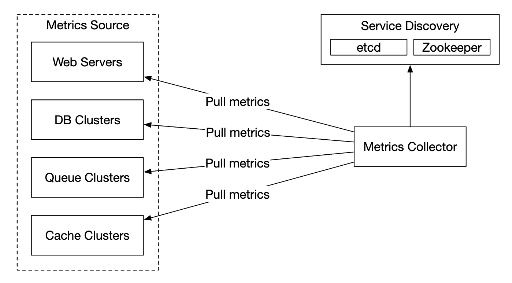
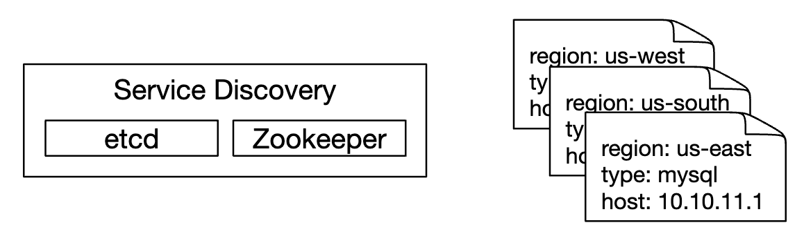
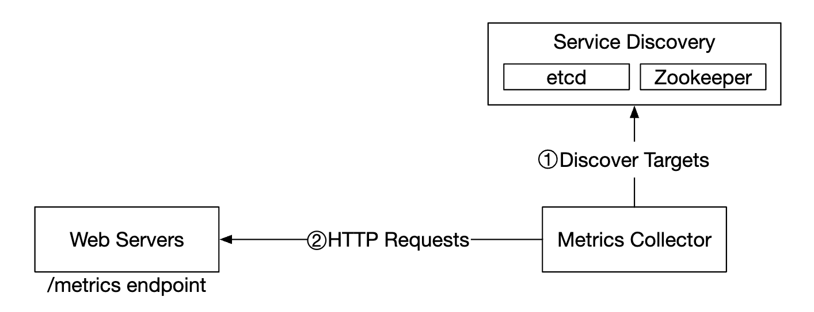
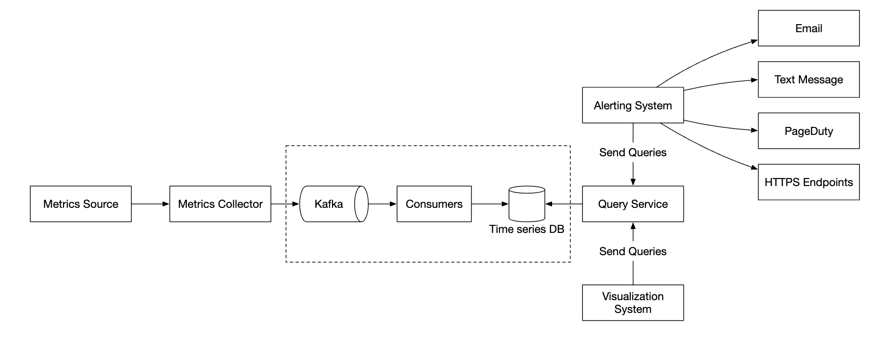
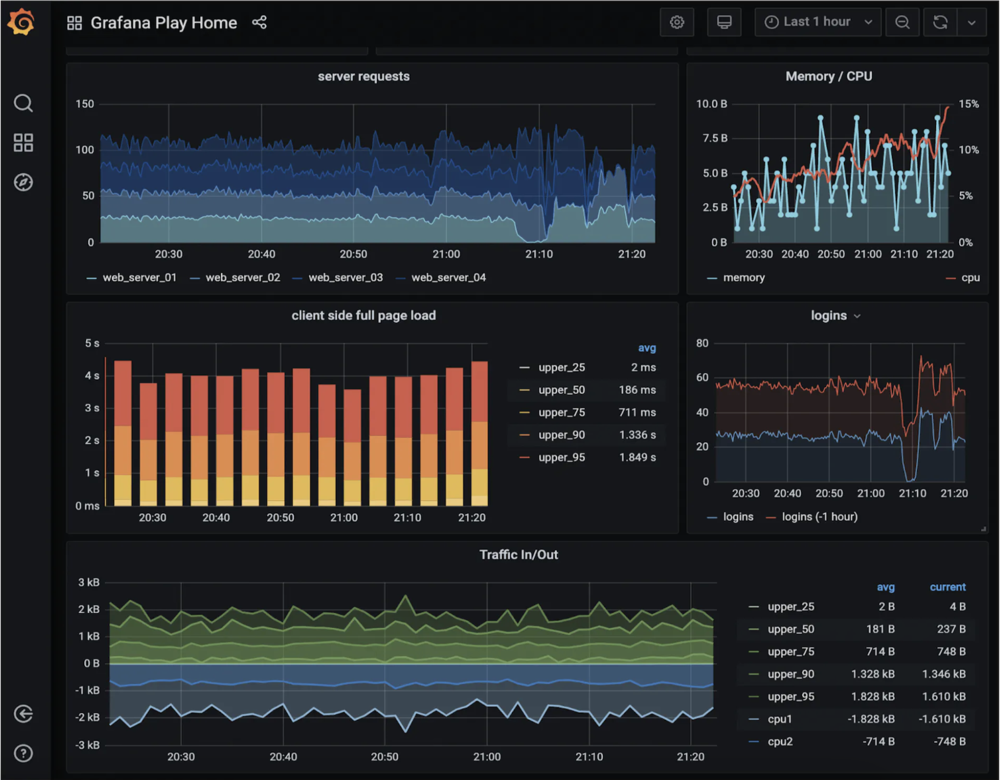
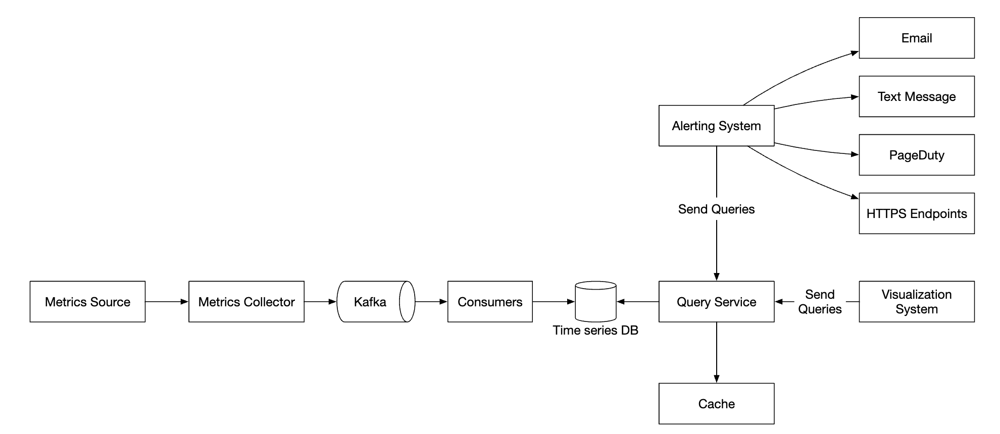

# 20장: 지표 모니터링 및 경보 시스템

## 소개
이 장에서는 높은 가용성과 안정성을 보장하는 데 꼭 필요한, 규모 확장성이 뛰어난 **지표 모니터링 및 경보 시스템(metrics monitoring and alerting system)** 을 설계하는 데 집중한다.

---

## 1단계: 문제 이해 및 설계 범위 확정
지표 모니터링 시스템이 뜻하는 바는 아주 다양하다. 예를 들어 면접관은 인프라 지표에만 관심이 있는데 로그 수집 시스템을 설계하면 곤란하다.

먼저 문제를 이해해 보자(지: 지원자, 면: 면접관).
 - 지: 누구를 위한 시스템인가요? 대형 IT 회사의 사내 모니터링 시스템인가요, 아니면 DataDog 같은 SaaS인가요?
 - 면: 사내용입니다.
 - 지: 어떤 지표를 수집해야 하나요?
 - 면: CPU 부하, 메모리, 데이터 디스크 공간 같은 운영 시스템 지표입니다. 초당 요청 수 같은 고수준 지표도 포함됩니다. 비즈니스 지표는 범위에서 제외합니다.
 - 지: 모니터링할 인프라의 규모는 어느 정도인가요?
 - 면: 일간 능동 사용자 1억 명, 서버 풀 1,000개, 풀당 서버 100대입니다.
 - 지: 데이터는 얼마 동안 보관해야 하나요?
 - 면: 1년 보관으로 가정합시다.
 - 지: 장기 보관용 지표 데이터는 해상도를 낮춰도 될까요?
 - 면: 새로 수집한 지표는 7일 동안 그대로 보관합니다. 그 뒤 30일 동안은 1분 단위로, 30일 이후로는 1시간 단위로 묶어서(roll up) 보관합니다.
 - 지: 지원해야 할 경보 채널은 무엇인가요?
 - 면: 이메일, 전화, PagerDuty, 웹훅입니다.
 - 지: 오류 로그나 접근 로그 같은 로그도 수집해야 하나요?
 - 면: 아니요.
 - 지: 분산 시스템 추적도 지원해야 하나요?
 - 면: 아니요.

### **개략적인 요구 사항과 가정**
모니터링 대상 인프라는 대규모다.
 - DAU 1억 명
 - 서버 풀 1,000개 * 서버 100대 * 서버당 약 100개 지표 -> 약 1,000만 개 지표
 - 데이터 보관 기간 1년
 - 데이터 보관 정책 - 7일간 원본 그대로, 30일간 1분 단위, 1년간 1시간 단위

다양한 지표를 모니터링할 수 있다.
 - CPU 부하
 - 요청 수
 - 메모리 사용량
 - 메시지 큐 안의 메시지 수

### **비기능 요구 사항**
 - **규모 확장성**: 늘어나는 지표와 경보를 감당할 수 있도록 확장 가능해야 한다.
 - **낮은 지연 시간**: 대시보드와 경보를 위해 질의 지연 시간이 짧아야 한다.
 - **안정성**: 중요한 경보를 놓치지 않도록 안정성이 높아야 한다.
 - **유연성**: 앞으로 새로운 기술을 쉽게 통합할 수 있어야 한다.

범위에서 제외하는 요구 사항:
 - **로그 모니터링**: 이 용도로는 ELK 스택이 널리 쓰인다.
 - **분산 시스템 추적**: 요청이 시스템 안의 여러 서비스를 거쳐 가는 전체 생명 주기에 대한 데이터를 수집하는 것을 말한다.

---

## 2단계: 개략적인 설계안 제시 및 동의 구하기

### **기본 사항**
지표 모니터링 및 경보 시스템은 다섯 가지 핵심 컴포넌트로 구성된다.

<div style="margin-left:3rem">
    
</div>

 - **데이터 수집**: 여러 출처에서 지표 데이터를 수집한다.
 - **데이터 전송**: 출처에서 지표 모니터링 시스템으로 데이터를 보낸다.
 - **데이터 저장소**: 들어오는 데이터를 정리해 저장한다.
 - **경보**: 들어오는 데이터를 분석해 이상을 감지하고 경보를 만든다.
 - **시각화**: 데이터를 그래프, 차트 등으로 보여 준다.

### **데이터 모델**
지표 데이터는 보통 타임스탬프가 붙은 값들의 집합인 시계열(time-series)로 기록한다.
시계열은 이름과, 선택적인 태그(레이블) 집합으로 식별할 수 있다.

예 1 - 운영 서버 인스턴스 i631의 20:00 시점 CPU 부하는 얼마인가?

<div style="margin-left:3rem">
    
</div>

이 데이터는 다음 표로 식별할 수 있다.

<div style="margin-left:3rem">
    
</div>

시계열은 지표 이름, 레이블, 그리고 특정 시점의 값 하나로 식별된다.

예 2 - 지난 10분 동안 us-west 지역에 있는 모든 웹 서버의 평균 CPU 부하는 얼마인가?

```
CPU.load host=webserver01,region=us-west 1613707265 50

CPU.load host=webserver01,region=us-west 1613707265 62

CPU.load host=webserver02,region=us-west 1613707265 43

CPU.load host=webserver02,region=us-west 1613707265 53

...

CPU.load host=webserver01,region=us-west 1613707265 76

CPU.load host=webserver01,region=us-west 1613707265 83
```

이 질문에 답하기 위해 저장소에서 가져올 만한 데이터의 예다.
각 행의 마지막 열에 있는 값들의 평균을 구하면 평균 CPU 부하를 계산할 수 있다.

위 형식을 행 프로토콜(line protocol)이라고 하며, Prometheus, OpenTSDB 등 시장에서 널리 쓰이는 여러 모니터링 소프트웨어가 사용한다.

모든 시계열은 다음으로 구성된다.

<div style="margin-left:3rem">
    
</div>

데이터의 모양을 시각화하면 다음과 같다.

<div style="margin-left:3rem">
    
</div>

 - x축은 시간이다.
 - y축은 질의하는 차원(예: 지표 이름, 태그 등)이다.

데이터 접근 패턴은 쓰기가 많고 읽기는 간헐적으로 몰린다. 지표를 아주 많이 수집하지만 평소에는 거의 조회하지 않다가, 장애가 진행 중일 때처럼 특정 시점에 집중적으로 조회하기 때문이다.

데이터 저장소는 이 설계의 핵심이다.
 - 범용 데이터베이스는 이 문제에 권장하지 않는다. 전문가 수준으로 튜닝하면 좋은 규모를 낼 수는 있다.
 - NoSQL 데이터베이스도 이론상 가능하지만, 시계열 데이터를 효과적으로 저장하고 질의할 수 있는 확장 가능한 스키마를 고안하기 어렵다.

시계열 데이터 저장에 특화된 데이터베이스가 많다. 상당수는 시계열 데이터를 효과적으로 질의할 수 있는 자체 질의 인터페이스를 지원한다.
 - OpenTSDB는 분산 시계열 데이터베이스지만 하둡과 HBase를 기반으로 한다. 그 인프라가 갖춰져 있지 않다면 쓰기 어렵다.
 - 트위터는 MetricsDB를 쓰고, 아마존은 Timestream을 제공한다.
 - 가장 인기 있는 시계열 데이터베이스 두 가지는 InfluxDB와 Prometheus다.
 - 둘 다 대량의 시계열 데이터를 저장하도록 설계되었으며, 메모리 캐시와 디스크 저장소를 함께 사용한다.

InfluxDB 규모의 예 - 8코어, 32 GB RAM으로 초당 250,000건 이상의 쓰기를 처리한다.

<div style="margin-left:3rem">
    
</div>

지표 데이터베이스의 내부 구조는 전문적인 지식이므로 면접에서 알고 있으리라 기대하지는 않는다. 이력서에 언급했을 때만 질문받을 수 있다.

면접에서는 지표가 시계열 데이터라는 점과 InfluxDB 같은 대표적인 시계열 데이터베이스를 알고 있는 것으로 충분하다.

시계열 데이터베이스의 좋은 특징 하나는 대량의 시계열 데이터를 레이블별로 효율적으로 집계·분석할 수 있다는 것이다.
예를 들어 InfluxDB는 레이블마다 색인을 만든다.

다만 레이블의 기수(cardinality)를 낮게 유지하는 것, 즉 고유한 레이블 값을 너무 많이 쓰지 않는 것이 매우 중요하다.

### **개략적인 설계**

<div style="margin-left:3rem">
    
</div>

 - **지표 출처**: 애플리케이션 서버, SQL 데이터베이스, 메시지 큐 등이 될 수 있다.
 - **지표 수집기**: 지표 데이터를 모아 시계열 데이터베이스에 기록한다.
 - **시계열 데이터베이스**: 지표를 시계열 데이터로 저장한다. 대량의 지표를 분석할 수 있는 자체 질의 인터페이스를 제공한다.
 - **질의 서비스**: 시계열 데이터베이스에서 데이터를 쉽게 질의하고 가져올 수 있게 한다. 데이터베이스 인터페이스가 충분히 강력하다면 이것으로 완전히 대체할 수도 있다.
 - **경보 시스템**: 다양한 경보 대상으로 경보를 보낸다.
 - **시각화 시스템**: 지표를 그래프나 차트 형태로 보여 준다.

---

## 3단계: 상세 설계
시스템에서 흥미로운 부분 몇 가지를 깊이 살펴보자.

### **지표 수집**
지표 수집에서는 데이터가 가끔 유실되어도 큰 문제가 아니다. 클라이언트는 보내고 잊어버려도(fire and forget) 된다.

<div style="margin-left:3rem">
    
</div>

지표 수집 방법은 풀(pull)과 푸시(push) 두 가지다.

풀 모델은 다음과 같다.

<div style="margin-left:3rem">
    
</div>

이 방법에서는 지표 수집기가 서비스와 지표 엔드포인트 목록을 최신 상태로 유지해야 한다.
이를 위해 ZooKeeper나 etcd를 서비스 탐색 용도로 쓸 수 있다.

서비스 탐색에는 언제, 어디서 지표를 수집할지에 관한 설정 규칙이 들어 있다.

<div style="margin-left:3rem">
    
</div>

지표 수집 흐름을 자세히 보면 다음과 같다.

<div style="margin-left:3rem">
    
</div>

 - 지표 수집기는 서비스 탐색에서 설정 메타데이터를 가져온다. 여기에는 수집 주기, IP 주소, 타임아웃과 재시도 인자가 들어 있다.
 - 지표 수집기는 미리 정의된 HTTP 엔드포인트(예: `/metrics`)에서 지표 데이터를 가져온다. 이 엔드포인트는 보통 클라이언트 라이브러리가 제공한다.
 - 또는 지표 수집기가 서비스 탐색에 변경 이벤트 알림을 등록해, 서비스 엔드포인트가 바뀌면 통보받을 수 있다.
 - 지표 수집기가 지표 엔드포인트 설정 변경을 주기적으로 확인(polling)하는 방법도 있다.

우리 규모에서는 지표 수집기 하나로는 부족하므로 여러 인스턴스를 두어야 한다.
그런데 두 수집기가 같은 지표를 중복 수집하지 않도록 수집기들 사이에 일종의 조율이 필요하다.

한 가지 해결책은 수집기와 서버를 안정 해시 링 위에 배치하고, 서버 집합 하나를 수집기 하나에만 대응시키는 것이다.

<div style="margin-left:3rem">
    
</div>

반면 푸시 모델에서는 서비스가 지표 수집기로 지표를 능동적으로 보낸다.

<div style="margin-left:3rem">
    
</div>

이 방법에서는 보통 서비스 인스턴스와 함께 수집 에이전트를 설치한다.
에이전트는 서버에서 지표를 모아 지표 수집기로 보낸다.

<div style="margin-left:3rem">
    
</div>

이 모델에서는 수집기로 보내기 전에 지표를 집계할 수 있어, 수집기가 처리할 데이터 양을 줄일 수 있다.

반대로 지표 수집기가 부하를 감당하지 못해 푸시 요청을 거부할 수도 있다.
따라서 수집기를 로드밸런서 뒤의 오토스케일링 그룹에 두는 것이 중요하다.

그럼 어느 쪽이 나을까? 두 방법 사이에는 트레이드오프가 있으며, 시스템마다 다른 방법을 쓴다.
 - Prometheus는 풀 아키텍처를 쓴다.
 - Amazon CloudWatch와 Graphite는 푸시 아키텍처를 쓴다.

푸시와 풀의 주요 차이는 다음과 같다.
|                                        | 풀                                                                                                                                                                                                    | 푸시                                                                                                                                                                                                                                    |
|----------------------------------------|---------------------------------------------------------------------------------------------------------------------------------------------------------------------------------------------------------|-----------------------------------------------------------------------------------------------------------------------------------------------------------------------------------------------------------------------------------------|
| 손쉬운 디버깅                         | 지표를 가져가는 데 쓰는 애플리케이션 서버의 /metrics 엔드포인트로 언제든 지표를 볼 수 있다. 노트북에서도 가능하다. 풀이 유리하다.                                          | 지표 수집기가 지표를 받지 못하면 네트워크 문제 때문일 수 있다.                                                                                                                                        |
| 상태 진단(health check)                           | 애플리케이션 서버가 풀 요청에 응답하지 않으면 서버가 다운되었는지 빠르게 알 수 있다. 풀이 유리하다.                                                                           | 지표 수집기가 지표를 받지 못하면 네트워크 문제 때문일 수 있다.                                                                                                                                        |
| 생명 주기가 짧은 작업                       |                                                                                                                                                                                                         | 일부 배치 작업은 생명 주기가 너무 짧아 지표를 가져갈 틈이 없을 수 있다. 푸시가 유리하다. 풀 모델에 푸시 게이트웨이를 도입하면 해결할 수 있다[22].                                                                 |
| 방화벽 등 복잡한 네트워크 구성 | 서버가 지표를 가져가려면 모든 지표 엔드포인트에 접근할 수 있어야 한다. 데이터 센터가 여러 개라면 문제가 될 수 있으며, 더 정교한 네트워크 인프라가 필요할 수 있다. | 지표 수집기가 로드밸런서와 오토스케일링 그룹으로 구성되어 있다면 어디서든 데이터를 받을 수 있다. 푸시가 유리하다.                                                                                             |
| 성능                            | 풀 방식은 보통 TCP를 쓴다.                                                                                                                                                                         | 푸시 방식은 보통 UDP를 쓰므로 지표 전송 지연 시간이 더 짧다. 반론으로, TCP 연결을 맺는 비용은 지표 페이로드를 보내는 비용에 비하면 작다는 주장도 있다. |
| 데이터 신빙성                      | 지표를 수집할 애플리케이션 서버 목록이 설정 파일에 미리 정의되어 있으므로, 그 서버들에서 모은 지표는 믿을 수 있다.                                                 | 어떤 클라이언트든 지표 수집기로 지표를 보낼 수 있다. 지표를 받을 서버의 허용 목록(whitelist)을 두거나 인증을 요구하면 해결할 수 있다.                                                                   |

어느 한쪽이 확실히 낫다고 할 수는 없다. 큰 조직이라면 둘 다 지원해야 할 것이다. 애초에 푸시 에이전트를 설치할 수 없는 경우도 있다.

### **지표 전송 파이프라인의 규모 확장**

<div style="margin-left:3rem">
    
</div>

푸시 모델이든 풀 모델이든 지표 수집기는 오토스케일링 그룹으로 구성한다.

하지만 시계열 데이터베이스에 장애가 나면 데이터가 유실될 수 있다. 이를 완화하기 위해 큐를 둔다.

<div style="margin-left:3rem">
    
</div>

 - 지표 수집기는 지표 데이터를 Kafka에 넣는다.
 - 소비자나 Apache Storm, Flink, Spark 같은 스트림 처리 서비스가 데이터를 처리해 시계열 데이터베이스에 넣는다.

이 방법의 장점:
 - Kafka는 안정성과 규모 확장성이 뛰어난 분산 메시지 플랫폼이다.
 - 데이터 수집과 데이터 처리를 서로 분리한다.
 - 데이터를 Kafka에 보관하므로 데이터 유실을 막을 수 있다.

Kafka는 지표 이름마다 파티션을 하나씩 두도록 설정할 수 있다. 그러면 소비자가 지표 이름별로 데이터를 집계할 수 있다.
더 확장하려면 태그/레이블별로 다시 파티션을 나누고, 먼저 수집할 지표를 분류하고 우선순위를 매길 수 있다.

<div style="margin-left:3rem">
    
</div>

이 문제에 Kafka를 쓸 때의 주된 단점은 유지·운영 부담이다.
대안으로 [Gorilla](https://www.vldb.org/pvldb/vol8/p1816-teller.pdf) 같은 대규모 수집 시스템을 쓸 수 있다.
이를 쓰면 Kafka로 큐를 두는 것만큼 확장 가능하다고 볼 수 있다.

### **집계 시점**
지표는 여러 곳에서 집계할 수 있으며, 선택지마다 트레이드오프가 있다.
 - **수집 에이전트**: 클라이언트 측 수집 에이전트는 단순한 집계 로직만 지원한다. 예를 들어 1분 동안 카운터를 모아 지표 수집기로 보낸다.
 - **데이터 수집 파이프라인**: 데이터베이스에 기록하기 전에 집계하려면 Flink 같은 스트림 처리 엔진이 필요하다. 쓰기 양은 줄지만, 원본 데이터를 저장하지 않으므로 데이터 정밀도를 잃는다.
 - **질의 시점**: 시각화 시스템으로 질의를 실행할 때 데이터를 집계할 수 있다. 데이터 손실은 없지만, 처리할 데이터가 많아 질의가 느려질 수 있다.

### **질의 서비스**
질의 서비스를 시계열 데이터베이스와 분리하면 시각화·경보 시스템과 데이터베이스 사이의 결합이 끊어진다. 그러면 클라이언트와 상관없이 데이터베이스를 자유롭게 바꿀 수 있다.

시계열 데이터베이스의 부하를 줄이기 위해 여기에 캐시 계층을 둘 수 있다.

<div style="margin-left:3rem">
    
</div>

대부분의 시각화·경보 시스템은 주요 시계열 데이터베이스와 연동되는 강력한 플러그인을 갖추고 있으므로, 질의 서비스를 아예 두지 않을 수도 있다.
시계열 데이터베이스를 잘 고르면 자체 캐시 계층도 필요 없을 수 있다.

대부분의 시계열 데이터베이스는 SQL을 지원하지 않는다. 시계열 데이터를 질의하는 데 SQL이 효과적이지 않기 때문이다. 다음은 지수 이동 평균을 계산하는 SQL 질의의 예다.

```
select id,
       temp,
       avg(temp) over (partition by group_nr order by time_read) as rolling_avg
from (
  select id,
         temp,
         time_read,
         interval_group,
         id - row_number() over (partition by interval_group order by time_read) as group_nr
  from (
    select id,
    time_read,
    "epoch"::timestamp + "900 seconds"::interval * (extract(epoch from time_read)::int4 / 900) as interval_group,
    temp
    from readings
  ) t1
) t2
order by time_read;
```

같은 질의를 InfluxDB의 질의 언어인 Flux로 쓰면 다음과 같다.

```
from(db:"telegraf")
  |> range(start:-1h)
  |> filter(fn: (r) => r._measurement == "foo")
  |> exponentialMovingAverage(size:-10s)
```

### **저장소 계층**
시계열 데이터베이스는 신중하게 골라야 한다.

페이스북이 발표한 연구에 따르면, 운영 데이터 저장소에 대한 질의의 약 85%가 지난 26시간 안의 데이터를 대상으로 한다.

이 특성을 잘 활용하는 데이터베이스를 고르면 시스템 성능에 큰 영향을 줄 수 있다. InfluxDB가 그런 선택지 중 하나다.

어떤 데이터베이스를 고르든 적용할 수 있는 최적화 기법이 있다.

데이터 인코딩과 압축으로 데이터 크기를 크게 줄일 수 있다. 좋은 시계열 데이터베이스에는 보통 이런 기능이 내장되어 있다.

<div style="margin-left:3rem">
    
</div>

위 예에서는 전체 타임스탬프 대신 타임스탬프 차이(delta)만 저장한다.

또 다른 기법은 다운샘플링(down-sampling)이다. 고해상도 데이터를 저해상도로 바꿔 디스크 사용량을 줄이는 것이다.

오래된 데이터에 적용하며, 데이터 과학자가 규칙을 설정할 수 있게 한다. 예를 들면 다음과 같다.
 - 7일 - 다운샘플링하지 않음
 - 30일 - 1분 단위로 다운샘플링
 - 1년 - 1시간 단위로 다운샘플링

예를 들어 다음은 10초 단위 지표 테이블이다.
| metric | timestamp            | hostname | Metric_value |
|--------|----------------------|----------|--------------|
| cpu    | 2021-10-24T19:00:00Z | host-a   | 10           |
| cpu    | 2021-10-24T19:00:10Z | host-a   | 16           |
| cpu    | 2021-10-24T19:00:20Z | host-a   | 20           |
| cpu    | 2021-10-24T19:00:30Z | host-a   | 30           |
| cpu    | 2021-10-24T19:00:40Z | host-a   | 20           |
| cpu    | 2021-10-24T19:00:50Z | host-a   | 30           |

30초 단위로 다운샘플링하면 다음과 같다.
| metric | timestamp            | hostname | Metric_value (avg) |
|--------|----------------------|----------|--------------------|
| cpu    | 2021-10-24T19:00:00Z | host-a   | 19                 |
| cpu    | 2021-10-24T19:00:30Z | host-a   | 25                 |

마지막으로, 더 이상 쓰지 않는 오래된 데이터는 냉동 저장소(cold storage)로 옮길 수 있다. 냉동 저장소는 비용이 훨씬 저렴하다.

### **경보 시스템**

<div style="margin-left:3rem">
    
</div>

설정 파일을 캐시 서버로 불러온다. 규칙은 보통 YAML 형식으로 정의한다. 예를 들면 다음과 같다.

```
- name: instance_down
  rules:

  # Alert for any instance that is unreachable for >5 minutes.
  - alert: instance_down
    expr: up == 0
    for: 5m
    labels:
      severity: page
```

경보 관리자(alert manager)는 캐시에서 경보 설정을 가져온다. 설정 규칙에 따라 미리 정한 주기로 질의 서비스를 호출한다.
규칙을 만족하면 경보 이벤트를 만든다.

경보 관리자의 다른 역할:
 - 경보 필터링, 병합, 중복 제거. 예를 들어 인스턴스 하나에서 같은 경보가 여러 번 발생하면 경보 이벤트는 하나만 만든다.
 - 접근 제어 - 경보 관리 작업은 특정 인원만 할 수 있도록 제한하는 것이 중요하다.
 - 재시도 - 경보가 최소 한 번은 전달되도록 보장한다.

경보 저장소는 Cassandra 같은 키-값 데이터베이스로, 모든 경보의 상태를 보관한다. 알림이 최소 한 번은 전송되도록 보장한다.
경보가 발생하면 Kafka에 발행된다.

마지막으로 경보 소비자가 Kafka에서 경보 데이터를 가져와 이메일, 문자 메시지, PagerDuty, 웹훅 등 여러 채널로 알림을 보낸다.

현실에서는 바로 쓸 수 있는 경보 시스템이 많다. 사내에서 직접 만드는 것을 정당화하기는 어렵다.

### **시각화 시스템**
시각화 시스템은 일정 기간의 지표와 경보를 보여 준다. 다음은 Grafana로 만든 대시보드다.

<div style="margin-left:3rem">
    
</div>

품질 좋은 시각화 시스템은 만들기 매우 어렵다. Grafana 같은 기성 솔루션을 쓰지 않을 이유를 찾기 어렵다.

---

## 4단계: 마무리
최종 설계는 다음과 같다.

<div style="margin-left:3rem">
    
</div>
