# 21장: 광고 클릭 이벤트 집계

## 소개
페이스북, 유튜브, 틱톡 등이 성장하면서 **디지털 광고**는 거대한 산업이 되었다.

그래서 광고 클릭 이벤트를 추적하는 일이 중요하다. 이 장에서는 페이스북이나 구글 규모의 **광고 클릭 이벤트 집계(ad click event aggregation)** 시스템을 설계하는 방법을 살펴본다.

디지털 광고에는 디지털 광고 재고(inventory)를 사고파는 **실시간 경매(real-time bidding, RTB)** 라는 절차가 있다.

<div style="margin-left:3rem">
    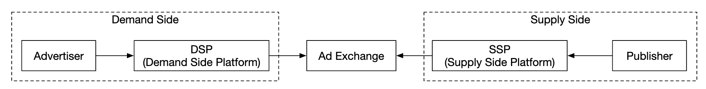
</div>

RTB는 보통 1초 안에 끝나므로 속도가 중요하다.
광고주가 얼마를 지불할지에 영향을 주므로 데이터 정확성도 매우 중요하다.

광고주는 광고 클릭 이벤트 집계 결과를 바탕으로 대상 고객층이나 키워드 조정 같은 결정을 내린다.

---

## 1단계: 문제 이해 및 설계 범위 확정
(지: 지원자, 면: 면접관)
 - 지: 입력 데이터의 형태는 어떻게 되나요?
 - 면: 하루 광고 클릭은 10억 건이고 광고는 총 200만 개입니다. 광고 클릭 이벤트 수는 매년 30%씩 늘어납니다.
 - 지: 시스템이 지원해야 할 가장 중요한 질의는 무엇인가요?
 - 면: 다음 질의를 고려해야 합니다.
   - 지난 Y분 동안 광고 X의 클릭 이벤트 수를 반환
   - 지난 1분 동안 가장 많이 클릭된 광고 100개를 반환. 두 인자 모두 설정할 수 있어야 하며, 집계는 1분마다 이루어집니다.
   - 위 질의에서 `ip`, `user_id`, `country`로 데이터를 필터링할 수 있어야 함
 - 지: 경계 사례도 고려해야 하나요? 생각나는 것들은 다음과 같습니다.
   - 예상보다 늦게 도착하는 이벤트가 있을 수 있음
   - 중복된 이벤트가 있을 수 있음
   - 시스템 일부가 다운될 수 있으므로 시스템 복구를 고려해야 함
 - 면: 좋은 목록이네요. 모두 고려해 주세요.
 - 지: 지연 시간 요구 사항은 어떻게 되나요?
 - 면: 광고 클릭 집계는 종단 간 지연 시간이 몇 분이면 됩니다. RTB는 1초 미만입니다. 광고 클릭 집계 결과는 주로 과금과 보고서에 쓰이므로 그 정도 지연은 괜찮습니다.

### **기능 요구 사항**
 - 지난 Y분 동안의 `ad_id` 클릭 수 집계
 - 매분 가장 많이 클릭된 `ad_id` 100개 반환
 - 다양한 속성에 따른 집계 필터링 지원
 - 데이터 양은 페이스북이나 구글 규모

### **비기능 요구 사항**
 - 집계 결과는 RTB와 광고 과금에 쓰이므로 정확성이 중요하다.
 - 지연되거나 중복된 이벤트를 적절히 처리해야 한다.
 - 안정성 - 부분적인 장애가 나도 견딜 수 있어야 한다.
 - 지연 시간 - 종단 간 지연 시간은 최대 몇 분이어야 한다.

### **개략적인 규모 추정**
 - DAU 10억 명
 - 사용자가 하루 평균 광고 1개를 클릭한다고 가정 -> 하루 광고 클릭 10억 건
 - 광고 클릭 QPS = 10,000
 - 최대 QPS는 평균의 5배인 50,000
 - 광고 클릭 하나는 0.1 KB를 차지한다. 일일 저장소 요구량은 100 GB다.
 - 월간 저장소 요구량 = 3 TB

---

## 2단계: 개략적인 설계안 제시 및 동의 구하기
이 절에서는 질의 API 설계, 데이터 모델, 개략적인 설계를 다룬다.

### **질의 API 설계**
API는 클라이언트와 서버 사이의 계약이다. 여기서 클라이언트는 대시보드 사용자, 즉 데이터 과학자/분석가, 광고주 등이다.

기능 요구 사항은 다음과 같다.
 - 지난 Y분 동안의 `ad_id` 클릭 수 집계
 - 지난 M분 동안 가장 많이 클릭된 `ad_id` N개 반환
 - 다양한 속성에 따른 집계 필터링 지원

이 요구 사항을 만족하려면 엔드포인트 두 개가 필요하다. 필터링은 둘 중 하나에 질의 인자를 붙여 처리할 수 있다.

**지난 M분 동안의 ad_id 클릭 수 집계**:

```
GET /v1/ads/{:ad_id}/aggregated_count
```

질의 인자:
 - from - 집계 시작 시각(분). 기본값은 현재 시각 - 1분
 - to - 집계 종료 시각(분). 기본값은 현재 시각
 - filter - 필터링 전략 식별자. 예를 들어 001은 '미국 이외 지역의 클릭'을 뜻한다.

응답:
 - ad_id - 광고 식별자
 - count - 시작 시각과 종료 시각 사이의 집계된 클릭 수

**지난 M분 동안 가장 많이 클릭된 ad_id N개 반환**

```
GET /v1/ads/popular_ads
```

질의 인자:
 - count - 가장 많이 클릭된 광고 N개
 - window - 집계 윈도 크기(분)
 - filter - 필터링 전략 식별자

응답:
 - ad_id 목록

### **데이터 모델**
시스템에는 원시 데이터와 집계 데이터가 있다.

원시 데이터는 다음과 같다.

```
[AdClickEvent] ad001, 2021-01-01 00:00:01, user 1, 207.148.22.22, USA
```

구조화된 형식으로 나타내면 다음과 같다.
| ad_id | click_timestamp     | user  | ip            | country |
|-------|---------------------|-------|---------------|---------|
| ad001 | 2021-01-01 00:00:01 | user1 | 207.148.22.22 | USA     |
| ad001 | 2021-01-01 00:00:02 | user1 | 207.148.22.22 | USA     |
| ad002 | 2021-01-01 00:00:02 | user2 | 209.153.56.11 | USA     |

집계 데이터는 다음과 같다.
| ad_id | click_minute | filter_id | count |
|-------|--------------|-----------|-------|
| ad001 | 202101010000 | 0012      | 2     |
| ad001 | 202101010000 | 0023      | 3     |
| ad001 | 202101010001 | 0012      | 1     |
| ad001 | 202101010001 | 0023      | 6     |

`filter_id`는 필터링 요구 사항을 만족하는 데 쓰인다.
| filter_id | region | IP        | user_id |
|-----------|--------|-----------|---------|
| 0012      | US     | *         | *       |
| 0013      | *      | 123.1.2.3 | *       |

지난 M분 동안 가장 많이 클릭된 광고 N개를 빠르게 반환하기 위해 다음 구조도 유지한다.
| most_clicked_ads   |           |                                                  |
|--------------------|-----------|--------------------------------------------------|
| window_size        | integer   | 집계 윈도 크기(M, 분 단위)       |
| update_time_minute | timestamp | 마지막 갱신 타임스탬프(1분 단위) |
| most_clicked_ads   | array     | JSON 형식의 광고 ID 목록                   |

원시 데이터를 저장하는 것과 집계 데이터를 저장하는 것의 장단점은 무엇일까?
 - 원시 데이터는 전체 데이터를 그대로 쓸 수 있고, 데이터 필터링과 재계산을 지원한다.
 - 반면 집계 데이터는 데이터 양이 적고 질의가 빠르다.
 - 원시 데이터는 저장소가 커지고 질의가 느려진다.
 - 집계 데이터는 파생 데이터이므로 일부 데이터가 손실된다.

이번 설계에서는 두 방법을 함께 쓴다.
 - 원시 데이터는 디버깅용으로 보관해 두는 것이 좋다. 집계에 버그가 있으면 버그를 찾아 수정한 뒤 데이터를 다시 채워 넣을(backfill) 수 있다.
 - 질의 성능을 높이기 위해 집계 데이터도 저장해야 한다.
 - 원시 데이터는 추가 저장 비용을 피하기 위해 냉동 저장소(cold storage)에 둘 수 있다.

데이터베이스를 고를 때는 다음을 고려해야 한다.
 - 데이터는 어떤 모습인가? 관계형인가, 문서인가, BLOB인가?
 - 작업 부하는 읽기 중심인가, 쓰기 중심인가, 둘 다인가?
 - 트랜잭션이 필요한가?
 - 질의가 SUM, COUNT 같은 OLAP 함수에 의존하는가?

원시 데이터는 평균 QPS가 10k, 최대 QPS가 50k이므로 쓰기 중심 시스템이다.
반면 원시 데이터는 주로 문제가 생겼을 때를 대비한 백업으로 쓰이므로 읽기 트래픽은 적다.

관계형 데이터베이스로도 가능하지만 쓰기 연산을 확장하기 어려울 수 있다.
대신 많은 쓰기 부하를 기본적으로 더 잘 지원하는 Cassandra나 InfluxDB를 쓸 수 있다.

ORC, Parquet, AVRO 같은 칼럼형 데이터 형식으로 Amazon S3에 저장하는 방법도 있다. 이 구성은 익숙하지 않으므로 Cassandra를 쓰기로 한다.

집계 데이터는 대시보드와 경보를 위해 계속 질의되므로 읽기가 많다.
집계 서비스가 매분 데이터를 집계해 기록하므로 쓰기도 많다.
따라서 여기에도 같은 데이터 저장소(Cassandra)를 쓴다.

### **개략적인 설계**
시스템은 다음과 같다.

<div style="margin-left:3rem">
    
</div>

입력과 출력 모두 끝이 없는(unbounded) 데이터 스트림으로 흐른다.

소비자 하나가 죽으면 시스템 전체가 멈출 수 있는 동기식 싱크(sink)를 피하기 위해, 메시지 큐(Kafka)를 이용한 비동기 처리로 소비자와 생산자의 결합을 끊는다.

<div style="margin-left:3rem">
    
</div>

첫 번째 메시지 큐에는 광고 클릭 이벤트 데이터가 저장된다.
| ad_id | click_timestamp | user_id | ip | country |
|-------|-----------------|---------|----|---------|

두 번째 메시지 큐에는 분 단위로 집계된 광고 클릭 수가 들어간다.
| ad_id | click_minute | count |
|-------|--------------|-------|

분 단위로 집계된, 가장 많이 클릭된 광고 N개도 들어간다.
| update_time_minute | most_clicked_ads |
|--------------------|------------------|

두 번째 메시지 큐는 종단 간 '정확히 한 번' 원자적 커밋(atomic commit)을 달성하기 위해 둔다.

<div style="margin-left:3rem">
    
</div>

집계 서비스에는 맵리듀스(MapReduce) 프레임워크를 쓰는 것이 좋다.

<div style="margin-left:3rem">
    
</div>

<div style="margin-left:3rem">
    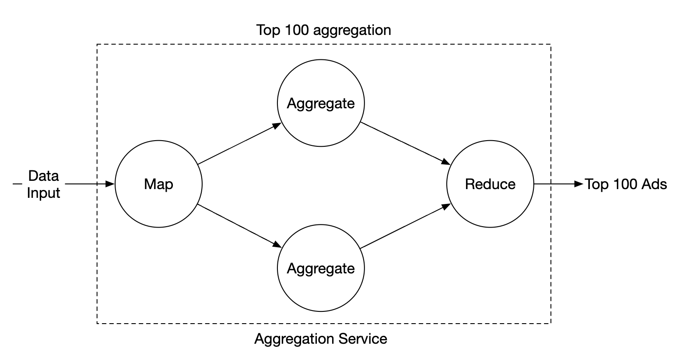
</div>

각 노드는 작업 하나만 맡으며, 처리 결과를 다음 노드로 보낸다.

맵 노드는 데이터 출처에서 데이터를 읽어 필터링하고 변환한다.

예를 들어 맵 노드는 `ad_id`를 기준으로 데이터를 여러 집계 노드에 분배할 수 있다.

<div style="margin-left:3rem">
    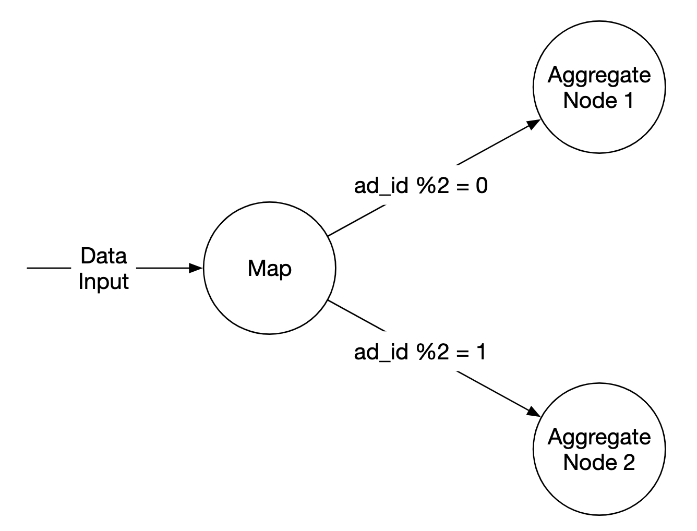
</div>

또는 광고를 Kafka 파티션에 분산하고, 집계 노드들이 소비자 그룹 안에서 직접 구독하게 할 수도 있다.
하지만 맵 노드를 두면 이후 처리 전에 데이터를 정제하거나 변환할 수 있다.

또 다른 이유는 데이터가 생성되는 방식을 우리가 제어할 수 없어서, 같은 `ad_id`의 이벤트가 서로 다른 파티션으로 갈 수 있다는 점이다.

집계 노드는 매분 메모리에서 `ad_id`별로 광고 클릭 이벤트 수를 센다.

리듀스 노드는 집계 노드들의 집계 결과를 모아 최종 결과를 만든다.

<div style="margin-left:3rem">
    
</div>

이 DAG 모델은 맵리듀스 패러다임을 따른다. 빅데이터를 입력받아 병렬 분산 컴퓨팅으로 일반적인 크기의 데이터로 바꾼다.

DAG 모델에서 중간 데이터는 메모리에 저장되며, 노드들은 TCP나 공유 메모리로 서로 통신한다.

이 모델로 여러 사용 사례를 어떻게 처리하는지 살펴보자.

**사용 사례 1 - 클릭 수 집계**:

<div style="margin-left:3rem">
    
</div>

 - 광고는 `ad_id % 3`으로 파티션을 나눈다.

**사용 사례 2 - 가장 많이 클릭된 광고 N개 반환**:

<div style="margin-left:3rem">
    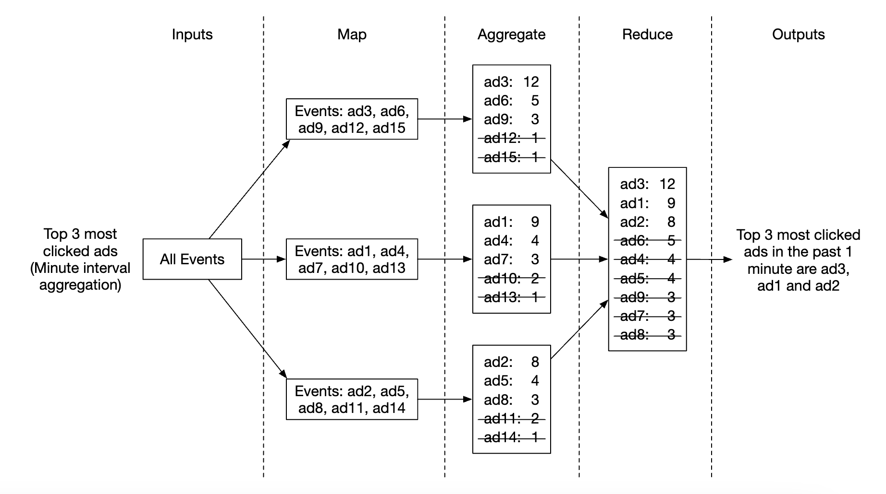
</div>

 - 이 예에서는 상위 광고 3개를 집계하지만, 상위 N개로 쉽게 확장할 수 있다.
 - 각 노드는 상위 N개 광고를 빠르게 찾기 위해 힙(heap) 자료 구조를 유지한다.

**사용 사례 3 - 데이터 필터링**:
데이터를 빠르게 필터링하려면 필터링 기준을 미리 정의하고 그에 따라 미리 집계해 둔다.
| ad_id | click_minute | country | count |
|-------|--------------|---------|-------|
| ad001 | 202101010001 | USA     | 100   |
| ad001 | 202101010001 | GPB     | 200   |
| ad001 | 202101010001 | others  | 3000  |
| ad002 | 202101010001 | USA     | 10    |
| ad002 | 202101010001 | GPB     | 25    |
| ad002 | 202101010001 | others  | 12    |

이 기법을 **스타 스키마(star schema)** 라고 하며, 데이터 웨어하우스에서 널리 쓰인다.
필터링에 쓰는 필드를 **차원(dimension)** 이라고 한다.

이 방법의 장점:
 - 이해하고 구축하기 쉽다.
 - 기존 집계 서비스를 재사용해 스타 스키마에 차원을 더 추가할 수 있다.
 - 결과를 미리 계산해 두므로 필터링 기준에 따른 데이터 접근이 빠르다.

이 방법의 한계는 필터링 기준이 많을수록 버킷과 레코드가 훨씬 많아진다는 점이다.

---

## 3단계: 상세 설계
흥미로운 주제 몇 가지를 더 깊이 살펴보자.

### **스트리밍 vs 일괄 처리**
앞에서 제안한 개략적인 아키텍처는 스트림 처리 시스템의 일종이다.
세 가지 시스템 유형을 비교하면 다음과 같다.
|                         | 서비스(온라인 시스템)      | 일괄 처리 시스템(오프라인 시스템)                          | 스트리밍 시스템(실시간에 가까운 시스템)     |
|-------------------------|-------------------------------|--------------------------------------------------------|----------------------------------------------|
| 응답성          | 클라이언트에 빠르게 응답 | 클라이언트에 응답할 필요 없음                       | 클라이언트에 응답할 필요 없음             |
| 입력                   | 사용자 요청                 | 크기가 유한한 입력. 대량의 데이터 | 경계가 없는 입력(무한 스트림)     |
| 출력                  | 클라이언트에 대한 응답          | 구체화 뷰(materialized view), 집계 지표 등           | 구체화 뷰, 집계 지표 등 |
| 성능 측정 기준 | 가용성, 지연 시간         | 처리량                                             | 처리량, 지연 시간                          |
| 예                 | 온라인 쇼핑               | 맵리듀스                                              | Flink [13]                                   |

이번 설계에서는 일괄 처리와 스트리밍을 함께 썼다.

데이터가 도착하는 대로 처리해 실시간에 가깝게 집계 결과를 만드는 데는 스트리밍을 썼다.
반면 과거 데이터 백업에는 일괄 처리를 썼다.

일괄 처리와 스트리밍이라는 두 처리 경로를 동시에 갖는 아키텍처를 람다(lambda) 아키텍처라고 한다.
단점은 서로 다른 코드베이스를 가진 두 처리 경로를 유지해야 한다는 것이다.

카파(Kappa) 아키텍처는 일괄 처리와 스트림 처리를 하나의 처리 경로로 합친 대안이다.
핵심 아이디어는 스트림 처리 엔진 하나만 쓰는 것이다.

람다 아키텍처:

<div style="margin-left:3rem">
    
</div>

카파 아키텍처:

<div style="margin-left:3rem">
    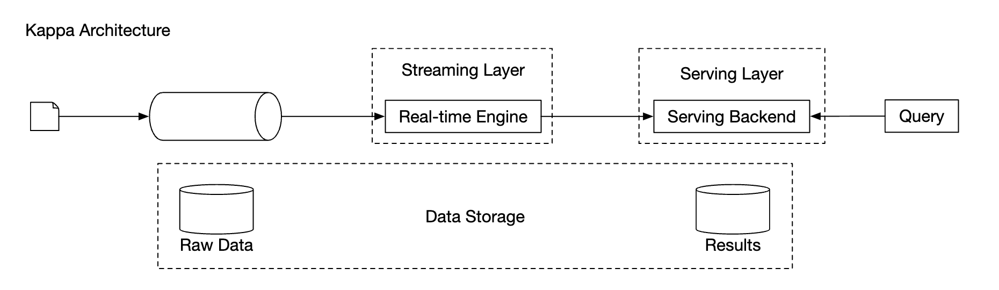
</div>

이번 개략적인 설계는 과거 데이터 재처리도 집계 서비스를 거치므로 카파 아키텍처를 쓴다.

예를 들어 집계 로직에 심각한 버그가 있어 집계 데이터를 다시 계산해야 하면, 저장해 둔 원시 데이터로 집계를 다시 계산할 수 있다.
 - 재계산 서비스는 원시 데이터 저장소에서 데이터를 가져온다. 이는 일괄 작업이다.
 - 실시간 처리용 집계 서비스에 영향을 주지 않도록, 가져온 데이터는 전용 집계 서비스로 보낸다.
 - 집계 결과는 두 번째 메시지 큐로 보내고, 그 뒤 집계 결과 데이터베이스를 갱신한다.

<div style="margin-left:3rem">
    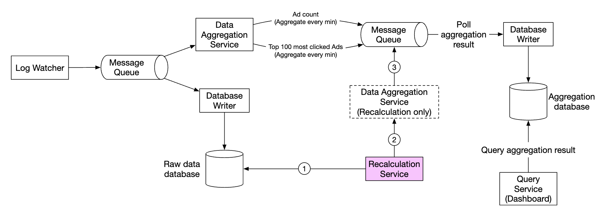
</div>

### **시각**
집계를 하려면 타임스탬프가 필요하다. 타임스탬프는 두 곳에서 만들어질 수 있다.
 - 이벤트 시각(event time) - 광고 클릭이 발생한 시각
 - 처리 시각(processing time) - 서버가 이벤트를 처리한 시스템 시각

비동기 처리(메시지 큐)와 네트워크 지연 때문에 이벤트 시각과 처리 시각 사이에 큰 차이가 날 수 있다.
 - 처리 시각을 쓰면 집계 결과가 부정확할 수 있다.
 - 이벤트 시각을 쓰면 지연된 이벤트를 처리해야 한다.

완벽한 해법은 없으므로 트레이드오프를 고려해야 한다.
|                 | 장점                                  | 단점                                                                                 |
|-----------------|---------------------------------------|--------------------------------------------------------------------------------------|
| 이벤트 시각      | 집계 결과가 더 정확함 | 클라이언트 시각이 틀렸거나, 악의적인 사용자가 타임스탬프를 만들었을 수 있음 |
| 처리 시각 | 서버 타임스탬프가 더 믿을 만함     | 이벤트가 늦게 도착하면 타임스탬프가 부정확함                                       |

데이터 정확성이 중요하므로 집계에는 이벤트 시각을 쓴다.

지연된 이벤트 문제를 완화하려면 '워터마크(watermark)'라는 기법을 쓸 수 있다.

아래 예에서 이벤트 2는 집계되어야 할 윈도를 놓친다.

<div style="margin-left:3rem">
    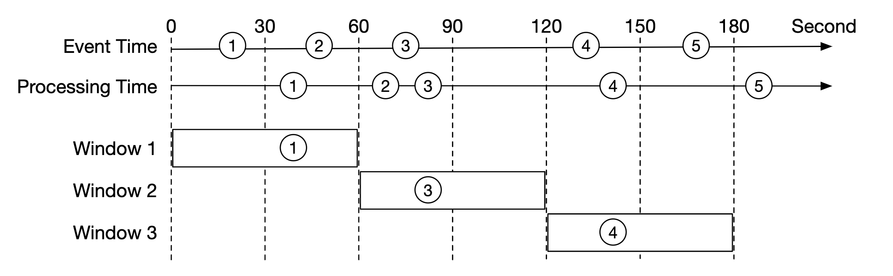
</div>

하지만 집계 윈도를 일부러 늘리면 이벤트를 놓칠 가능성을 줄일 수 있다.
윈도에서 늘린 부분을 '워터마크'라고 한다.

<div style="margin-left:3rem">
    
</div>

 - 워터마크가 짧으면 이벤트를 놓칠 가능성은 커지지만 지연 시간은 줄어든다.
 - 워터마크가 길면 이벤트를 놓칠 가능성은 줄지만 지연 시간은 늘어난다.

워터마크 크기와 상관없이 이벤트를 놓칠 가능성은 언제나 있다. 하지만 이렇게 발생 확률이 낮은 이벤트까지 최적화할 필요는 없다.

대신 하루가 끝날 때 대사(reconciliation)를 수행해 이런 불일치를 해소할 수 있다.

### **집계 윈도**
윈도 함수에는 네 가지가 있다.
 - 텀블링(고정) 윈도(tumbling window)
 - 호핑 윈도(hopping window)
 - 슬라이딩 윈도(sliding window)
 - 세션 윈도(session window)

이번 설계에서는 광고 클릭 집계에 텀블링 윈도를 쓴다.

<div style="margin-left:3rem">
    
</div>

M분 동안 가장 많이 클릭된 광고 N개 집계에는 슬라이딩 윈도를 쓴다.

<div style="margin-left:3rem">
    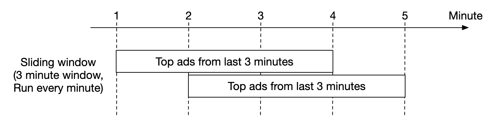
</div>

### **전달 보장**
집계하는 데이터는 과금에 쓰이므로 데이터 정확성이 최우선이다.

따라서 다음을 논의해야 한다.
 - 중복 이벤트 처리를 어떻게 피할 것인가
 - 모든 이벤트가 처리되도록 어떻게 보장할 것인가

전달 보장 방식에는 최대 한 번, 최소 한 번, 정확히 한 번, 세 가지가 있다.

중복이 조금 있어도 괜찮다면 대부분의 경우 최소 한 번으로 충분하다.
하지만 이 시스템은 그렇지 않다. 작은 비율의 차이가 수백만 달러의 차이로 이어질 수 있기 때문이다.
따라서 정확히 한 번 전달 방식을 써야 한다.

### **데이터 중복 제거**
가장 흔한 데이터 품질 문제 하나는 데이터 중복이다.

중복은 다양한 곳에서 생길 수 있다.
 - 클라이언트 측 - 클라이언트가 같은 이벤트를 여러 번 다시 보낼 수 있다. 악의적으로 보낸 중복 이벤트는 위험 탐지 엔진(risk engine)으로 처리하는 것이 좋다.
 - 서버 장애 - 집계 서비스 노드가 집계 도중 다운되고, 업스트림 서비스가 확인 응답을 받지 못해 이벤트를 다시 보낸다.

다음은 마지막 단계에서 이벤트에 대한 확인 응답이 실패해 데이터 중복이 발생하는 예다.

<div style="margin-left:3rem">
    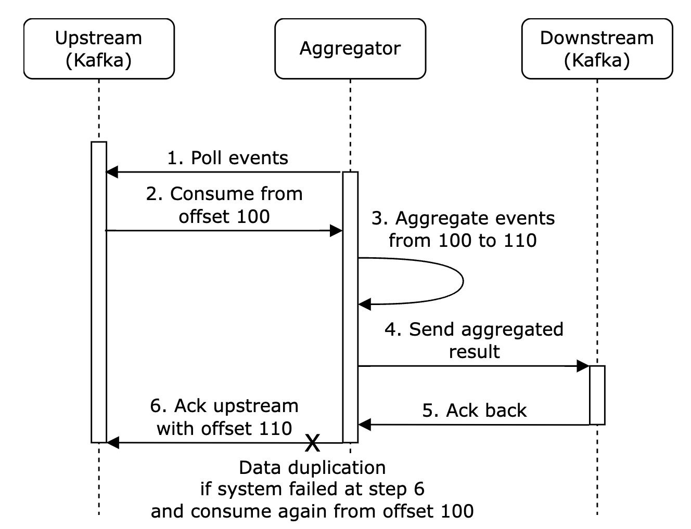
</div>

이 예에서 오프셋 100은 여러 번 처리되어 다운스트림으로 전송된다.

완화 방법 하나는 마지막으로 처리한 오프셋을 HDFS/S3에 저장하는 것이지만, 이 경우 결과가 다운스트림에 영영 도달하지 못할 위험이 있다.

<div style="margin-left:3rem">
    
</div>

결국 다운스트림과의 상호작용과 오프셋 저장을 원자적으로 처리해야 한다. 이를 위해서는 분산 트랜잭션을 구현해야 한다.

<div style="margin-left:3rem">
    
</div>

**원작자 메모**: 다운스트림 시스템이 집계 결과를 멱등적으로 처리한다면 분산 트랜잭션이 필요 없다.

### **시스템 규모 확장**
시스템이 커질 때 어떻게 확장할지 논의해 보자.

메시지 큐, 집계 서비스, 데이터베이스라는 세 개의 독립적인 컴포넌트가 있다.
서로 분리되어 있으므로 각각 독립적으로 확장할 수 있다.

메시지 큐의 규모 확장:
 - 생산자 수에는 제한을 두지 않으므로 쉽게 확장할 수 있다.
 - 소비자는 소비자 그룹에 할당하고 소비자 수를 늘려 확장할 수 있다.
 - 이를 위해 파티션을 미리 충분히 만들어 두어야 한다.
 - 소비자가 수천 개라면 소비자 재조정에 시간이 오래 걸릴 수 있으므로, 사용량이 적은 시간에 하는 것이 좋다.
 - 토픽을 지역별로 나누는 것도 고려할 수 있다(예: `topic_na`, `topic_eu` 등).

<div style="margin-left:3rem">
    
</div>

집계 서비스의 규모 확장:

<div style="margin-left:3rem">
    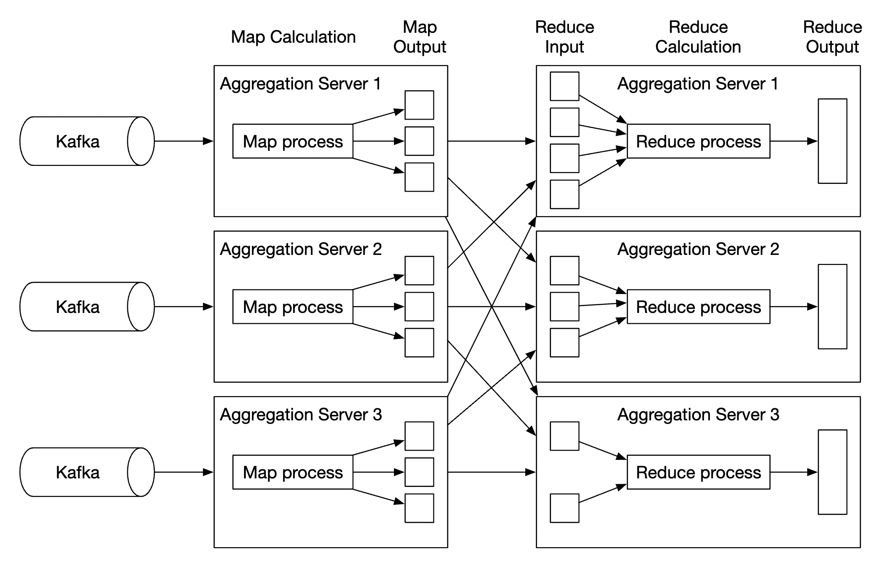
</div>

 - 맵리듀스 노드는 노드를 더 추가해 쉽게 확장할 수 있다.
 - 집계 서비스의 처리량은 다중 스레드를 활용해 늘릴 수 있다.
 - 또는 Apache YARN 같은 자원 공급자를 활용해 다중 프로세스를 쓸 수 있다.
 - 방법 1이 더 쉽지만, 확장성이 더 좋은 방법 2가 실제로 더 널리 쓰인다.
 - 다중 스레드 예시는 다음과 같다.

<div style="margin-left:3rem">
    
</div>

데이터베이스의 규모 확장:
 - Cassandra는 안정 해시를 이용한 수평적 규모 확장을 기본으로 지원한다.
 - 클러스터에 새 노드를 추가하면 데이터가 모든 (가상) 노드에 자동으로 재분배된다.
 - 이 방법에서는 수동 (재)샤딩이 필요 없다.

<div style="margin-left:3rem">
    
</div>

고려해야 할 또 다른 확장성 문제는 핫스팟 문제다. 어떤 광고가 다른 광고보다 훨씬 인기가 많아 주목을 더 받으면 어떻게 할까?

<div style="margin-left:3rem">
    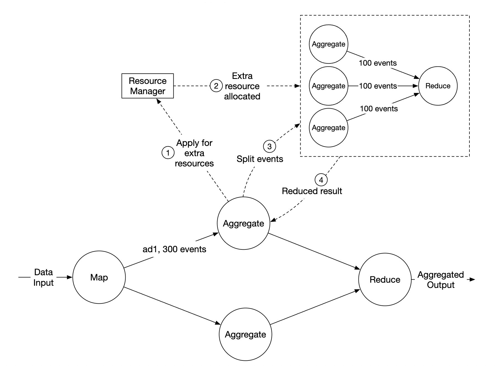
</div>

 - 위 예에서 집계 서비스 노드는 자원 관리자를 통해 추가 자원을 신청할 수 있다.
 - 자원 관리자가 자원을 더 할당해 원래 노드에 과부하가 걸리지 않게 한다.
 - 원래 노드는 이벤트를 세 그룹으로 나누고, 각 집계 노드가 100개씩 처리한다.
 - 결과는 원래 집계 노드에 다시 기록된다.

핫스팟 문제를 처리하는 더 정교한 대안:
 - 전역-지역 집계(global-local aggregation)
 - 분할 고유 집계(split distinct aggregation)

### **결함 감내**
집계 노드는 메모리에서 데이터를 처리한다. 노드가 다운되면 처리 중이던 데이터는 사라진다.

Kafka의 소비자 오프셋을 활용하면, 다른 노드가 작업을 넘겨받았을 때 중단된 지점부터 이어서 처리할 수 있다.
하지만 M분 동안의 상위 N개 광고를 집계하므로, 추가로 유지해야 할 중간 상태가 있다.

진행 중인 집계에 대해 특정 시점(분)마다 스냅숏을 만들어 둘 수 있다.

<div style="margin-left:3rem">
    
</div>

노드가 다운되면 새 노드는 마지막으로 커밋된 소비자 오프셋과 최신 스냅숏을 읽어 작업을 이어 간다.

<div style="margin-left:3rem">
    
</div>

### **데이터 모니터링과 정확성**
집계하는 데이터는 과금에 쓰이는 중요한 데이터이므로, 정확성을 보장하기 위해 철저한 모니터링이 매우 중요하다.

모니터링할 만한 지표:
 - **지연 시간**: 각 이벤트의 타임스탬프를 추적해 시스템의 종단 간 지연 시간을 파악한다.
 - **메시지 큐 크기**: 큐 크기가 갑자기 늘면 집계 노드를 더 추가해야 한다. Kafka는 분산 커밋 로그로 구현되어 있으므로 대신 레코드 처리 지연(records-lag) 지표를 추적해야 한다.
 - **집계 노드의 시스템 자원**: CPU, 디스크, JVM 등

하루가 끝날 때 실행되는 일괄 작업으로 대사(reconciliation) 흐름도 구현해야 한다.
원시 데이터로 집계 결과를 계산하고, 집계 결과 데이터베이스에 실제로 저장된 데이터와 비교한다.

<div style="margin-left:3rem">
    
</div>

### **대안 설계**
일반적인 시스템 설계 면접에서는 빅데이터 처리에 쓰이는 전문 소프트웨어의 내부 구조까지 알고 있으리라 기대하지 않는다.

특정 도구를 아는 것보다 사고 과정을 설명하고 트레이드오프를 논의하는 것이 더 중요하다. 그래서 이 장에서는 일반적인 해법을 다뤘다.

기성 도구를 활용하는 대안 설계로는 광고 클릭 데이터를 Hive에 저장하고, 빠른 질의를 위해 그 위에 ElasticSearch 계층을 두는 방법이 있다.

집계는 보통 ClickHouse나 Druid 같은 OLAP 데이터베이스에서 한다.

<div style="margin-left:3rem">
    
</div>

---

## 4단계: 마무리
다룬 내용:
 - 데이터 모델과 API 설계
 - 맵리듀스를 이용한 광고 클릭 이벤트 집계
 - 메시지 큐, 집계 서비스, 데이터베이스의 규모 확장
 - 핫스팟 문제 완화
 - 시스템의 지속적인 모니터링
 - 대사를 통한 정확성 보장
 - 결함 감내

광고 클릭 이벤트 집계는 전형적인 빅데이터 처리 시스템이다.

관련 기술에 대한 사전 지식이 있으면 이해하고 설계하기가 더 쉽다.
 - Apache Kafka
 - Apache Spark
 - Apache Flink
