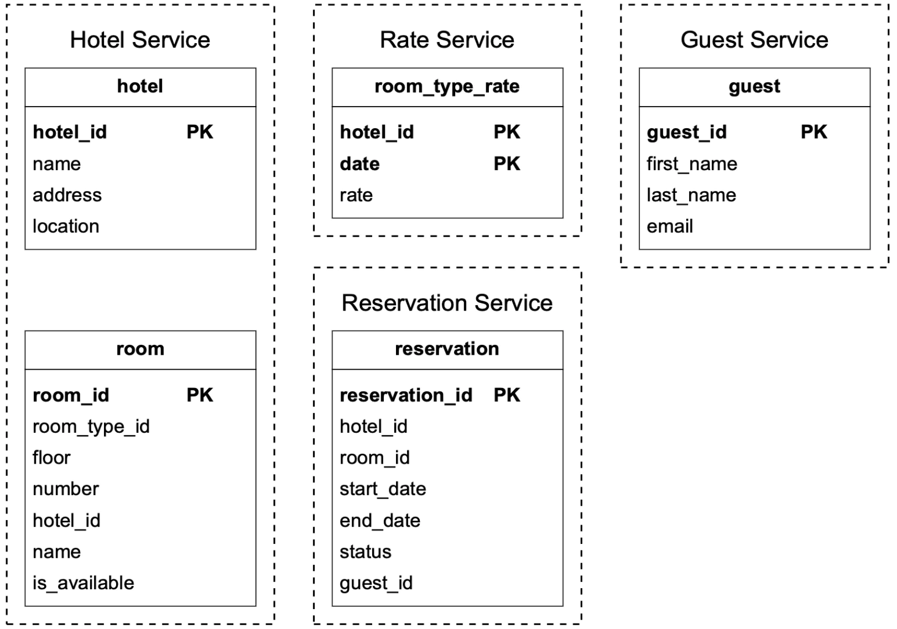
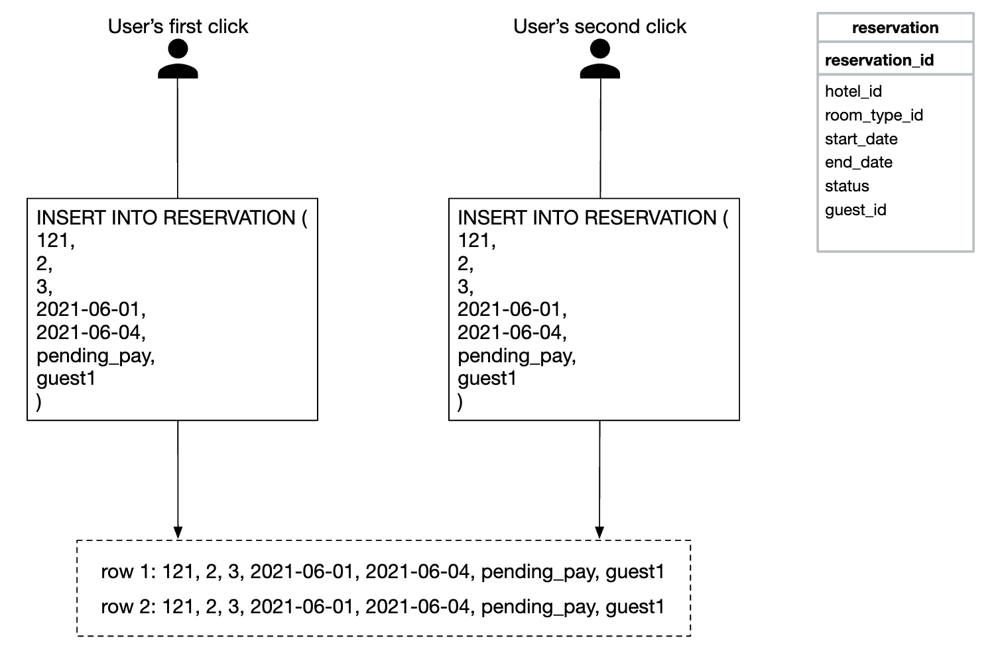
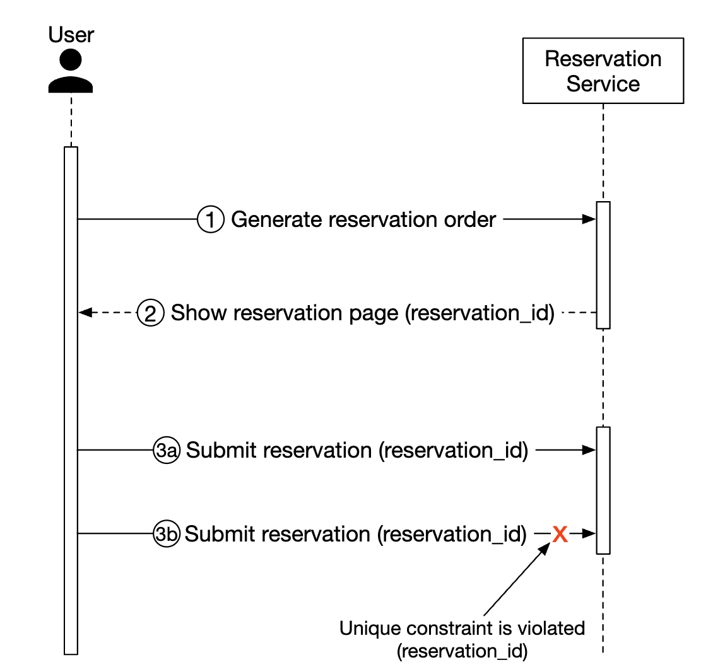
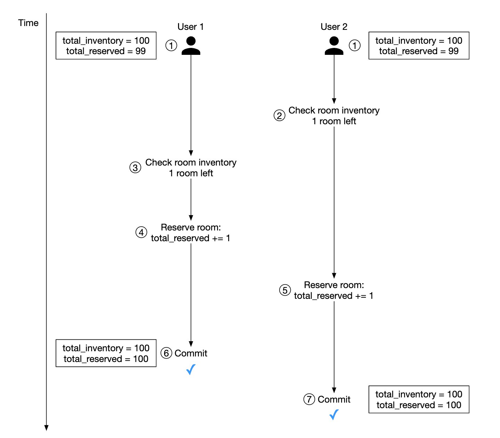
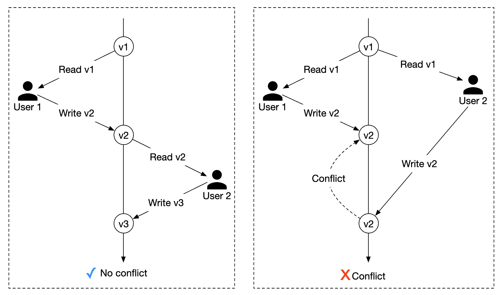
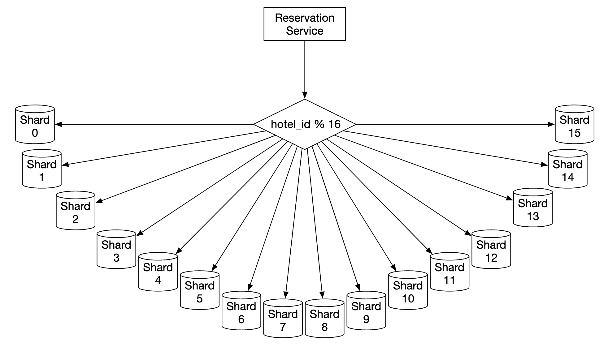
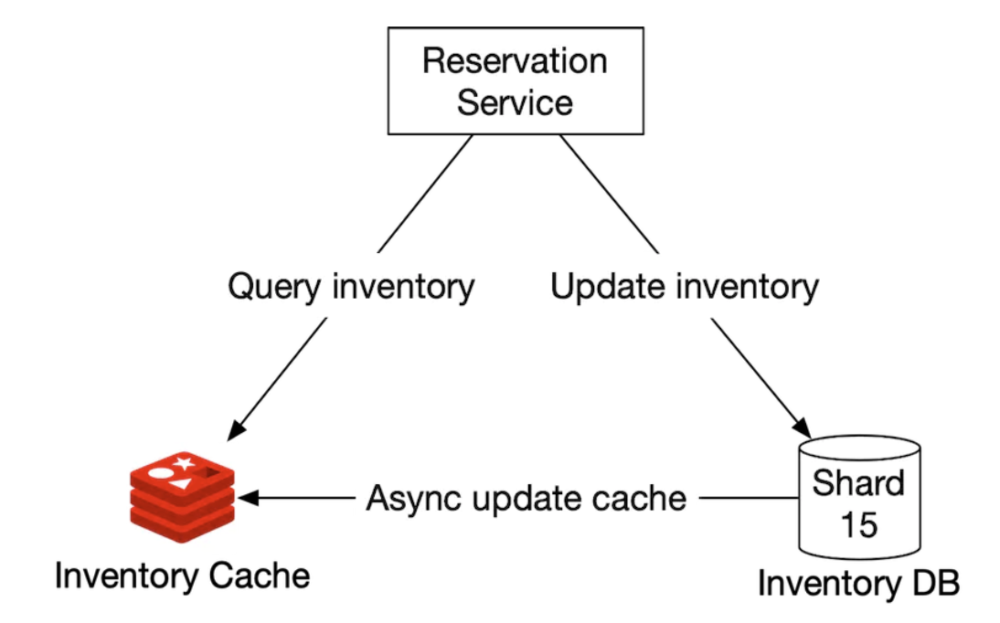
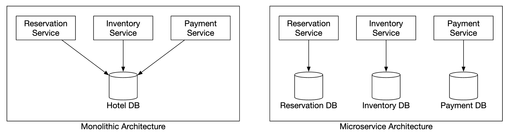
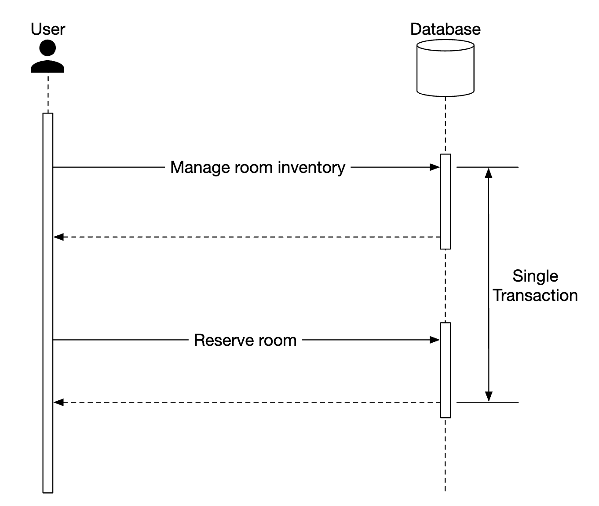
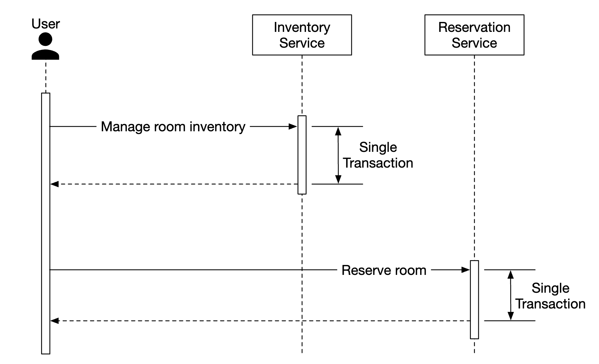

# 22장: 호텔 예약 시스템

## 소개
이 장에서는 메리어트 인터내셔널과 비슷한 **호텔 예약 시스템(hotel reservation system)** 을 설계한다.

에어비앤비, 항공권 예약, 영화 티켓 예매 같은 다른 시스템에도 적용할 수 있다.

---

## 1단계: 문제 이해 및 설계 범위 확정
시스템 설계에 들어가기 전에 면접관에게 질문해 범위를 분명히 해야 한다(지: 지원자, 면: 면접관).
 - 지: 시스템 규모는 어느 정도인가요?
 - 면: 호텔 5,000곳, 객실 100만 개를 가진 호텔 체인의 웹사이트를 만듭니다.
 - 지: 고객은 예약할 때 결제하나요, 호텔에 도착해서 결제하나요?
 - 면: 예약할 때 전액 결제합니다.
 - 지: 고객은 웹사이트로만 객실을 예약하나요? 전화 같은 다른 예약 수단도 지원해야 하나요?
 - 면: 웹사이트나 앱으로만 예약합니다.
 - 지: 고객이 예약을 취소할 수 있나요?
 - 면: 네.
 - 지: 그 밖에 고려할 점이 있나요?
 - 면: 네, 10% 초과 예약을 허용합니다. 호텔이 실제 객실 수보다 많이 판매하는 것인데, 고객이 예약을 취소할 것을 예상하고 그렇게 합니다.
 - 지: 시간이 많지 않으니 호텔 관련 페이지, 객실 상세 페이지, 객실 예약, 관리자 패널, 초과 예약 지원에 집중하겠습니다.
 - 면: 좋습니다.
 - 면: 한 가지 더 - 호텔 요금은 수시로 바뀝니다. 객실 요금이 매일 바뀐다고 가정하세요.
 - 지: 알겠습니다.

### **비기능 요구 사항**
 - 높은 수준의 동시성 지원 - 성수기에는 많은 고객이 같은 호텔을 동시에 예약하려 할 수 있다.
 - 적절한 지연 시간 - 예약할 때 응답이 빠르면 이상적이지만, 처리에 몇 초 정도 걸리는 것은 괜찮다.

### **개략적인 규모 추정**
 - 호텔 5,000곳, 객실 총 100만 개
 - 객실의 70%가 사용 중이고 평균 투숙 기간은 3일이라고 가정
 - 일일 예약 건수 추정 - 1mil * 0.7 / 3 = 하루 약 240,000건
 - 초당 예약 건수 - 240k / 하루 10^5초 = 약 3. 평균 예약 TPS는 낮다.

QPS를 추정해 보자. 예약 페이지까지 세 단계를 거치고 페이지마다 전환율이 10%라고 가정하면,
예약이 3건일 때 예약 페이지 조회는 30회, 객실 상세 페이지 조회는 300회라고 추정할 수 있다.

<div style="margin-left:3rem">
    
</div>

---

## 2단계: 개략적인 설계안 제시 및 동의 구하기
API 설계, 데이터 모델, 개략적인 설계를 살펴본다.

### **API 설계**
호텔 예약 시스템을 지원하는 데 필요한 핵심 엔드포인트(RESTful 관례를 따름)에 집중한다.

완전한 시스템이라면 다양한 조건으로 객실을 검색하는 기능 등 훨씬 많은 API가 필요하지만, 이 절에서는 다루지 않는다.
기술적으로 어렵지 않아 범위에서 제외한다.

**호텔 관련 API**
 - `GET /v1/hotels/{id}` - 호텔 상세 정보 조회
 - `POST /v1/hotels` - 새 호텔 추가. 운영 직원만 사용 가능
 - `PUT /v1/hotels/{id}` - 호텔 정보 수정. 운영 직원만 사용 가능
 - `DELETE /v1/hotels/{id}` - 호텔 삭제. 운영 직원만 사용 가능

**객실 관련 API**
 - `GET /v1/hotels/{id}/rooms/{id}` - 객실 상세 정보 조회
 - `POST /v1/hotels/{id}/rooms` - 객실 추가. 운영 직원만 사용 가능
 - `PUT /v1/hotels/{id}/rooms/{id}` - 객실 정보 수정. 운영 직원만 사용 가능
 - `DELETE /v1/hotels/{id}/rooms/{id}` - 객실 삭제. 운영 직원만 사용 가능

**예약 관련 API**
 - `GET /v1/reservations` - 로그인 사용자의 예약 이력 조회
 - `GET /v1/reservations/{id}` - 예약 상세 정보 조회
 - `POST /v1/reservations` - 신규 예약
 - `DELETE /v1/reservations/{id}` - 예약 취소

예약 요청의 예:

```
{
  "startDate":"2021-04-28",
  "endDate":"2021-04-30",
  "hotelID":"245",
  "roomID":"U12354673389",
  "reservationID":"13422445"
}
```

`reservationID`는 이중 예약을 막기 위한 멱등 키(idempotency key)다. 자세한 내용은 [동시성 문제](#동시성-문제) 절에서 설명한다.

### **데이터 모델**
어떤 데이터베이스를 쓸지 고르기 전에 접근 패턴부터 살펴보자.

다음 질의를 지원해야 한다.
 - 호텔 상세 정보 조회
 - 주어진 날짜 범위에 예약 가능한 객실 유형 찾기
 - 예약 기록
 - 예약 내역이나 과거 예약 이력 조회

추정 결과를 보면 시스템 규모는 크지 않지만, 트래픽 급증에는 대비해야 한다.

이를 고려해 다음 이유로 관계형 데이터베이스를 선택한다.
 - 관계형 데이터베이스는 읽기가 많고 쓰기는 적은 시스템에 잘 맞는다.
 - NoSQL 데이터베이스는 보통 쓰기에 최적화되어 있지만, 사이트 방문자 중 일부만 예약하므로 쓰기는 많지 않을 것이다.
 - 관계형 데이터베이스는 ACID를 보장한다. ACID가 없으면 잔액이 마이너스가 되거나 이중 청구되는 문제 등을 막을 수 없으므로 이런 시스템에서는 중요하다.
 - 데이터 구조가 아주 명확하므로 관계형 데이터베이스로 쉽게 모델링할 수 있다.

스키마 설계는 다음과 같다.

<div style="margin-left:3rem">
    
</div>

대부분의 필드는 이름만 봐도 의미를 알 수 있다. 짚고 넘어갈 필드는 객실 예약의 상태 기계(state machine)를 나타내는 `status` 필드뿐이다.

<div style="margin-left:3rem">
    
</div>

이 데이터 모델은 에어비앤비 같은 시스템에는 잘 맞지만, 사용자가 특정 객실이 아니라 객실 유형을 예약하는 호텔에는 맞지 않는다.
호텔에서는 객실 유형을 예약하고, 객실 번호는 체크인할 때 정해진다.

이 단점은 [개선된 데이터 모델](#개선된-데이터-모델) 절에서 다룬다.

### **개략적인 설계**
이번 설계에는 최근 몇 년 동안 큰 인기를 얻은 마이크로서비스 아키텍처를 택했다.

<div style="margin-left:3rem">
    
</div>

 - **사용자**: 휴대폰이나 컴퓨터로 객실을 예약한다.
 - **관리자**: 환불, 결제 취소 같은 관리 기능을 수행한다.
 - **CDN**: JS 번들, 이미지, 동영상 같은 정적 자원을 캐시한다.
 - **공개 API 게이트웨이**: 처리율 제한, 인증 등을 지원하는 완전 관리형 서비스다.
 - **내부 API**: 승인된 직원만 볼 수 있다. 보통 VPN으로 보호한다.
 - **호텔 서비스**: 호텔과 객실 상세 정보를 제공한다. 호텔과 객실 데이터는 거의 바뀌지 않으므로 적극적으로 캐시할 수 있다.
 - **요금 서비스**: 미래 날짜별 객실 요금을 제공한다. 이 분야의 흥미로운 점은 요금이 해당 날짜에 호텔이 얼마나 찼는지에 따라 달라진다는 것이다.
 - **예약 서비스**: 예약 요청을 받아 객실을 예약한다. 예약이 생기거나 취소될 때 객실 재고도 추적한다.
 - **결제 서비스**: 결제를 처리하고, 성공하면 예약 상태를 갱신한다.
 - **호텔 관리 서비스**: 승인된 직원만 쓸 수 있다. 예약, 호텔 등을 관리하고 조회하는 관리 기능을 제공한다.

서비스 간 통신은 gRPC 같은 RPC 프레임워크로 처리할 수 있다.

---

## 3단계: 상세 설계
다음 주제를 더 깊이 살펴본다.
 - 개선된 데이터 모델
 - 동시성 문제
 - 규모 확장성
 - 마이크로서비스 간 데이터 불일치 해소

### **개선된 데이터 모델**
앞에서 말했듯, 특정 객실이 아니라 객실 유형을 예약할 수 있도록 API와 스키마를 고쳐야 한다.

예약 API에서는 이제 `roomID`가 아니라 `roomTypeID`를 예약한다.

```
POST /v1/reservations
{
  "startDate":"2021-04-28",
  "endDate":"2021-04-30",
  "hotelID":"245",
  "roomTypeID":"12354673389",
  "roomCount":"3",
  "reservationID":"13422445"
}
```

수정된 스키마는 다음과 같다.

<div style="margin-left:3rem">
    
</div>

 - **room**: 객실 정보
 - **room_type_rate**: 객실 유형별 요금 정보
 - **reservation**: 투숙객 예약 정보
 - **room_type_inventory**: 호텔 객실 재고 정보

더 흥미로운 `room_type_inventory` 테이블의 칼럼을 살펴보자.
 - **hotel_id**: 호텔 ID
 - **room_type_id**: 객실 유형 ID
 - **date**: 날짜
 - **total_inventory**: 전체 객실 수에서 일시적으로 재고에서 뺀 객실 수를 제외한 값
 - **total_reserved**: (hotel_id, room_type_id, date)에 대해 예약된 객실 수

이 테이블을 다르게 설계할 수도 있지만, (hotel_id, room_type_id, date)마다 행 하나를 두면 예약 관리와 질의가 쉬워진다.

테이블의 행은 매일 실행되는 CRON 작업으로 미리 채워 둔다.

예시 데이터:
| hotel_id | room_type_id | date       | total_inventory | total_reserved |
|----------|--------------|------------|-----------------|----------------|
| 211      | 1001         | 2021-06-01 | 100             | 80             |
| 211      | 1001         | 2021-06-02 | 100             | 82             |
| 211      | 1001         | 2021-06-03 | 100             | 86             |
| 211      | 1001         | ...        | ...             |                |
| 211      | 1001         | 2023-05-31 | 100             | 0              |
| 211      | 1002         | 2021-06-01 | 200             | 16             |
| 2210     | 101          | 2021-06-01 | 30              | 23             |
| 2210     | 101          | 2021-06-02 | 30              | 25             |

객실 유형의 예약 가능 여부를 확인하는 SQL 질의 예:

```
SELECT date, total_inventory, total_reserved
FROM room_type_inventory
WHERE room_type_id = ${roomTypeId} AND hotel_id = ${hotelId}
AND date between ${startDate} and ${endDate}
```

이 데이터로 지정한 수의 객실을 예약할 수 있는지 확인하는 방법(초과 예약을 지원한다는 점에 유의):

```
if (total_reserved + ${numberOfRoomsToReserve}) <= 110% * total_inventory
```

이제 저장 용량을 추정해 보자.
 - 호텔은 5,000곳이다.
 - 호텔마다 객실 유형이 20가지다.
 - 5000 * 20 * 2(년) * 365(일) = 7,300만 행

7,300만 행은 많은 데이터가 아니므로 데이터베이스 서버 한 대로 감당할 수 있다.
하지만 고가용성을 위해 (가능하면 여러 가용성 구역에 걸쳐) 읽기 전용 사본을 두는 것이 합리적이다.

후속 질문 - 예약 데이터가 데이터베이스 한 대에 담기에 너무 크다면 어떻게 할까?
 - 현재와 미래의 예약 데이터만 저장한다. 예약 이력은 냉동 저장소(cold storage)로 옮길 수 있다.
 - 데이터베이스 샤딩 - 모든 질의가 `hotel_id`로 데이터를 선택하므로 `hash(hotel_id) % servers_cnt`로 샤딩할 수 있다.

### **동시성 문제**
해결해야 할 또 다른 중요한 문제는 이중 예약이다.

두 가지 문제를 해결해야 한다.
 - 같은 사용자가 '예약' 버튼을 두 번 누른다.
 - 여러 사용자가 같은 객실을 동시에 예약하려 한다.

첫 번째 문제를 그림으로 나타내면 다음과 같다.

<div style="margin-left:3rem">
    
</div>

이 문제를 해결하는 방법은 두 가지다.
 - 클라이언트 측 처리 - 프런트엔드에서 버튼을 한 번 누르면 비활성화한다. 하지만 사용자가 자바스크립트를 꺼 두었다면 버튼이 비활성화되지 않는다.
 - 멱등(idempotent) API - API에 멱등 키를 추가해, 엔드포인트를 몇 번 호출하든 작업이 한 번만 실행되게 한다.

<div style="margin-left:3rem">
    
</div>

흐름은 다음과 같다.
 - 사용자가 상세 정보를 입력하고 예약을 진행하는 시점에 예약 주문서가 만들어진다. 예약 주문서는 전역적으로 유일한 식별자로 만든다.
 - 앞 단계에서 만든 `reservation_id`로 예약 1을 제출한다.
 - '예약 완료'를 다시 누르면 같은 `reservation_id`가 전송되고, 백엔드는 이것이 중복 예약임을 감지한다.
 - `reservation_id` 칼럼에 유일성 제약 조건(unique constraint)을 걸어, 같은 ID를 가진 레코드가 데이터베이스에 여러 번 저장되지 않게 해 중복을 막는다.

<div style="margin-left:3rem">
    
</div>

여러 사용자가 같은 객실을 예약하면 어떻게 될까?

<div style="margin-left:3rem">
    
</div>

 - 트랜잭션 격리 수준이 직렬화 가능(serializable)이 아니라고 가정한다.
 - 사용자 1과 2가 같은 객실을 동시에 예약하려 한다.
 - 트랜잭션 1이 객실이 충분한지 확인한다 - 충분하다.
 - 트랜잭션 2가 객실이 충분한지 확인한다 - 충분하다.
 - 트랜잭션 2가 객실을 예약하고 재고를 갱신한다.
 - 트랜잭션 1도 여전히 100개 중 `total_reserved`가 99개라고 보므로 객실을 예약한다.
 - 두 트랜잭션 모두 변경 사항을 성공적으로 커밋한다.

이 문제는 다음과 같은 일종의 락 메커니즘으로 해결할 수 있다.
 - 비관적 락(pessimistic locking)
 - 낙관적 락(optimistic locking)
 - 데이터베이스 제약 조건

객실 예약에 쓰는 SQL은 다음과 같다.

```sql
# step 1: check room inventory
SELECT date, total_inventory, total_reserved
FROM room_type_inventory
WHERE room_type_id = ${roomTypeId} AND hotel_id = ${hotelId}
AND date between ${startDate} and ${endDate}

# For every entry returned from step 1
if((total_reserved + ${numberOfRoomsToReserve}) > 110% * total_inventory) {
  Rollback
}

# step 2: reserve rooms
UPDATE room_type_inventory
SET total_reserved = total_reserved + ${numberOfRoomsToReserve}
WHERE room_type_id = ${roomTypeId}
AND date between ${startDate} and ${endDate}

Commit
```

#### 방안 1: 비관적 락
비관적 락은 레코드를 갱신하는 동안 락을 걸어 동시 갱신을 막는다.

MySQL에서는 `SELECT... FOR UPDATE` 질의로 구현할 수 있다. 이 질의는 트랜잭션이 커밋될 때까지 선택된 행에 락을 건다.

<div style="margin-left:3rem">
    
</div>

장점:
 - 변경 중인 데이터를 다른 애플리케이션이 갱신하지 못하게 한다.
 - 구현이 쉽고, 갱신을 직렬화해 충돌을 피한다. 데이터 경합이 심할 때 유용하다.

단점:
 - 여러 자원에 락을 걸면 교착 상태(deadlock)가 생길 수 있다.
 - 확장성이 떨어진다. 트랜잭션이 너무 오래 락을 잡고 있으면, 그 자원에 접근하려는 다른 모든 트랜잭션에 영향을 준다.
 - 질의가 많은 자원을 선택하고 트랜잭션이 오래 지속되면 영향이 심각하다.

저자는 확장성 문제 때문에 이 방법을 권하지 않는다.

#### 방안 2: 낙관적 락
낙관적 락은 여러 사용자가 동시에 레코드 갱신을 시도하도록 허용한다.

흔히 버전 번호나 타임스탬프로 구현한다. 서버 시계는 부정확할 수 있으므로 버전 번호를 권장한다.

<div style="margin-left:3rem">
    
</div>

 - 데이터베이스 테이블에 `version`이라는 새 칼럼을 추가한다.
 - 사용자가 행을 수정하기 전에 버전 번호를 읽는다.
 - 사용자가 행을 갱신할 때 버전 번호를 1 늘려 데이터베이스에 다시 기록한다.
 - 새 버전 번호가 이전 번호보다 크지 않으면 데이터베이스 검증 단계에서 기록을 막는다.

낙관적 락은 데이터베이스에 락을 걸지 않으므로 보통 비관적 락보다 빠르다.
하지만 동시성 수준이 높으면 롤백이 많이 발생해 성능이 떨어지는 경향이 있다.

장점:
 - 애플리케이션이 오래된 데이터를 수정하지 못하게 한다.
 - 데이터베이스에서 락을 획득할 필요가 없다.
 - 데이터 경합이 적을 때, 즉 갱신 충돌이 드물 때 선호되는 방법이다.

단점:
 - 데이터 경합이 심하면 성능이 나쁘다.

예약 QPS가 아주 높지 않으므로 낙관적 락은 이 시스템에 좋은 선택지다.

#### 방안 3: 데이터베이스 제약 조건
낙관적 락과 매우 비슷하지만, 데이터베이스 제약 조건으로 안전장치를 구현한다.

```
CONSTRAINT `check_room_count` CHECK((`total_inventory - total_reserved` >= 0))
```

<div style="margin-left:3rem">
    
</div>

장점:
 - 구현이 쉽다.
 - 데이터 경합이 적을 때 잘 동작한다.

단점:
 - 낙관적 락처럼 데이터 경합이 심하면 성능이 나쁘다.
 - 데이터베이스 제약 조건은 애플리케이션 코드처럼 버전 관리하기 어렵다.
 - 모든 데이터베이스가 제약 조건을 지원하지는 않는다.

구현이 쉬우므로 호텔 예약 시스템에 또 하나의 좋은 선택지다.

### **규모 확장성**
보통 호텔 예약 시스템의 부하는 높지 않다.

하지만 면접관은 booking.com처럼 더 크고 인기 있는 여행 사이트에 이 시스템을 쓰게 되면 어떻게 대처할지 물을 수 있다.
그 경우 QPS가 1,000배 커질 수 있다.

이런 상황에서는 병목이 어디인지 파악하는 것이 중요하다. 모든 서비스는 무상태이므로 서버를 늘려 쉽게 확장할 수 있다.

하지만 데이터베이스는 상태를 가지므로 어떻게 확장할지가 명확하지 않다.

한 가지 방법은 데이터베이스 샤딩이다. 데이터를 여러 데이터베이스에 나눠, 각 데이터베이스가 데이터의 일부만 갖게 한다.

모든 질의가 `hotel_id`로 필터링하므로 `hotel_id`를 기준으로 샤딩할 수 있다.
QPS가 30,000이라고 가정하면, 데이터베이스를 샤드 16개로 나눌 때 샤드마다 1,875 QPS를 처리하게 된다. 이는 MySQL 클러스터 하나가 감당할 수 있는 수준이다.

<div style="margin-left:3rem">
    
</div>

Redis로 객실 재고와 예약 정보를 캐시할 수도 있다. TTL을 설정해 이미 지난 날짜의 오래된 데이터가 만료되게 할 수 있다.

<div style="margin-left:3rem">
    
</div>

재고는 `hotel_id`, `room_type_id`, `date`를 기준으로 저장한다.

```
key: hotelID_roomTypeID_{date}
value: the number of available rooms for the given hotel ID, room type ID and date.
```

데이터 일관성은 비동기적으로 맞춰지며, CDC(변경 데이터 감지) 스트리밍 메커니즘으로 관리한다. 데이터베이스의 변경 사항을 읽어 다른 시스템에 반영하는 방식이다.
데이터베이스 변경 사항을 Redis와 동기화하는 데는 Debezium이 널리 쓰인다.

이런 메커니즘을 쓰면 한동안 캐시와 데이터베이스가 일치하지 않을 수 있다.
하지만 데이터베이스가 잘못된 예약을 막아 주므로 이 경우에는 괜찮다.

다만 사용자가 페이지를 새로 고쳐야 '남은 객실 없음'을 볼 수 있는 UI 문제가 생길 수 있다.
그렇지만 이는 예를 들어 사용자가 예약하기 전에 오래 망설이는 경우에도 생길 수 있는 문제다.

캐시의 장점:
 - 데이터베이스 부하가 줄어든다.
 - Redis는 메모리에서 데이터를 관리하므로 성능이 높다.

캐시의 단점:
 - 캐시와 데이터베이스 사이의 데이터 일관성을 유지하기 어렵다. 불일치가 사용자 경험에 어떤 영향을 줄지 고려해야 한다.

### **서비스 간 데이터 일관성**
모놀리식(monolithic) 애플리케이션에서는 공유 관계형 데이터베이스로 데이터 일관성을 보장할 수 있다.

이번 마이크로서비스 설계에서는 일부 서비스는 분리하되, 예약 API와 재고 API는 같은 서비스에서 처리하는 혼합 방식을 택했다.

관계형 데이터베이스의 ACID 보장을 활용해 일관성을 확보하기 위해서다.

하지만 면접관은 서비스마다 전용 데이터베이스를 갖는 순수한 마이크로서비스 아키텍처가 아니라며 이 방식에 이의를 제기할 수 있다.

<div style="margin-left:3rem">
    
</div>

이 경우 일관성 문제가 생길 수 있다. 모놀리식 서버에서는 관계형 데이터베이스의 트랜잭션 기능으로 원자적 연산을 구현할 수 있다.

<div style="margin-left:3rem">
    
</div>

하지만 연산이 여러 서비스에 걸치면 원자성을 보장하기가 더 어렵다.

<div style="margin-left:3rem">
    
</div>

이런 데이터 불일치를 처리하는 잘 알려진 기법이 있다.
 - **2단계 커밋(two-phase commit, 2PC)**: 여러 노드에 걸친 원자적 트랜잭션 커밋을 보장하는 데이터베이스 프로토콜이다.
   하지만 노드 하나만 느려져도 모든 노드가 연산을 기다려야 하므로 성능이 좋지 않다.
 - **사가(Saga)**: 일련의 로컬 트랜잭션으로, 작업 흐름의 어느 단계든 실패하면 보상 트랜잭션(compensating transaction)이 실행된다. 결과적 일관성을 따르는 방식이다.

마이크로서비스 간 데이터 불일치를 해결하는 것은 어려운 문제이며 시스템 복잡도를 높인다는 점을 기억해야 한다.
서로 의존하는 연산을 같은 관계형 데이터베이스 안에 묶는 더 실용적인 방법이 있으니, 그만한 비용을 치를 가치가 있는지 따져 보는 것이 좋다.

---

## 4단계: 마무리
호텔 예약 시스템 설계를 제시했다.

거쳐 온 단계는 다음과 같다.
 - 요구 사항을 모으고 개략적인 규모 추정으로 시스템 규모를 파악했다.
 - 개략적인 설계에서 API 설계, 데이터 모델, 시스템 아키텍처를 제시했다.
 - 상세 설계에서는 요구 사항 변화에 따라 대안 데이터베이스 스키마를 살펴보았다.
 - 경쟁 조건을 논의하고 비관적/낙관적 락, 데이터베이스 제약 조건이라는 해결책을 제시했다.
 - 데이터베이스 샤딩과 캐시로 시스템을 확장하는 방법을 살펴보았다.
 - 마지막으로 여러 마이크로서비스 간 데이터 일관성 문제를 다루는 방법을 논의했다.
