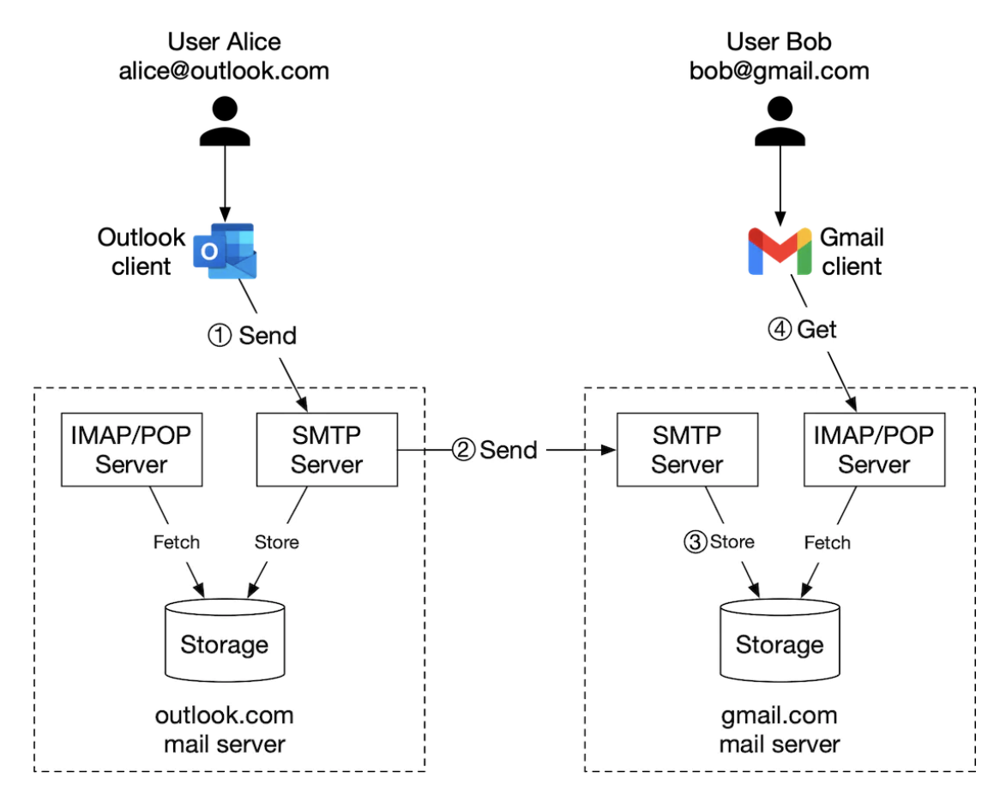
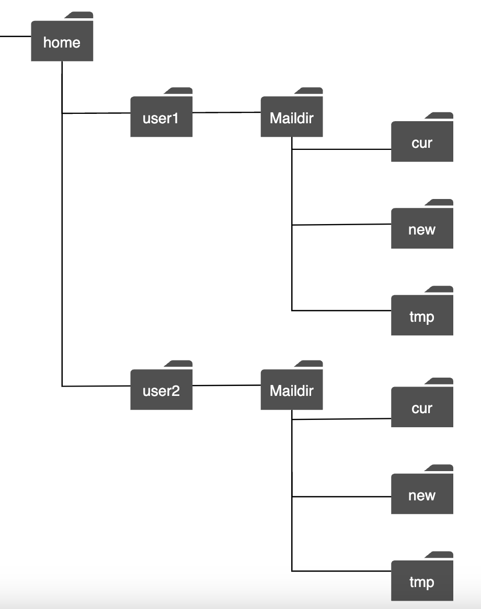
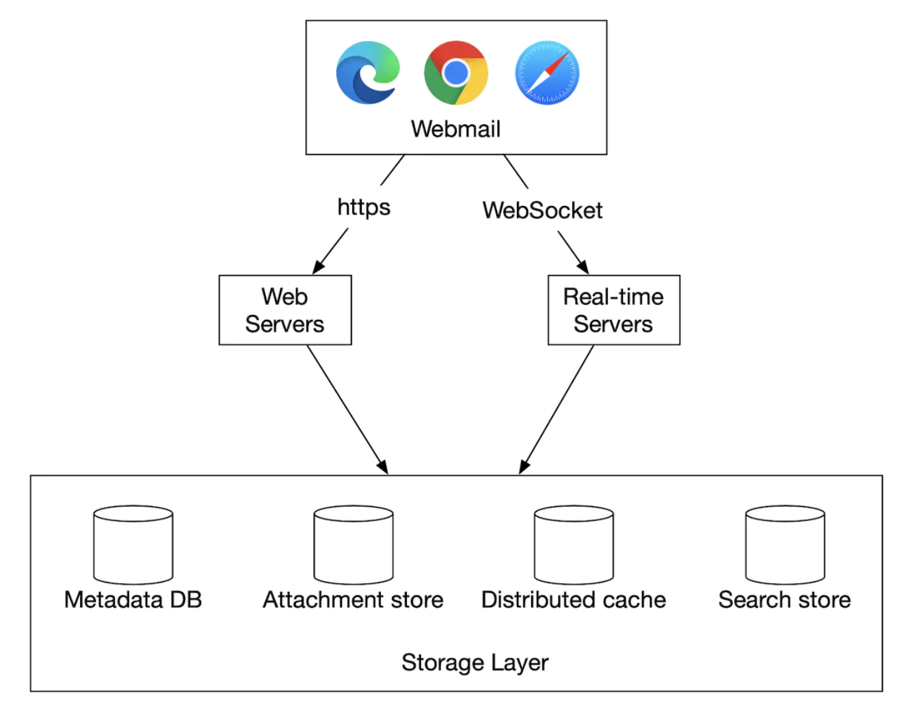
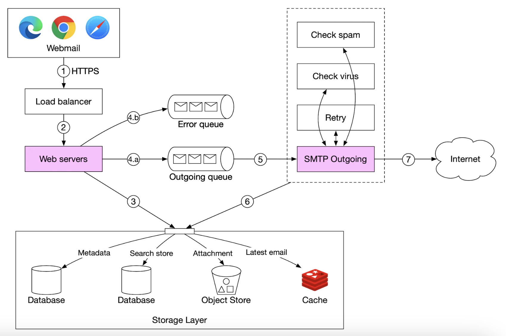
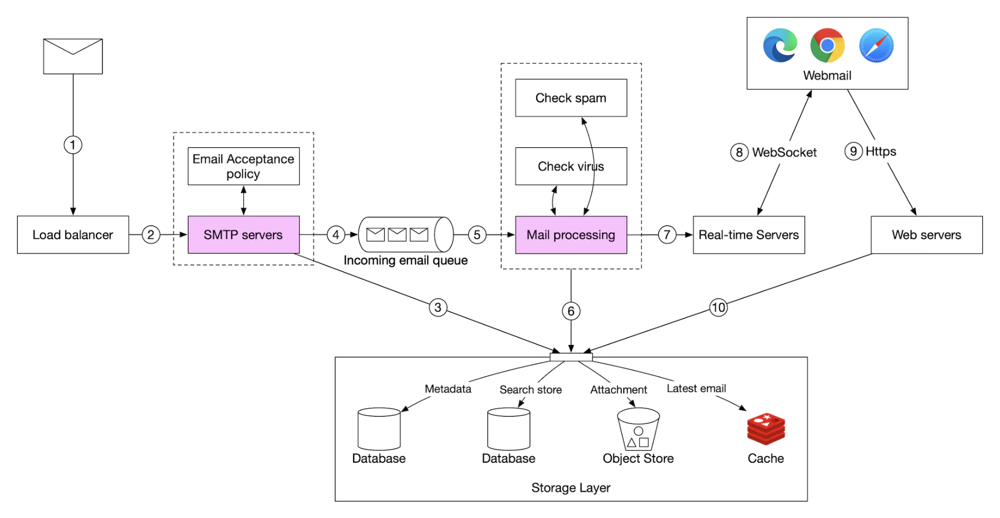
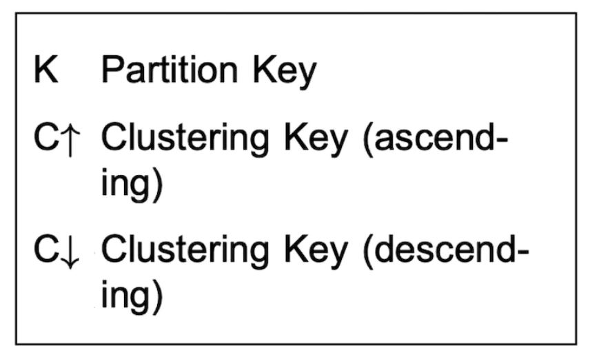
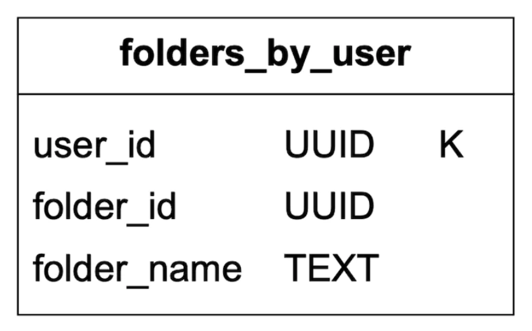
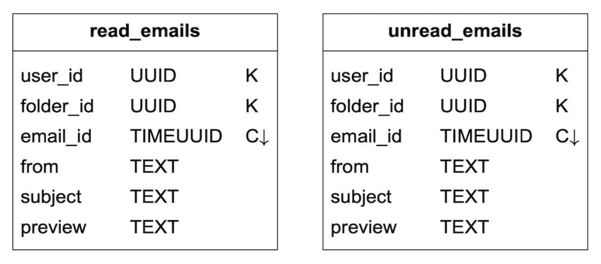
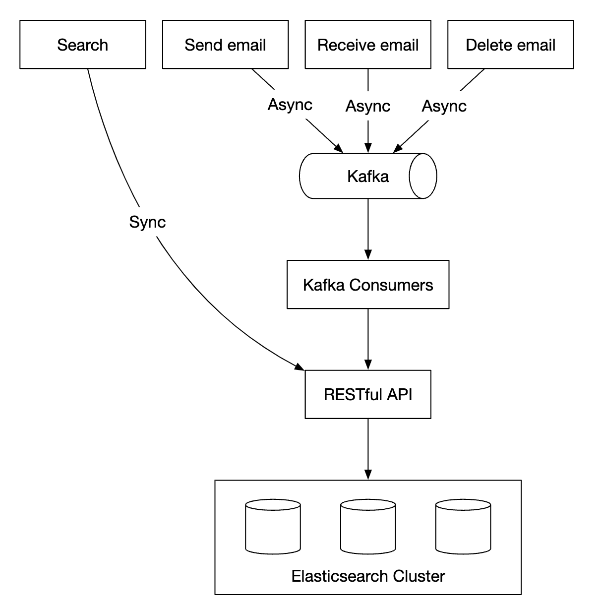
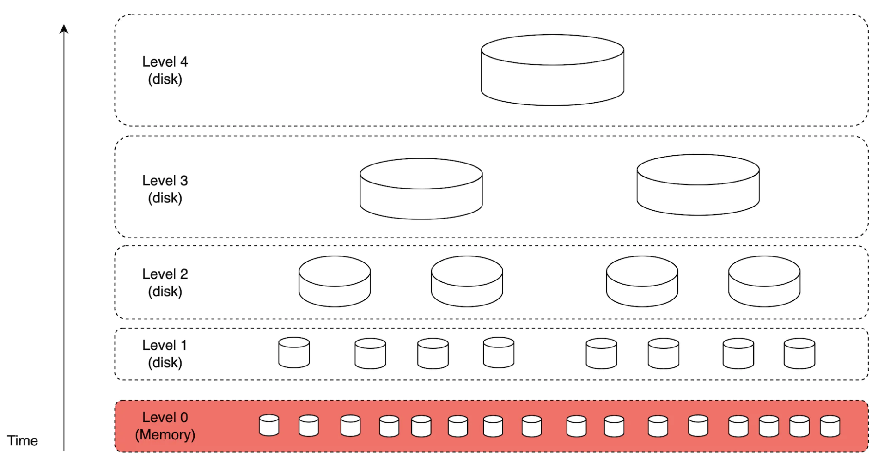

# 23장: 분산 이메일 서비스

## 소개

이 장에서는 **지메일(Gmail)** 과 비슷한 **분산 이메일 서비스(distributed email service)** 를 설계한다.

2020년 기준으로 **지메일**의 활성 사용자는 18억 명, **아웃룩(Outlook)** 의 사용자는 전 세계 4억 명이었다.

---

## 1단계: 문제 이해 및 설계 범위 확정

(지: 지원자, 면: 면접관)
- 지: 시스템 사용자는 몇 명인가요?
- 면: 10억 명입니다.
- 지: 인증, 이메일 발송/수신, 이메일 가져오기, 이메일 필터링, 이메일 검색, 스팸 방지 기능이 중요하다고 생각합니다.
- 면: 좋은 목록입니다. 인증은 일단 신경 쓰지 않아도 됩니다.
- 지: 사용자는 메일 서버에 어떻게 접속하나요?
- 면: 보통 이메일 클라이언트는 SMTP, POP, IMAP으로 접속하지만, 이번 문제에서는 HTTP를 씁니다.
- 지: 이메일에 첨부 파일을 넣을 수 있나요?
- 면: 네.

### **비기능 요구 사항**

- **안정성** - 데이터를 잃어서는 안 된다.
- **가용성** - 다중화로 단일 장애 지점을 없애야 한다. 시스템 일부에 장애가 나도 견뎌야 한다.
- **규모 확장성** - 사용자가 늘어나도 시스템이 감당할 수 있어야 한다.
- **유연성과 확장성** - 시스템이 유연해야 하고 새 기능을 쉽게 추가할 수 있어야 한다. SMTP 같은 메일 프로토콜 대신 HTTP를 택한 이유 중 하나다.

### **개략적인 규모 추정**

- **사용자 10억 명**
- 한 사람이 하루 10통의 이메일을 보낸다고 가정 -> **초당 100,000통**
- 한 사람이 하루 40통의 이메일을 받고, 이메일 하나의 메타데이터가 평균 50 KB라고 가정 -> **연간 730 PB**
- 이메일의 20%에 첨부 파일이 있고, 첨부 파일 평균 크기가 500 KB라고 가정 -> **연간 1,460 PB**

---

## 2단계: 개략적인 설계안 제시 및 동의 구하기

### **이메일 101**

이메일을 보내고 받는 데는 여러 프로토콜이 쓰인다.
- **SMTP** - 한 서버에서 다른 서버로 이메일을 보내는 표준 프로토콜이다.
- **POP** - 원격 메일 서버에서 로컬 클라이언트로 이메일을 받아 내려받는 표준 프로토콜이다. 이메일을 가져오면 원격 서버에서 삭제된다.
- **IMAP** - POP처럼 원격 서버에서 이메일을 받아 내려받는 데 쓰지만, 이메일을 서버에 그대로 둔다.
- **HTTPS** - 엄밀히 말해 이메일 프로토콜은 아니지만, 웹 기반 이메일 클라이언트에 쓸 수 있다.

메일 프로토콜 외에도 이메일 서버를 위해 설정해야 하는 DNS 레코드가 있다. 바로 MX 레코드다.

<div style="margin-left:3rem">
    
</div>

이메일 첨부 파일은 base64로 인코딩해 보내며, 대부분의 메일 서비스는 크기 제한을 보통 25 MB로 둔다.
이 값은 설정할 수 있으며, 개인 계정과 기업 계정에 따라 다르다.

### **전통적인 메일 서버**

전통적인 메일 서버는 사용자가 많지 않아 서버 한 대에 연결될 때 잘 동작한다.

<div style="margin-left:3rem">
    
</div>

- 앨리스가 아웃룩 이메일에 로그인해 '보내기'를 누른다. 이메일은 아웃룩 메일 서버로 전송된다. 통신에는 SMTP를 쓴다.
- 아웃룩 서버는 DNS에 질의해 gmail.com의 MX 레코드를 찾고, 이메일을 지메일 서버로 전송한다. 통신에는 SMTP를 쓴다.
- 밥은 IMAP/POP으로 지메일 서버에서 이메일을 가져온다.

전통적인 메일 서버에서는 이메일을 로컬 파일 시스템에 저장했다. 이메일 하나가 별도의 파일이었다.

<div style="margin-left:3rem">
    
</div>

규모가 커지면서 디스크 I/O가 병목이 되었다. 또한 높은 가용성과 안정성 요구 사항도 만족하지 못한다.
디스크는 손상될 수 있고 서버는 다운될 수 있다.

### **분산 메일 서버**

분산 메일 서버는 현대적인 사용 사례를 지원하고 현대적인 확장성 문제를 해결하도록 설계되었다.

이 서버도 네이티브 이메일 클라이언트를 위한 IMAP/POP과 서버 간 메일 교환을 위한 SMTP를 계속 지원할 수 있다.

하지만 기능이 풍부한 웹 기반 메일 클라이언트에는 보통 HTTP 기반 RESTful API를 쓴다.

API 예:
- `POST /v1/messages` - To, Cc, Bcc 헤더에 지정된 수신자에게 메시지를 보낸다.
- `GET /v1/folders` - 이메일 계정의 모든 폴더를 반환한다.

응답 예:

```
[{id: string        Unique folder identifier.
  name: string      Name of the folder.
                    According to RFC6154 [9], the default folders can be one of
                    the following: All, Archive, Drafts, Flagged, Junk, Sent,
                    and Trash.
  user_id: string   Reference to the account owner
}]
```

- `GET /v1/folders/{:folder_id}/messages` - 폴더 안의 모든 메시지를 페이지 단위로 반환한다.
- `GET /v1/messages/{:message_id}` - 특정 메시지의 모든 정보를 가져온다.

응답 예:

```
{
  user_id: string                      // Reference to the account owner.
  from: {name: string, email: string}  // <name, email> pair of the sender.
  to: [{name: string, email: string}]  // A list of <name, email> paris
  subject: string                      // Subject of an email
  body: string                         //  Message body
  is_read: boolean                     //  Indicate if a message is read or not.
}
```

분산 메일 서버의 개략적인 설계는 다음과 같다.

<div style="margin-left:3rem">
    
</div>

- **웹메일** - 사용자는 웹 브라우저로 이메일을 보내고 받는다.
- **웹 서버** - 로그인, 회원 가입, 사용자 프로필 등을 관리하는, 외부에 공개된 요청/응답 서비스다.
- **실시간 서버** - 새 이메일 소식을 클라이언트에 실시간으로 보낸다. 실시간 통신에는 웹소켓을 쓰되, 웹소켓을 지원하지 않는 오래된 브라우저에는 롱 폴링으로 대체한다.
- **메타데이터 데이터베이스** - 제목, 본문, 발신자, 수신자 등 이메일 메타데이터를 저장한다.
- **첨부 파일 저장소** - 큰 파일을 저장하기에 적합한 객체 저장소(예: Amazon S3)다.
- **분산 캐시** - 최근 이메일을 Redis에 캐시해 사용자 경험을 개선할 수 있다.
- **검색 저장소** - 전문 검색(full-text search)을 지원하는 분산 문서 저장소다.

이메일 발송 흐름은 다음과 같다.

<div style="margin-left:3rem">
    
</div>

- 사용자가 이메일을 작성하고 '보내기'를 누른다. 이메일은 로드밸런서로 전송된다.
- 로드밸런서는 과도한 메일 발송을 처리율 제한으로 막고, 웹 서버 중 하나로 요청을 보낸다.
- 웹 서버는 기본적인 이메일 검증(예: 이메일 크기)을 하고, 수신자 도메인이 발신자와 같으면 외부 발송 흐름을 건너뛴다. 단, 그 전에 스팸 검사를 먼저 한다.
- 기본 검증을 통과하면 이메일을 메시지 큐에 넣는다(첨부 파일은 객체 저장소에서 참조한다).
- 기본 검증에 실패하면 이메일을 오류 큐에 넣는다.
- SMTP 외부 전송 담당 작업 프로세스가 외부 전송 큐에서 메시지를 꺼내 스팸/바이러스 검사를 한 뒤 수신자 메일 서버로 보낸다.
- 이메일은 '보낸 편지함' 폴더에 저장된다.

외부 전송 큐의 크기도 모니터링해야 한다. 큐가 너무 커지면 문제가 있다는 신호일 수 있다.
- 수신자 메일 서버에 장애가 있다. 지수적 백오프(exponential backoff)를 써서 나중에 다시 보내면 된다.
- 부하를 처리할 소비자가 부족하다. 소비자를 늘려야 할 수 있다.

이메일 수신 흐름은 다음과 같다.

<div style="margin-left:3rem">
    
</div>

- 들어오는 이메일은 SMTP 로드밸런서에 도착한다. 메일은 SMTP 서버들로 분산되며, SMTP 서버에서 메일 수락 정책을 적용한다(예: 유효하지 않은 이메일은 바로 버림).
- 첨부 파일이 너무 크면 객체 저장소(S3)에 넣을 수 있다.
- 메일 처리 작업 프로세스가 예비 검사를 한 뒤, 메일을 저장소, 캐시, 객체 저장소, 실시간 서버로 전달한다.
- 오프라인 사용자는 다시 온라인이 되면 HTTP API로 새 이메일을 받는다.

---

## 3단계: 상세 설계

몇몇 컴포넌트를 더 깊이 살펴보자.

### **메타데이터 데이터베이스**

이메일 메타데이터의 특성:
- 헤더는 보통 작고 자주 접근된다.
- 본문 크기는 작은 것부터 큰 것까지 다양하지만, 보통 한 번만 읽힌다.
- 대부분의 메일 작업은 사용자 한 명에 국한된다. 예: 이메일 가져오기, 읽음 표시, 검색
- 데이터가 얼마나 최근 것인지가 데이터 사용에 영향을 준다. 사용자는 보통 최근 이메일만 읽는다.
- 데이터 안정성 요구 사항이 높다. 데이터 손실은 용납되지 않는다.

지메일/아웃룩 규모에서는 초당 입출력 연산 수(IOPS)를 줄이기 위해 보통 데이터베이스를 직접 만들어 쓴다.

어떤 데이터베이스 선택지가 있는지 살펴보자.
- **관계형 데이터베이스** - 헤더와 본문에 색인을 만들 수 있지만, 이런 데이터베이스는 보통 작은 데이터 조각에 최적화되어 있다.
- **분산 객체 저장소** - 백업 저장소로는 좋은 선택이지만, 검색이나 읽음 표시 같은 기능을 효율적으로 지원하지 못한다.
- **NoSQL** - 지메일은 구글 빅테이블(BigTable)을 쓰지만 오픈소스가 아니다.

위 분석을 보면 기존 솔루션 중 요구 사항에 딱 맞는 것은 거의 없어 보인다.
면접에서 새로운 분산 데이터베이스를 설계하는 것은 불가능하지만, 다음 특성은 언급하는 것이 중요하다.
- 칼럼 하나의 크기가 수 MB에 이를 수 있다.
- 강한 데이터 일관성
- 디스크 I/O를 줄이도록 설계
- 높은 가용성과 결함 감내
- 증분 백업을 쉽게 만들 수 있어야 함

데이터를 파티션으로 나누려면 `user_id`를 파티션 키로 써서 한 사용자의 데이터가 샤드 하나에 저장되게 하면 된다.
이렇게 하면 이메일 하나를 여러 사용자가 공유할 수 없지만, 이번 면접의 요구 사항은 아니다.

테이블을 정의해 보자.
- 기본 키는 파티션 키(데이터 분산)와 클러스터링 키(데이터 정렬)로 구성된다.
- 지원해야 할 질의 - 사용자의 모든 폴더 조회, 폴더 안의 모든 이메일 표시, 이메일 생성/조회/삭제, 읽은/읽지 않은 이메일 가져오기, 대화 스레드 조회(보너스)

이후 테이블의 범례:

<div style="margin-left:3rem">
    
</div>

folders 테이블:

<div style="margin-left:3rem">
    
</div>

emails 테이블:

<div style="margin-left:3rem">
    
</div>

- email_id는 timeuuid로, 이메일이 만들어진 시각을 기준으로 정렬할 수 있다.

첨부 파일은 파일 이름으로 식별하는 별도 테이블에 저장한다.

<div style="margin-left:3rem">
    
</div>

읽은/읽지 않은 이메일을 가져오는 기능은 전통적인 관계형 데이터베이스에서는 쉽지만, Cassandra에서는 파티션 키나 클러스터링 키가 아닌 칼럼으로 필터링할 수 없으므로 쉽지 않다.
폴더의 모든 이메일을 가져와 메모리에서 필터링하는 우회책이 있지만, 애플리케이션이 충분히 크면 잘 동작하지 않는다.

대신 emails 테이블을 읽은 이메일 테이블과 읽지 않은 이메일 테이블로 비정규화할 수 있다.

<div style="margin-left:3rem">
    
</div>

대화 스레드를 지원하려면, 메일 클라이언트가 해석해 대화 스레드를 재구성하는 데 쓰는 헤더를 포함하면 된다.

```
{
  "headers" {
     "Message-Id": "<7BA04B2A-430C-4D12-8B57-862103C34501@gmail.com>",
     "In-Reply-To": "<CAEWTXuPfN=LzECjDJtgY9Vu03kgFvJnJUSHTt6TW@gmail.com>",
     "References": ["<7BA04B2A-430C-4D12-8B57-862103C34501@gmail.com>"]
  }
}
```

마지막으로, 이 문제에서는 일관성이 반드시 필요하므로 분산 데이터베이스에서 가용성을 희생하고 일관성을 택한다.

따라서 장애 조치나 네트워크 파티션이 생기면, 영향을 받는 사용자는 잠시 동기화/갱신 작업을 할 수 없다.

### **이메일 전송 가능성**

이메일을 보내는 서버를 구축하기는 쉽지만, 스팸 방지 알고리즘 때문에 이메일을 수신자의 받은 편지함까지 보내기는 어렵다.

새 메일 서버를 구축하고 그냥 메일을 보내기 시작하면 이메일이 스팸함에 들어갈 가능성이 크다.

이를 막으려면 다음과 같이 할 수 있다.
- **전용 IP** - 이메일 발송에 전용 IP를 쓴다. 그렇지 않으면 수신 서버가 신뢰하지 않는다.
- **범주화** - 마케팅 이메일은 같은 서버에서 보내지 않아, 더 중요한 이메일이 스팸으로 분류되지 않게 한다.
- **IP 주소 워밍업** - 대형 이메일 사업자에게 좋은 평판을 쌓도록 IP 주소를 천천히 워밍업한다. 새 IP를 워밍업하는 데 2~6주가 걸린다.
- **스팸 발송자 차단** - 평판이 나빠지지 않도록 스팸 발송자를 빨리 차단한다.
- **피드백 처리** - ISP와 피드백 루프를 구축해 불만 비율을 추적하고 스팸 계정을 빨리 차단한다.
- **이메일 인증** - SPF(Sender Policy Framework), DKIM(DomainKeys Identified Mail) 같은 피싱 방지 기법을 쓴다.

이 내용을 모두 기억할 필요는 없다. 좋은 메일 서버를 만들려면 도메인 지식이 많이 필요하다는 것만 알면 된다.

### **검색**

검색에는 이메일 내용을 대상으로 한 전문 검색과, 발신자, 수신자, 제목, 읽지 않음 등의 필터를 쓰는 고급 질의가 있다.

이메일 검색의 특성 하나는 검색 범위가 사용자 자신의 메일함으로 한정된다는 것이다. 또한 작업이 있을 때마다 색인을 다시 만들어야 하지만 사용자는 검색을 거의 쓰지 않으므로, 읽기보다 쓰기가 많다.

구글 검색과 이메일 검색을 비교해 보자.

|               | 범위                | 정렬                               | 정확도                                          |
|---------------|----------------------|---------------------------------------|---------------------------------------------------|
| 구글 검색 | 인터넷 전체   | 관련성 순으로 정렬                     | 색인에 시간이 걸리므로 결과가 즉시 반영되지 않음 |
| 이메일 검색  | 사용자 자신의 메일함 | 시간, 날짜 등 속성 기준으로 정렬 | 색인이 빨라야 하고 결과가 정확해야 함    |

이 검색 기능을 구현하는 한 가지 방법은 Elasticsearch 클러스터를 쓰는 것이다. `user_id`를 파티션 키로 써서 같은 사용자의 데이터를 같은 노드에 모을 수 있다.

<div style="margin-left:3rem">
    
</div>

데이터를 변경하는 작업은 서비스와 재색인 흐름을 분리하기 위해 Kafka를 통해 비동기로 처리한다.
실제 검색은 동기적으로 처리한다.

Elasticsearch는 가장 인기 있는 검색 엔진 데이터베이스 중 하나이며, 이메일 전문 검색을 아주 잘 지원한다.

또는 우리 요구 사항에 맞는 자체 검색 솔루션을 개발할 수도 있다.

그런 시스템의 설계는 이 장의 범위를 벗어난다. 구축할 때 핵심 과제 하나는 쓰기가 많은 작업 부하에 최적화하는 것이다.

이를 위해 디스크의 색인 데이터를 LSM 트리(Log-Structured Merge-Tree)로 구성할 수 있다. 쓰기 경로는 순차 쓰기만 하도록 최적화된다.
이 기법은 Cassandra, 빅테이블, RocksDB에서 쓰인다.

핵심 아이디어는 미리 정한 임계치에 도달할 때까지 데이터를 메모리에 저장하고, 임계치에 도달하면 다음 계층(디스크)에 병합하는 것이다.

<div style="margin-left:3rem">
    
</div>

두 방법 사이의 주요 트레이드오프:
- Elasticsearch는 어느 정도까지만 확장되지만, 자체 검색 엔진은 이메일 사용 사례에 맞게 세밀하게 조정해 더 크게 확장할 수 있다.
- Elasticsearch는 메타데이터 저장소와 별도로 유지해야 하는 서비스다. 자체 솔루션은 데이터 저장소 자체가 될 수 있다.
- Elasticsearch는 기성 솔루션이지만, 자체 검색 엔진은 구축하는 데 상당한 엔지니어링 노력이 필요하다.

### **규모 확장성과 가용성**

사용자 한 명의 작업은 다른 사용자와 충돌하지 않으므로, 대부분의 컴포넌트를 독립적으로 확장할 수 있다.

고가용성을 보장하기 위해 여러 데이터 센터를 두고, 장애가 나면 리더-팔로워 방식으로 장애 조치할 수도 있다.

<div style="margin-left:3rem">
    
</div>

---

## 4단계: 마무리

추가로 논의할 만한 주제:
- **결함 감내** - 시스템의 많은 부분에 장애가 날 수 있다. 노드 장애를 어떻게 처리할지 논의해 볼 만하다.
- **규정 준수** - 유럽의 GDPR 법규를 고려해 개인 식별 정보(PII)를 적절한 방식으로 저장해야 한다.
- **보안** - 이메일 암호화, 피싱 방지, 안전 브라우징 등
- **최적화** - 예를 들어 여러 사용자가 여러 번 보낸 같은 첨부 파일이 중복 저장되지 않게 한다.
