# 24장: S3와 유사한 객체 저장소

## 소개

이 장에서는 **Amazon S3**와 비슷한 **객체 저장소(object storage)** 서비스를 설계한다.

저장소 시스템은 크게 세 가지로 나뉜다.
- **블록 저장소(block storage)**
- **파일 저장소(file storage)**
- **객체 저장소(object storage)**

**블록 저장소**는 1960년대에 처음 등장한 장치로, HDD와 SSD가 그 예다.
이런 장치는 보통 서버에 물리적으로 연결되지만, 고속 네트워크 프로토콜로 네트워크를 통해 연결할 수도 있다.
서버는 원시 블록을 포맷해 파일 시스템으로 쓸 수도 있고, 블록 제어권을 서버 애플리케이션에 직접 넘길 수도 있다.

**파일 저장소**는 블록 저장소 위에 구축된다. 더 높은 수준의 추상화를 제공해 폴더와 파일을 쉽게 관리할 수 있게 한다.

**객체 저장소**는 높은 내구성, 거대한 규모, 낮은 비용을 위해 성능을 희생한다.
'차가운(cold)' 데이터를 대상으로 하며 주로 보관(archival)과 백업에 쓰인다.
계층적 디렉터리 구조가 없으며, 모든 데이터를 수평적 구조 안에 객체로 저장한다.
다른 저장소 유형에 비해 상대적으로 느리다. 대부분의 클라우드 사업자가 Amazon S3, Google GCS 같은 객체 저장소를 제공한다.

<div style="margin-left:3rem">
    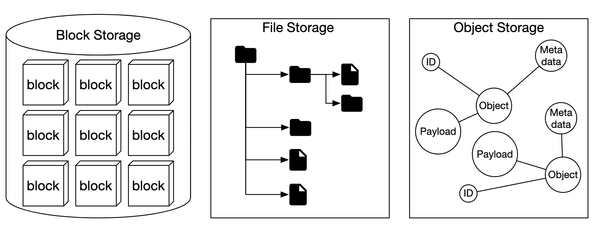
</div>

|                 | 블록 저장소                    | 파일 저장소                            | 객체 저장소                 |
|-----------------|----------------------------------|-----------------------------------------|--------------------------------|
| 내용 변경 | Y                                | Y                                       | N(객체 버전 관리는 지원）     |
| 비용            | 높음                             | 중간~높음                          | 낮음                            |
| 성능     | 중간~높음, 매우 높음        | 중간~높음                          | 낮음~중간                  |
| 일관성     | 강한 일관성               | 강한 일관성                      | 강한 일관성 [5]         |
| 데이터 접근     | SAS/iSCSI/FC                     | 표준 파일 접근, CIFS/SMB, NFS | RESTful API                    |
| 규모 확장성     | 중간 수준                  | 높음                        | 매우 높음               |
| 적합한 용도        | 가상 머신(VM), 데이터베이스 | 범용 파일 시스템 접근      | 이진 데이터, 비정형 데이터 |

객체 저장소 관련 용어:
- **버킷(bucket)** - 객체를 담는 논리적 컨테이너. 이름은 전역적으로 유일해야 한다.
- **객체(object)** - 버킷에 저장되는 개별 데이터. 객체 데이터와 메타데이터를 갖는다.
- **버전(versioning)** - 한 객체의 여러 버전을 같은 버킷 안에 유지하는 기능
- **URI(Uniform Resource Identifier)** - 각 자원은 URI로 고유하게 식별된다.
- **SLA(Service-level Agreement)** - 서비스 제공자와 클라이언트 사이의 계약

Amazon S3 Standard-Infrequent Access 저장소 클래스의 SLA:
- 여러 가용성 구역에 걸쳐 99.999999999%의 객체 내구성
- 가용성 구역 하나가 통째로 소실되어도 데이터 보존
- 99.9% 가용성을 목표로 설계

---

## 1단계: 문제 이해 및 설계 범위 확정

(지: 지원자, 면: 면접관)
- 지: 어떤 기능을 포함해야 하나요?
- 면: 버킷 생성, 객체 업로드/다운로드, 버전 관리, 버킷 안의 객체 목록 조회입니다.
- 지: 데이터 크기는 보통 어느 정도인가요?
- 면: 아주 큰 객체와 작은 객체를 모두 효율적으로 저장할 수 있어야 합니다.
- 지: 한 해에 저장하는 데이터는 얼마나 되나요?
- 면: 100 PB입니다.
- 지: 데이터 내구성은 9 여섯 개(99.9999%), 서비스 가용성은 9 네 개(99.99%)로 가정해도 될까요?
- 면: 네, 합리적인 것 같습니다.

### **비기능 요구 사항**

- **데이터 100 PB**
- **9 여섯 개 수준의 데이터 내구성**
- **9 네 개 수준의 서비스 가용성**
- 저장소 효율성. 높은 안정성과 성능을 유지하면서 저장 비용을 줄인다.

### **개략적인 규모 추정**

객체 저장소는 디스크 용량이나 초당 디스크 IO(IOPS)가 병목이 될 가능성이 크다.

가정:
- 객체의 20%는 작은 객체(1 MB 미만), 60%는 중간 크기 객체(1~64 MB), 20%는 큰 객체(64 MB 초과)다.
- 하드 디스크(SATA, 7200rpm) 하나는 초당 100~150회의 임의 탐색(100~150 IOPS)을 할 수 있다.

이 가정으로 시스템이 저장할 수 있는 객체 수를 추정할 수 있다.
- 계산을 단순화하기 위해 객체 유형별 중앙값 크기를 쓴다 - 작은 객체 0.5 MB, 중간 객체 32 MB, 큰 객체 200 MB
- 저장소가 100 PB(10^11 MB)이고 저장 공간 사용률이 40%라면 약 6.8억 개의 객체를 저장할 수 있다.
- 메타데이터 크기가 1 KB라고 가정하면 메타데이터 저장에 0.68 TB가 필요하다.

---

## 2단계: 개략적인 설계안 제시 및 동의 구하기

설계에 들어가기 전에 객체 저장소의 흥미로운 특성 몇 가지를 살펴보자.
- **객체 불변성(object immutability)** - 객체 저장소의 객체는 변경할 수 없다(다른 저장소 시스템과 다른 점). 삭제하거나 새 버전으로 교체할 수는 있지만 갱신할 수는 없다.
- **키-값 저장소** - 객체 URI가 키이며, HTTP 호출로 객체 내용을 가져올 수 있다.
- **한 번 쓰고 여러 번 읽기** - 데이터 접근 패턴은 한 번 쓰고 여러 번 읽는 것이다. 링크드인 연구에 따르면 연산의 95%가 읽기다.
- 작은 객체와 큰 객체를 모두 지원한다.

객체 저장소의 설계 철학은 유닉스와 비슷하다. 파일을 저장하면 아이노드(inode)라는 자료 구조에 파일 이름을 만들고, 파일 데이터는 디스크의 여러 위치에 저장한다.
아이노드에는 디스크의 여러 위치를 가리키는 파일 블록 포인터 목록이 들어 있다.

파일에 접근할 때는 파일 내용을 가져오기 전에 아이노드에서 메타데이터를 먼저 가져온다.

객체 저장소도 비슷하게 동작한다. 파일 정보는 메타데이터 저장소에, 내용은 디스크에 저장한다.

<div style="margin-left:3rem">
    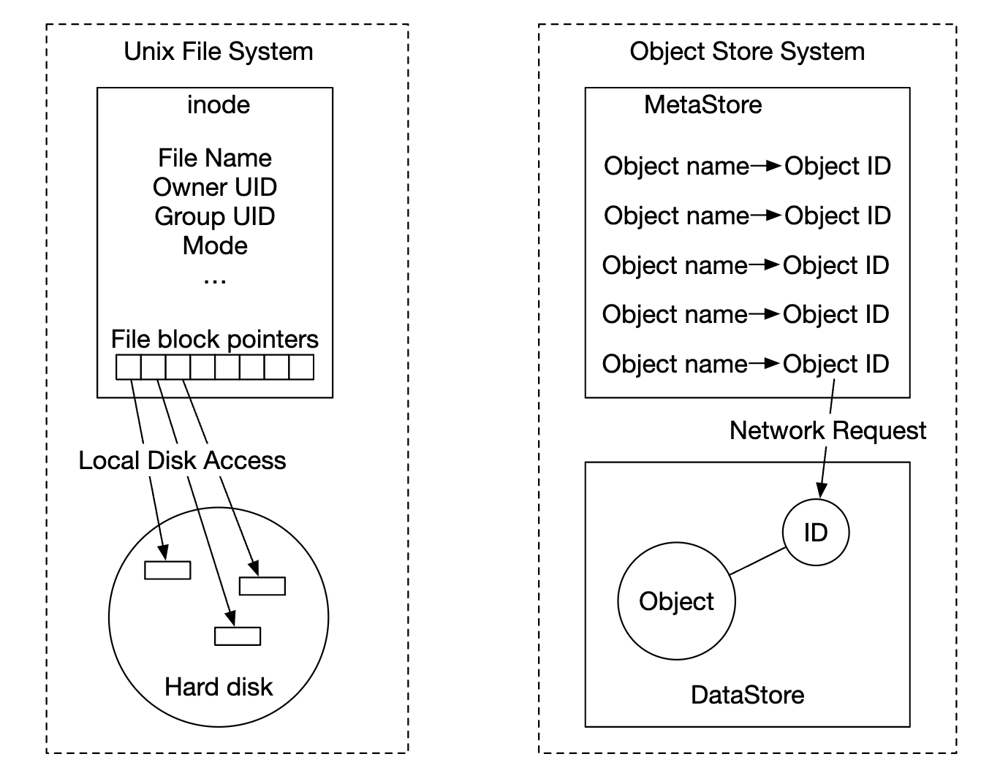
</div>

메타데이터와 파일 내용을 분리하면 각 저장소를 독립적으로 확장할 수 있다.

<div style="margin-left:3rem">
    
</div>

### **개략적인 설계**

<div style="margin-left:3rem">
    
</div>

- **로드밸런서** - API 요청을 서비스 사본들에 분산한다.
- **API 서비스** - 메타데이터 저장소, 객체 저장소, IAM 서비스 호출을 조율하는 무상태 서버다.
- **IAM(Identity and Access Management)** - 인증, 권한 부여, 접근 제어를 중앙에서 맡는다.
- **데이터 저장소** - 실제 데이터를 저장하고 가져온다. 연산은 객체 ID(UUID)를 기준으로 한다.
- **메타데이터 저장소** - 객체 메타데이터를 저장한다.

### **객체 업로드**

<div style="margin-left:3rem">
    
</div>

- HTTP PUT 요청으로 "bucket-to-share"라는 버킷을 만든다.
- API 서비스는 IAM을 호출해 사용자가 인증되었고 쓰기 권한이 있는지 확인한다.
- API 서비스는 메타데이터 저장소를 호출해 버킷 항목을 만든다. 만들어지면 성공 응답을 반환한다.
- 버킷이 만들어지면 "script.txt"라는 객체를 만들기 위해 HTTP PUT 요청을 보낸다.
- API 서비스는 사용자 신원과 쓰기 권한을 확인한다.
- 검증을 통과하면 객체 페이로드를 HTTP PUT으로 데이터 저장소에 보낸다. 데이터 저장소는 이를 저장하고 UUID를 반환한다.
- API 서비스는 메타데이터 저장소를 호출해 object_id, bucket_id, bucket_name 등의 메타데이터를 담은 새 항목을 만든다.

객체 업로드 요청의 예:

```
PUT /bucket-to-share/script.txt HTTP/1.1
Host: foo.s3example.org
Date: Sun, 12 Sept 2021 17:51:00 GMT
Authorization: authorization string
Content-Type: text/plain
Content-Length: 4567
x-amz-meta-author: Alex

[4567 bytes of object data]
```

### **객체 다운로드**

버킷에는 디렉터리 계층이 없지만, 버킷 이름과 객체 이름을 이어 붙여 폴더 구조를 흉내 내는 논리적 계층을 만들 수 있다.

객체를 가져오는 GET 요청의 예:

```
GET /bucket-to-share/script.txt HTTP/1.1
Host: foo.s3example.org
Date: Sun, 12 Sept 2021 18:30:01 GMT
Authorization: authorization string
```

<div style="margin-left:3rem">
    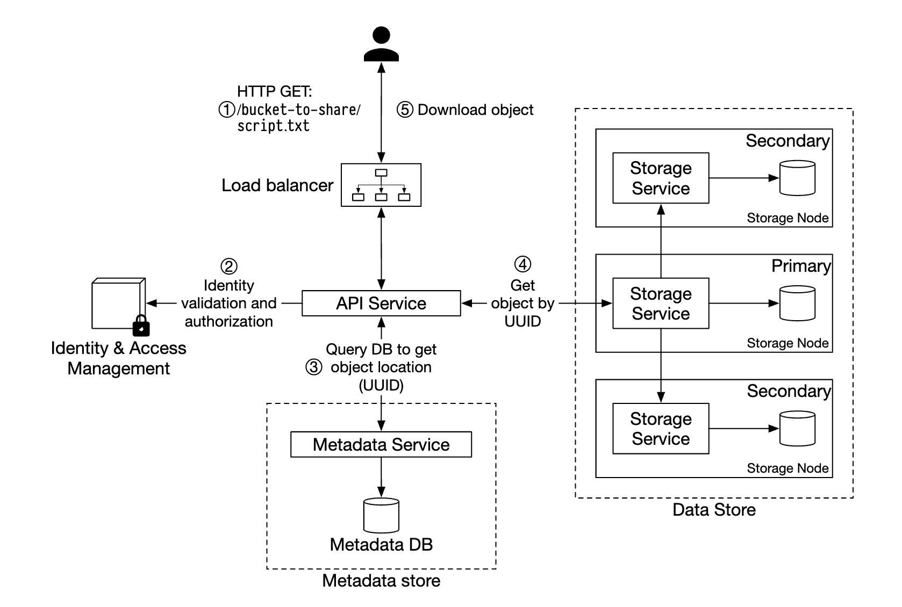
</div>

- 클라이언트가 로드밸런서에 HTTP GET 요청을 보낸다. 예: `GET /bucket-to-share/script.txt`
- API 서비스는 IAM에 질의해 사용자에게 버킷 읽기 권한이 있는지 확인한다.
- 검증을 통과하면 메타데이터 저장소에서 객체의 UUID를 가져온다.
- UUID로 데이터 저장소에서 객체 페이로드를 가져와 클라이언트에 반환한다.

---

// sprint 1

## 3단계: 상세 설계

### **데이터 저장소**

API 서비스와 데이터 저장소의 상호작용은 다음과 같다.

<div style="margin-left:3rem">
    
</div>

데이터 저장소의 주요 컴포넌트:

<div style="margin-left:3rem">
    
</div>

데이터 라우팅 서비스는 데이터 노드 클러스터에 접근하기 위한 RESTful 또는 gRPC API를 제공한다.
서버를 추가해 확장할 수 있는 무상태 서비스다.

주요 역할:
- 배치 서비스(placement service)에 질의해 데이터를 저장할 최적의 데이터 노드를 알아낸다.
- 데이터 노드에서 데이터를 읽어 API 서비스에 반환한다.
- 데이터 노드에 데이터를 기록한다.

배치 서비스는 어느 데이터 노드에 객체를 저장할지 결정한다.
클러스터의 물리적 형상(topology)을 나타내는 가상 클러스터 지도(virtual cluster map)를 유지한다.

<div style="margin-left:3rem">
    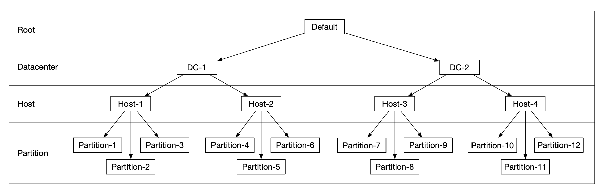
</div>

배치 서비스는 모든 데이터 노드와 박동 메시지를 주고받으며, 노드를 가상 클러스터에서 제거해야 하는지 판단한다.

중요한 서비스이므로 5대 또는 7대 규모의 클러스터로 구성하고 팩서스(Paxos)나 래프트(Raft) 합의 알고리즘으로 동기화하는 것이 좋다.
예를 들어 노드 7대로 구성된 클러스터는 노드 3대의 장애까지 견딘다.

데이터 노드는 실제 객체 데이터를 저장한다.
데이터를 여러 데이터 노드에 다중화해 안정성과 내구성을 보장한다.

각 데이터 노드에서는 배치 서비스로 박동 메시지를 보내는 데몬이 실행된다.

박동 메시지에는 다음 정보가 들어 있다.
- 데이터 노드가 관리하는 디스크 드라이브(HDD 또는 SSD) 수
- 각 드라이브에 저장된 데이터 양

#### 데이터 저장 흐름

<div style="margin-left:3rem">
    
</div>

- API 서비스는 객체 데이터를 데이터 저장소로 전달한다.
- 데이터 라우팅 서비스는 데이터를 주 데이터 노드로 보낸다.
- 주 데이터 노드는 데이터를 로컬에 저장하고 부 데이터 노드 두 대에 다중화한다. 다중화가 성공하면 응답을 보낸다.
- 객체의 UUID를 API 서비스에 반환한다.

참고:
- 객체 UUID가 주어지면, 안정 해시를 써서 그 객체의 다중화 그룹을 결정적으로 고른다.
- 4단계에서 주 데이터 노드는 응답을 반환하기 전에 객체 데이터를 다중화한다. 지연 시간이 길어지더라도 강한 일관성을 택한 것이다.

<div style="margin-left:3rem">
    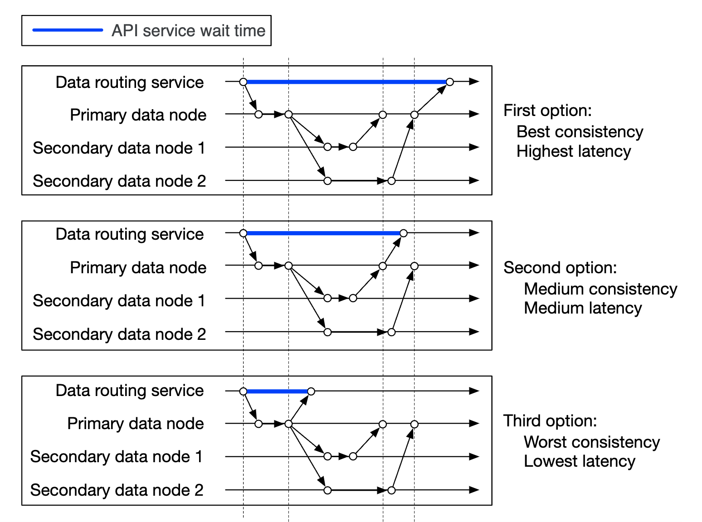
</div>

#### 데이터 구성 방식

데이터를 관리하는 단순한 방법 하나는 객체마다 별도 파일로 저장하는 것이다.

동작은 하지만, 작은 파일이 많으면 파일 시스템 성능이 떨어진다.
- 모든 파일이 블록 크기 전체를 쓰므로 HDD의 데이터 블록이 낭비된다. 보통 블록 크기는 4 KB다.
- 파일이 많으면 아이노드도 많아진다. 운영체제는 아이노드가 너무 많으면 잘 처리하지 못하며, 아이노드 수에는 상한도 있다.

이 문제는 선행 기록 로그(WAL)로 작은 파일 여러 개를 큰 파일 하나로 합쳐 해결할 수 있다. 파일이 용량 한도(보통 수 GB)에 도달하면 새 파일을 만든다.

<div style="margin-left:3rem">
    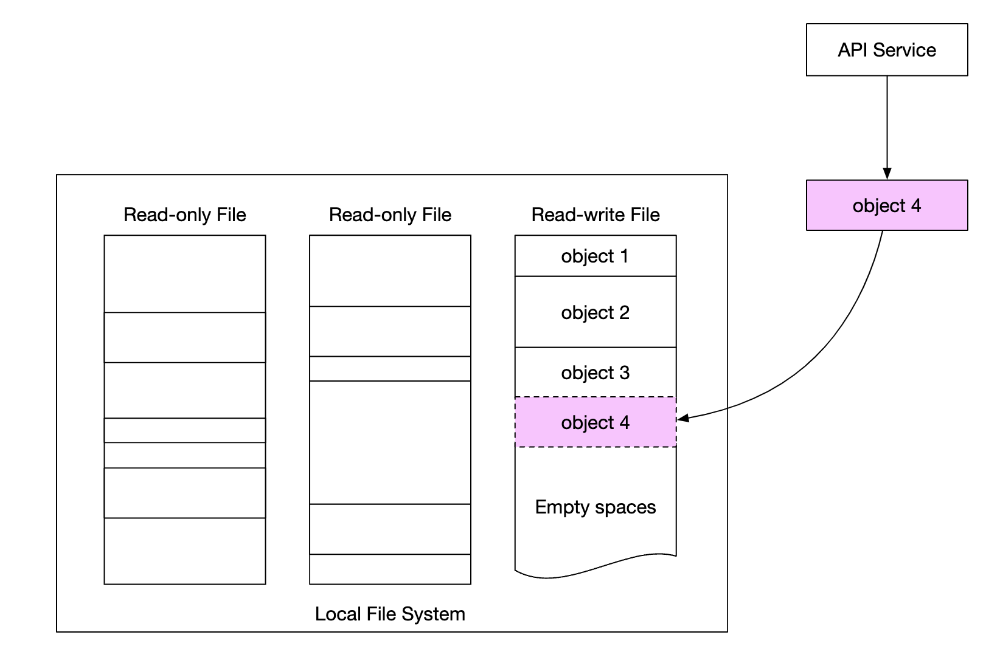
</div>

이 방법의 단점은 파일에 대한 쓰기 접근을 직렬화해야 한다는 것이다. 같은 파일에 접근하는 여러 코어는 서로 기다려야 한다.
이를 해결하려면 파일을 특정 코어에 전담시켜 락 경합을 피한다.

#### 객체 소재 확인

같은 파일에 여러 객체를 저장하려면, 데이터 노드에 다음 정보를 알려 주는 테이블을 유지해야 한다.
- `object_id`
- 객체가 저장된 `filename`
- 객체가 시작되는 `file_offset`
- `object_size`

이 테이블은 RocksDB 같은 파일 기반 데이터베이스나 전통적인 관계형 데이터베이스에 둘 수 있다.
접근 패턴이 쓰기는 적고 읽기는 많으므로 관계형 데이터베이스가 더 낫다.

어떻게 배포해야 할까?
데이터베이스를 별도 클러스터로 배포해 독립적으로 확장하고, 모든 데이터 노드가 접근하게 할 수 있다.

단점:
- 모든 요청을 처리하려면 클러스터를 적극적으로 확장해야 한다.
- 데이터 노드와 데이터베이스 클러스터 사이에 네트워크 지연이 추가된다.

대안은 데이터 노드가 자신과 관련된 데이터에만 관심이 있다는 점을 활용해, 관계형 데이터베이스를 데이터 노드 안에 두는 것이다.

가벼운 파일 기반 관계형 데이터베이스인 SQLite가 좋은 선택이다.

#### 개선된 데이터 저장 흐름

<div style="margin-left:3rem">
    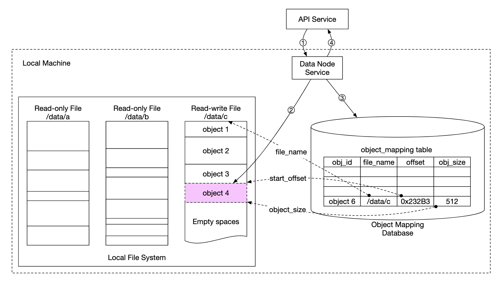
</div>

- API 서비스가 새 객체를 저장하라는 요청을 보낸다.
- 데이터 노드 서비스는 "/data/c"라는 파일의 끝에 새 객체를 추가한다.
- 객체 대응 테이블에 해당 객체의 새 레코드를 추가한다.

#### 데이터 내구성

데이터 내구성은 이 설계의 중요한 요구 사항이다. 9 여섯 개 수준의 내구성을 달성하려면 모든 장애 사례를 꼼꼼히 살펴야 한다.

첫 번째로 다룰 문제는 하드웨어 장애다. 데이터 노드를 다중화해 장애 확률을 최소화할 수 있다.
그 밖에도 서로 다른 장애 도메인(랙, 데이터 센터, 별도 네트워크 등)에 걸쳐 다중화해야 한다.
치명적인 사건 하나가 같은 도메인 안의 하드웨어 여러 대에 장애를 일으킬 수 있기 때문이다.

<div style="margin-left:3rem">
    
</div>

일반적인 HDD의 연간 장애율이 0.81%라고 가정하면, 사본을 세 개 만들면 9 여섯 개 수준의 내구성을 얻는다.

이렇게 데이터 노드를 다중화하면 원하는 내구성을 얻을 수 있지만, 소거 코드(erasure coding)를 활용해 저장 비용을 줄일 수도 있다.

소거 코드는 패리티 비트를 사용해, 장애가 났을 때 잃어버린 비트를 복구할 수 있게 한다.

<div style="margin-left:3rem">
    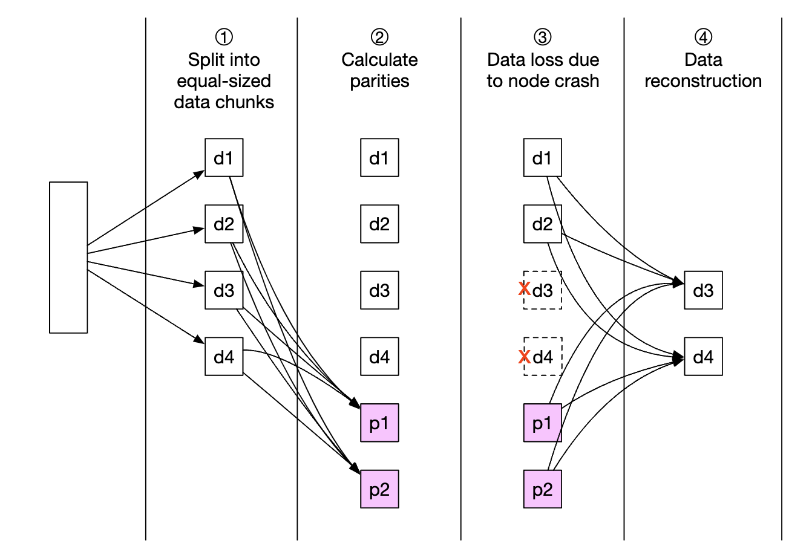
</div>

이 비트들을 데이터 노드라고 생각해 보자. 그중 두 개가 다운되어도 나머지 네 개로 복구할 수 있다.

소거 코드 방식은 여러 가지다. 이 경우 8+4 소거 코드를 쓰고, 안정성을 최대화하기 위해 서로 다른 장애 도메인에 나눠 둘 수 있다.

<div style="margin-left:3rem">
    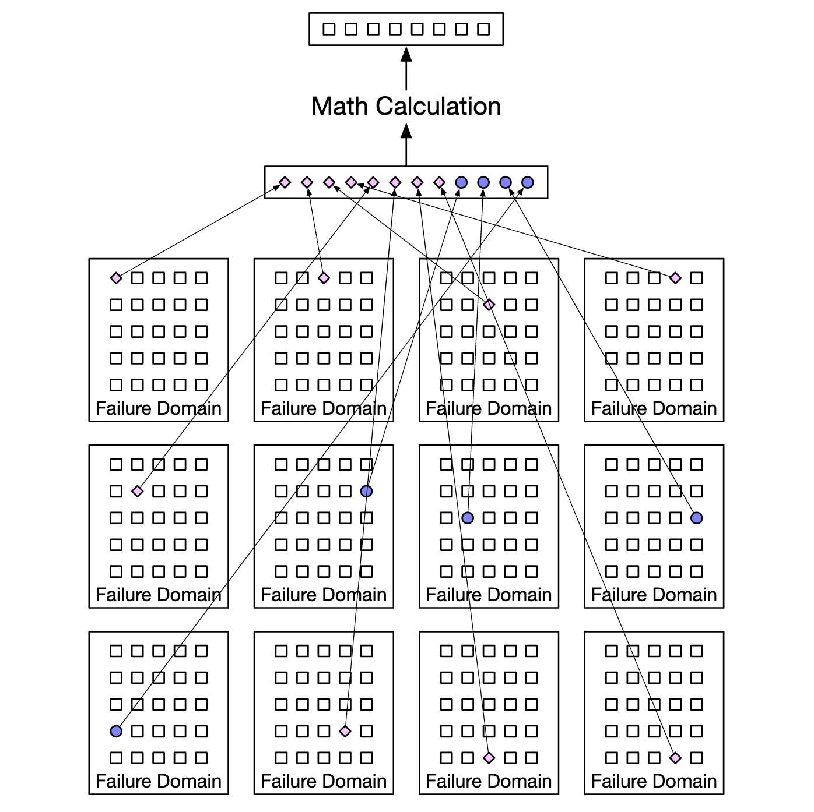
</div>

소거 코드를 쓰면 저장 비용을 훨씬 낮출 수 있다(50% 개선). 대신 데이터 라우팅 서비스가 여러 곳에서 데이터를 모아야 하므로 접근 속도가 느려진다.

<div style="margin-left:3rem">
    
</div>

기타 참고 사항:
- 다중화는 (사본 3개 기준) 200%의 저장 공간 오버헤드가 필요하지만, 소거 코드는 50%면 된다.
- 소거 코드는 [9 열한 개 수준의 내구성](https://github.com/Backblaze/erasure-coding-durability)을 제공하지만, 다중화는 9 여섯 개 수준이다.
- 소거 코드는 패리티를 계산하고 저장하는 데 계산이 더 많이 필요하다.

정리하면, 다중화는 지연 시간에 민감한 애플리케이션에 더 유용하고, 소거 코드는 저장 비용 효율성과 내구성 측면에서 매력적이다.
소거 코드는 구현하기도 훨씬 어렵다.

#### 정확성 검증

디스크 전체에 장애가 나면 쉽게 감지할 수 있다. 하지만 디스크 메모리의 일부만 손상되면 감지하기가 쉽지 않다.

이를 감지하려면 체크섬을 쓰면 된다. 체크섬은 파일 내용의 해시로, 파일의 무결성을 검증하는 데 쓸 수 있다.

이번 설계에서는 파일마다, 그리고 객체마다 체크섬을 저장한다.

<div style="margin-left:3rem">
    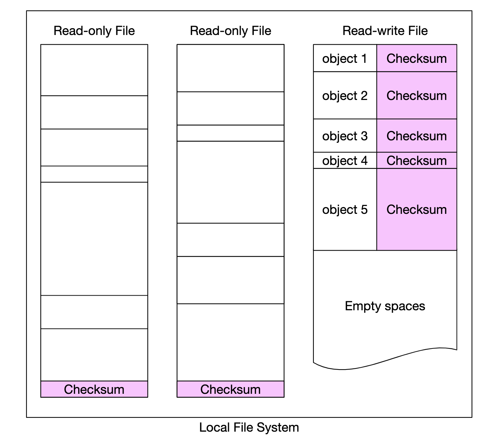
</div>

소거 코드(8+4)를 쓰는 경우에는 데이터 조각 8개를 각각 가져와 각 체크섬을 검증해야 한다.

// sprint 2

### **메타데이터 데이터 모델**

테이블 스키마:

<div style="margin-left:3rem">
    
</div>

지원해야 할 질의:
- 이름으로 객체 ID 찾기
- 이름으로 객체 추가/삭제
- 같은 접두어를 갖는 버킷 안의 객체 목록 조회

보통 사용자가 만들 수 있는 버킷 수에는 제한이 있으므로, 버킷 테이블은 작아서 데이터베이스 서버 한 대에 들어간다.
그래도 읽기 처리량을 위해 서버를 확장할 필요는 있다.

하지만 객체 테이블은 데이터베이스 서버 한 대에 들어가지 않을 것이다. 따라서 샤딩으로 테이블을 확장한다.
- bucket_id로 샤딩하면, 버킷 하나에 객체가 수십억 개 있을 수 있으므로 핫스팟 문제가 생긴다.
- object_id로 샤딩하면 부하는 더 고르게 분산되지만 질의가 느려진다.
- 대부분의 질의가 객체/버킷 이름을 기준으로 하므로 `hash(bucket_name, object_name)`으로 샤딩한다.

하지만 이 샤딩 방식으로도 버킷 안의 객체 목록 조회는 느리다.

### **버킷 내 객체 목록**

데이터베이스가 하나라면, 접두어(디렉터리처럼 보이는 부분)로 객체 목록을 조회하는 질의는 다음과 같다.

```
SELECT * FROM object WHERE bucket_id = "123" AND object_name LIKE `abc/%`
```

데이터베이스가 샤딩되어 있으면 이 질의를 처리하기 어렵다. 모든 샤드에 질의를 실행하고 결과를 메모리에서 합치는 방법이 있다.
하지만 샤드마다 결과 크기가 다르고 샤드별로 limit/offset을 따로 관리해야 하므로 페이지 나누기(pagination)가 어려워진다.

보통 객체 저장소는 객체 목록 조회에 최적화되어 있지 않다는 점을 활용해, 목록 조회 성능을 희생할 수 있다.
또한 버킷 ID로 샤딩한, 목록 조회 전용 비정규화 테이블을 만들 수도 있다.
그러면 목록 조회 질의가 데이터베이스 인스턴스 하나로 한정되어 충분히 빨라진다.

### **객체 버전 관리**

TIMEUUID 타입의 `object_version` 칼럼을 하나 더 두어 버전 관리를 구현한다. 이 칼럼으로 레코드를 정렬할 수 있다.

새 버전마다 새 `object_id`가 만들어진다.

<div style="margin-left:3rem">
    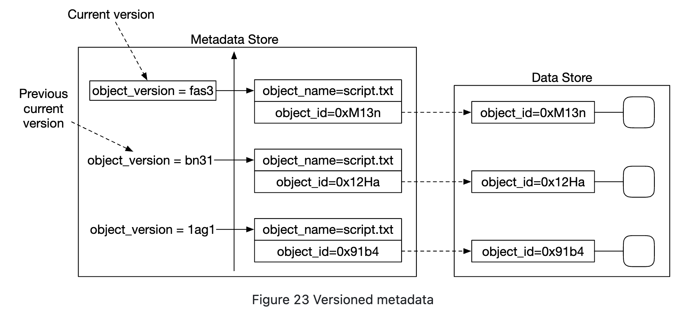
</div>

객체를 삭제하면, 객체가 삭제되었음을 나타내는 특수한 `object_id`를 가진 새 버전이 만들어진다. 이 객체를 조회하면 404를 반환한다.

<div style="margin-left:3rem">
    
</div>

### **큰 파일의 업로드 성능 최적화**

큰 파일 업로드는 멀티파트 업로드(multipart upload)로 최적화할 수 있다. 큰 파일을 여러 조각으로 나눠 각각 독립적으로 업로드하는 방식이다.

<div style="margin-left:3rem">
    
</div>

- 클라이언트가 서비스를 호출해 멀티파트 업로드를 시작한다.
- 데이터 저장소는 업로드를 고유하게 식별하는 업로드 ID를 반환한다.
- 클라이언트는 큰 파일을 여러 조각으로 나누고, 업로드 ID를 써서 각 조각을 독립적으로 업로드한다.
- 조각 하나가 업로드되면 데이터 저장소는 해당 조각을 식별하는 MD5 체크섬인 ETag를 반환한다.
- 모든 조각이 업로드되면 클라이언트는 upload_id, 조각 번호, 모든 ETag를 담은 멀티파트 업로드 완료 요청을 보낸다.
- 데이터 저장소는 조각들로 객체를 재조립한다. 이 과정은 몇 분이 걸릴 수 있다. 끝나면 클라이언트에 성공 응답을 반환한다.

이 시점에 더 이상 쓸모없는 기존 조각들은 제거해도 된다. 이를 처리하는 쓰레기 수집기(garbage collector)를 둘 수 있다.

### **쓰레기 수집**

쓰레기 수집(garbage collection)은 더 이상 쓰지 않는 저장 공간을 회수하는 과정이다. 데이터가 쓰레기가 되는 경우는 몇 가지가 있다.
- **객체의 지연된 삭제(lazy object deletion)** - 객체를 실제로 지우지 않고 삭제되었다고 표시만 한다.
- **갈 곳 없는 데이터(orphan data)** - 예를 들어 업로드가 도중에 실패해 남은 조각들을 지워야 한다.
- **훼손된 데이터(corrupted data)** - 체크섬 검증에 실패한 데이터

쓰레기 수집기는 사본에서 쓰지 않는 공간을 회수하는 일도 맡는다.
다중화를 쓰면 주 사본과 부 사본 모두에서 데이터를 지운다. 소거 코드(8+4)를 쓰면 노드 12개 모두에서 데이터를 지운다.

삭제를 처리하기 위해 정리(compaction)라는 과정을 쓴다.
- 쓰레기 수집기는 삭제되지 않은 객체를 "data/b"에서 "data/d"로 복사한다.
- 복사가 끝나면 데이터베이스 트랜잭션으로 `object_mapping` 테이블을 갱신한다.
- 작은 파일이 너무 많이 생기지 않도록, 일정 크기를 넘은 파일에 대해서만 정리 작업을 한다.

<div style="margin-left:3rem">
    
</div>

---

## 4단계: 마무리

다룬 내용:
- S3와 유사한 객체 저장소 설계
- 객체 저장소, 블록 저장소, 파일 저장소의 차이 비교
- 버킷 안 객체의 업로드, 다운로드, 목록 조회, 버전 관리
- 상세 설계 - 데이터 저장소와 메타데이터 저장소, 다중화와 소거 코드, 멀티파트 업로드, 샤딩
