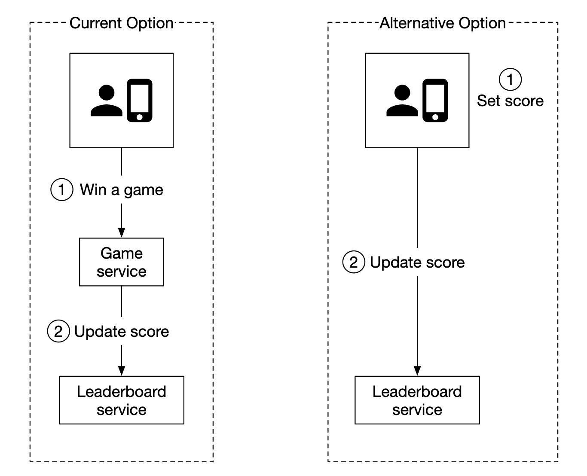
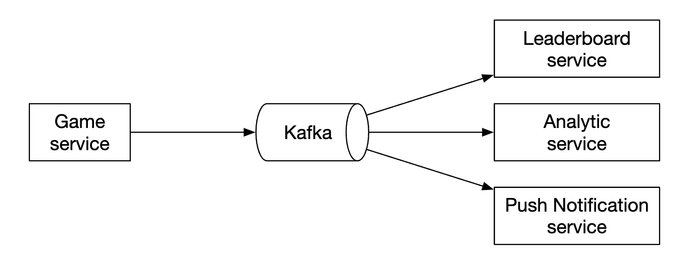
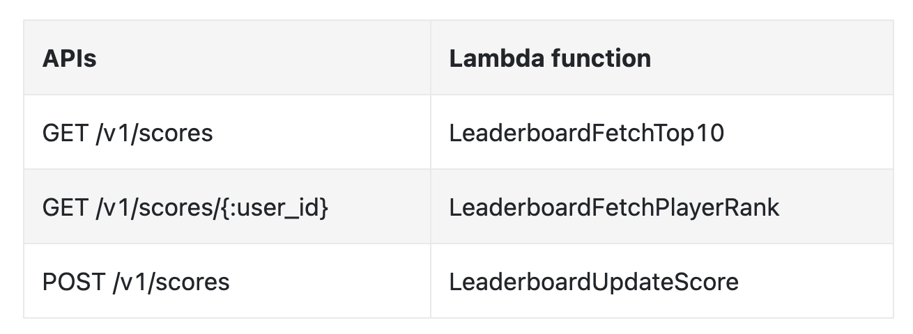
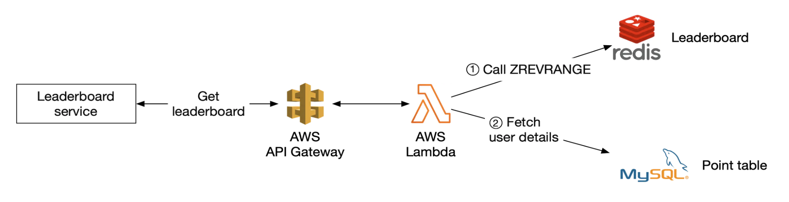
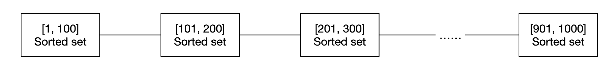
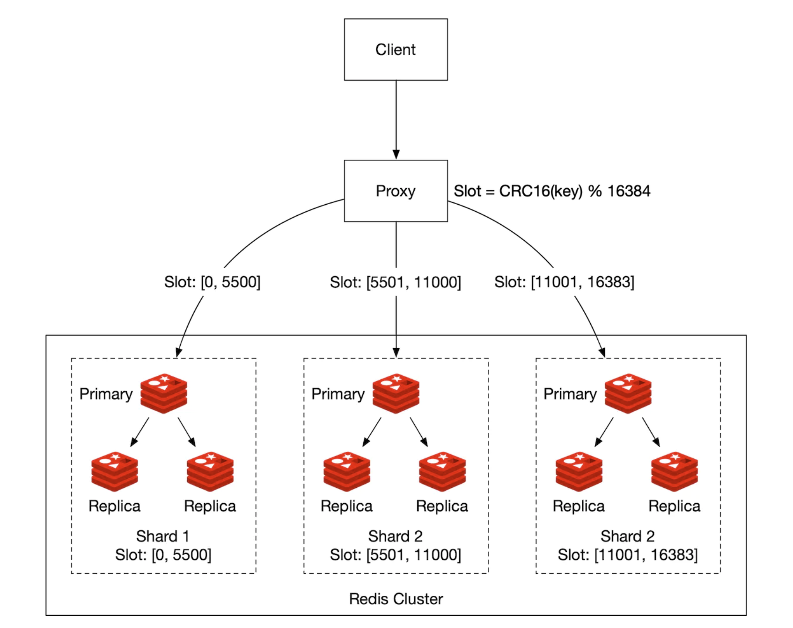
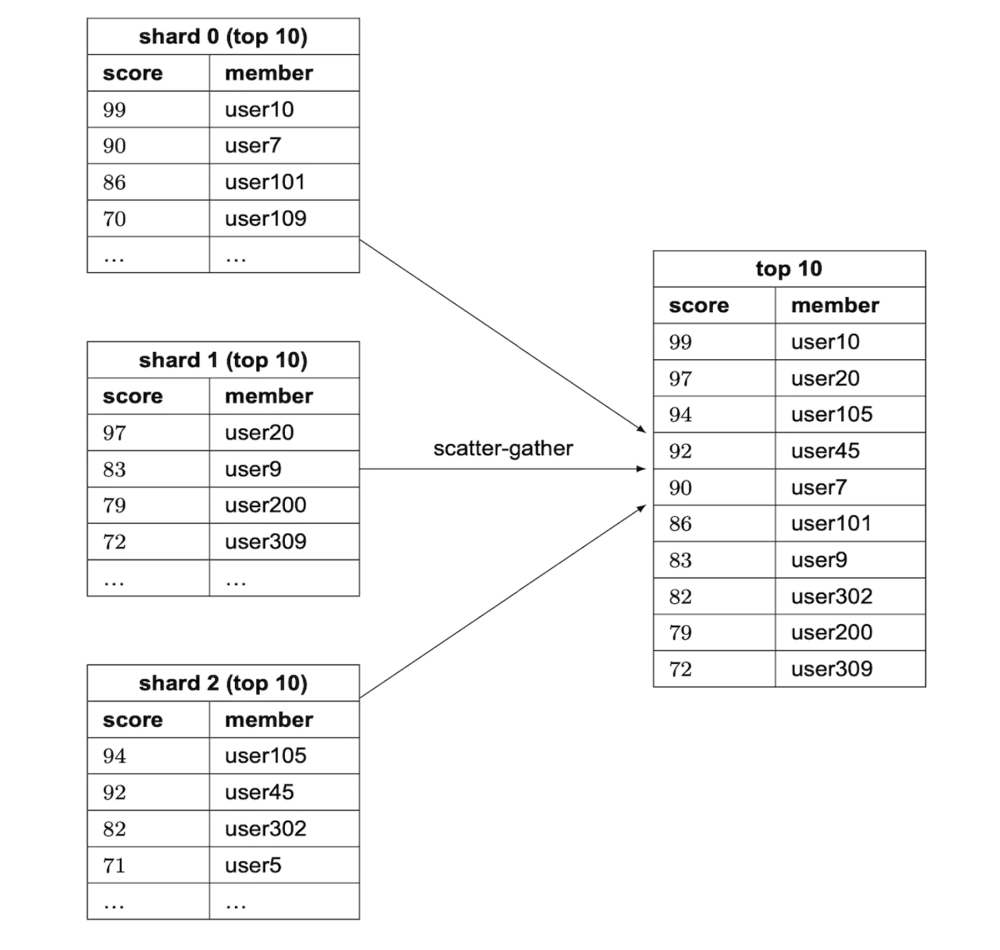

# 25장: 실시간 게임 순위표

## 소개

온라인 모바일 게임의 **순위표(leaderboard)** 를 설계한다.

<div style="margin-left:3rem">
    
</div>

---

## 1단계: 문제 이해 및 설계 범위 확정

(지: 지원자, 면: 면접관)
- 지: 순위표의 점수는 어떻게 계산하나요?
- 면: 사용자는 경기에서 이길 때마다 1점을 얻습니다.
- 지: 모든 플레이어가 순위표에 포함되나요?
- 면: 네.
- 지: 순위표와 연관된 기간이 있나요?
- 면: 매달 새 토너먼트가 시작되며, 그때 새 순위표도 시작됩니다.
- 지: 상위 10명만 신경 쓰면 된다고 가정해도 될까요?
- 면: 상위 10명과 함께 특정 사용자의 순위도 보여 줘야 합니다. 시간이 되면 순위표에서 특정 사용자의 앞뒤 사용자를 보여 주는 기능도 논의할 수 있습니다.
- 지: 토너먼트에 참여하는 사용자는 몇 명인가요?
- 면: DAU 500만 명, MAU 2,500만 명입니다.
- 지: 토너먼트 기간에 평균 몇 경기가 열리나요?
- 면: 플레이어 한 명이 하루 평균 10경기를 합니다.
- 지: 두 플레이어의 점수가 같으면 순위를 어떻게 정하나요?
- 면: 그 경우 순위는 같습니다. 시간이 되면 동점자 순위를 가르는 방법을 논의할 수 있습니다.
- 지: 순위표는 실시간이어야 하나요?
- 면: 네, 실시간이거나 실시간에 최대한 가까운 결과를 보여 줘야 합니다. 일괄 처리된 과거 결과를 보여 주는 것은 안 됩니다.

### **기능 요구 사항**

- 순위표 상위 10명의 플레이어 표시
- 특정 사용자의 순위 표시
- 특정 사용자보다 네 순위 위와 아래에 있는 사용자 표시(보너스)

### **비기능 요구 사항**

- 점수의 실시간 갱신
- 점수 갱신 내역을 순위표에 실시간 반영
- 일반적인 규모 확장성, 가용성, 안정성

### **개략적인 규모 추정**

DAU가 500만 명이고 플레이어가 24시간 동안 고르게 분포한다면, 초당 평균 50명이 접속한다.
하지만 분포는 보통 고르지 않으므로 최대 접속자는 초당 250명으로 추정할 수 있다.

사용자 점수 획득 QPS - 하루 평균 10경기라면 초당 50명 * 10 = 500 QPS다. 최대 QPS = 2,500.

상위 10명 순위표 조회 QPS - 사용자가 하루 평균 한 번 순위표를 연다고 가정하면 QPS는 50이다.

---

## 2단계: 개략적인 설계안 제시 및 동의 구하기

### **API 설계**

첫 번째로 필요한 API는 사용자 점수를 갱신하는 API다.

```
POST /v1/scores
```

이 API는 `user_id`와 경기에서 이겨 얻은 `points`, 두 인자를 받는다.

이 API는 최종 클라이언트가 아니라 게임 서버만 호출할 수 있어야 한다.

다음은 순위표 상위 10명을 가져오는 API다.

```
GET /v1/scores
```

응답 예:

```
{
  "data": [
    {
      "user_id": "user_id1",
      "user_name": "alice",
      "rank": 1,
      "score": 12543
    },
    {
      "user_id": "user_id2",
      "user_name": "bob",
      "rank": 2,
      "score": 11500
    }
  ],
  ...
  "total": 10
}
```

특정 사용자의 점수를 가져올 수도 있다.

```
GET /v1/scores/{:user_id}
```

응답 예:

```
{
    "user_info": {
        "user_id": "user5",
        "score": 1000,
        "rank": 6,
    }
}
```

### **개략적인 아키텍처**

<div style="margin-left:3rem">
    
</div>

- 플레이어가 경기에서 이기면 클라이언트가 게임 서비스에 요청을 보낸다.
- 게임 서비스는 승리가 유효한지 검증하고, 순위표 서비스를 호출해 플레이어의 점수를 갱신한다.
- 순위표 서비스는 순위표 저장소의 사용자 점수를 갱신한다.
- 플레이어는 순위표 서비스를 호출해 상위 10명, 자신의 순위 같은 순위표 데이터를 가져온다.

검토했던 대안 설계는 클라이언트가 순위표 서비스에서 직접 자기 점수를 갱신하는 것이다.

<div style="margin-left:3rem">
    
</div>

이 방법은 중간자 공격(man-in-the-middle attack)에 취약해 안전하지 않다. 플레이어가 프록시를 두고 점수를 마음대로 바꿀 수 있다.

참고로 게임 로직을 서버가 관리하는 게임이라면, 클라이언트가 승리를 기록하기 위해 서버를 명시적으로 호출할 필요가 없다.
서버가 게임 로직에 따라 자동으로 처리한다.

또 하나 고려할 점은 게임 서버와 순위표 서비스 사이에 메시지 큐를 둘지다. 다른 서비스들도 게임 결과를 필요로 한다면 유용하지만, 지금까지 면접에서 명시적인 요구 사항은 아니었으므로 설계에 포함하지 않는다.

<div style="margin-left:3rem">
    
</div>

### **데이터 모델**

순위표 데이터를 저장할 선택지인 관계형 데이터베이스, Redis, NoSQL을 살펴보자.

NoSQL 해법은 상세 설계에서 다룬다.

#### 관계형 데이터베이스 해법

규모가 중요하지 않고 사용자가 많지 않다면 관계형 데이터베이스로 충분하다.

매달 하나씩 만드는 단순한 순위표 테이블에서 시작할 수 있다(원작자 메모 - 이 방식은 합리적이지 않다. `month` 칼럼 하나만 추가하면 매달 새 테이블을 관리하는 번거로움을 피할 수 있다).

<div style="margin-left:3rem">
    
</div>

추가 데이터도 들어갈 수 있지만, 실행할 질의와는 상관없으므로 생략했다.

사용자가 점수를 얻으면 어떻게 될까?

<div style="margin-left:3rem">
    
</div>

사용자가 아직 테이블에 없으면 먼저 추가해야 한다.

```
INSERT INTO leaderboard (user_id, score) VALUES ('mary1934', 1);
```

그 이후로는 점수만 갱신하면 된다.

```
UPDATE leaderboard set score=score + 1 where user_id='mary1934';
```

순위표의 상위 플레이어는 어떻게 찾을까?

<div style="margin-left:3rem">
    
</div>

다음 질의를 실행할 수 있다.

```
SELECT (@rownum := @rownum + 1) AS rank, user_id, score
FROM leaderboard
ORDER BY score DESC;
```

하지만 테이블의 모든 레코드를 정렬하기 위해 테이블 전체를 훑으므로 성능이 좋지 않다.

`score`에 색인을 추가하고 `LIMIT`을 써서 전체를 훑지 않게 최적화할 수 있다.

```
SELECT (@rownum := @rownum + 1) AS rank, user_id, score
FROM leaderboard
ORDER BY score DESC
LIMIT 10;
```

하지만 사용자가 순위표 상위에 있지 않은데 그 사용자의 순위를 알고 싶다면 이 방법은 잘 확장되지 않는다.

#### Redis 해법

복잡한 데이터베이스 질의에 기대지 않고도 수백만 플레이어 규모에서 잘 동작하는 해법을 찾고 싶다.

Redis는 메모리 기반 데이터 저장소로, 메모리에서 동작하므로 빠르고, 요구 사항에 딱 맞는 자료 구조인 정렬 집합(sorted set)을 제공한다.

정렬 집합은 프로그래밍 언어의 집합(set)과 비슷한 자료 구조로, 주어진 기준에 따라 정렬된 상태를 유지한다.
내부적으로는 키(user_id)와 값(score)의 대응 관계를 유지하는 해시 맵과, 점수를 정렬된 순서로 사용자에 대응시키는 스킵 리스트(skip list)로 구현된다.

<div style="margin-left:3rem">
    
</div>

스킵 리스트는 어떻게 동작할까?
- 빠른 검색을 가능하게 하는 연결 리스트다.
- 정렬된 연결 리스트와 다단계 색인으로 구성된다.

<div style="margin-left:3rem">
    
</div>

이 구조 덕분에 데이터가 충분히 많을 때 특정 값을 빠르게 찾을 수 있다.
아래 예(노드 64개)에서 기본 연결 리스트로는 주어진 값을 찾기 위해 노드 62개를 거쳐야 하지만, 스킵 리스트로는 노드 11개만 거치면 된다.

<div style="margin-left:3rem">
    
</div>

정렬 집합은 추가와 검색 연산에 O(logN)이 드는 대신 데이터가 항상 정렬된 상태로 유지되므로 관계형 데이터베이스보다 성능이 좋다.

반대로 관계형 데이터베이스에서 특정 사용자의 순위를 찾으려면 다음과 같은 중첩 질의를 실행해야 한다.

```
SELECT *,(SELECT COUNT(*) FROM leaderboard lb2
WHERE lb2.score >= lb1.score) RANK
FROM leaderboard lb1
WHERE lb1.user_id = {:user_id};
```

Redis로 순위표를 운영하려면 어떤 연산이 필요할까?
- **ZADD** - 사용자가 집합에 없으면 추가하고, 있으면 점수를 갱신한다. 시간 복잡도 O(logN)
- **ZINCRBY** - 사용자 점수를 지정한 값만큼 늘린다. 사용자가 없으면 점수는 0에서 시작한다. 시간 복잡도 O(logN)
- **ZRANGE/ZREVRANGE** - 점수로 정렬된 사용자 범위를 가져온다. 순서(ASC/DESC), 오프셋, 결과 크기를 지정할 수 있다. 시간 복잡도 O(logN+M), M은 결과 크기
- **ZRANK/ZREVRANK** - 오름차순/내림차순 기준으로 사용자의 위치(순위)를 가져온다. 시간 복잡도 O(logN)

사용자가 점수를 얻으면 어떻게 될까?

```
ZINCRBY leaderboard_feb_2021 1 'mary1934'
```

매달 새 순위표가 만들어지고, 이전 순위표는 이력 저장소로 옮겨진다.

사용자가 상위 10명을 조회하면 어떻게 될까?

```
ZREVRANGE leaderboard_feb_2021 0 9 WITHSCORES
```

결과 예:

```
[(user2,score2),(user1,score1),(user5,score5)...]
```

사용자가 순위표에서 자기 위치를 조회하면 어떻게 될까?

<div style="margin-left:3rem">
    
</div>

사용자의 순위표 위치를 안다면 다음 질의로 쉽게 처리할 수 있다.

```
ZREVRANGE leaderboard_feb_2021 357 365
```

사용자의 위치는 `ZREVRANK <user-id>`로 가져올 수 있다.

저장소 요구량을 살펴보자.
- 최악의 경우, 한 달 동안 MAU 2,500만 명 전원이 게임에 참여한다고 가정한다.
- ID가 24자 문자열이고 점수가 16비트 정수라면 26바이트 * 2,500만 = 약 650 MB가 필요하다.
- 스킵 리스트 오버헤드 때문에 저장 공간을 두 배로 잡더라도 현대적인 Redis 클러스터에 충분히 들어간다.

고려할 또 다른 비기능 요구 사항은 초당 2,500건의 갱신을 지원하는 것이다. Redis 서버 한 대로 충분히 감당할 수 있다.

추가 참고 사항:
- Redis 서버가 죽었을 때 데이터를 잃지 않도록 Redis 사본을 둘 수 있다.
- 장애가 나도 데이터를 잃지 않도록 Redis 영속성 기능을 활용할 수도 있다.
- 사용자 이름, 표시 이름 같은 사용자 상세 정보를 가져오고, 사용자가 경기에서 이긴 시점 등을 저장하기 위해 MySQL에 보조 테이블 두 개가 필요하다.
- MySQL의 두 번째 테이블은 인프라 장애가 났을 때 순위표를 재구성하는 데 쓸 수 있다.
- 작은 성능 최적화로, 자주 조회되는 상위 10명의 사용자 상세 정보를 캐시할 수 있다.

---

## 3단계: 상세 설계

### **클라우드 서비스 사용 여부**

서비스를 직접 배포하고 관리할 수도 있고, 클라우드 사업자가 관리하게 할 수도 있다.

직접 관리한다면 순위표 데이터에는 Redis, 사용자 프로필에는 MySQL을 쓰고, 데이터베이스를 확장해야 한다면 사용자 프로필용 캐시도 둘 수 있다.

<div style="margin-left:3rem">
    
</div>

또는 클라우드 서비스로 많은 부분을 관리하게 할 수 있다. 예를 들어 AWS API Gateway로 API 호출을 AWS Lambda 함수에 연결할 수 있다.

<div style="margin-left:3rem">
    
</div>

AWS Lambda를 쓰면 서버를 직접 관리하거나 준비하지 않고 코드를 실행할 수 있다. 필요할 때만 실행되고 자동으로 확장된다.

사용자 점수 획득 예:

<div style="margin-left:3rem">
    
</div>

사용자 순위표 조회 예:

<div style="margin-left:3rem">
    
</div>

Lambda는 서버리스(serverless) 아키텍처의 구현체다. 규모 확장과 환경 설정을 직접 관리할 필요가 없다.

저자는 게임을 처음부터 만든다면 이 방법을 권한다.

### **Redis 규모 확장**

DAU 500만 명이라면 저장 공간과 QPS 측면 모두에서 Redis 인스턴스 하나로 충분하다.

하지만 사용자가 10배 늘어 DAU가 5억 명이 된다고 상상해 보면, 저장 공간은 65 GB가 필요하고 QPS는 250k가 된다.

이 규모라면 샤딩이 필요하다.

한 가지 방법은 데이터를 범위 기반으로 분할(range partitioning)하는 것이다.

<div style="margin-left:3rem">
    
</div>

이 예에서는 사용자 점수를 기준으로 샤딩한다. user_id와 샤드 사이의 대응 관계는 애플리케이션 코드에서 관리한다.
대응 관계 자체는 MySQL이나 별도 캐시에 둘 수 있다.

상위 10명을 가져오려면 점수가 가장 높은 샤드(`[900-1000]`)에 질의하면 된다.

사용자의 순위를 가져오려면 사용자가 속한 샤드 안에서 순위를 계산하고, 다른 샤드에서 점수가 더 높은 사용자 수를 모두 더해야 한다.
뒤의 연산은 info keyspace 명령으로 샤드별 전체 레코드 수를 바로 알 수 있으므로 O(1)이다.

또는 Redis 클러스터로 해시 기반 분할(hash partitioning)을 쓸 수 있다. 안정 해시와 비슷하지만 똑같지는 않은 분할 방식에 따라 데이터를 Redis 노드들에 분산한다.

<div style="margin-left:3rem">
    
</div>

이 구성에서는 상위 10명을 계산하기가 어렵다. 샤드마다 상위 10명을 가져와 애플리케이션에서 결과를 합쳐야 한다.

<div style="margin-left:3rem">
    
</div>

해시 기반 분할에는 몇 가지 한계가 있다.
- 상위 K명을 가져와야 하는데 K가 크면, 모든 샤드에서 많은 데이터를 가져와야 하므로 지연 시간이 늘어난다.
- 파티션 수가 늘어날수록 지연 시간도 늘어난다.
- 사용자의 순위를 정하는 간단한 방법이 없다.

이런 이유로 저자는 이 문제에 고정 파티션 방식을 선호한다.

기타 참고 사항:
- 쓰기가 많은 Redis 노드에는 필요할 때 스냅숏을 담을 수 있도록 필요한 메모리의 두 배를 할당하는 것이 좋다.
- Redis-benchmark라는 도구로 Redis 구성의 성능을 측정하고 데이터에 기반해 결정할 수 있다.

### **대안: NoSQL**

고려할 만한 대안은 다음에 최적화된 NoSQL 데이터베이스를 쓰는 것이다.
- 많은 쓰기 연산
- 같은 파티션 안의 항목을 점수로 효율적으로 정렬

DynamoDB, Cassandra, MongoDB 모두 잘 맞는다.

이 장에서 저자는 DynamoDB를 쓰기로 했다. 안정적인 성능과 뛰어난 확장성을 제공하는 완전 관리형 NoSQL 데이터베이스다.
기본 키에 포함되지 않은 필드로 질의해야 할 때 전역 보조 색인(global secondary index)도 쓸 수 있다.

<div style="margin-left:3rem">
    
</div>

체스 게임 순위표를 저장하는 테이블부터 시작해 보자.

<div style="margin-left:3rem">
    
</div>

이 테이블은 잘 동작하지만, 점수로 질의해야 할 때는 잘 확장되지 않는다. 그래서 점수를 정렬 키(sort key)로 둔다.

<div style="margin-left:3rem">
    
</div>

이 설계의 또 다른 문제는 월 단위로 파티션을 나눈다는 점이다. 최근 달에 접근이 몰리므로 핫스팟 파티션이 생긴다.

쓰기 샤딩(write sharding)이라는 기법을 쓸 수 있다. 키마다 `user_id % num_partitions`로 계산한 파티션 번호를 덧붙이는 방법이다.

<div style="margin-left:3rem">
    
</div>

고려해야 할 중요한 트레이드오프는 파티션을 몇 개로 할지다.
- 파티션이 많을수록 쓰기 확장성은 높아진다.
- 하지만 집계 결과를 모으려면 더 많은 파티션에 질의해야 하므로 읽기 확장성은 떨어진다.

이 방법을 쓰면 앞에서 본 '분산-수집(scatter-gather)' 기법을 써야 하며, 파티션이 늘어날수록 시간 복잡도도 커진다.

<div style="margin-left:3rem">
    
</div>

파티션 수를 잘 정하려면 벤치마크가 필요하다.

이 NoSQL 방법에도 여전히 큰 단점이 하나 있다. 사용자의 정확한 순위를 계산하기 어렵다는 것이다.

샤딩이 필요할 만큼 규모가 크다면, 사용자에게 점수가 상위 몇 퍼센트(percentile)에 속하는지 알려 주는 방법도 있다.

크론 작업을 주기적으로 실행해 점수 분포를 분석하고, 이를 바탕으로 사용자의 백분위를 정할 수 있다. 예를 들면 다음과 같다.

```
10th percentile = score < 100
20th percentile = score < 500
...
90th percentile = score < 6500
```

---

## 4단계: 마무리

시간이 남으면 논의할 만한 주제:
- **더 빠른 조회** - `user_id -> user object` 대응 관계를 가진 Redis 해시로 사용자 객체를 캐시할 수 있다. 데이터베이스에 질의하는 것보다 빠르게 조회할 수 있다.
- **동점자 순위 가르기** - 두 플레이어의 점수가 같으면 마지막으로 경기한 시각을 기준으로 정렬해 순위를 가를 수 있다.
- **시스템 장애 복구** - Redis에 대규모 장애가 나면, MySQL WAL 항목을 훑는 임시 스크립트로 순위표를 다시 만들 수 있다.
