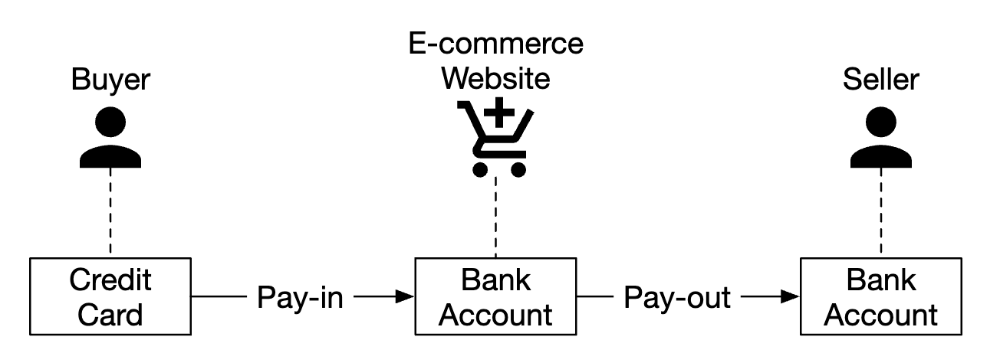
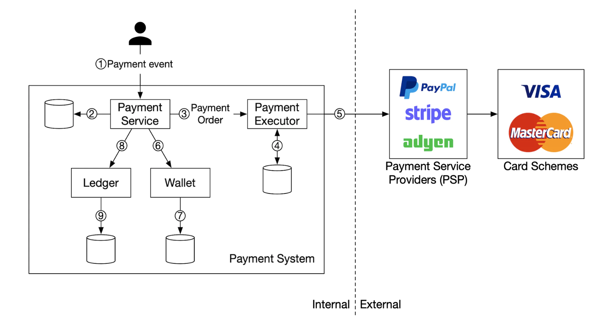
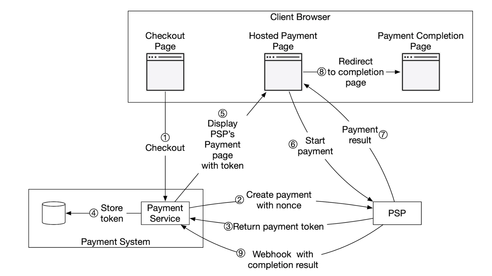
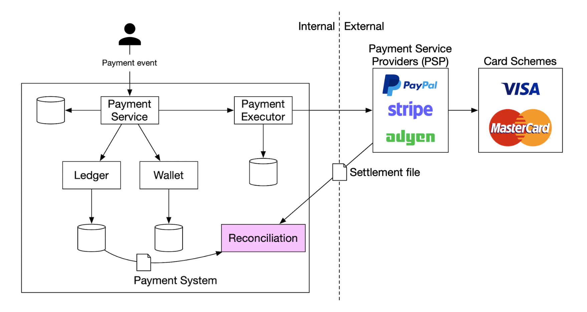
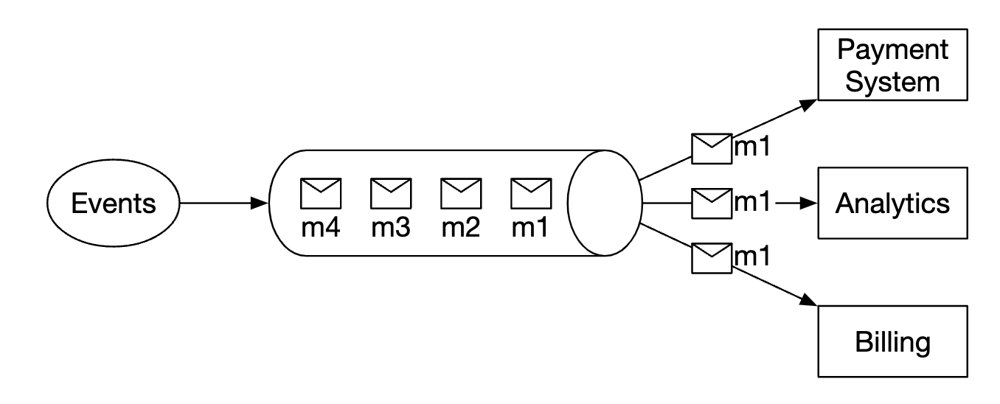

# 26장: 결제 시스템

## 소개
이 장에서는 현대 **전자상거래**의 토대인 **결제 시스템(payment system)** 을 설계한다.

**결제 시스템**은 금전적 가치를 이전해 금융 거래를 정산하는 데 쓰인다.

---

## 1단계: 문제 이해 및 설계 범위 확정
(지: 지원자, 면: 면접관)
 * 지: 어떤 결제 시스템을 만드나요?
 * 면: 아마존닷컴 같은 전자상거래 시스템의 결제 백엔드입니다. 돈의 이동과 관련된 모든 것을 처리합니다.
 * 지: 어떤 결제 수단을 지원하나요? 신용카드, 페이팔, 은행 카드 등이요.
 * 면: 실제로는 모두 지원해야 합니다. 이번 면접에서는 신용카드 결제를 예로 들겠습니다.
 * 지: 신용카드 결제 처리를 직접 하나요?
 * 면: 아니요. Stripe, Braintree, Square 같은 제3자 사업자를 씁니다.
 * 지: 신용카드 데이터를 시스템에 저장하나요?
 * 면: 규정 준수 문제로 신용카드 데이터를 시스템에 직접 저장하지 않습니다. 제3자 결제 처리 업체에 맡깁니다.
 * 지: 전 세계를 대상으로 하나요? 여러 통화와 국제 결제를 지원해야 하나요?
 * 면: 전 세계를 대상으로 하지만, 이번 면접에서는 통화 하나만 쓴다고 가정합니다.
 * 지: 하루 결제 건수는 얼마나 되나요?
 * 면: 하루 100만 건입니다.
 * 지: 예를 들어 매달 판매자에게 대금을 지급하는 정산 흐름도 지원해야 하나요?
 * 면: 네, 지원해야 합니다.
 * 지: 그 밖에 신경 써야 할 점이 있나요?
 * 면: 내부·외부 시스템과 통신하면서 생기는 불일치를 바로잡기 위한 대사(reconciliation)를 지원해야 합니다.

### **기능 요구 사항**
 * 대금 수신(pay-in) 흐름 - 결제 시스템이 판매자를 대신해 고객으로부터 대금을 받는다.
 * 대금 정산(pay-out) 흐름 - 결제 시스템이 전 세계의 판매자에게 대금을 보낸다.

### **비기능 요구 사항**
 * 안정성과 결함 감내. 실패한 결제는 신중하게 처리해야 한다.
 * 내부 시스템과 외부 시스템 사이의 대사 절차를 갖춰야 한다.

### **개략적인 규모 추정**
시스템은 하루 100만 건, 즉 초당 10건의 거래를 처리해야 한다.

어떤 데이터베이스 시스템에도 높은 처리량이 아니므로, 이번 면접의 초점은 아니다.

---

## 2단계: 개략적인 설계안 제시 및 동의 구하기
개략적으로 보면 돈의 이동에는 세 주체가 참여한다.

<div style="margin-left:3rem">
    
</div>

### **대금 수신 흐름**
대금 수신 흐름의 개요는 다음과 같다.

<div style="margin-left:3rem">
    
</div>

 * 결제 서비스(payment service) - 결제 이벤트를 받아 결제 과정을 조율한다. 보통 제3자 사업자를 통해 자금 세탁 방지(AML) 규정 위반이나 범죄 행위 여부를 확인하는 위험 점검도 한다.
 * 결제 실행자(payment executor) - 결제 대행사(PSP)를 통해 결제 주문 하나를 실행한다. 결제 이벤트 하나에 결제 주문이 여러 개 있을 수 있다.
 * 결제 대행사(Payment Service Provider, PSP) - 한 계좌에서 다른 계좌로 돈을 옮긴다. 예를 들어 구매자의 신용카드 계좌에서 전자상거래 사이트의 은행 계좌로 옮긴다.
 * 카드 유형(card scheme) - 비자, 마스터카드 등 신용카드 업무를 처리하는 조직이다.
 * 원장(ledger) - 모든 결제 거래의 재무 기록을 보관한다.
 * 지갑(wallet) - 모든 판매자의 계정 잔액을 기록한다.

대금 수신 흐름의 예:
 * 사용자가 '주문하기'를 누르면 결제 이벤트가 결제 서비스로 전송된다.
 * 결제 서비스는 이벤트를 데이터베이스에 저장한다.
 * 결제 서비스는 그 결제 이벤트에 포함된 모든 결제 주문에 대해 결제 실행자를 호출한다.
 * 결제 실행자는 결제 주문을 데이터베이스에 저장한다.
 * 결제 실행자는 외부 PSP를 호출해 신용카드 결제를 처리한다.
 * 결제 실행자가 결제를 처리하면, 결제 서비스는 지갑을 갱신해 판매자가 얼마를 갖고 있는지 기록한다.
 * 지갑 서비스는 갱신된 잔액 정보를 데이터베이스에 저장한다.
 * 결제 서비스는 원장을 호출해 모든 돈의 이동을 기록한다.

### **결제 서비스 API**
```
POST /v1/payments
{
  "buyer_info": {...},
  "checkout_id": "some_id",
  "credit_card_info": {...},
  "payment_orders": [{...}, {...}, {...}]
}
```

`payment_order`의 예:
```
{
  "seller_account": "SELLER_IBAN",
  "amount": "3.15",
  "currency": "USD",
  "payment_order_id": "globally_unique_payment_id"
}
```

참고:
 * `payment_order_id`는 결제 중복을 막기 위해 PSP로 전달된다. 즉, 멱등 키다.
 * `double`은 금액을 표현하기에 적합하지 않으므로 amount 필드는 `string`이다.

```
GET /v1/payments/{:id}
```

이 엔드포인트는 `payment_order_id`로 결제 하나의 실행 상태를 반환한다.

### **결제 서비스 데이터 모델**
`payment_events`와 `payment_orders`, 두 테이블을 유지해야 한다.

결제에서는 보통 성능이 중요한 요소가 아니다. 대신 강한 일관성이 중요하다.

데이터베이스를 고를 때 고려할 다른 사항:
 * 데이터베이스를 관리할 DBA를 쉽게 채용할 수 있는가
 * 다른 대형 금융 기관에서 쓰인 검증된 실적이 있는가
 * 지원 도구가 풍부한가
 * ACID를 보장하므로 NoSQL/NewSQL보다 전통적인 SQL을 선호한다.

`payment_events` 테이블의 칼럼:
 * `checkout_id` - string, 기본 키
 * `buyer_info` - string(원작자 메모 - 다른 테이블을 가리키는 외래 키가 더 적절해 보임)
 * `seller_info` - string(원작자 메모 - 위와 같음)
 * `credit_card_info` - 카드 사업자에 따라 다름
 * `is_payment_done` - boolean

`payment_orders` 테이블의 칼럼:
 * `payment_order_id` - string, 기본 키
 * `buyer_account` - string
 * `amount` - string
 * `currency` - string
 * `checkout_id` - string, 외래 키
 * `payment_order_status` - enum(`NOT_STARTED`, `EXECUTING`, `SUCCESS`, `FAILED`)
 * `ledger_updated` - boolean
 * `wallet_updated` - boolean

참고:
 * 결제 이벤트 하나에 여러 결제 주문이 연결된다.
 * `seller_info`는 대금 수신 흐름에는 필요 없고 대금 정산에만 필요하다.
 * `ledger_updated`와 `wallet_updated`는 결제 결과를 기록하기 위해 해당 서비스를 호출할 때 갱신된다.
 * 결제 상태 전이는 백그라운드 작업이 관리한다. 이 작업은 진행 중인 결제의 갱신 여부를 확인하고, 결제가 적절한 시간 안에 처리되지 않으면 경보를 보낸다.

### **복식부기 원장 시스템**
복식부기(double-entry) 회계 방식은 모든 결제 시스템의 핵심이다. 돈의 이동을 추적하기 위해 모든 거래를 항상 두 계좌에 기록하는 방식으로, 한 계좌의 잔액은 늘어나고(대변, credit) 다른 계좌의 잔액은 줄어든다(차변, debit).

| 계좌 | 차변 | 대변 |
|---------|-------|--------|
| 구매자   | $1    |        |
| 판매자  |       | $1     |

모든 거래 항목의 합은 항상 0이다. 이 방식으로 시스템 안에서 일어나는 모든 돈의 이동을 처음부터 끝까지 추적할 수 있다.

### **외부 결제 페이지**
신용카드 정보를 저장하고 각종 까다로운 규정을 준수해야 하는 부담을 피하기 위해, 대부분의 회사는 PSP가 제공하는 위젯을 선호한다. 이 위젯이 신용카드 결제를 저장하고 처리해 준다.

<div style="margin-left:3rem">
    
</div>

### **대금 정산 흐름**
대금 정산 흐름의 컴포넌트는 대금 수신 흐름과 매우 비슷하다.

주요 차이점:
 * 돈은 전자상거래 사이트의 은행 계좌에서 판매자의 은행 계좌로 이동한다.
 * Tipalti 같은 제3자 매입 채무(account payable) 서비스를 쓸 수 있다.
 * 대금 정산과 관련해서도 처리해야 할 장부 기록과 규제 요구 사항이 많다.

---

## 3단계: 상세 설계
이 절에서는 시스템을 더 빠르고, 견고하고, 안전하게 만드는 데 집중한다.

### **PSP 연동**
시스템이 은행이나 카드 유형에 직접 연결될 수 있다면 PSP 없이도 결제할 수 있다.
이런 연결은 매우 드물며, 보통 그만한 투자를 정당화할 수 있는 대기업에서나 한다.

전통적인 방식을 따른다면 PSP는 두 가지 방법 중 하나로 연동할 수 있다.
 * 결제 시스템이 결제 정보를 수집할 수 있다면 API로 연동한다.
 * 결제 정보 관련 규정을 다루지 않으려면 외부 결제 페이지로 연동한다.

외부 결제 페이지의 작업 흐름은 다음과 같다.

<div style="margin-left:3rem">
    
</div>

 * 사용자가 브라우저에서 '결제' 버튼을 누른다.
 * 클라이언트가 결제 주문 정보를 담아 결제 서비스를 호출한다.
 * 결제 주문 정보를 받은 결제 서비스는 PSP에 결제 등록 요청을 보낸다.
 * PSP는 통화, 금액, 만료일 같은 결제 정보와 멱등성을 위한 UUID를 받는다. UUID는 보통 결제 주문의 UUID다.
 * PSP는 결제 등록을 고유하게 식별하는 토큰을 반환한다. 토큰은 결제 서비스 데이터베이스에 저장된다.
 * 토큰이 저장되면 사용자에게 PSP가 제공하는 결제 페이지를 보여 준다. 이 페이지는 토큰과 성공/실패 시 이동할 리디렉션 URL로 초기화된다.
 * 사용자가 PSP 페이지에 결제 정보를 입력하면, PSP는 결제를 처리하고 결제 상태를 반환한다.
 * 사용자는 이제 redirectURL로 리디렉션된다. 리디렉션 URL의 예 - `https://your-company.com/?tokenID=JIOUIQ123NSF&payResult=X324FSa`
 * PSP는 비동기적으로 웹훅을 통해 결제 서비스를 호출해 백엔드에 결제 결과를 알린다.
 * 결제 서비스는 받은 웹훅을 바탕으로 결제 결과를 기록한다.

### **대사**
앞 절에서는 결제가 순조롭게 진행되는 경우를 설명했다. 그렇지 않은 경우는 백그라운드 대사(reconciliation) 과정으로 찾아내 바로잡는다.

매일 밤 PSP는 정산 파일을 보내며, 시스템은 이 파일로 외부 시스템의 상태와 내부 시스템의 상태를 비교한다.

<div style="margin-left:3rem">
    
</div>

이 과정은 원장 서비스와 지갑 서비스 사이 같은 내부 불일치를 찾는 데도 쓸 수 있다.

불일치는 재무팀이 수동으로 처리한다. 불일치는 다음과 같이 분류해 처리한다.
 * 분류 가능하며, 표준 절차로 조정할 수 있는 알려진 불일치
 * 분류 가능하지만 자동화할 수 없는 불일치. 재무팀이 수동으로 조정한다.
 * 분류 불가능한 불일치. 재무팀이 수동으로 조사하고 조정한다.

### **결제 지연 처리**
결제는 보통 몇 초면 끝나지만, 몇 시간이 걸리는 경우도 있다.

다음과 같은 이유 때문이다.
 * 결제가 고위험으로 분류되어 누군가 수동으로 검토해야 한다.
 * 신용카드에 3D 보안 인증 같은 추가 보호 장치가 필요해, 카드 소지자에게 추가 정보를 받아야 결제가 완료된다.

이런 상황은 다음과 같이 처리한다.
 * 결제가 완료되면 PSP가 웹훅을 보내 주기를 기다린다. PSP가 웹훅을 제공하지 않으면 API를 폴링한다.
 * 사용자에게 '대기 중' 상태를 보여 주고, 결제 상태를 확인할 수 있는 페이지를 제공한다. 결제가 완료되면 이메일을 보낼 수도 있다.

### **내부 서비스 간 통신**
서비스 간 통신 패턴은 동기식과 비동기식 두 가지다.

동기식 통신(예: HTTP)은 소규모 시스템에서는 잘 동작하지만, 규모가 커지면 문제가 생긴다.
 * 낮은 성능 - 호출 사슬에 관여하는 서비스가 늘어날수록 요청-응답 주기가 길어진다.
 * 장애 격리 곤란 - PSP나 다른 서비스에 장애가 나면 사용자는 응답을 받지 못한다.
 * 높은 결합도 - 요청자가 수신자를 알아야 한다.
 * 낮은 확장성 - 버퍼가 없어 갑작스러운 트래픽 증가에 대응하기 어렵다.

비동기식 통신은 두 가지로 나뉜다.

단일 수신자 - 여러 수신자가 같은 토픽을 구독하지만, 메시지는 한 번만 처리된다.

<div style="margin-left:3rem">
    
</div>

다중 수신자 - 여러 수신자가 같은 토픽을 구독하고, 메시지는 모든 수신자에게 전달된다.

<div style="margin-left:3rem">
    
</div>

결제 하나가 여러 서비스에서 처리되는 여러 부수 효과를 일으킬 수 있으므로, 뒤의 모델이 결제 시스템에 잘 맞는다.

요약하면, 동기식 통신은 단순하지만 서비스들이 자율적으로 동작하기 어렵다.
비동기식 통신은 단순성과 일관성을 희생하는 대신 규모 확장성과 장애 내성을 얻는다.

### **결제 실패 처리**
모든 결제 시스템은 실패한 결제를 처리해야 한다. 이를 위해 다음 방법을 쓴다.
 * 결제 상태 추적 - 결제가 실패할 때마다 결제 상태를 보고 재시도할지 환불할지 정한다.
 * 재시도 큐 - 재시도할 결제는 재시도 큐에 넣는다.
 * 실패 메시지 큐(dead-letter queue) - 최종적으로 실패한 결제는 실패 메시지 큐에 넣어, 실패한 결제를 디버깅하고 조사할 수 있게 한다.

<div style="margin-left:3rem">
    
</div>

### **정확히 한 번 전달**
고객에게 이중으로 청구하지 않으려면 결제가 정확히 한 번만 처리되도록 보장해야 한다.

연산이 최소 한 번 실행되면서 동시에 최대 한 번 실행되면, 그 연산은 정확히 한 번 실행된 것이다.

최소 한 번 실행을 보장하기 위해 재시도 메커니즘을 쓴다.

<div style="margin-left:3rem">
    
</div>

재시도 간격을 정하는 흔한 전략:
 * 즉시 재시도 - 실패하면 클라이언트가 즉시 요청을 다시 보낸다.
 * 고정 간격 - 결제를 재시도하기 전에 일정 시간을 기다린다.
 * 증분 간격 - 재시도할 때마다 대기 시간을 점진적으로 늘린다.
 * 지수적 백오프(exponential back-off) - 재시도할 때마다 대기 시간을 두 배로 늘린다.
 * 취소 - 클라이언트가 요청을 취소한다. 오류가 최종적이거나 재시도 횟수 한도에 도달했을 때 일어난다.

경험상 기본값으로는 지수적 백오프 재시도 전략을 쓰는 것이 좋다. 서버가 `Retry-After` 헤더로 재시도 간격을 알려 주는 것이 좋은 관행이다.

재시도의 문제는 서버가 결제를 두 번 처리할 수도 있다는 것이다.
 * 클라이언트가 '결제' 버튼을 두 번 눌러 두 번 청구된다.
 * PSP는 결제를 성공적으로 처리했지만 다운스트림 서비스(원장, 지갑)에서는 처리되지 않았다. 재시도 때문에 PSP가 결제를 다시 처리한다.

이중 결제 문제를 해결하려면 멱등성 메커니즘이 필요하다. 멱등성이란 같은 연산을 여러 번 적용해도 한 번만 처리되는 성질이다.

API 관점에서 보면, 클라이언트가 여러 번 호출해도 같은 결과가 나온다.
멱등성은 요청에 담긴 특별한 헤더(예: `idempotency-key`)로 관리하며, 이 값은 보통 UUID다.

<div style="margin-left:3rem">
    
</div>

멱등성은 데이터베이스의 유일성 제약 조건(unique key constraint)으로 구현할 수 있다.
 * 서버가 데이터베이스에 새 행을 추가하려 한다.
 * 유일성 제약 조건 위반으로 추가가 실패한다.
 * 서버는 이 오류를 감지하고, 대신 기존 객체를 클라이언트에 반환한다.

앞에서 다룬 논스(nonce)를 써서 PSP 측에서도 멱등성을 적용한다. PSP는 같은 논스로 들어온 결제를 두 번 처리하지 않는다.

### **일관성**
결제 생명 주기 동안 PSP, 원장, 지갑, 결제 서비스 등 여러 상태 유지 서비스가 호출된다.

어느 두 서비스 사이의 통신이든 실패할 수 있다.
정확히 한 번 처리와 대사를 구현하면 모든 서비스 사이의 결과적 데이터 일관성을 보장할 수 있다.

다중화를 쓰면 복제 지연을 다뤄야 한다. 복제 지연 때문에 사용자는 주 데이터베이스와 사본 데이터베이스 사이에서 서로 다른 데이터를 볼 수 있다.

이를 완화하려면 모든 읽기와 쓰기를 주 데이터베이스에서 처리하고, 사본은 다중화와 장애 조치 용도로만 쓴다.
또는 팩서스(Paxos)나 래프트(Raft) 같은 합의 알고리즘으로 사본이 항상 동기화된 상태를 유지하게 할 수 있다.
YugabyteDB나 CockroachDB 같은 합의 기반 분산 데이터베이스를 쓸 수도 있다.

### **결제 보안**
결제 보안을 보장하기 위해 쓸 수 있는 방법:
 * 요청/응답 도청 - HTTPS로 모든 통신을 보호한다.
 * 데이터 변조 - 암호화와 무결성 모니터링을 적용한다.
 * 중간자 공격 - 인증서 고정(certificate pinning)과 함께 SSL을 쓴다.
 * 데이터 손실 - 여러 리전에 데이터를 다중화하고 스냅숏을 떠 둔다.
 * DDoS 공격 - 처리율 제한과 방화벽을 적용한다.
 * 카드 도용 - 실제 카드 정보를 시스템에 저장하지 않고 토큰을 쓴다.
 * PCI 규정 준수 - 브랜드 신용카드를 다루는 조직을 위한 보안 표준이다.
 * 사기 - 주소 확인, 카드 확인 값(CVV), 사용자 행동 분석 등

---

## 4단계: 마무리
그 밖에 논의할 만한 주제:
 * 모니터링과 경보
 * 디버깅 도구 - 결제가 왜 실패했는지 쉽게 파악할 수 있는 도구가 필요하다.
 * 환전 - 국제 결제 시스템을 설계할 때 중요하다.
 * 지역 - 지역마다 결제 수단이 다를 수 있다.
 * 현금 결제 - 인도와 브라질 같은 곳에서 아주 흔하다.
 * 구글 페이/애플 페이 연동
