# 27장: 전자 지갑

## 소개
**결제 플랫폼**에는 보통 **지갑 서비스(wallet service)** 가 있어, 고객이 애플리케이션 안에 돈을 보관했다가 나중에 인출할 수 있다.

이 돈으로 상품과 서비스 대금을 치르거나, **전자 지갑(digital wallet)** 서비스를 쓰는 다른 사용자에게 송금할 수도 있다. 일반적인 결제 수단을 거치는 것보다 빠르고 저렴할 수 있다.

<div style="margin-left:3rem">
    
</div>

---

## 1단계: 문제 이해 및 설계 범위 확정
(지: 지원자, 면: 면접관)
 * 지: 전자 지갑 간 이체에만 집중하면 되나요? 다른 연산도 지원해야 하나요?
 * 면: 일단 전자 지갑 간 이체에 집중합시다.
 * 지: 시스템이 지원해야 할 초당 거래 수(TPS)는 얼마인가요?
 * 면: 100만 TPS로 가정합시다.
 * 지: 전자 지갑에는 엄격한 정확성 요구 사항이 있습니다. 트랜잭션 보장으로 충분하다고 가정해도 될까요?
 * 면: 좋습니다.
 * 지: 정확성을 증명해야 하나요?
 * 면: 대사(reconciliation)로 할 수도 있지만, 대사는 불일치를 찾아낼 뿐 근본 원인을 알려 주지는 않습니다. 대신 처음부터 데이터를 재생해 이력을 재구성할 수 있으면 좋겠습니다.
 * 지: 가용성 요구 사항은 99.99%로 가정해도 될까요?
 * 면: 네.
 * 지: 환전도 고려해야 하나요?
 * 면: 아니요, 범위에서 제외합니다.

요약하면 다음을 지원해야 한다.
 * 두 계정 간 잔액 이체 지원
 * 100만 TPS 지원
 * 안정성 99.99%
 * 트랜잭션 지원
 * 재현성(reproducibility) 지원

### **개략적인 규모 추정**
클라우드에 구축한 전통적인 관계형 데이터베이스는 약 1,000 TPS를 지원한다.

100만 TPS에 도달하려면 데이터베이스 노드 1,000대가 필요하다. 그런데 이체 하나는 두 단계(출금과 입금)로 이루어지므로 실제로는 200만 TPS를 지원해야 한다.

설계 목표 하나는 노드 한 대가 처리할 수 있는 TPS를 높여 데이터베이스 노드 수를 줄이는 것이다.

| 노드당 TPS | 노드 수 |
|--------------|-------------|
| 100          | 20,000      |
| 1,000        | 2,000       |
| 10,000       | 200         |

---

## 2단계: 개략적인 설계안 제시 및 동의 구하기

### **API 설계**
이번 면접에서는 엔드포인트 하나만 지원하면 된다.
```
POST /v1/wallet/balance_transfer - transfers balance from one wallet to another
```

요청 인자 - from_account, to_account, amount(정밀도를 잃지 않도록 문자열), currency, transaction_id(멱등 키)

응답 예:
```
{
    "status": "success"
    "transaction_id": "01589980-2664-11ec-9621-0242ac130002"
}
```

### **인메모리 샤딩 방안**
지갑 애플리케이션은 모든 사용자 계정의 잔액을 유지한다.

이를 표현하기 좋은 자료 구조는 `map<user_id, balance>`이며, 메모리 기반 Redis 저장소로 구현할 수 있다.

Redis 노드 하나로는 100만 TPS를 감당할 수 없으므로 Redis 클러스터를 여러 노드로 분할해야 한다.

분할 알고리즘의 예:
```
String accountID = "A";
Int partitionNumber = 7;
Int myPartition = accountID.hashCode() % partitionNumber;
```

파티션 수와 Redis 노드 주소는 고가용성 설정 저장소인 ZooKeeper에 저장할 수 있다.

마지막으로 지갑 서비스는 이체 연산을 수행하는 무상태 서비스다. 수평적으로 쉽게 확장할 수 있다.

<div style="margin-left:3rem">
    
</div>

이 방안은 확장성 문제는 해결하지만, 잔액 이체를 원자적으로 실행할 수 없다.

### **분산 트랜잭션**
트랜잭션을 처리하는 한 가지 방법은 샤딩된 일반 관계형 데이터베이스 위에서 2단계 커밋(2PC) 프로토콜을 쓰는 것이다.

<div style="margin-left:3rem">
    
</div>

2단계 커밋 프로토콜은 다음과 같이 동작한다.

<div style="margin-left:3rem">
    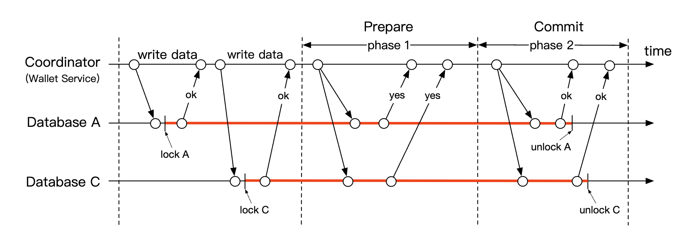
</div>

 * 조정자(지갑 서비스)가 평소처럼 여러 데이터베이스에 읽기와 쓰기 연산을 한다.
 * 애플리케이션이 트랜잭션을 커밋할 준비가 되면, 조정자는 모든 데이터베이스에 트랜잭션 준비를 요청한다.
 * 모든 데이터베이스가 '예'라고 답하면 조정자는 데이터베이스들에 트랜잭션 커밋을 요청한다.
 * 그렇지 않으면 모든 데이터베이스에 트랜잭션 중단을 요청한다.

2PC 방식의 단점:
 * 락 경합 때문에 성능이 좋지 않다.
 * 조정자가 단일 장애 지점이 된다.

### **TC/C를 이용한 분산 트랜잭션**
TC/C(Try-Confirm/Cancel, 시도-확정/취소)는 2PC 프로토콜의 변형으로, 보상 트랜잭션을 활용한다.
 * 조정자는 모든 데이터베이스에 트랜잭션에 필요한 자원을 예약해 달라고 요청한다.
 * 조정자는 데이터베이스들의 응답을 모은다. 모두 '예'면 확정(confirm)을, 아니면 취소(cancel)를 요청한다.

TC/C와 2PC의 중요한 차이 하나는, 2PC는 트랜잭션 하나를 수행하지만 TC/C에서는 독립적인 트랜잭션 두 개가 수행된다는 것이다.

TC/C는 단계별로 다음과 같이 동작한다.

| 단계 | 연산 | A                   | C                   |
|-------|-----------|---------------------|---------------------|
| 1     | 시도       | 잔액 변경: -$1 | 아무것도 하지 않음          |
| 2     | 확정   | 아무것도 하지 않음          | 잔액 변경: +$1 |
|       | 취소    | 잔액 변경: +$1 | 아무것도 하지 않음          |

1단계 - 시도:

<div style="margin-left:3rem">
    
</div>

 * 조정자는 A의 데이터베이스에서 로컬 트랜잭션을 시작해 A의 잔액을 1달러 줄인다.
 * C의 데이터베이스에는 아무것도 하지 않는 NOP 명령을 보낸다.

2a단계 - 확정:

<div style="margin-left:3rem">
    
</div>

 * 두 데이터베이스가 모두 '예'라고 답하면 확정 단계가 시작된다.
 * A의 데이터베이스는 NOP를 받고, C의 데이터베이스는 C의 잔액을 1달러 늘리라는 명령을 받는다(로컬 트랜잭션).

2b단계 - 취소:

<div style="margin-left:3rem">
    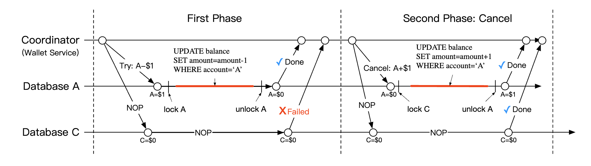
</div>

 * 1단계의 연산 중 하나라도 실패하면 취소 단계가 시작된다.
 * A의 데이터베이스는 A의 잔액을 1달러 늘리라는 명령을, C의 데이터베이스는 NOP를 받는다.

2PC와 TC/C 비교:

|      | 첫 번째 단계                                            | 두 번째 단계: 성공              | 두 번째 단계: 실패                        |
|------|--------------------------------------------------------|------------------------------------|-------------------------------------------|
| 2PC  | 트랜잭션이 아직 완료되지 않음                          | 모든 트랜잭션 커밋/취소     | 모든 트랜잭션 취소                   |
| TC/C | 모든 트랜잭션이 완료됨(커밋 또는 취소) | 필요하면 새 트랜잭션 실행 | 이미 커밋된 트랜잭션을 되돌림 |

TC/C는 보상 기반 분산 트랜잭션이라고도 한다. 고수준의 연산은 비즈니스 로직에서 처리한다.

TC/C의 다른 특성:
 * 데이터베이스가 트랜잭션을 지원하기만 하면 데이터베이스 종류와 무관하다.
 * 분산 트랜잭션의 세부 사항과 복잡성을 비즈니스 로직에서 처리해야 한다.

### **TC/C 실행 도중의 장애**
조정자가 실행 도중에 죽으면 중간 상태를 복구해야 한다.
이를 위해 데이터베이스 샤드 안에서 원자적으로 갱신되는 단계별 상태 테이블(phase status table)을 유지한다.

<div style="margin-left:3rem">
    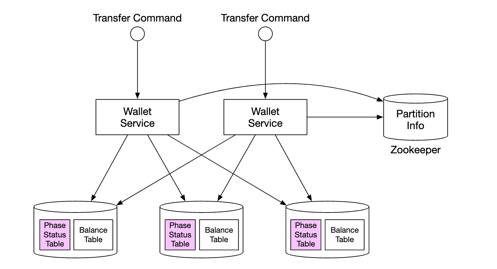
</div>

이 테이블에 들어 있는 내용:
 * 분산 트랜잭션의 ID와 내용
 * 시도 단계의 상태 - 보내지 않음, 보냄, 응답 받음
 * 두 번째 단계의 이름 - 확정 또는 취소
 * 두 번째 단계의 상태
 * 순서가 어긋났음을 나타내는 플래그(뒤에서 설명)

TC/C를 쓸 때 주의할 점은, 분산 트랜잭션이 진행되는 동안 잠시 계정 상태가 서로 맞지 않는 순간이 있다는 것이다.

<div style="margin-left:3rem">
    
</div>

이 상태에서 항상 복구할 수 있고, 사용자가 이 중간 상태를 이용해(예: 돈을 써 버리는 등) 이득을 볼 수 없다면 괜찮다.
항상 차감을 추가보다 먼저 실행하면 이를 보장할 수 있다.

| 시도 단계 선택지  | 계정 A | 계정 C |
|--------------------|-----------|-----------|
| 선택지 1           | -$1       | NOP       |
| 선택지 2(유효하지 않음) | NOP       | +$1       |
| 선택지 3(유효하지 않음) | -$1       | +$1       |

위 표의 선택지 3이 유효하지 않은 이유는, 2PC에 의존하지 않고는 서로 다른 데이터베이스에 걸친 트랜잭션의 원자적 실행을 보장할 수 없기 때문이다.

처리해야 할 경계 사례 하나는 순서가 바뀐 실행이다.

<div style="margin-left:3rem">
    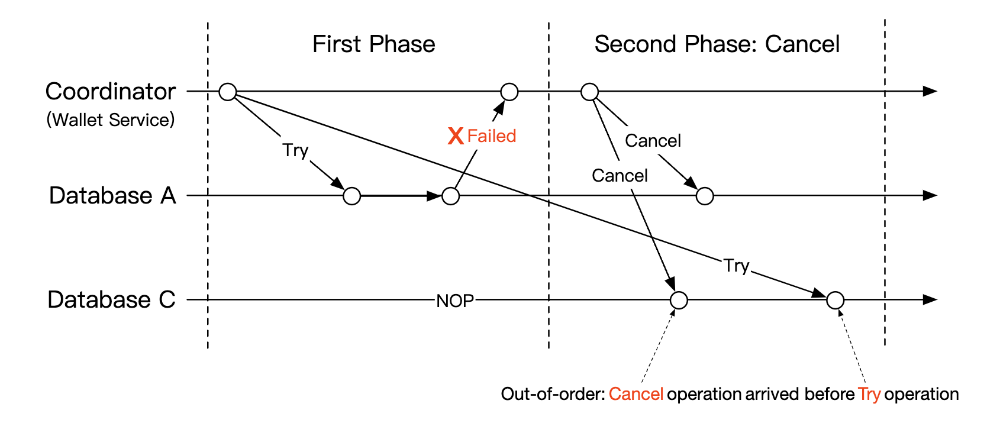
</div>

데이터베이스가 시도 연산보다 취소 연산을 먼저 받을 수 있다. 이 경계 사례는 단계별 상태 테이블에 순서가 어긋났음을 나타내는 플래그를 추가해 처리한다.
시도 연산을 받으면 먼저 이 플래그가 설정되어 있는지 확인하고, 설정되어 있으면 실패를 반환한다.

### **사가를 이용한 분산 트랜잭션**
널리 쓰이는 또 다른 방법은 사가(Saga)다. 사가는 마이크로서비스 아키텍처에서 분산 트랜잭션을 구현하는 표준 방식이다.

동작 방식은 다음과 같다.
 * 모든 연산은 순서대로 나열된다. 각 연산은 자기 데이터베이스에서 독립적으로 실행된다.
 * 연산은 처음부터 끝까지 순서대로 실행된다.
 * 연산이 실패하면 보상 연산을 써서 처음까지 전체 과정을 롤백한다.

<div style="margin-left:3rem">
    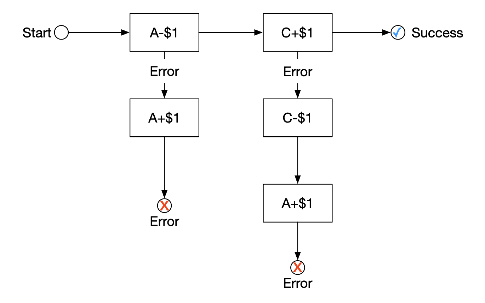
</div>

작업 흐름은 어떻게 조율할까? 두 가지 방법이 있다.
 * 분산 조율(choreography) - 사가에 관련된 모든 서비스가 관련 이벤트를 구독해 사가에서 맡은 일을 한다.
 * 중앙 집중형 조율(orchestration) - 조정자 하나가 모든 서비스에 올바른 순서로 작업하도록 지시한다.

분산 조율 방식의 문제는 비즈니스 로직이 비동기적으로 통신하는 여러 서비스에 흩어진다는 것이다.
중앙 집중형 조율 방식은 복잡성을 잘 다루므로 보통 전자 지갑 시스템에서 선호된다.

TC/C와 사가 비교:

|                                           | TC/C            | 사가                     |
|-------------------------------------------|-----------------|--------------------------|
| 보상 연산                       | 취소 단계에서 | 롤백 단계에서        |
| 중앙 조정                      | 예             | 예(중앙 집중형 조율 모드) |
| 연산 실행 순서                 | 임의             | 순차                   |
| 병렬 실행 가능성            | 예             | 아니요(순차 실행)    |
| 일시적으로 불일치 상태가 보일 수 있음 | 예             | 예                      |
| 애플리케이션 로직인가, 데이터베이스 로직인가             | 애플리케이션     | 애플리케이션              |

주된 차이는 TC/C는 병렬화할 수 있다는 것이다. 따라서 지연 시간 요구 사항에 따라 결정하면 된다. 지연 시간이 짧아야 한다면 TC/C를 택해야 한다.

어느 방법을 택하든, 감사(audit)를 지원하고 실패한 상태에서 복구하기 위해 이력을 재생할 수 있어야 한다.

### **이벤트 소싱**
실제로 전자 지갑 애플리케이션은 감사를 받을 수 있으며, 다음과 같은 질문에 답해야 한다.
 * 특정 시점의 계정 잔액을 알 수 있는가?
 * 과거와 현재의 잔액이 정확한지 어떻게 알 수 있는가?
 * 코드를 변경한 뒤에도 시스템 로직이 정확한지 어떻게 증명할 수 있는가?

이벤트 소싱(event sourcing)은 이런 질문에 답하는 데 도움이 되는 기법이다.

이벤트 소싱은 네 가지 개념으로 구성된다.
 * 명령(command) - 외부에서 전달된, 의도가 명확한 요청이다. 예: 계정 A에서 B로 1달러 이체. 전역적인 순서가 있어야 하므로 FIFO 큐에 넣는다.
   * 명령은 이벤트와 달리 실패할 수 있으며, IO나 유효하지 않은 상태 등으로 인한 무작위성이 있을 수 있다.
   * 명령은 0개 이상의 이벤트를 만들 수 있다.
   * 이벤트 생성에는 외부 IO 같은 무작위성이 있을 수 있다. 이는 뒤에서 다시 다룬다.
 * 이벤트(event) - 시스템에서 일어난 일에 대한 과거의 사실이다. 예: 'A에서 B로 1달러를 이체했음'
   * 명령과 달리 이벤트는 시스템 안에서 이미 일어난 사실이다.
   * 명령처럼 순서가 있어야 하므로 FIFO 큐에 넣는다.
 * 상태(state) - 이벤트의 결과로 바뀐 내용이다. 예: 계정과 잔액을 대응시키는 키-값 저장소
 * 상태 기계(state machine) - 이벤트 소싱 과정을 구동한다. 주로 명령의 유효성을 검사하고, 이벤트를 적용해 시스템 상태를 갱신한다.
   * 상태 기계는 결정론적(deterministic)이어야 하므로 외부 IO를 읽거나 무작위성에 의존해서는 안 된다.

<div style="margin-left:3rem">
    
</div>

이벤트 소싱을 동적으로 나타내면 다음과 같다.

<div style="margin-left:3rem">
    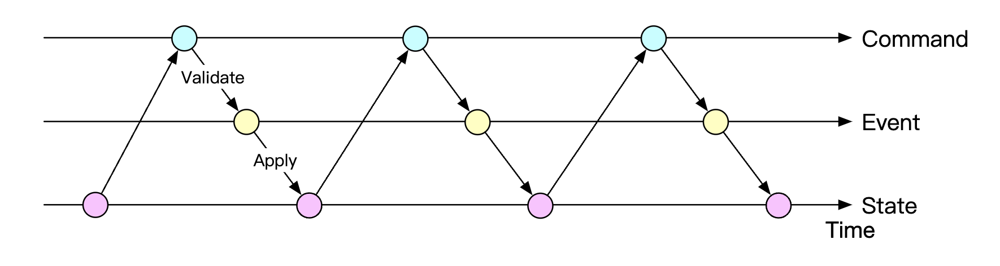
</div>

지갑 서비스에서 명령은 잔액 이체 요청이다. 이 명령을 Kafka 같은 FIFO 큐에 넣을 수 있다.

<div style="margin-left:3rem">
    
</div>

전체 그림은 다음과 같다.

<div style="margin-left:3rem">
    
</div>

 * 상태 기계가 명령 큐에서 명령을 읽는다.
 * 데이터베이스에서 잔액 상태를 읽는다.
 * 명령의 유효성을 검사한다. 유효하면 각 계정에 대한 이벤트 두 개를 만든다.
 * 다음 이벤트를 읽어, 데이터베이스의 잔액(상태)을 갱신하는 방식으로 적용한다.

이벤트 소싱의 주된 장점은 재현성이다. 이 설계에서 모든 상태 갱신 연산은 잔액 변경의 변경 불가능한 이력으로 저장된다.

처음부터 이벤트를 재생하면 언제든 과거 잔액을 재구성할 수 있다.
이벤트 목록은 변경할 수 없고 상태 기계는 결정론적이므로, 어떤 중간 상태든 반드시 재생해 낼 수 있다.

<div style="margin-left:3rem">
    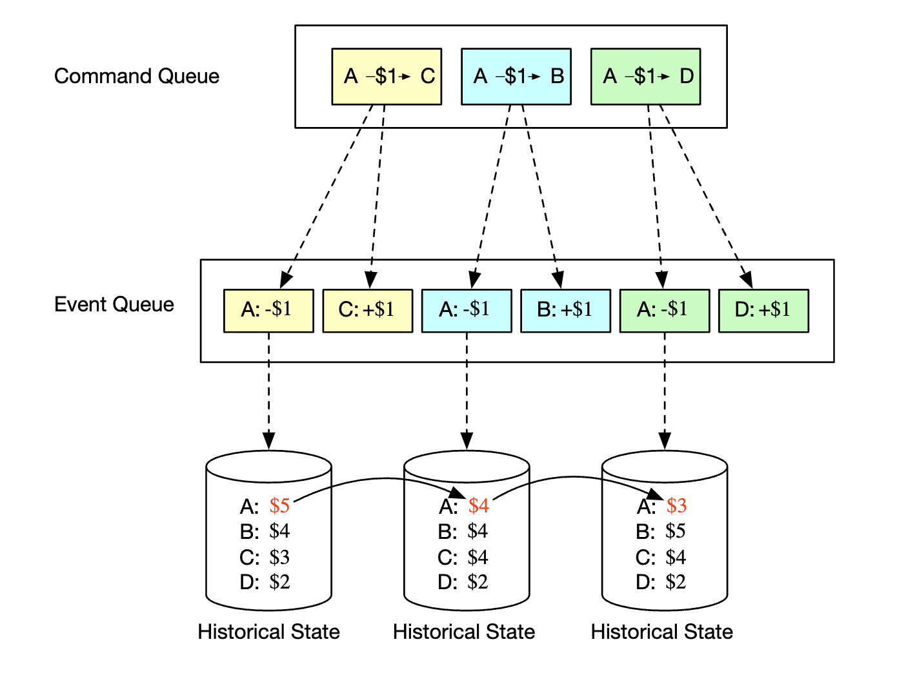
</div>

이 절의 앞에서 던진 감사 관련 질문은 모두 이벤트 소싱으로 답할 수 있다.
 * 특정 시점의 계정 잔액을 알 수 있는가? - 처음부터 원하는 시점까지 이벤트를 재생하면 된다.
 * 과거와 현재의 잔액이 정확한지 어떻게 알 수 있는가? - 처음부터 모든 이벤트를 다시 계산해 정확성을 검증할 수 있다.
 * 코드를 변경한 뒤에도 시스템 로직이 정확한지 어떻게 증명할 수 있는가? - 서로 다른 버전의 코드를 같은 이벤트에 대해 실행하고 결과가 같은지 확인하면 된다.

고객의 잔액 조회 요청은 CQRS 아키텍처로 처리할 수 있다. 변경 불가능한 이벤트 목록을 바탕으로 과거 상태를 질의하는 읽기 전용 상태 기계를 여러 개 둘 수 있다.

<div style="margin-left:3rem">
    
</div>

---

## 3단계: 상세 설계
여전히 100만 TPS까지 확장해야 하므로, 이 절에서는 성능 최적화 방법 몇 가지를 살펴본다.

### **고성능 이벤트 소싱**
첫 번째 최적화는 명령과 이벤트를 Kafka 같은 외부 저장소 대신 로컬 디스크 저장소에 저장하는 것이다.

이렇게 하면 네트워크 지연을 피할 수 있고, 추가(append) 연산만 하므로 HDD에서도 대체로 빠르다.

다음 최적화는 최근 명령과 이벤트를 메모리에 캐시해, 디스크에서 다시 불러오는 시간을 아끼는 것이다.

저수준에서는 mmap이라는 명령을 활용해 위 최적화를 구현할 수 있다. mmap은 데이터를 로컬 디스크에 저장하면서 메모리에도 캐시한다.

<div style="margin-left:3rem">
    
</div>

그다음 최적화로 상태도 로컬 파일 시스템에 저장할 수 있다. 파일 기반 로컬 관계형 데이터베이스인 SQLite를 쓸 수 있고, RocksDB도 좋은 선택지다.

여기서는 쓰기 연산에 최적화된 LSM 트리(log-structured merge-tree)를 쓰는 RocksDB를 택한다.
읽기 성능은 캐시로 최적화한다.

<div style="margin-left:3rem">
    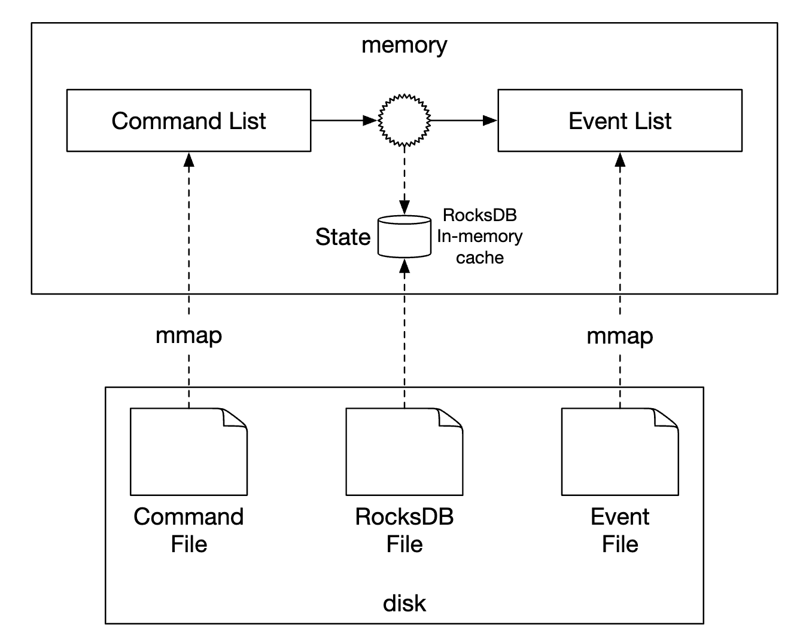
</div>

재현성을 최적화하기 위해 주기적으로 디스크에 스냅숏을 저장해, 매번 처음부터 상태를 재현하지 않아도 되게 한다. 스냅숏은 HDFS 같은 분산 파일 저장소에 큰 이진 파일로 저장할 수 있다.

<div style="margin-left:3rem">
    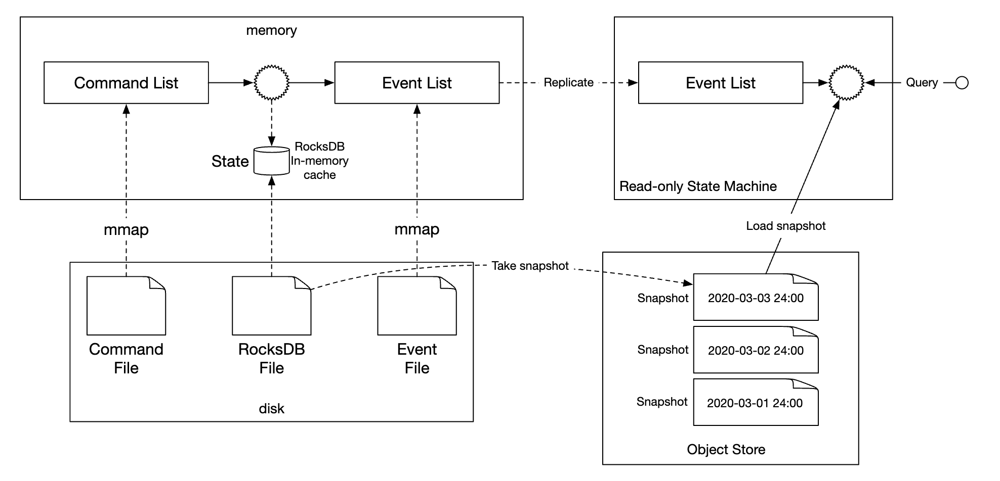
</div>

### **신뢰할 수 있는 고성능 이벤트 소싱**
지금까지의 최적화는 훌륭하지만 서비스를 상태 유지 서비스로 만든다. 안정성을 위해 일종의 복제를 도입해야 한다.

그 전에 시스템에서 어떤 데이터가 높은 안정성을 필요로 하는지 분석해야 한다.
 * 상태와 스냅숏은 이벤트 목록을 재생하면 언제든 다시 만들 수 있다. 따라서 이벤트 목록의 안정성만 보장하면 된다.
 * 명령 목록에서 이벤트 목록을 언제든 다시 만들 수 있다고 생각할 수 있지만, 명령은 결정론적이지 않으므로 그렇지 않다.
 * 결론적으로 이벤트 목록에 대해서만 높은 안정성을 보장하면 된다.

이벤트의 안정성을 높이려면 이벤트 목록을 여러 노드에 복제해야 한다. 다음을 보장해야 한다.
 * 데이터 손실이 없어야 한다.
 * 로그 파일 안의 데이터 순서가 모든 사본에서 같아야 한다.

이를 위해 래프트(Raft) 같은 합의 알고리즘을 쓸 수 있다.

래프트에서는 능동적으로 동작하는 리더 하나와 수동적으로 동작하는 팔로워들이 있다. 리더가 죽으면 팔로워 중 하나가 리더 역할을 이어받는다.
노드의 절반 이상이 살아 있는 한 시스템은 계속 동작한다.

<div style="margin-left:3rem">
    
</div>

이 방식에서는 모든 노드가 이벤트 목록을 바탕으로 상태를 갱신한다. 래프트는 리더와 팔로워가 같은 이벤트 목록을 갖도록 보장한다.

### **분산 이벤트 소싱**
지금까지 노드 한 대의 성능이 높고 안정적인 시스템을 설계했다.

해결해야 할 한계:
 * 래프트 그룹 하나의 용량은 제한되어 있다. 언젠가는 데이터를 샤딩하고 분산 트랜잭션을 구현해야 한다.
 * CQRS 아키텍처에서는 요청/응답 흐름이 느리다. 클라이언트는 지갑이 갱신되었는지 알기 위해 시스템을 주기적으로 폴링해야 한다.

폴링은 실시간이 아니므로 사용자가 잔액 변경을 알기까지 시간이 걸릴 수 있다. 또한 폴링 빈도가 너무 높으면 질의 서비스에 과부하가 걸릴 수 있다.

<div style="margin-left:3rem">
    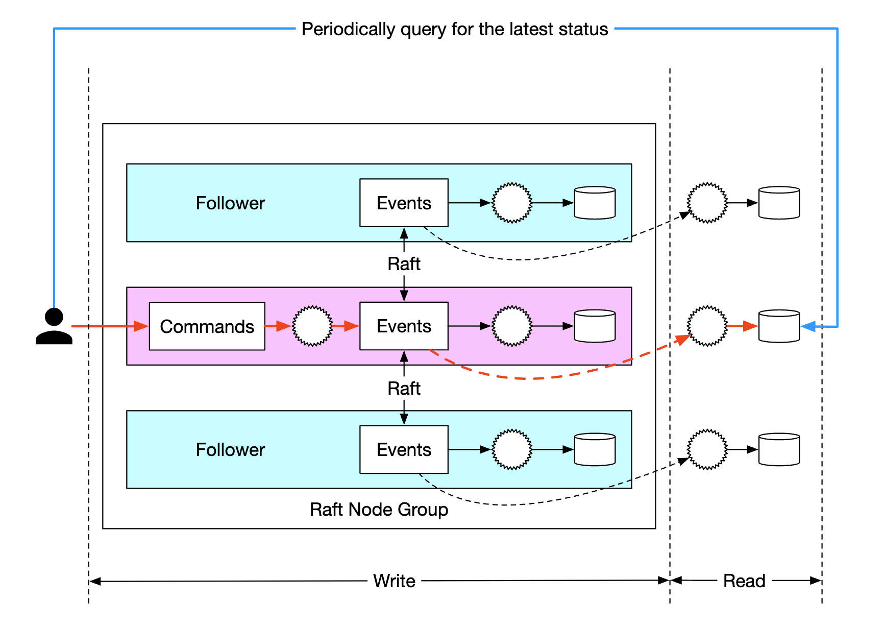
</div>

시스템 부하를 줄이기 위해, 사용자 대신 명령을 보내고 응답을 폴링하는 역방향 프록시(reverse proxy)를 둘 수 있다.

<div style="margin-left:3rem">
    
</div>

요청 하나로 여러 사용자의 데이터를 가져올 수 있으므로 시스템 부하는 줄지만, 실시간으로 결과를 받아야 한다는 요구 사항은 여전히 해결하지 못한다.

마지막으로, 읽기 전용 상태 기계가 응답이 준비되면 역방향 프록시로 바로 푸시하도록 바꿀 수 있다. 그러면 사용자는 갱신이 실시간으로 일어나는 것처럼 느낀다.

<div style="margin-left:3rem">
    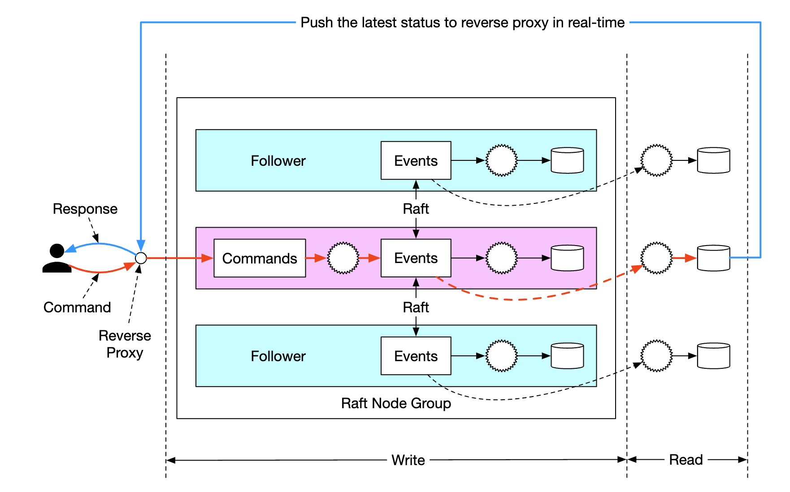
</div>

끝으로 시스템을 더 확장하려면 시스템을 여러 래프트 그룹으로 샤딩하고, 그 위에서 TC/C나 사가 방식의 조정자로 분산 트랜잭션을 구현하면 된다.

<div style="margin-left:3rem">
    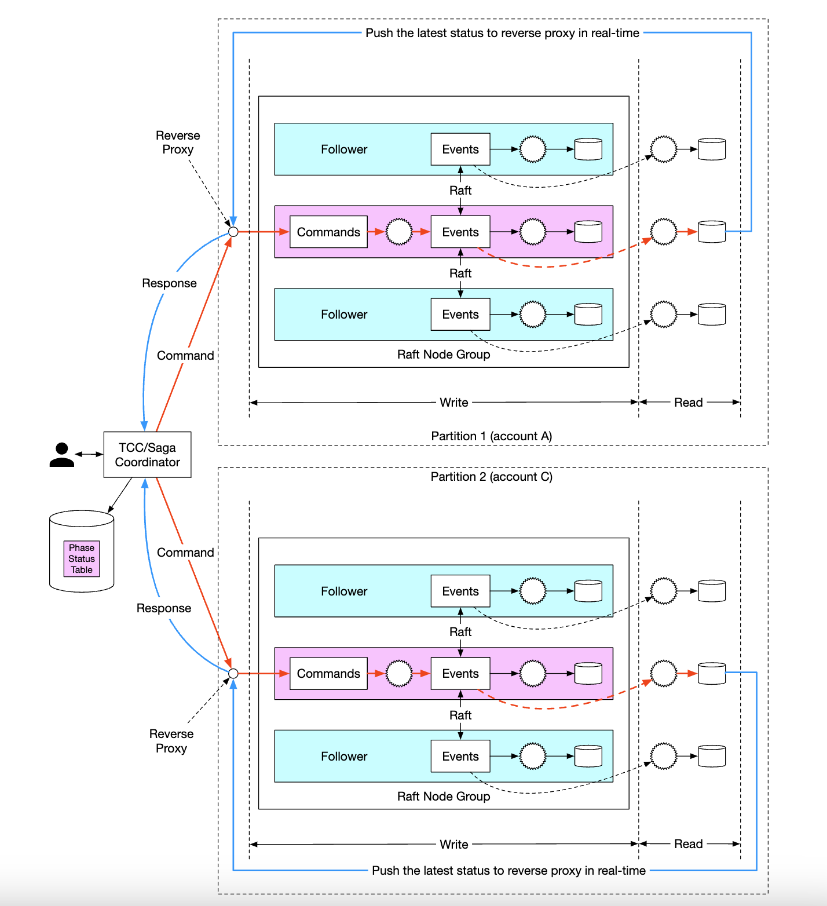
</div>

최종 시스템에서 잔액 이체 요청의 생명 주기 예:
 * 사용자 A가 `A-1`과 `C+1`이라는 두 연산으로 구성된 분산 트랜잭션을 사가 조정자에게 보낸다.
 * 사가 조정자는 트랜잭션 상태를 추적하기 위해 단계별 상태 테이블에 레코드를 만든다.
 * 조정자는 명령을 보낼 파티션을 결정한다.
 * 파티션 1의 래프트 리더는 `A-1` 명령을 받아 유효성을 검사하고, 이벤트로 변환해 래프트 그룹의 다른 노드들에 복제한다.
 * 이벤트 결과는 읽기 상태 기계로 동기화되고, 읽기 상태 기계는 조정자에게 응답을 푸시한다.
 * 조정자는 연산이 성공했음을 나타내는 레코드를 만들고 다음 연산인 `C+1`을 진행한다.
 * 다음 연산도 첫 번째와 같은 방식으로 실행된다. 파티션을 결정하고, 명령을 보내 실행하고, 읽기 상태 기계가 응답을 푸시한다.
 * 조정자는 두 번째 연산도 성공했음을 나타내는 레코드를 만들고, 마지막으로 클라이언트에 결과를 알린다.

---

## 4단계: 마무리
설계가 발전해 온 과정은 다음과 같다.
 * 메모리 기반 Redis를 쓰는 방안에서 출발했다. 이 방안의 문제는 저장소가 영속적이지 않다는 것이다.
 * 관계형 데이터베이스로 넘어가, 그 위에서 2PC, TC/C, 분산 사가로 분산 트랜잭션을 실행했다.
 * 다음으로 모든 연산을 감사할 수 있도록 이벤트 소싱을 도입했다.
 * 처음에는 외부 데이터베이스와 큐로 외부 저장소에 데이터를 저장했지만, 성능이 좋지 않았다.
 * 추가 전용(append-only) 연산의 성능을 활용해 로컬 파일 저장소에 데이터를 저장했다. 읽기 경로는 캐시로 최적화했다.
 * 앞의 방식은 성능은 좋았지만 영속적이지 않았다. 그래서 단일 장애 지점을 없애기 위해 복제와 함께 래프트 합의를 도입했다.
 * 사용자 대신 트랜잭션의 생명 주기를 관리하기 위해 역방향 프록시와 함께 CQRS를 도입했다.
 * 마지막으로 데이터를 여러 래프트 그룹으로 분할하고, TC/C나 분산 사가 같은 분산 트랜잭션 메커니즘으로 조율했다.
