# 28장: 증권 거래소

## 소개
이 장에서는 **전자 증권 거래소(electronic stock exchange)** 를 설계한다.

거래소의 기본 기능은 매수자와 매도자를 효율적으로 연결하는 것이다.

주요 증권 거래소로는 **뉴욕 증권 거래소(NYSE)**, **나스닥(NASDAQ)** 등이 있다.

<div style="margin-left:3rem">
    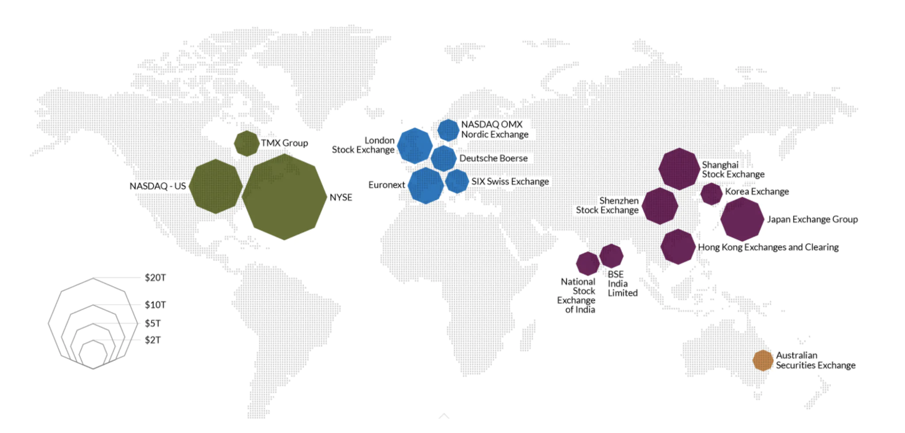
</div>

---

## 1단계: 문제 이해 및 설계 범위 확정
(지: 지원자, 면: 면접관)
 * 지: 어떤 증권을 거래하나요? 주식, 옵션, 선물 중에서요.
 * 면: 단순화를 위해 주식만 거래합니다.
 * 지: 어떤 주문 유형을 지원하나요? 신규, 취소, 정정 중에서요. 지정가, 시장가, 조건부 주문은요?
 * 면: 주문 신규와 취소를 지원해야 합니다. 주문 유형은 지정가 주문만 고려하면 됩니다.
 * 지: 시간외 거래도 지원해야 하나요?
 * 면: 아니요, 정규 거래 시간만 지원합니다.
 * 지: 거래소의 기본 기능을 설명해 주실 수 있나요?
 * 면: 고객은 지정가 주문을 넣거나 취소할 수 있고, 체결된 거래를 실시간으로 받아 볼 수 있습니다. 호가 창도 실시간으로 볼 수 있어야 합니다.
 * 지: 거래소 규모는 어느 정도인가요?
 * 면: 수만 명의 사용자가 동시에 거래하고 종목(symbol)은 약 100개입니다. 하루 주문은 수십억 건입니다. 규정 준수를 위한 위험 점검도 지원해야 합니다.
 * 지: 어떤 위험 점검인가요?
 * 면: 단순한 위험 점검만 합시다. 예를 들어 사용자가 하루에 애플 주식을 100만 주까지만 거래할 수 있게 제한하는 것입니다.
 * 지: 사용자 지갑 관리는 어떻게 하나요?
 * 면: 주문을 넣기 전에 고객에게 충분한 자금이 있는지 확인해야 합니다. 미체결 주문에 묶인 자금은 주문이 최종 처리될 때까지 인출할 수 없게 해야 합니다.

### **비기능 요구 사항**
면접관이 말한 규모를 보면 중소 규모의 거래소를 설계하면 된다.
앞으로 더 많은 종목과 사용자를 지원할 수 있도록 유연성도 확보해야 한다.

그 밖의 비기능 요구 사항:
 * 가용성 - 최소 99.99%. 중단은 평판을 해칠 수 있다.
 * 결함 감내 - 운영 장애의 영향을 줄이려면 결함 감내와 빠른 복구 메커니즘이 필요하다.
 * 지연 시간 - 왕복 지연 시간은 밀리초 수준이어야 하며, 특히 p99 지연 시간에 집중해야 한다. p99 지연 시간이 계속 높으면 일부 사용자의 경험이 나빠진다.
 * 보안 - 계정 관리 시스템이 있어야 한다. 법규 준수를 위해 KYC(고객 신원 확인)로 사용자 신원을 확인해야 한다. 공개 자원은 DDoS 공격으로부터 보호해야 한다.

### **개략적인 규모 추정**
 * 종목 100개, 하루 주문 10억 건
 * 정규 거래 시간은 09:30부터 16:00까지(6.5시간)
 * QPS = 1bil / 6.5 / 3600 = 43000
 * 최대 QPS = 5*QPS = 215000
 * 장이 열릴 때 거래량이 훨씬 많다.

---

## 2단계: 개략적인 설계안 제시 및 동의 구하기

### **업무 지식 101**
거래소와 관련된 기본 개념을 살펴보자.

브로커(broker)는 거래소와 최종 사용자 사이를 중개한다. 로빈후드, 피델리티 등이 있다.

기관 고객은 전문 트레이딩 소프트웨어로 대량 거래를 한다. 이들에게는 특별한 처리가 필요하다.
예를 들어 대량 거래 시 시장에 영향을 주지 않도록 주문을 나눠야 한다.

주문 유형:
 * 지정가(limit) - 정해진 가격에 사거나 판다. 바로 체결되지 않거나 부분적으로만 체결될 수 있다.
 * 시장가(market) - 가격을 지정하지 않는다. 현재 시장 가격으로 즉시 체결된다.

가격:
 * 매수 호가(bid) - 매수자가 주식을 사려는 가장 높은 가격
 * 매도 호가(ask) - 매도자가 주식을 팔려는 가장 낮은 가격

미국 시장에는 L1, L2, L3라는 세 가지 등급의 시세 정보가 있다.

L1 시장 데이터에는 최우선 매수/매도 호가와 수량이 들어 있다.

<div style="margin-left:3rem">
    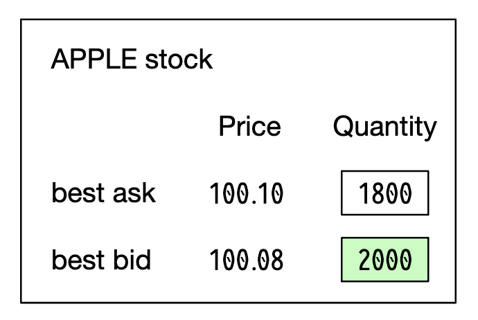
</div>

L2에는 더 많은 호가 단계가 들어 있다.

<div style="margin-left:3rem">
    
</div>

L3는 호가 단계와 단계별 대기 수량을 보여 준다.

<div style="margin-left:3rem">
    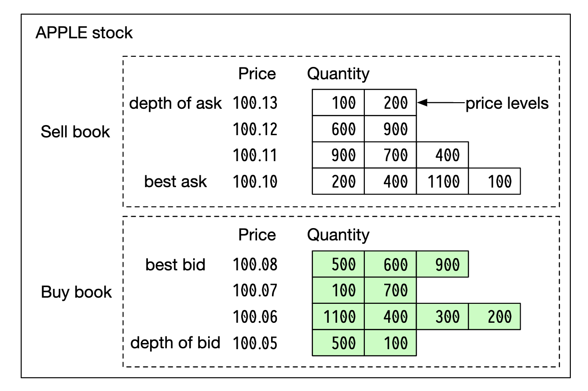
</div>

봉 차트(candlestick)는 주어진 기간의 시가와 종가, 그리고 최고가와 최저가를 보여 준다.

<div style="margin-left:3rem">
    
</div>

FIX는 증권 거래 정보를 교환하기 위한 프로토콜로, 대부분의 업체가 쓴다. 증권 거래 정보의 예:
```
8=FIX.4.2 | 9=176 | 35=8 | 49=PHLX | 56=PERS | 52=20071123-05:30:00.000 | 11=ATOMNOCCC9990900 | 20=3 | 150=E | 39=E | 55=MSFT | 167=CS | 54=1 | 38=15 | 40=2 | 44=15 | 58=PHLX EQUITY TESTING | 59=0 | 47=C | 32=0 | 31=0 | 151=15 | 14=0 | 6=0 | 10=128 |
```

### **개략적인 설계**

<div style="margin-left:3rem">
    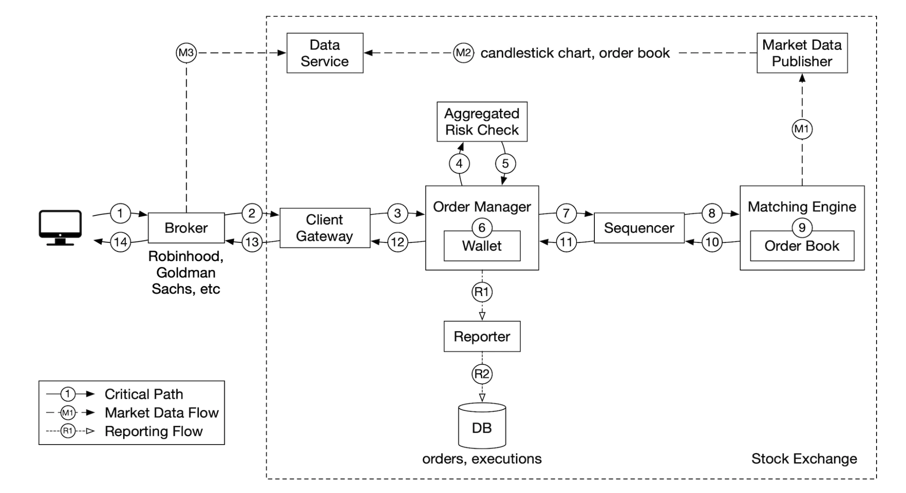
</div>

거래 흐름:
 * 고객이 트레이딩 인터페이스로 주문을 넣는다.
 * 브로커가 주문을 거래소로 보낸다.
 * 주문은 클라이언트 게이트웨이를 거쳐 거래소에 들어온다. 클라이언트 게이트웨이는 입력 검증, 처리율 제한, 인증 등을 하고 주문을 주문 관리자로 전달한다.
 * 주문 관리자는 위험 관리자가 정한 규칙에 따라 위험 점검을 한다.
 * 위험 점검을 통과하면 주문 관리자는 지갑에 주문을 처리할 자금이 충분한지 확인한다.
 * 주문은 체결 엔진으로 전송된다. 체결이 이루어지면 체결 엔진은 매수 측과 매도 측에 대한 체결 기록(fill) 두 개를 만든다. 두 주문 모두 결정론적으로 처리되도록 순서가 매겨진다.
 * 체결 결과가 고객에게 반환된다.

시장 데이터 흐름(M1~M3):
 * 체결 엔진은 체결 기록 스트림을 만들어 시장 데이터 게시 서비스로 보낸다.
 * 시장 데이터 게시 서비스는 봉 차트를 만들어 데이터 서비스로 보낸다.
 * 시장 데이터는 실시간 분석을 위한 특수 저장소에 저장된다. 브로커는 데이터 서비스에 연결해 시장 데이터를 적시에 받는다.

보고 흐름(R1~R2):
 * 보고 서비스(reporter)는 주문과 체결 기록에서 보고에 필요한 필드를 모두 모아 데이터베이스에 기록한다.
 * 보고 필드 - client_id, price, quantity, order_type, filled_quantity, remaining_quantity

거래 흐름은 핵심 경로(critical path)에 있고 나머지 흐름은 그렇지 않으므로, 흐름마다 지연 시간 요구 사항이 다르다.

#### 거래 흐름
거래 흐름은 핵심 경로에 있으므로 낮은 지연 시간을 위해 고도로 최적화해야 한다.

그 중심에는 교차 엔진(cross engine)이라고도 하는 체결 엔진(matching engine)이 있다. 주요 역할:
 * 종목별 호가 창(order book)을 유지한다. 호가 창은 종목의 매수/매도 주문 목록이다.
 * 매수 주문과 매도 주문을 연결(체결)한다. 체결이 이루어지면 매수 측과 매도 측에 하나씩, 체결 기록 두 개가 만들어진다. 이 기능은 빠르고 정확해야 한다.
 * 체결 기록 스트림을 시장 데이터로 배포한다.
 * 체결은 결정론적인 순서로 이루어져야 한다. 이는 고가용성의 기반이 된다.

다음은 시퀀서(sequencer)다. 들어오는 주문과 나가는 체결 기록에 순서 ID를 찍어, 체결 엔진을 결정론적으로 만드는 핵심 컴포넌트다.

<div style="margin-left:3rem">
    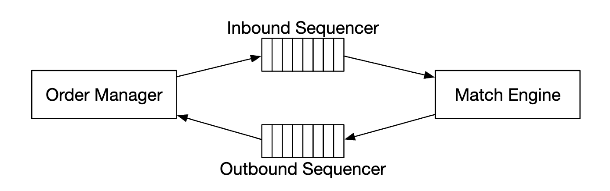
</div>

들어오는 주문과 나가는 체결 기록에 순서 ID를 찍는 이유:
 * 시의성과 공정성
 * 빠른 복구/재생
 * 정확히 한 번 실행 보장

개념적으로 시퀀서는 들어오고 나가는 메시지 큐이므로 Kafka를 쓸 수도 있다. 하지만 더 낮은 지연 시간을 위해 직접 구현한다.

주문 관리자(order manager)는 주문 상태를 관리한다. 또한 체결 엔진과 상호작용하며 주문을 보내고 체결 기록을 받는다.

주문 관리자의 역할:
 * 위험 점검을 위해 주문을 보낸다. 예: 사용자의 거래량이 100만 주 미만인지 확인
 * 사용자 지갑을 확인해 주문을 처리할 자금이 충분한지 검증한다.
 * 주문을 시퀀서로, 이어서 체결 엔진으로 보낸다. 대역폭을 줄이기 위해 필요한 주문 정보만 체결 엔진에 전달한다.
 * 시퀀서에서 체결 기록을 받아 클라이언트 게이트웨이를 거쳐 브로커에 보낸다.

주문 관리자를 구현할 때 가장 어려운 점은 상태 전이 관리다. 이벤트 소싱이 현실적인 해법 하나다(상세 설계에서 다룸).

마지막으로 클라이언트 게이트웨이는 사용자에게서 주문을 받아 주문 관리자로 보낸다. 역할은 다음과 같다.

<div style="margin-left:3rem">
    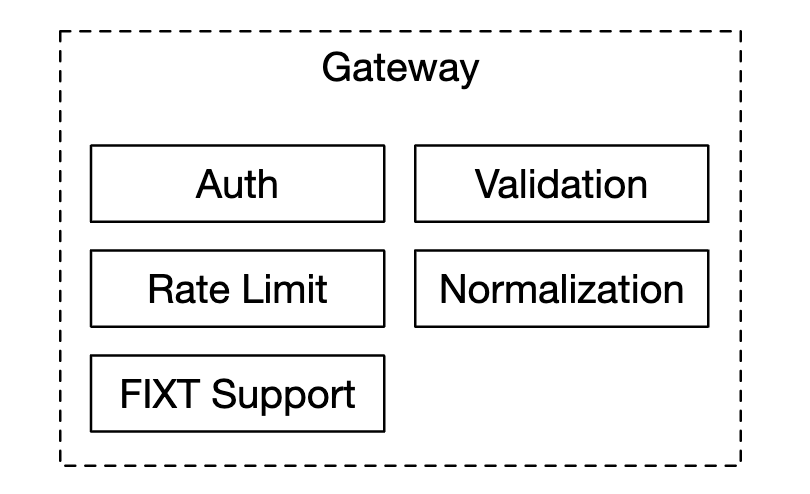
</div>

클라이언트 게이트웨이는 핵심 경로에 있으므로 가볍게 유지해야 한다.

고객 유형에 따라 클라이언트 게이트웨이를 여러 개 둘 수 있다. 예를 들어 코로(colo) 엔진은 브로커가 거래소 데이터 센터 안에 임대한 트레이딩 엔진 서버다.

<div style="margin-left:3rem">
    
</div>

#### 시장 데이터 흐름
시장 데이터 게시 서비스는 체결 엔진에서 체결 기록을 받아, 체결 기록 스트림으로 호가 창과 봉 차트를 만든다.

이 데이터는 데이터 서비스로 전송되며, 데이터 서비스는 집계된 데이터를 구독자에게 보여 준다.

<div style="margin-left:3rem">
    
</div>

#### 보고 흐름
보고 서비스는 핵심 경로에 있지는 않지만 중요한 컴포넌트다.

<div style="margin-left:3rem">
    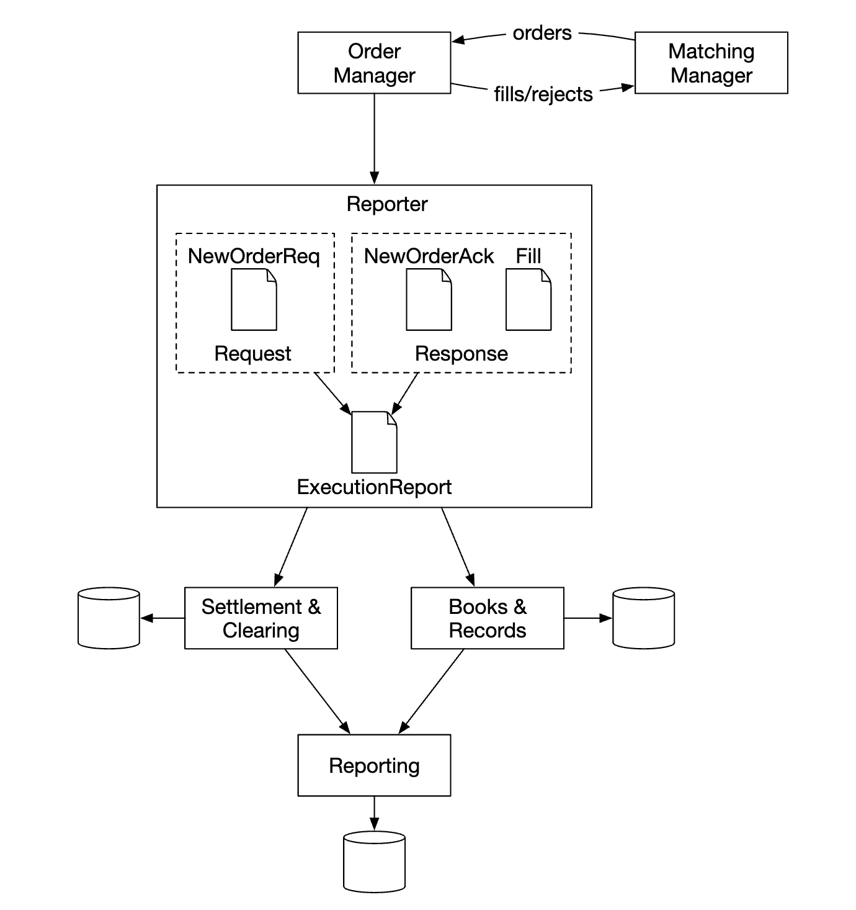
</div>

거래 이력, 세금 보고, 규정 준수 보고, 결산 등을 맡는다.
보고 흐름에서는 지연 시간이 핵심 요구 사항이 아니다. 정확성과 규정 준수가 더 중요하다.

### **API 설계**
고객은 브로커를 통해 증권 거래소와 상호작용하며 주문을 넣고, 체결 내역과 시장 데이터를 보고, 분석용 과거 데이터를 내려받는다.

클라이언트 게이트웨이와 브로커 사이의 통신에는 RESTful API를 쓴다.

기관 고객에게는 낮은 지연 시간 요구 사항을 만족하기 위해 독자적인 프로토콜을 쓴다.

주문:
```
POST /v1/order
```

인자:
 * symbol - 종목 기호. String
 * side - 매수 또는 매도. String
 * price - 지정가 주문의 가격. Long
 * orderType - 지정가 또는 시장가(이번 설계는 지정가만 지원). String
 * quantity - 주문 수량. Long

응답:
 * id - 주문 ID. Long
 * creationTime - 시스템이 주문을 생성한 시각. Long
 * filledQuantity - 체결된 수량. Long
 * remainingQuantity - 아직 체결되지 않은 수량. Long
 * status - new/canceled/filled. String
 * 나머지 속성은 입력 인자와 같다.

체결 내역 조회:
```
GET /execution?symbol={:symbol}&orderId={:orderId}&startTime={:startTime}&endTime={:endTime}
```

인자:
 * symbol - 종목 기호. String
 * orderId - 주문 ID. 선택 사항. String
 * startTime - 조회 시작 시각(epoch)\[11\]. Long
 * endTime - 조회 종료 시각(epoch). Long

응답:
 * executions - 범위 안의 체결 기록 배열(속성은 아래 참고). Array
 * id - 체결 ID. Long
 * orderId - 주문 ID. Long
 * symbol - 종목 기호. String
 * side - 매수 또는 매도. String
 * price - 체결 가격. Long
 * orderType - 지정가 또는 시장가. String
 * quantity - 체결 수량. Long

호가 창 조회:
```
GET /marketdata/orderBook/L2?symbol={:symbol}&depth={:depth}
```

인자:
 * symbol - 종목 기호. String
 * depth - 매수/매도 측별 호가 창 깊이. Int

응답:
 * bids - 가격과 수량을 담은 배열. Array
 * asks - 가격과 수량을 담은 배열. Array

봉 차트 조회:
```
GET /marketdata/candles?symbol={:symbol}&resolution={:resolution}&startTime={:startTime}&endTime={:endTime}
```

인자:
 * symbol - 종목 기호. String
 * resolution - 봉 차트의 윈도 길이(초). Long
 * startTime - 윈도 시작 시각(epoch). Long
 * endTime - 윈도 종료 시각(epoch). Long

응답:
 * candles - 봉 데이터 배열(속성은 아래 참고). Array
 * open - 봉의 시가. Double
 * close - 봉의 종가. Double
 * high - 봉의 고가. Double
 * low - 봉의 저가. Double

### **데이터 모델**
거래소에는 세 가지 주요 데이터 유형이 있다.
 * 상품, 주문, 체결
 * 호가 창
 * 봉 차트

#### 상품, 주문, 체결
상품(product)은 거래 종목의 속성을 나타낸다. 상품 유형, 거래 기호, UI 표시 기호 등이 있다.

이 데이터는 자주 바뀌지 않으며, 주로 UI 표시에 쓰인다.

주문(order)은 매수/매도 지시를 나타낸다. 체결(execution)은 밖으로 내보내는 체결 결과다.

데이터 모델은 다음과 같다.

<div style="margin-left:3rem">
    
</div>

주문과 체결은 세 흐름 모두에 등장한다.
 * 핵심 경로에서는 높은 성능을 위해 메모리에서 처리된다. 시퀀서에 저장되고 시퀀서에서 복구된다.
 * 보고 서비스는 보고 목적으로 주문과 체결을 데이터베이스에 기록한다.
 * 체결 기록은 시장 데이터 서비스로 전달되어 호가 창과 봉 차트를 재구성하는 데 쓰인다.

#### 호가 창
호가 창은 특정 종목의 매수/매도 주문 목록을 가격 수준별로 정리한 것이다.

이 모델을 위한 효율적인 자료 구조는 다음을 만족해야 한다.
 * 일정한 조회 시간 - 특정 가격 수준이나 가격 수준 사이의 수량 조회
 * 빠른 주문 추가/체결/취소
 * 최우선 매수/매도 호가 조회
 * 가격 수준 순회

호가 창 체결의 예:

<div style="margin-left:3rem">
    
</div>

이 대량 주문이 체결되면 매수/매도 호가 차이(spread)가 벌어지면서 가격이 올라간다.

의사 코드로 나타낸 호가 창 구현 예:
```
class PriceLevel{
    private Price limitPrice;
    private long totalVolume;
    private List<Order> orders;
}

class Book<Side> {
    private Side side;
    private Map<Price, PriceLevel> limitMap;
}

class OrderBook {
    private Book<Buy> buyBook;
    private Book<Sell> sellBook;
    private PriceLevel bestBid;
    private PriceLevel bestOffer;
    private Map<OrderID, Order> orderMap;
}
```

더 효율적으로 구현하려면 일반 리스트 대신 이중 연결 리스트를 쓸 수 있다.
 * 새 주문은 리스트 끝에 추가하므로 O(1)이다.
 * 주문 체결은 리스트 맨 앞에서 주문을 지우므로 O(1)이다.
 * 주문 취소는 호가 창에서 주문을 지우는 것이다. `orderMap`으로 O(1)에 찾고, `Order`가 리스트의 이전 원소에 대한 참조를 갖고 있으므로 O(1)에 지울 수 있다.

<div style="margin-left:3rem">
    
</div>

이 자료 구조는 시장 데이터 서비스에서 호가 창을 재구성할 때도 쓰인다.

#### 봉 차트
봉 데이터는 일정 시간 동안 처리된 주문을 바탕으로 시장 데이터 서비스에서 계산한다.
```
class Candlestick {
    private long openPrice;
    private long closePrice;
    private long highPrice;
    private long lowPrice;
    private long volume;
    private long timestamp;
    private int interval;
}

class CandlestickChart {
    private LinkedList<Candlestick> sticks;
}
```

메모리를 너무 많이 쓰지 않기 위한 최적화:
 * 미리 할당한 링 버퍼에 봉을 담아 메모리 할당 횟수를 줄인다.
 * 메모리에 두는 봉 수를 제한하고 나머지는 디스크에 저장한다.

실시간 분석에는 메모리 기반 칼럼형 데이터베이스(예: KDB)를 쓴다. 장이 마감되면 데이터를 이력 데이터베이스에 저장한다.

---

## 3단계: 상세 설계
현대 거래소의 흥미로운 점 하나는, 대부분의 다른 소프트웨어와 달리 보통 모든 것을 거대한 서버 한 대에서 실행한다는 것이다.

자세히 살펴보자.

### **성능**
거래소에서는 모든 백분위에서 전반적으로 지연 시간이 낮은 것이 매우 중요하다.

지연 시간은 어떻게 줄일 수 있을까?
 * 핵심 경로에서 실행할 작업 수를 줄인다.
 * 네트워크/디스크 사용량을 줄이거나 작업 실행 시간을 줄여, 각 작업에 드는 시간을 단축한다.

첫 번째 목표를 위해 핵심 경로에서 부수적인 책임을 모두 걷어 냈다. 최적의 지연 시간을 위해 로깅까지 뺐다.

원래 설계대로라면 서비스 간 네트워크 지연과 시퀀서의 디스크 사용이라는 병목이 여럿 있다.

그런 설계로는 종단 간 지연 시간을 수십 밀리초 수준까지 낼 수 있다. 하지만 목표는 수십 마이크로초다.

그래서 모든 것을 서버 한 대에 두고, 프로세스들은 이벤트 저장소 역할을 하는 mmap으로 통신하게 한다.

<div style="margin-left:3rem">
    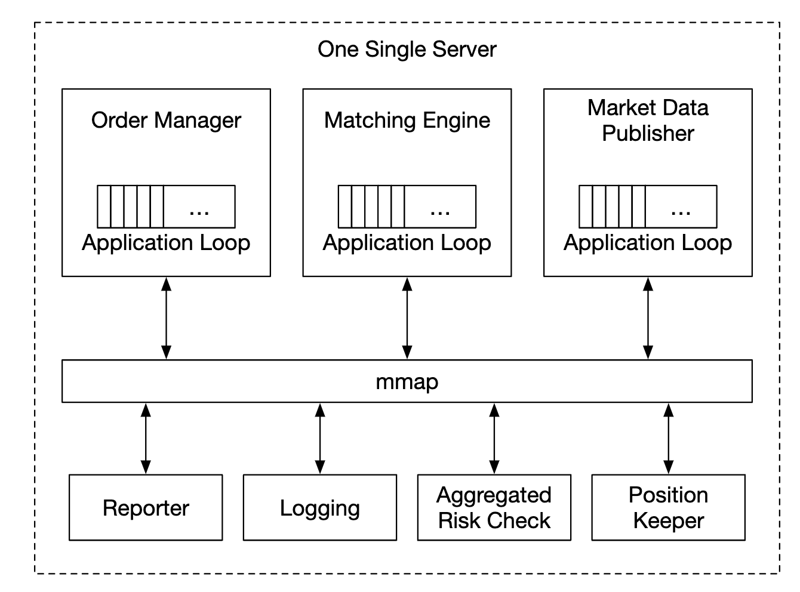
</div>

또 다른 최적화는 애플리케이션 루프(핵심 작업을 실행하는 while 루프)를 쓰고, 문맥 전환(context switching)을 피하기 위해 같은 CPU에 고정(pinning)하는 것이다.

<div style="margin-left:3rem">
    
</div>

애플리케이션 루프의 또 다른 효과는 여러 스레드가 같은 자원을 두고 다투는 락 경합이 없다는 것이다.

이제 mmap이 어떻게 동작하는지 살펴보자. mmap은 디스크의 파일을 애플리케이션 메모리에 대응시키는 유닉스 시스템 호출이다.

활용할 수 있는 요령 하나는 '공유 메모리(shared memory)'를 뜻하는 `/dev/shm`에 파일을 만드는 것이다. 그러면 디스크 접근이 전혀 일어나지 않는다.

### **이벤트 소싱**
이벤트 소싱은 [27장 전자 지갑](../27.%20%20Digital%20Wallet/)에서 자세히 다뤘다. 세부 사항은 그 장을 참고한다.

요약하면, 현재 상태를 저장하는 대신 변경 불가능한 상태 전이를 저장한다.

<div style="margin-left:3rem">
    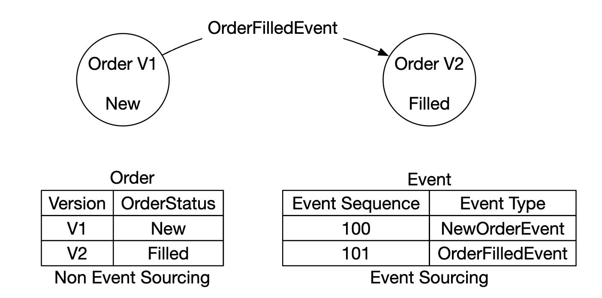
</div>

 * 왼쪽 - 전통적인 스키마
 * 오른쪽 - 이벤트 소싱 스키마

지금까지의 설계는 다음과 같다.

<div style="margin-left:3rem">
    
</div>

 * 외부 도메인은 FIX 프로토콜로 클라이언트 게이트웨이와 통신한다.
 * 주문 관리자는 새 주문 이벤트를 받아 검증하고 내부 상태에 추가한다. 그런 다음 주문을 체결 엔진 코어로 보낸다.
 * 주문이 체결되면 `OrderFilledEvent`가 만들어져 mmap을 통해 전송된다.
 * 다른 컴포넌트들은 이벤트 저장소를 구독하고 각자 맡은 처리를 한다.

추가 최적화 하나 - 주문 관리를 위한 추가 호출을 피하기 위해, 주문 관리자를 라이브러리로 패키징해 모든 컴포넌트가 사본을 갖게 한다.

이 설계에서 시퀀서는 이벤트 저장소가 아니라, 이벤트를 이벤트 저장소로 보내기 전에 순서를 매기는 단일 기록자(single writer)로 바뀐다.

<div style="margin-left:3rem">
    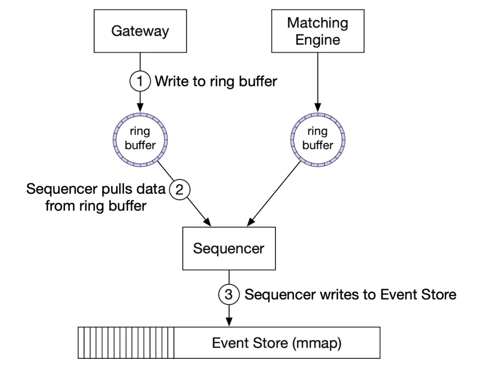
</div>

### **고가용성**
목표는 99.99% 가용성, 즉 하루 중단 시간 8.64초 이하다.

이를 달성하려면 거래소 아키텍처에서 단일 장애 지점을 찾아내야 한다.
 * 핵심 서비스(예: 체결 엔진)의 백업 인스턴스를 대기 상태로 둔다.
 * 장애 감지와 백업 인스턴스로의 장애 조치를 적극적으로 자동화한다.

클라이언트 게이트웨이 같은 무상태 서비스는 서버를 추가해 쉽게 수평적으로 확장할 수 있다.

상태 유지 컴포넌트는, 리더가 아니라면 들어오는 이벤트를 처리하되 나가는 이벤트는 발행하지 않는다.

<div style="margin-left:3rem">
    
</div>

주 사본이 다운되었는지 감지하려면 박동 메시지를 보내 응답이 없는지 확인한다.

이 메커니즘은 서버 한 대 안에서만 동작한다.
범위를 넓히려면 서버 전체를 핫/웜 사본으로 두고, 장애가 나면 그 서버로 장애 조치하면 된다.

이벤트 저장소를 사본들에 복제할 때는 더 빠른 통신을 위해 신뢰성 있는 UDP(reliable UDP)를 쓸 수 있다.

### **결함 감내**
웜 인스턴스까지 다운되면 어떻게 할까? 발생 확률은 낮지만 대비해야 한다.

대형 IT 기업은 자연재해 등에 대비해 핵심 데이터를 여러 도시의 데이터 센터에 복제하는 방식으로 이 문제에 대처한다.

고려할 질문:
 * 주 인스턴스가 다운되면 언제, 어떻게 백업 인스턴스로 장애 조치할 것인가?
 * 백업 인스턴스 중에서 리더를 어떻게 고를 것인가?
 * 필요한 복구 시간은 얼마인가(RTO, 복구 시간 목표)?
 * 어떤 기능을 복구해야 하는가? 기능이 저하된 상태로도 시스템을 운영할 수 있는가?

대처 방법:
 * 버그 때문에(주 사본과 사본 모두에 영향을 주어) 시스템이 다운될 수 있다. 카오스 엔지니어링으로 이런 경계 사례와 치명적인 결과를 미리 드러낼 수 있다.
 * 다만 처음에는 시스템의 장애 양상을 충분히 파악할 때까지 장애 조치를 수동으로 하는 것도 방법이다.
 * 주 인스턴스가 다운되면 리더 선출(예: 래프트)로 어느 사본이 리더가 될지 정할 수 있다.

여러 서버에 걸친 복제가 동작하는 방식의 예:

<div style="margin-left:3rem">
    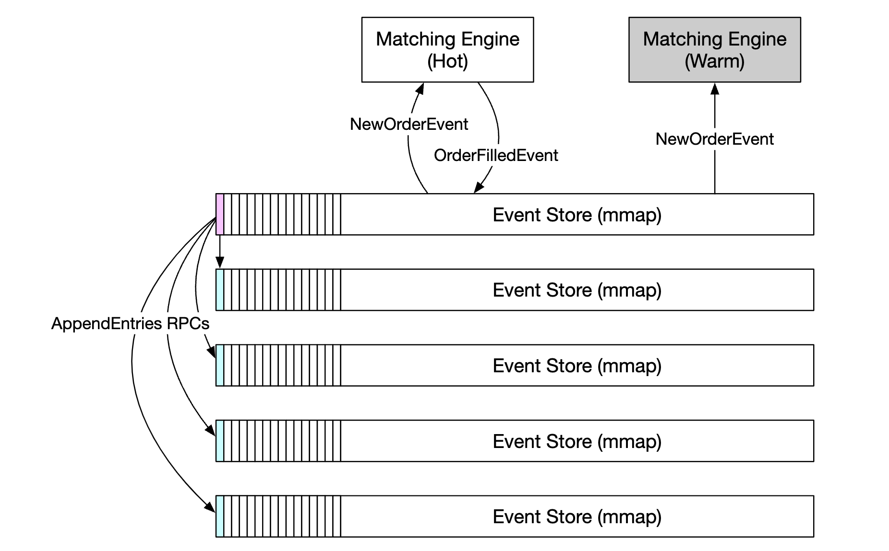
</div>

리더 선출 임기(term)의 예:

<div style="margin-left:3rem">
    
</div>

래프트의 동작 방식은 [여기](https://thesecretlivesofdata.com/raft/)를 참고한다.

마지막으로 손실 허용 범위, 즉 데이터를 얼마나 잃으면 치명적인지도 고려해야 한다.
이에 따라 데이터를 얼마나 자주 백업할지 정한다.

증권 거래소에서는 데이터 손실이 용납되지 않으므로, 데이터를 자주 백업하고 래프트 복제로 데이터 손실 가능성을 줄여야 한다.

### **체결 알고리즘**
체결이 어떻게 동작하는지 의사 코드로 잠시 살펴보자.
```
Context handleOrder(OrderBook orderBook, OrderEvent orderEvent) {
    if (orderEvent.getSequenceId() != nextSequence) {
        return Error(OUT_OF_ORDER, nextSequence);
    }

    if (!validateOrder(symbol, price, quantity)) {
        return ERROR(INVALID_ORDER, orderEvent);
    }

    Order order = createOrderFromEvent(orderEvent);
    switch (msgType):
        case NEW:
            return handleNew(orderBook, order);
        case CANCEL:
            return handleCancel(orderBook, order);
        default:
            return ERROR(INVALID_MSG_TYPE, msgType);

}

Context handleNew(OrderBook orderBook, Order order) {
    if (BUY.equals(order.side)) {
        return match(orderBook.sellBook, order);
    } else {
        return match(orderBook.buyBook, order);
    }
}

Context handleCancel(OrderBook orderBook, Order order) {
    if (!orderBook.orderMap.contains(order.orderId)) {
        return ERROR(CANNOT_CANCEL_ALREADY_MATCHED, order);
    }

    removeOrder(order);
    setOrderStatus(order, CANCELED);
    return SUCCESS(CANCEL_SUCCESS, order);
}

Context match(OrderBook book, Order order) {
    Quantity leavesQuantity = order.quantity - order.matchedQuantity;
    Iterator<Order> limitIter = book.limitMap.get(order.price).orders;
    while (limitIter.hasNext() && leavesQuantity > 0) {
        Quantity matched = min(limitIter.next.quantity, order.quantity);
        order.matchedQuantity += matched;
        leavesQuantity = order.quantity - order.matchedQuantity;
        remove(limitIter.next);
        generateMatchedFill();
    }
    return SUCCESS(MATCH_SUCCESS, order);
}
```

이 체결 알고리즘은 같은 가격 수준에서 어떤 주문을 체결할지 정하는 데 FIFO 알고리즘을 쓴다.

### **결정론**
기능적 결정론(functional determinism)은 앞에서 쓴 시퀀서 기법으로 보장된다.

이벤트가 실제로 일어난 시각은 중요하지 않다.

<div style="margin-left:3rem">
    
</div>

지연 시간 결정론(latency determinism)은 추적해야 한다. p99나 p99.99 지연 시간을 모니터링해 계산할 수 있다.

지연 시간을 갑자기 튀게 하는 원인으로는 Java 같은 언어의 쓰레기 수집(GC) 이벤트가 있다.

### **시장 데이터 게시 서비스 최적화**
시장 데이터 게시 서비스는 체결 엔진에서 체결 결과를 받아 호가 창과 봉 차트를 다시 만든다.

메모리는 무한하지 않으므로 봉 차트는 일부만 보관한다. 고객은 얼마나 세분화된 정보를 받을지 고를 수 있다. 더 세분화된 정보는 더 비쌀 수 있다.

<div style="margin-left:3rem">
    
</div>

링 버퍼(ring buffer, 순환 버퍼라고도 함)는 머리와 꼬리가 연결된 고정 크기 큐다. 공간을 미리 할당해 두므로 메모리 할당이 일어나지 않는다. 또한 락이 필요 없는(lock-free) 자료 구조다.

링 버퍼를 최적화하는 또 다른 기법은 패딩(padding)이다. 일련번호가 다른 데이터와 같은 캐시 라인에 놓이지 않도록 보장한다.

### **시장 데이터의 공정한 배포와 멀티캐스트**
구독자들이 데이터를 동시에 받도록 보장해야 한다. 누군가 다른 사람보다 먼저 데이터를 받으면 중요한 시장 정보를 먼저 얻게 되고, 이를 이용해 시장을 조작할 수 있기 때문이다.

이를 위해 구독자에게 데이터를 게시할 때 신뢰성 있는 UDP 기반 멀티캐스트를 쓸 수 있다.

인터넷으로 데이터를 전송하는 방법은 세 가지다.
 * 유니캐스트(unicast) - 출발지 하나에서 목적지 하나로
 * 브로드캐스트(broadcast) - 출발지 하나에서 하위 네트워크 전체로
 * 멀티캐스트(multicast) - 출발지 하나에서 여러 하위 네트워크에 있는 호스트 집합으로

이론상 멀티캐스트를 쓰면 모든 구독자가 데이터를 동시에 받는다.

하지만 UDP는 신뢰성이 없어 데이터가 모두에게 도달하지 못할 수 있다. 재전송 기능을 추가해 보완할 수 있다.

### **코로케이션**
거래소는 브로커가 거래소와 같은 데이터 센터에 서버를 둘 수 있게(colocation) 해 준다.

이렇게 하면 지연 시간이 크게 줄어들며, 일종의 VIP 서비스로 볼 수 있다.

### **네트워크 보안**
거래소에는 인터넷에 공개된 서비스가 있으므로 DDoS는 어려운 문제다. 선택지는 다음과 같다.
 * 공개 서비스와 데이터를 비공개 서비스와 분리해, DDoS 공격이 가장 중요한 고객에게 영향을 주지 않게 한다.
 * 자주 갱신되지 않는 데이터는 캐시 계층에 저장한다.
 * URL을 DDoS에 강하게 만든다. 예를 들어 `https://my.website.com/data?from=123&to=456`보다 `https://my.website.com/data/recent`가 캐시하기 좋으므로 낫다.
 * 효과적인 허용 목록/차단 목록 메커니즘이 필요하다.
 * 처리율 제한으로 DDoS를 완화할 수 있다.

---

## 4단계: 마무리
그 밖에 흥미로운 점:
 * 모든 거래소가 큰 서버 한 대에 모든 것을 두는 것은 아니지만, 여전히 그렇게 하는 곳도 있다.
 * 현대 거래소는 클라우드 인프라에 더 많이 의존하며, 호가 창을 유지하지 않기 위해 자동화된 시장 조성자(automatic market maker, AMM)를 쓰기도 한다.
